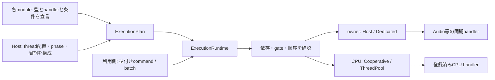
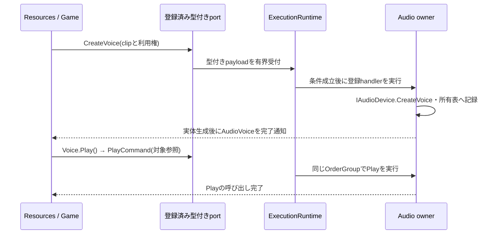

# ADR-CORE-0003: 宣言した仕事と型付きコマンドによる実行基盤

- 状態: 提案
- 日付: 2026-10-11
- 関連カテゴリ: engine、platform、input、graphics、audio、resources、ecs、animation、diagnostics

## 背景

Lumyteには、Input、BrowserのJS interop、Audio deviceなど、生成・操作・解放を同じ所有スレッドで行う処理と、独立したデータを並列計算できる処理がある。Browserではmanaged threadを作れない構成も必要になる。lockによる排他、処理順序、物理threadの固定は異なる条件である。

各呼び出し側がラムダを作って実行先を選ぶAPIでは、モジュールの所有者・進行条件・終了手順が利用コードへ分散する。AudioのPlay／Stop、Resourcesの実体生成、ECSの大量適用には、入力の型と実行条件を事前に確定し、小さいデータをまとめて送れる仕組みが必要である。

本ADRは、モジュールが仕事を宣言し、runtimeが宣言と構成に従って実行するcore基盤を定義する。生成要求の完了は実体生成完了を表す。生成前のhandle発行が必要ならResources側で設計し、ジョブ基盤が未生成voiceのproxyを返す仕組みにはしない。

このPRは設計案であり、実装・動作テスト・性能測定を含まない。以下のAPIはmainに存在しない追加提案である。未取り込みの従来案にあったInvokeAsync(Action／Func)、delegateを受けるAdd／AddOn／StartPeriodicは公開案から置き換える。

## 決定

### モジュールの宣言と実行時の責務

仕事を次の三つに分ける。

| 種類 | 宣言するもの | 実行条件と完了 |
| --- | --- | --- |
| 型付きcommand | 入力型、結果型、handler、target、順序group、gate | 受付済みで条件が成立すると一度実行。同期handlerの終了が完了 |
| 範囲計算 | 入力型、範囲handler、CPU target | graph内の先行完了後、指定粒度で実行。全範囲の終了が完了 |
| 継続更新 | 更新handler、owner、gate | host phaseまたは専用threadの周期でruntimeが直接実行 |

handlerはモジュール登録時に一度渡す実装であり、投入時にはcommandのstructだけを渡す。公開の投入APIはAction／Func、任意のラムダ、型名文字列を受け取らない。handler内部の通常のコードまでラムダを禁止するものではなく、ThreadPoolやTask継続の内部実装がdelegateを使うこととも区別する。

初期配置は `src/Core/Lumyte.Execution/`、名前空間・NuGet名は `Lumyte.Execution` とする。宣言・型付き配送・owner駆動・CPU graphを一つの基盤に置き、BCLだけへ依存する。Audio／Resources／ECS／DIへの逆依存は持たない。従来案の未実装 `Lumyte.Threading`／`Lumyte.Jobs` プロジェクトはこの案では作らない。Audioなどの統合層が登録とhandlerを提供し、低レベルbackendの同期APIを呼ぶ。この設計PRで空プロジェクトを追加しない。



### 登録、配置と起動

1. モジュールは論理owner、commandと結果の型、handler、順序group、gate、更新、初期化依存を宣言する。ここではnative deviceやthreadを作らない。handlerが保持するstateも構成用の参照に留める。
2. アプリはownerをHostまたは専用threadへ割り当て、CPU backend、host phase、更新周期、容量を設定する。同じ物理threadへ複数ownerを割り当てられる。
3. 実際のhost thread上でBuildOnCurrentHostを呼び、HostとCooperativeのownerを固定する。未割り当て、型やkeyの所属不一致、初期化依存の循環、不正な配置・更新周期を検査して宣言をfreezeする。
4. hostの初期化用Pumpを接続してからStartAsyncを呼ぶ。runtimeが必要な専用threadを起動し、依存順にモジュールのStartAsyncを進める。モジュールは型付きの初期化仕事を使い、deviceを正しいownerで生成する。
5. 全モジュールの起動成功後に通常commandを受け付け、宣言済み更新を有効にする。途中失敗でも成功済み・部分生成物のstateを保持し、同じownerで後始末する。

DIはモジュールstate、構成値、型付きportを渡す方法の一つである。DI登録からthreadを自動発見せず、同期factoryで非同期起動をblockしない。名前は診断用であり、型付きkeyとruntimeの所属で対象を識別する。同じAudioモジュールを二つ登録してもportを取り違えない。

### 宣言API

比較元はmain `81bba9e6a30ae7d2e926d0cf3247c140cca3502c`。宣言は主要メンバーの抜粋であり、以下はすべて追加である。

```diff
+namespace Lumyte.Execution
+{
+    public readonly struct Unit;
+    // すべてbuilder/plan所属の不透明key。defaultや別planのkeyは無効。
+    public readonly struct ModuleKey;
+    public readonly struct OwnerKey;
+    public readonly struct ThreadKey;
+    public readonly struct PhaseKey;
+    public readonly struct OrderGroupKey;
+    public readonly struct GateKey;
+    public readonly struct WorkKey<TCommand, TResult> where TCommand : struct;
+    public readonly struct RangeWorkKey<TContext> where TContext : struct;
+    public readonly struct UpdateKey;
+
+    public enum OwnerRequirement { HostOnly, FixedThread }
+    public enum WorkAdmission { Normal, Startup, Cleanup }
+    public enum CpuExecutionMode { Cooperative, ThreadPool }
+    public enum ShutdownMode { Drain, CancelPending }
+    public enum ExecutionStatus { Created, Starting, Running, Quiescing, Stopping, Stopped }
+
+    public readonly struct WorkTarget
+    {
+        public static WorkTarget Cpu { get; }
+        public static WorkTarget On(OwnerKey owner);
+    }
+
+    public sealed class WorkOptions
+    {
+        // defaultは無効。CpuまたはOn(owner)を明示する。
+        public WorkTarget Target { get; init; }
+        // owner commandは必須。異なる型でも同じgroupなら受付順を守る。
+        // CPU commandのdefaultは非順序化。直列化はgraphの辺で指定する。
+        public OrderGroupKey OrderGroup { get; init; }
+        public WorkAdmission Admission { get; init; } = WorkAdmission.Normal;
+        // 構築時にcopy。全gateが開いていることが開始条件。
+        public ReadOnlyMemory<GateKey> RequiredGates { get; init; }
+    }
+
+    public readonly struct WorkContext
+    {
+        // 現在の宣言targetを検査。CPU仕事でowner操作を許可する機能ではない。
+        public void VerifyAccess();
+    }
+
+    public interface ICommandHandler<TCommand, TResult> where TCommand : struct
+    {
+        // 同期・有限時間で返す。未完了仕事のwait、async void、別仕事の投入は禁止。
+        TResult Execute(in TCommand command, in WorkContext context);
+    }
+
+    public interface IRangeWorkHandler<TContext> where TContext : struct
+    {
+        // 受付前に一度評価する副作用のない長さ取得。ownerを参照しない。
+        int GetLength(in TContext context);
+        void Execute(in TContext context, int first, int endExclusive);
+    }
+
+    public readonly struct UpdateTick
+    {
+        public TimeSpan Elapsed { get; }
+        public long Index { get; }
+        public long SkippedTicks { get; }
+        public TimeSpan ScheduledTime { get; }
+        public TimeSpan StartedTime { get; }
+    }
+
+    public interface IUpdateHandler
+    {
+        // 登録された同じinstanceをownerで直接呼ぶ。更新ごとのcommandを作らない。
+        void Update(in UpdateTick tick, in WorkContext context);
+    }
+
+    public interface IExecutionModule
+    {
+        // 構成時に一度呼ぶ。device生成は禁止。
+        void Declare(ModuleBuilder builder);
+        // 外側の非同期workflow。継続threadは固定されない。
+        ValueTask StartAsync(ModuleContext context, CancellationToken token);
+        ValueTask StopAsync(ModuleContext context);
+    }
+
+    public sealed class ModuleBuilder
+    {
+        public OwnerKey Owner(string name, OwnerRequirement requirement);
+        public OrderGroupKey OrderGroup(string name, OwnerKey owner);
+        public GateKey Gate(string name);
+        public void DependsOn(ModuleKey dependency);
+        public WorkKey<TCommand, TResult> Command<TCommand, TResult, THandler>(
+            string name, THandler handler, WorkOptions options)
+            where TCommand : struct
+            where THandler : ICommandHandler<TCommand, TResult>;
+        public RangeWorkKey<TContext> Range<TContext, THandler>(string name, THandler handler)
+            where TContext : struct where THandler : IRangeWorkHandler<TContext>;
+        public UpdateKey Update<THandler>(string name, OwnerKey owner, THandler handler,
+            ReadOnlyMemory<GateKey> requiredGates = default) where THandler : IUpdateHandler;
+    }
+
+    public sealed class ExecutionPlanBuilder
+    {
+        public ExecutionPlanBuilder();
+        // Declareを同期実行してから返す。失敗時はbuilder全体を破棄する。
+        public ModuleKey AddModule(string name, IExecutionModule module);
+        public PhaseKey HostPhase(string name);
+        public ThreadKey DedicatedThread(string name);
+        public void BindHost(OwnerKey owner, PhaseKey phase);
+        public void BindDedicated(OwnerKey owner, ThreadKey thread);
+        public void DriveOnHost(UpdateKey update, PhaseKey phase);
+        public void DrivePeriodic(UpdateKey update, ThreadLoopOptions options);
+        public ExecutionRuntime BuildOnCurrentHost(CpuExecutionMode cpuMode,
+            int maxCpuConcurrency, ExecutionOptions options);
+    }
+}
```

`Command`は具象THandlerの閉じたgeneric adapterを登録時に作る。handlerは一度だけ保持し、投入データにhandlerやclosureを複製しない。struct handlerなら登録時のcopyを保持する。可変のdevice stateは明示した参照先に置き、ownerだけが変更する。CPU handlerは同時実行され得るので、モジュールinstanceの可変fieldを無同期に共有しない。

AOTで必要な型を明示登録し、実行時のassembly走査、MakeGenericType、DynamicInvoke、式のcompileに依存しない。メソッド属性から閉じた型と登録コードを生成するsource generatorを提供し、手書き登録と同じruntime契約を使う。GetLengthや通常handler内からの別command／graph投入は拒否し、依存辺か外側workflowへ展開する。

`FixedThread`はHostにもDedicatedにも配置できる。`HostOnly`やOSイベント／JS interopの制約は専用threadへの移動で回避しない。BuildはownerとOrderGroupの不一致、ownerに対するCPU範囲処理、Host以外のhost phaseを拒否する。初期化依存はmodule instance間、graph依存は同じrun内のnode instance間とし、「型Aは型Bの後」という暗黙の依存を作らない。

### メソッドから仕事を生成するsource generator

モジュールの通常の同期メソッドから、型付きcommand、結果型を保持する仕事定義、handler、登録helper、送信用portを生成する。`Lumyte.Execution.Generators`を初期設計に含め、手書きのICommandHandler実装だけを利用者へ要求しない。生成物は本ADRのModuleBuilder／型付き受付primitive／CommandBatchを使い、別のschedulerや配送経路を作らない。単発送信はExecuteAsyncへ転送せず、その便宜処理を生成メソッド本体へ展開する。

属性はruntime側の `Lumyte.Execution` に置き、generatorは `src/Core/Lumyte.Execution.Generators/` の独立したAnalyzer packageとする。既存のDiagnostics／Composition generatorに合わせ、IIncrementalGeneratorとForAttributeWithMetadataNameを使う。generatorはnetstandard2.0をtargetにRoslynをPrivateAssetsで参照し、`analyzers/dotnet/cs`へ配布する。runtimeや利用者の実行成果物へRoslynの依存を持ち込まない。このPRはその設計であり、generator projectの実装は追加しない。

```diff
+namespace Lumyte.Execution
+{
+    public enum ExecutionInputKind { PackArguments, ExistingCommand }
+
+    [AttributeUsage(AttributeTargets.Method, AllowMultiple = false, Inherited = false)]
+    public sealed class ExecutionCommandAttribute : Attribute
+    {
+        public ExecutionCommandAttribute();
+        // 生成名の基底。省略時はメソッド名。空文字や不正な識別子は診断する。
+        public string? Name { get; set; }
+        public ExecutionInputKind Input { get; set; } = ExecutionInputKind.PackArguments;
+        // 対象を保持する送信structの名前。nullなら従来の単独portを生成する。
+        public string? Sender { get; set; }
+        // 同期メソッドがpending operationを結果のデータとして返す場合だけ明示する。
+        // asyncメソッドを許可したり、結果をawait/unwrapしたりする指定ではない。
+        public bool AllowAwaitableResult { get; set; }
+    }
+
+    [AttributeUsage(AttributeTargets.Parameter, AllowMultiple = false, Inherited = false)]
+    public sealed class ExecutionTargetAttribute : Attribute
+    {
+        // Senderへ束縛する元インスタンス。各メソッドで一つだけ指定する。
+        public ExecutionTargetAttribute();
+    }
+
+    [AttributeUsage(AttributeTargets.Method, AllowMultiple = false, Inherited = false)]
+    public sealed class ExecutionUpdateAttribute : Attribute
+    {
+        public ExecutionUpdateAttribute();
+        public string? Name { get; set; }
+    }
+
+    [AttributeUsage(AttributeTargets.Method, AllowMultiple = false, Inherited = false)]
+    public sealed class ExecutionRangeAttribute : Attribute
+    {
+        // 同じクラスの同期intメソッド。入力は範囲処理と同じin TContext。
+        public ExecutionRangeAttribute(string lengthMethod);
+        public string LengthMethod { get; }
+        public string? Name { get; set; }
+    }
+}
```

メソッド属性を起点とし、クラス属性は不要とする。生成先は同じpartial classなので、privateメソッドへ直接アクセスできる。owner、OrderGroup、RequiredGates、Admissionは型の形から推測せず、生成された登録helperへWorkOptionsで渡す。Host／Dedicatedの配置、module間の依存、StartAsync／StopAsyncのworkflowも明示した構成として残す。

#### 入力、結果と実行条件の対応

- PackArgumentsでは通常の引数を宣言順のreadonly fieldに持つ `<Name>Command` を生成する。引数なしは空のstruct、戻り値なしはUnit、戻り値TはそのままTResultとする。単一引数でも既定ではwrapperを生成し、メソッドごとのcommand型を区別する。
- 引数の参照先はdeep copyしない。参照型、配列、Memory等を格納できても、buffer／leaseの寿命や不変性をgeneratorが証明・管理するわけではない。ref-like型はqueueへ保持できないため拒否する。signatureに現れるdynamic、delegate（Action／Func／独自delegate／Delegate）、Expressionも、配列要素・型引数を含めて拒否する。生成される送信APIを任意コードの配送経路にせず、動的binderを必要としない形に保つ。objectや独自DTOの内部まで調べてコードの不在を証明するものではなく、送るのはデータという契約を守る。
- ExistingCommandは一つの `in TCommand` 引数をそのまま入力型に使う。TCommandは非ref-likeなstructに限定し、別のpayload型を作らない。既存のAudioFrameを使うCPU／owner graphが同じTContextで接続できる。生成portではその入力を値渡しで受けて格納し、adapterから元メソッドへinで渡す。
- commandの末尾に限り任意の `in WorkContext` を受けられる。これはruntimeから注入し、payloadや送信引数に含めない。生成handlerはこの引数の有無によらずVerifyAccess後に対象メソッドを直接呼ぶ。
- Updateは `void Method(in UpdateTick tick)`、または末尾に `in WorkContext` を加えた形とする。生成IUpdateHandlerと `Declare<Name>(ModuleBuilder builder, OwnerKey owner, ReadOnlyMemory<GateKey> requiredGates = default)` がUpdateKeyを返す。毎tickのpayloadや送信portは生成しない。
- Rangeは `void Method(in TContext value, int first, int endExclusive)` と、同じクラスの `int Length(in TContext value)` を組にする。生成IRangeWorkHandlerと `Declare<Name>(ModuleBuilder)` がRangeWorkKeyを返す。CPU専用、lengthの純粋性、chunkと入力寿命は手書きと同じ契約になる。

次のApplyは `WorkKey<AudioFrame, Unit>`、Prepareは `RangeWorkKey<AudioFrame>` を得るので、既存JobGraphBuilderへそのまま接続できる。

```csharp
sealed partial class AudioBridgeWork
{
    [ExecutionCommand(Input = ExecutionInputKind.ExistingCommand)]
    private void Apply(in AudioFrame frame) => ApplyOnAudioOwner(in frame);

    [ExecutionRange(nameof(GetLength))]
    private void Prepare(in AudioFrame frame, int first, int endExclusive)
        => PrepareRange(in frame, first, endExclusive);

    private int GetLength(in AudioFrame frame) => frame.Count;
    // snapshot操作のDomain実装は省略。
}

// module.Declare内。Applyのowner/group/gateは明示したWorkOptions。
var prepareKey = work.DeclarePrepare(builder);
var applyKey = work.DeclareApply(builder, audioOptions).Key;
// それぞれgraph.AddRange、graph.Addへ渡す。
```

#### 生成されるAPIと配送経路

例えば `private AudioVoice CreateVoice(ClipId clip)` にExecutionCommandを付けると、同じpartial classへ次のAPIを生成する。以下はAudio例に対する生成宣言の抜粋である。

```diff
+partial class AudioState
+{
+    public readonly struct CreateVoiceCommand
+    {
+        public CreateVoiceCommand(ClipId clip);
+        public readonly ClipId Clip;
+    }
+
+    // thisを保持する具象handlerを一度作り、ModuleBuilder.Commandへ登録する。
+    // Name、型、handlerは生成側で確定。optionsの所有者・条件は通常の検査を受ける。
+    public CreateVoiceWork DeclareCreateVoice(ModuleBuilder builder, WorkOptions options);
+
+    public readonly struct CreateVoiceWork
+    {
+        public WorkKey<CreateVoiceCommand, AudioVoice> Key { get; }
+        // runtime.Bindを使う。別plan、無効key、Startupの通常port化は同じく拒否する。
+        public CreateVoicePort Bind(ExecutionRuntime runtime);
+        // 起動・終了workflow用。context.TryEnqueueと完了構築を本体へ展開する。
+        public ValueTask<AudioVoice> ExecuteAsync(ModuleContext context, ClipId clip,
+            CancellationToken cancellationToken = default);
+    }
+
+    public readonly struct CreateVoicePort
+    {
+        public CommandPort<CreateVoiceCommand, AudioVoice> Port { get; }
+        // payload構築、Port.TryEnqueue、受付結果の変換を本体へ展開する。
+        public ValueTask<AudioVoice> ExecuteAsync(ClipId clip,
+            CancellationToken cancellationToken = default);
+        // 高頻度経路。単発runを作らず、同じtyped payloadをbatchへ追加する。
+        public CommandResultKey<AudioVoice> AddTo(CommandBatch batch, ClipId clip);
+    }
+}
```

生成するWork／Portも薄いreadonly structとし、それぞれkeyの値／生CommandPortへの参照を保持する。wrapperだけのheap objectを作らず、公開constructorを生成しない。defaultは未登録／未束縛として使用時に拒否する。型が同じmoduleを複数登録してもKeyは個々の登録に属し、static fieldへplan keyやruntimeを保持しない。Bindを呼び出しごとに繰り返さず、戻ったportをサービスへ渡す。生成されたpayloadとKeyは公開し、手書きbatch／graphとも組み合わせられる。

Senderを指定しない`Play(AudioVoice voice)`では同じ規則でPlayCommand、PlayWork、PlayPortを生成し、ExecuteAsyncの結果は`ValueTask<Unit>`、AddToの結果は`CommandResultKey<Unit>`になる。voidをfire-and-forgetへ変換せず、受付失敗、開始前取消、backend例外を観測できる。戻り値は実体生成完了後に返し、生成前の仮handleへ変換しない。

同じpartial classの内部へ置く生成adapterの本体は概ね次の形である。module参照は登録時に一度保持する。投入のたびにメソッドをdelegateへ変換せず、object配列、boxing、Reflection、DynamicInvokeも使わない。

```csharp
private sealed class __LumyteExecutionCreateVoiceHandler
    : ICommandHandler<CreateVoiceCommand, AudioVoice>
{
    private readonly AudioState target;
    public __LumyteExecutionCreateVoiceHandler(AudioState target) => this.target = target;
    public AudioVoice Execute(in CreateVoiceCommand command, in WorkContext context)
    {
        context.VerifyAccess();
        return target.CreateVoice(command.Clip);
    }
}
```

生成helperはStartAsyncやthread生成を自動実行しない。Declareは構成中だけ呼び、登録helperの返値をmoduleが保持する。Startupの仕事はWork.ExecuteAsync(ModuleContext, ...)から使い、Bindで通常portへ公開しない。CleanupもWorkOptionsのAdmissionとcontextの権限制限に従い、生成APIに独自の権限昇格はない。

async／iteratorメソッドは生成対象にしない。Task／ValueTask等のawaitableを返す同期メソッドも既定では診断し、AllowAwaitableResult=trueでpending operationをデータとして返す場合だけ許す。AllowAwaitableResultを指定した仕事のDeclare helperはAdmission.Startupだけを許し、Normal／Cleanupへの登録を引数例外で拒否する。Browserの初期化開始はこの指定、またはoperationを格納した明示structを使える。後者も起動workflowの仕事として登録する。generatorはawait／unwrapせず、実operationの待機とowner上の確定・cleanupは既存の外側workflowが追跡する。メソッド本体の同期waitや隠れた非同期処理をすべて静的に検出できるとは扱わない。

#### 元インスタンスを保持する送信struct

対象を引数で渡すportに加え、元インスタンスを保持するreadonly structを生成する。そのstructの `Play()` 等を呼ぶと、対象参照を含む型付きcommandをその場で受付へ渡す。元メソッドの本体は変更せず、生成structが送信用の入口になる。

同じmodule classのメソッドへ `ExecutionCommand(Sender = "Voice")` を指定し、対象引数一つへExecutionTargetを付ける。同じSender名の仕事を一つの送信structへまとめる。例えばPlay、Stop、DestroyからAudioState.Voiceを生成する。通常引数から対象だけを取り除いたメソッドをstructへ生成し、送信時に保持した対象を元の位置へ戻してpayloadを構築する。

```csharp
sealed partial class AudioState
{
    [ExecutionCommand(Sender = "Voice")]
    private void Play([ExecutionTarget] AudioVoice voice)
    {
        voice.VerifyUsableBy(this);
        voice.Backend.Play();
    }
    // Stop、Destroyも同じSenderと対象型で宣言する。
}
```

登録はmoduleごとに一度行う。同じgroupの全仕事を登録するDeclareVoice、結果のVoiceWork、runtimeへ結び付けるVoiceBinding、対象を保持するVoiceを生成する。Sender対象の仕事には個別のDeclarePlay／PlayWork／PlayPortを生成せず、二重登録と不要なwrapperを避ける。各command型は元partial classから、WorkKeyはgroupのVoiceWorkから公開し、手書きbatch／graph／ModuleContextでも利用できる。

```diff
+partial class AudioState
+{
+    // すべて検証してから登録する。順序を仕事名や引数の記載順から推測しない。
+    public VoiceWork DeclareVoice(ModuleBuilder builder,
+        WorkOptions destroy, WorkOptions play, WorkOptions stop);
+
+    public readonly struct VoiceWork
+    {
+        public WorkKey<PlayCommand, Unit> Play { get; }
+        public WorkKey<StopCommand, Unit> Stop { get; }
+        public WorkKey<DestroyCommand, Unit> Destroy { get; }
+        // shared bindingは構成時に一度作って保持する。
+        public VoiceBinding Bind(ExecutionRuntime runtime);
+    }
+
+    public sealed class VoiceBinding
+    {
+        // nullを拒否。新しい仕事やheap上のsenderを作らず、2参照のstructを返す。
+        // 所属・生存の最終検査は従来どおりowner上のhandlerが行う。
+        public Voice For(AudioVoice target);
+    }
+
+    public readonly struct Voice
+    {
+        private readonly AudioVoice target;
+        private readonly VoiceBinding binding;
+
+        // 呼び出した時点で受付を試みる。awaitは実行完了・失敗を観測する。
+        public ValueTask<Unit> Play(CancellationToken cancellationToken = default);
+        public ValueTask<Unit> Stop(CancellationToken cancellationToken = default);
+        public ValueTask<Unit> Destroy(CancellationToken cancellationToken = default);
+        // こちらは明示的なstaging。TrySubmit成功まで送信・実行されない。
+        public CommandResultKey<Unit> AddPlayTo(CommandBatch batch);
+        public CommandResultKey<Unit> AddStopTo(CommandBatch batch);
+        public CommandResultKey<Unit> AddDestroyTo(CommandBatch batch);
+    }
+}
```

VoiceBindingは各操作の生CommandPortだけを保持し、多数のvoiceで共有する。Voiceにはport配列、delegate、interface、診断文字列、完了状態、batch用cursorを保持しない。典型的な64bit環境では参照2本分の大きさを狙うが、ABI上のサイズを保証せず実装後に測る。structは格納先によってheap上にも存在し、常にstackへ置かれるとは言わない。

Voiceのconstructorは公開せず、binding.Forで生成する。defaultのVoiceは未束縛とし、送信メソッドは受付前にInvalidOperationExceptionを投げる。immutableなfieldだけなので、structのコピーや同じsenderからの複数producerの投入に、sender自身のlockや新しい参照objectは必要ない。実際のqueue同期はruntimeが行い、CommandBatchは従来どおり単一producerで扱う。

コピーしてもvoiceの所有権やclip leaseを増減しない。Destroy受付時にはsenderの他のコピーを無効化せず、受付順の先行仕事を実行する。owner上でDestroyが成功した後は、すべてのコピーからの通常操作が同じ破棄済み状態で拒否される。IDisposable／IAsyncDisposable／IAudioVoiceは実装せず、structコピーのDisposeで暗黙にnative資源を破棄する契約にしない。明示的なDestroy仕事とmodule cleanupを使う。

同じSenderに含める仕事はPackArgumentsに限定し、ExecutionTargetは非nullableなclass型の引数一つとする。対象型、登録元module instance、owner、OrderGroupはgroup内で一致させる。RequiredGatesとNormal／Cleanupの違いは許す。Startup、AllowAwaitableResult、CPU target、Update／Rangeをsender groupへ混在させない。型・属性の矛盾は生成時、WorkOptionsの不一致はDeclareVoiceで登録前に拒否する。group内の生成memberとDeclare引数は生成する仕事名のordinal順で安定化し、呼び出し側はnamed argumentでWorkOptionsを対応させる。これは実行順序を指定するものではない。

元AudioVoiceへの参照が送信structに入っても、所属検査やnative寿命の契約は変えない。Forは対象参照を束縛するだけで、別threadからbackend状態を読んだり、その場でPlayを実行したりしない。Browserで同じHostになっても同じ受付とphaseを通す。

#### 単発送信の本体展開と呼び出し段数の削減

生成senderのメソッドに、ExecuteAsyncが担うpayloadの組み立て、受付結果の分岐、ValueTaskの構築を展開する。`Voice.Play → CommandPort.ExecuteAsync → 完了待ちhelper` という中継を作らず、`Voice.Play → CommandPort.TryEnqueue` で型付き受付へ直接入る。生成する単独portのExecuteAsyncとlifecycle用Work.ExecuteAsyncも同じ本体展開を使い、coreのExecuteAsyncを呼ばない。戻り値は `ValueTask<Unit>` または `ValueTask<TResult>` とし、生成メソッドにasync／await、完了変換helper、共通送信wrapperを追加しない。

次は生成されたVoice.Playの本体の例である。TryEnqueueは後述する受付primitiveで、ValueTaskを返す便宜APIとは責務を分ける。PlayPortはVoiceBinding内の生CommandPortを指す。

```csharp
public ValueTask<Unit> Play(CancellationToken cancellationToken = default)
{
    if (binding is null)
        throw new InvalidOperationException("Sender is not bound.");

    var command = new PlayCommand(target);
    var status = binding.PlayPort.TryEnqueue(
        in command, cancellationToken, out var completion);

    switch (status)
    {
        case CommandEnqueueStatus.Accepted:
            return new ValueTask<Unit>(completion!, 0);
        case CommandEnqueueStatus.Canceled:
            return ValueTask.FromCanceled<Unit>(cancellationToken);
        case CommandEnqueueStatus.NotRunning:
            return ValueTask.FromException<Unit>(
                new InvalidOperationException("Command admission is closed."));
        case CommandEnqueueStatus.QueueFull:
            return ValueTask.FromException<Unit>(
                new ExecutionQueueFullException("Command capacity is exhausted."));
        default:
            throw new InvalidOperationException("Unknown enqueue status.");
    }
}

public CommandResultKey<Unit> AddPlayTo(CommandBatch batch)
{
    if (binding is null)
        throw new InvalidOperationException("Sender is not bound.");
    var command = new PlayCommand(target);
    return batch.Add(binding.PlayPort, in command);
}
```

TryEnqueueは一件分の容量予約、payload格納、順序の確定、受付commitと到着通知を行うcoreの入口である。ExecuteAsync、CommandBatchの構築、asyncな結果待ちhelperを内部で呼ばず、ValueTaskの作成も担当しない。単なるExecuteAsyncの改名や別wrapperへの転送ではなく、その前後の便宜処理を生成本体へ移す。queueの原子性・会計・owner／権限検査・cancel競合を各送信メソッドへ複製せず、runtime内の共通受付処理に残す。複数段階の予約／commit APIを利用側へ公開しない。

生成物は利用者側のassemblyに入るため、受付primitiveはpublicとしてAPI一覧へ含める。internal field、InternalsVisibleTo、UnsafeAccessor、Reflectionに頼らない。手書きのCommandPort.ExecuteAsync／ModuleContext.ExecuteAsyncも同じprimitiveを使い、受付結果の変換と例外契約を生成版と一致させる。generatorは必要なprimitiveのsignatureをビルド時に検査し、対応しないruntimeとの組み合わせを診断する。

受理時のcompletionは、安定した単発run自身が実装する `IValueTaskSource<TResult>` への参照である。public CommandRunの外側に別の完了wrapperを確保せず、この専用run一つで完了と結果回収を扱う。source instanceはpool再利用せず、ValueTaskのtokenは0に固定する。公開batch runと単発runは同じ容量・取消・静止条件で会計し、単発のためのCommandBatchやCompletion Taskを作らない。IValueTaskSourceへの変換は参照型なのでboxingを伴わない。

GetResultはtoken、完了と単一consumerを検査してから、実際の結果／取消／例外を取り出し、finallyで結果slotなどを一度だけ返す。未完了または二重のGetResultは拒否し、進行中のslotを返さない。成功・取消・失敗のすべてで回収し、返却済みのsourceがpayloadや結果を保持し続けない。戻ったValueTaskは一度だけ観測し、未観測の結果も有界容量を使う。sourceが先に完了した場合と継続登録が先の場合の両方を扱い、OnCompletedのcontext指定flagsを尊重しつつ、外部継続をhandler内でinline実行しない。開始後の取消で実際の生成結果を失わない契約も維持する。

StackTraceHiddenは使用しない。生成した中継メソッドやthrow helper自体を作らず、必要なチェックと返値構築を本体へ置いて実際の呼び出し段数を減らす。対象メソッドへ渡す側は閉じたhandlerから直接呼び、元メソッドの業務処理をgeneratorがコピーすることはない。正常経路にcatch／wrap、reflection、delegate生成、object配列、boxing、送信元StackTraceの取得を追加しない。JIT／AOTのインライン化hintに依存した削減とせず、生成ソースとILでも中継callがないことを確認する。

例外はruntimeのhandler境界で捕捉し、ExceptionDispatchInfo等で取得できた元のDomain／backendのtraceを保って完了へ伝える。生成層で例外を包み直さず、単一失敗は元の例外、複数失敗だけを集約する。成功送信ごとの文字列化やActivityは作らず、必要な相関は既存の仕事IDとrun IDで扱う。詳細な送信元traceは明示的な診断設定でだけ取得する。実際のframeはJIT／AOTで変わり、全経路の固定の段数は保証しない。

本体展開で生成コード量は増えるため、展開は上記の便宜処理に限り、生成IL量・native code size・命令cacheへの影響も測る。送信structの生成・コピー自体は新しいheap objectを必要としないが、単発runの確保と完了管理の費用は残る。高頻度のECS／Audio制御は再利用CommandBatchへ追加し、一つのrunへまとめてポーリングする。新しいfire-and-forget経路や失敗を無視するvoidメソッドは生成しない。

#### 生成時の診断と互換性

初期版の対象は名前空間直下のpublic／internalな非generic・非abstract・非static・非record・非file-localのpartial class、およびそのクラス自身に定義した通常の同期instanceメソッドとする。生成memberはpublicとし、包含型のaccessibilityで外部公開範囲を制限する。入力・結果型の有効なaccessibilityがその公開範囲より狭ければエラーにする。privateメソッドをpublicへ変更する必要はない。

次は生成時のErrorとし、未対応メソッドを黙って登録対象から落とさない。該当クラスにエラーがある場合は、そのクラスの生成物を出力しない。診断コードは他generatorと同様にAnalyzerReleasesで管理する。

| 診断 | 条件 |
| --- | --- |
| LMEXEC001 | 対象classのpartial不足、file-local、非対応の包含／generic構造、生成member／予約prefix `__LumyteExecution` の衝突 |
| LMEXEC002 | static、generic、abstract、extern、virtual／override、async、iterator、partial methodなど非対応メソッド |
| LMEXEC003 | ref／out／ref return、pointer／function pointer、ref-like型、dynamic／delegate／Expressionを含む型、PackArgumentsのin引数、optional／params引数、公開できない入力・結果型 |
| LMEXEC004 | 不正・重複する生成名、複数の仕事属性、overload間の名前衝突、payload fieldの名前衝突 |
| LMEXEC005 | ExistingCommand、WorkContext注入、Update／Range／length methodの型や引数の不一致 |
| LMEXEC006 | 明示許可のないawaitable結果、不正なenum値、生成helperのcontrol引数と衝突するpayload引数名 |
| LMEXEC007 | Sender名・ExecutionTargetの不足／重複／型不一致、SenderなしのExecutionTarget、非対応入力modeやawaitable結果との併用 |
| LMEXEC008 | 参照runtimeが生成コードに必要な受付primitive・結果型のsignatureと対応しない |

Nameを省略した場合はメソッド名を基底とする。overloadは異なるNameを明示すれば登録できる。payloadのfieldは引数名の先頭を大文字にした名前とし、C# keywordをescapeする。変換後に重複するfieldや生成する包含型名と同名になるfieldは診断する。生成するSender、Work、Binding、メソッド、AddXxxToと既存・生成memberとの衝突も検査する。group登録helperのWorkOptions引数は仕事名から生成し、呼び出しはnamed argumentを使える。生成helperが使うcontext／batch／cancellationTokenとpayload引数名が衝突する場合は、初期版では引数名を変更するよう診断する。注入するWorkContextの引数名はこの制限に含めない。

同じメソッド集合から生成するコードはsource fileの走査順、絶対path、cultureへ依存させない。型名はglobal::付きの完全修飾名で出力し、nullable注釈を維持する。展開する本体のlocal名はpayload引数と衝突しないよう決定的に生成する。生成名やsource上の並びから永続ID、frame順序、依存関係を作らず、受付sequenceと明示したgraphで順序を決める。

手書き登録APIも残し、両方式は同じruntimeへ登録できる。ただし同じ仕事を二重登録しない。生成される型・member名と、展開した送信本体が使う受付primitiveは利用側のソースAPIとなる。メソッド名・Name・引数／結果型の変更は生成APIの互換性変更として扱い、runtime／generatorは対応するversionを組にして検証する。wire形式や保存形式の互換性は保証しない。

### 型付きport、batchと結果

```diff
+namespace Lumyte.Execution
+{
+    public sealed class ExecutionOptions
+    {
+        // すべて正値。完了済み未回収の結果も容量へ含める。
+        public int MaxInFlightRuns { get; init; } = 64;
+        public int MaxCommands { get; init; } = 4096;
+        public int MaxGraphNodes { get; init; } = 4096;
+        // payload/result storeの保持byte数。再利用待ちの空きblockも含む。
+        public long MaxPayloadBytes { get; init; } = 4 * 1024 * 1024;
+        // 通常受付に使わせないcleanup専用の有界枠。
+        public int ReservedCleanupCommands { get; init; } = 32;
+        public int ReservedCleanupRuns { get; init; } = 4;
+        public long ReservedCleanupPayloadBytes { get; init; } = 64 * 1024;
+    }
+
+    public sealed class ExecutionQueueFullException : InvalidOperationException
+    {
+        public ExecutionQueueFullException(string message);
+    }
+
+    public enum CommandEnqueueStatus
+    {
+        Accepted,   // 受理済み。completionは必ず非null。
+        Canceled,   // 渡されたtokenが取消済みのため未受理。
+        NotRunning, // 該当経路の受付が閉じているため未受理。
+        QueueFull   // 必要な有界容量を確保できず未受理。
+    }
+
+    public sealed class CommandPort<TCommand, TResult> where TCommand : struct
+    {
+        // 単発受付の便宜API。batchを構築せず、TryEnqueueと返値構築を行う。
+        // 生成senderからは呼ばない。実行は常にruntimeへ配送する。
+        // 未受理・実行失敗は返すValueTaskへ伝える。結果は一度だけ観測する。
+        public ValueTask<TResult> ExecuteAsync(TCommand command,
+            CancellationToken token = default);
+        // 生成コードも使う単発受付primitive。予約・格納・commit・通知を行う。
+        // Accepted以外はcompletion=null。sourceのtokenは0、一度だけ観測する。
+        // ValueTask構築や結果待機は行わない。
+        public CommandEnqueueStatus TryEnqueue(in TCommand command,
+            CancellationToken token,
+            out System.Threading.Tasks.Sources.IValueTaskSource<TResult>? completion);
+    }
+
+    // builder世代と結果位置を保持し、対応するrun以外では使用できない。
+    public readonly struct CommandResultKey<TResult>;
+
+    public sealed class CommandBatch : IDisposable
+    {
+        // 単一producerで構築する再利用可能なstaging領域。maxCommands > 0。
+        public CommandBatch(int maxCommands);
+        public CommandResultKey<TResult> Add<TCommand, TResult>(
+            CommandPort<TCommand, TResult> port, in TCommand command) where TCommand : struct;
+        // 未受理または対応runの完了・Dispose後だけ再利用可能。旧keyは無効になる。
+        public void Reset();
+        public void Dispose();
+    }
+
+    public sealed class CommandRun : IDisposable
+    {
+        public bool IsCompleted { get; }
+        // 参照された場合だけ一つ作る共有Task。全handlerの静止と成功/取消/失敗を通知。
+        public Task Completion { get; }
+        // thread-safe、冪等。開始前の仕事だけを抑止する。
+        public void RequestCancel();
+        public void ThrowIfFailed();
+        // 全体完了後に各結果を読む。該当command失敗/取消は例外。
+        public TResult GetResult<TResult>(CommandResultKey<TResult> key);
+        // 完了前は拒否。内部結果slotを返すだけで、native資源は解放しない。
+        public void Dispose();
+    }
+
+    public sealed class ModuleContext
+    {
+        // activeなmodule lifecycleのための権限付き配送。所属と依存先を検査する。
+        public ValueTask<TResult> ExecuteAsync<TCommand, TResult>(
+            WorkKey<TCommand, TResult> key, TCommand command,
+            CancellationToken token = default) where TCommand : struct;
+        // 同じ権限検査を行う受付primitive。生成WorkはExecuteAsyncを経由しない。
+        public CommandEnqueueStatus TryEnqueue<TCommand, TResult>(
+            WorkKey<TCommand, TResult> key, in TCommand command, CancellationToken token,
+            out System.Threading.Tasks.Sources.IValueTaskSource<TResult>? completion)
+            where TCommand : struct;
+        public GateControl GetGate(GateKey key);
+    }
+
+    public sealed class GateControl
+    {
+        // 任意threadから通知可能。closeは開始済みhandlerを中断しない。
+        public void Open();
+        public void Close();
+        // 永続失敗。待機要求を失敗させる。復旧は新しいmodule/runtime世代で行う。
+        public void Fail(Exception error);
+    }
+
+    public sealed class ExecutionRuntime
+    {
+        public ExecutionStatus Status { get; }
+        // 起動・更新・内部障害・cleanupの失敗を安全に公開する。通常command失敗はrunへ。
+        public Exception? Failure { get; }
+        // Startupは通常portへ公開しない。ModuleContextの権限付き配送を使う。
+        public CommandPort<TCommand, TResult> Bind<TCommand, TResult>(
+            WorkKey<TCommand, TResult> key) where TCommand : struct;
+        public ValueTask StartAsync(CancellationToken token = default);
+        // falseは容量不足の未受理。batch全体を受理するか、一件も受理しない。
+        public bool TrySubmit(CommandBatch batch, out CommandRun? run,
+            CancellationToken token = default);
+        public int PumpHostLifecycle(int maxWorkItems, TimeSpan maxElapsed);
+        public int PumpJobs(int maxWorkItems, TimeSpan maxElapsed);
+        public int RunHostPhase(PhaseKey phase, int maxWorkItems, TimeSpan maxElapsed);
+        // 通常受付を閉じ、更新停止・既存仕事・module cleanup・thread終了を追跡する。
+        public ValueTask StopAsync(ShutdownMode mode = ShutdownMode.CancelPending);
+    }
+}
```

portはruntime、module instance、登録世代へ結び付く。利用側は受け取ったportへ入力を渡し、ownerやhandlerを毎回指定しない。ExecuteAsyncと本体展開した生成メソッドは同じ例外契約とする。引数不正は同期的な引数例外、起動前や終了後の外部受付は失敗ValueTask内の状態例外、単発APIの容量不足は `ExecutionQueueFullException` として返すValueTaskを失敗させる。既に取消済みなら未受理の取消ValueTaskを返す。TrySubmitは事前取消をOperationCanceledExceptionとして同期的に返す。成功したTrySubmitは必ずrunを返す。TrySubmitの無効batch・状態違反は同期例外、容量不足だけはfalseとrun=nullになる。

TryEnqueueは登録・引数・handler内投入禁止を検査し、ModuleContext経由ではcontextの有効期間、module所属、lifecycle権限と依存先も検査する。不正は同期例外とし、生成コードから来たことを理由に検査を省かない。その後、該当経路の受付が閉じていればNotRunning、渡されたtokenが取消済みならCanceled、容量不足ならQueueFullを返す。Canceledは必ずtoken.IsCancellationRequestedがtrueの場合だけ返し、停止やcontext失効を取消に置き換えない。元API・生成版・手書きprimitive呼び出しで同じ優先順とする。

受付状態・取消とcommitの競合はruntimeで解決する。Acceptedはpayloadのcopyと必要枠の予約・公開が済んだことを示し、handlerの完了を意味しない。未受理のstatusやcommit前例外ではすべての予約を戻してcompletion=nullとし、一件も実行しない。commit後の取消は開始前抑止／開始済み追跡の規則に従う。受理後の内部障害は有効なcompletionへ通知し、進行中の仕事を未受理と偽って再送させない。single／batch／graphは同じ順序groupと会計へ入り、同じHostでも再入しない。

初期batchは同じowner・OrderGroupへ属する複数command、または非順序化CPU commandだけを受け付ける。異なるtargetをまたぐ依存はgraphで表す。同じowner batch内の異なるcommand型でも共通の受付sequenceを割り当て、同じOrderGroupの他batchが間へ割り込まない。別groupの仕事は公平性のため間で実行でき、CPU batchの実行順序は保証しない。原子的なのは受付であり、副作用のrollbackや音声sample精度の同時反映は保証しない。実行時の一件の失敗は後続未開始commandを抑止し、開始済み仕事の終了後にrunを失敗させる。成功済みの結果は失敗runでも個別に取得できる。

CommandBatchはBuilding→Submitted→対応run完了・Dispose→Reset→Buildingと進む。受理時にruntimeの予約storeへpayloadをcopyするが、result keyの世代を保つためSubmitted中のAdd／再Submit／Disposeを拒否する。容量不足ならBuildingのままで、後のturnに同じ内容を再試行できる。未受理のResetは内容を破棄し、keyを無効化する。未受理または対応run完了・Dispose後だけbatchをDisposeできる。

CommandRunはbatchごとに一つの安定した参照objectを確保し、公開instanceをpool再利用しない。結果はTResult専用storeへ保持し、GetResultは同じ結果を返すが、そのcopyは資源の所有権を増やさない。Disposeは冪等とし、以後の結果取得は拒否する。未完了runをDisposeしてborrowを失わせない。完了Taskを取得済みなら、そのTaskはrunのDispose後も同じ結果を保つ。

外部の投入はhandlerからでもownerからでもinlineに切り替えない。特にBrowserで同じ物理threadになっても、CPU処理中へAudio操作を再入させない。handler内のExecuteAsync／TryEnqueue／生成senderからの投入／TrySubmit／Pump／Stopは契約違反として拒否する。moduleのStartAsync／StopAsyncはhandlerではなく、非同期workflowとして明示的に配送できる。

### 実行条件、順序と条件待ち

開始条件は、先行nodeの成功、moduleの起動状態、RequiredGates、targetの実行可能phase、同じOrderGroupの先行完了、CPU同時数枠の成立である。条件は構造化して登録し、`Func<bool>`を毎回走査しない。gateや依存の変更通知でready集合へ移し、host phaseはホストが明示する。

共通の物理threadに一つの条件待ちFIFOを作らない。待機集合はOrderGroupごとに分け、閉じたAudio gateで止まるのはAudioのgroupとその依存先だけにする。同じgroupの後続は追い越さず、別module／groupは進行できる。readyなgroupを公平に選び、一つの連続producerが他を飢餓させない。型ごとのFIFOだけではPlayとStopの順が逆転し得るため、順序は型をまたいで管理する。

gate閉鎖とhandler開始は原子的な確定点で競合を解決する。開始が勝ったhandlerは最後まで追跡する。Closeは現在実行中の処理の終了通知ではないため、資源を変更する側は別途その静止を確認する。Browserのresumeは同じHostの同期handler間でgateを閉じれば、既存Audio handlerが実行中でないことを確定できる。

条件待ちもcommand／node枠、payload、borrowの寿命に含める。待機が満杯なら新規投入を拒否し、隠れた無制限queueを作らない。cancel／gate失敗／停止で必ずterminal化できる。自分のgateを開く仕事を、そのgateの後ろや同じ停止groupへ置かない。gateを開く通知は通常command queueの容量を消費しない制御経路で行う。初期化には通常groupを迂回する権限付きlifecycle経路を使う。

gateの初期状態はClosed、Open／Closeは同状態への呼び出しも許す。Fail後は永久Failedとし、Open／Closeは状態例外になる。同じgateへの後続仕事も待機せず失敗させる。GetGateは自moduleのkeyだけを受け付ける。

gateはDomainのready状態を表すが、voiceの生存やdevice所属の検査を代行しない。handlerは開始時に対象インスタンスの所属・生存、IDを使う資源の世代、必要な資源利用権を検査し、不正なcommandを副作用前に失敗させる。異なるgroupや独立run間の全順序は保証せず、依存が必要なら同じgroup、graphの辺、または先行runの完了で示す。

### 型付き格納、容量と完了の費用

型ごとのpayload storeは `TCommand[]` 相当のGCが追跡する再利用領域、結果は `TResult[]` 相当の領域とする。対象objectを含むstructもそのまま格納し、raw byte bufferへmanaged参照を退避しない。共通の順序queue／ready集合には登録ID、slot、generation、sequence、run IDだけを置く。payloadをobjectや非generic interfaceへboxしない。登録済みgeneric adapterがTHandlerを呼ぶため、投入ごとのdelegate・closure・Reflection invokeを必要としない。

runtimeはrun、header、payload、result、graph nodeの必要枠を受付前に予約して一括commitする。失敗時は一件も実行せず枠を戻す。不要になったpayloadの参照はhandler静止／開始前取消後のslot返却時にclearする。batch stagingはReset／Dispose時、resultはrun.Dispose時にclearし、空きslotやpoolがvoice・device・bufferを保持し続けないようにする。受理済みpayloadがstagingの強参照に依存する構成にはしない。型付きstoreのblock拡張とTResultの格納も総容量・byte上限へ含め、予算外の自動拡張で回避しない。別型の確保が必要な場合は未使用blockを返却して予算を回せるようにし、古い型のcacheだけで受付を永久拒否しない。slotのgenerationを検査し、古い通知やresult keyを再利用後の仕事へ適用しない。generationを安全に更新できないslotは再利用しない。

完了済みで未DisposeのCommandRunの結果も有界容量を使う。単発のTryEnqueueはcompletion sourceを兼ねる一件runを作り、ExecuteAsyncまたは展開した生成本体がValueTaskを構築する。結果の観測時にGetResultが内部slotを返し、未観測の結果をGCやfinalizerで早期回収しない。ValueTaskだから無割り当てとは宣言しない。取消登録、例外、AsTaskを使う場合のTask化、最初のstore確保、単発／batchごとのrun objectの費用を測る。高頻度の制御はbatchとポーリングを使えば、commandごとの完了sourceを必要としない。

structをcopyしても参照先はdeep copyしない。PCMやECS snapshotなどのbuffer・leaseは、未受理なら送信側が保持し、受理後は全handlerが静止するまで変更・返却しない。参照をstructへ代入すること自体に新しい対象objectの確保は不要だが、GC write barrier、保持期間、参照先へのcache missは残る。MaxPayloadBytesはpayloadとresultのstoreが保持する領域を制限するもので、参照先の巨大bufferのbyte予算はResources／統合側が別に制限する。

結果にnative資源の参照やIDが入っても、runのDisposeが資源の解放を代行しない。モジュールは生成直後に自分の所有表またはworkflowの所有記録へ登録する。結果未観測、後続失敗、取消でも生成物を失わず、型付きcleanup仕事で元ownerへ戻す。低頻度の生成結果も必ず観測し、利用権の移譲を確定する。

### 取消、失敗とメモリ可視性

受理後の取消と開始は同じ確定点で順序付ける。取消が先ならhandlerを実行せず、開始が先なら同期handlerの成功結果または例外まで追跡する。開始後の取消だけで生成結果を捨てない。batch／graphの別仕事が失敗しても、開始済みhandlerと配送済みowner仕事の静止前にrunを完了させない。

全仕事の会計後、例外があれば失敗、なければ開始前取消された仕事があれば取消、残りは成功とする。handler自身が投げたOperationCanceledExceptionは通常のhandler失敗であり、runtimeの開始前取消とは区別する。複数失敗は集約して観測できる。処理済みのPlayや生成をrollbackしない。

先行の書き込みは後続node、IsCompleted=trueの観測、Completionの完了観測へrelease/acquire相当で公開する。外部継続をhandler内でinline実行しない。await後のthreadは保証しないため、次のowner操作も型付きportを通す。完了はCPU／owner同期処理の終了であり、GPU fence、音声の再生終了、外部I/Oの終了ではない。

内部障害でも、ownerへ既に受理された仕事の開始前取消または実行終了まで入力を保持する。CPU backendの障害だけでownerの仕事が消えたと見なさない。別backendへ移して副作用を再実行しない。

### 宣言済み仕事のgraphとCPU範囲処理

```diff
+namespace Lumyte.Execution
+{
+    public readonly struct JobNodeId;
+    public sealed class JobGraphBuilder<TContext> where TContext : struct
+    {
+        public JobGraphBuilder();
+        // handlerとtargetは登録済みkeyから得る。ここでdelegateやownerを渡さない。
+        public JobNodeId Add(string name, WorkKey<TContext, Unit> work);
+        public JobNodeId AddRange(string name, RangeWorkKey<TContext> work, int batchSize);
+        public void DependsOn(JobNodeId after, JobNodeId before);
+        public JobGraph<TContext> Build();
+    }
+
+    public sealed class JobGraph<TContext> where TContext : struct
+    {
+        public int NodeCount { get; }
+    }
+
+    public sealed class JobRun : IDisposable
+    {
+        public bool IsCompleted { get; }
+        public Task Completion { get; }
+        public void RequestCancel();
+        public void ThrowIfFailed();
+        // 完了後だけ内部枠を返す。公開instanceは再利用しない。
+        public void Dispose();
+    }
+
+    public sealed class ExecutionRuntime
+    {
+        // 同じruntimeへ登録した仕事だけで構成。contextをrunにcopyする。
+        public bool TrySchedule<TContext>(JobGraph<TContext> graph, in TContext context,
+            out JobRun? run, CancellationToken token = default) where TContext : struct;
+    }
+}
```

初期graphは各nodeへ同じTContextを渡し、結果はUnitとする。run専用context内の明示した出力領域で段階をつなぐ。異なるTResultの自動変換、任意のデータflow型推論、nodeを作るlambdaは導入しない。生成結果を直接受け取りたいResourcesなどは型付きcommandの単発APIを使える。

graphは不変で再利用する。Buildで空graph、循環、異なるbuilderのID、無効key、Startup仕事を拒否し、重複辺は一辺へまとめる。通常nodeは一度、範囲nodeは `[0, length)` の重複しない最大batchSize件のchunkを処理する。GetLengthは受付前に一度評価し、負数・例外ならrun未受理とする。0件はcallbackなしで成功する。

TryScheduleはRunning中だけNormal／Cleanup仕事を受け付ける。状態・引数・事前取消の例外と容量不足falseの区別はTrySubmitと同じとする。run枠と全node枠を一括予約し、容量不足はfalseで返す。owner nodeがreadyになってから使う配送枠もnode予約に含め、内部の配送段階だけで追加の容量不足失敗を起こさない。外部commandとowner nodeは同じ順序groupの受付地点で並ぶ。owner nodeのgroup内sequenceはreadyになった時に確定し、先行待ちnodeが後から必要とする通常commandを早々に塞がない。graphの依存順と独立commandとの順序が必要なら、外側で先行runを待つ。

一つのnode／chunkの失敗またはrun取消後は、同じrunの未開始node・未claim chunkを抑止し、失敗した先行を待つnodeもterminalへ伝播する。既に開始した全handlerの静止を待ち、残った依存待ちだけでrunが永久未完了にならないよう会計する。

owner待ちとgate待ちはCPU同時数を占有しない。範囲計算はCPU backendだけへ配置し、maxCpuConcurrencyはCPU handlerだけの上限とする。worker一つは物理thread固定を意味しない。並列nodeやchunkの順序、浮動小数点reductionのbit一致は保証しない。必要なら固定順の集約仕事を宣言する。

ThreadPoolでは最大同時数のdrainがready範囲をclaimし、要素ごとのTask／queue entryを作らない。共有poolの最小・最大thread数を変更しない。CPU handlerは投入元のExecutionContext／AsyncLocal／SynchronizationContextやcultureに依存せず、必要値をcontextへ明示する。owner handlerはownerのcontextで実行する。単発CPU commandも同じbackendと同時数制限に従う。CooperativeではPumpJobsが同じ依存関係を進め、owner仕事はHost phaseまたは専用threadで実行する。Cooperative＋Dedicatedでも別threadからの完了通知を同期する。

PumpJobsは開始時点までのrunを公平に選び、callback、0件node、取消整理、依存辺伝播を有界な小区間で進める。件数・時間予算を確認して継続状態を残し、DAG全体を再帰処理しない。戻り値0は全run完了を意味しない。時間予算はsoftであり、開始済みhandlerは中断できない。各chunkを短くする責任はモジュールにある。

graphの全nodeはMaxGraphNodesへ、owner nodeの配送headerはMaxCommandsへも算入して受付時に予約する。ready化で追加容量を取りに行かず、CPU nodeの待機はowner枠を消費しない。graph contextと状態領域の格納byteも予算化し、内部slot会計を別backendで二重確保しない。rangeのchunk数分のobjectや配列を先に確保せず、進捗cursorと最大同時数に比例するready情報を使う。maxCpuConcurrencyは正値、Cooperativeでは1だけを許す。ThreadPool構成のPumpJobsはCPU handlerをHostへ移さず0を返す。

### 継続更新、専用threadとHost phase

```diff
+namespace Lumyte.Execution
+{
+    public sealed class ThreadLoopOptions
+    {
+        // period > 0、maxControlWorkItems > 0、0 < maxControlTime < period。
+        public ThreadLoopOptions(TimeSpan period, int maxControlWorkItems, TimeSpan maxControlTime);
+        public TimeSpan Period { get; }
+        public int MaxControlWorkItems { get; }
+        public TimeSpan MaxControlTime { get; }
+    }
+}
```

更新もモジュールがIUpdateHandlerとして一度宣言する。Dedicatedではruntimeが直接呼び、毎tickのcommand、Task、外側からの投入を作らない。同じ物理threadを共有する更新は初期案では同じ周期・予算に揃える。一周期のpassでgateが開いた更新を登録順に一回ずつ非並行に呼び、pass全体の終了後に次の予定時刻と制御予算を一度だけ更新する。先行更新の超過だけで後続更新を恒久的に省略しない。異なる周期を指定した共有構成はBuildで拒否し、独立threadを明示するかモジュール内で有界なsubstepを扱う。

更新有効化時刻を起点t0とし、周期P、予定時刻t0+nPを単調時計で管理する。初回Elapsedの起点もt0とする。最初の予定番号は1。到来を判定した時点の最新番号nを一度実行し、遅れた周期は省略する。Elapsedは前回実行開始からの実経過時間、SkippedTicksは実行しなかった予定数とする。Indexはpass共通、StartedTime／Elapsed／SkippedTicksは各handlerについて記録する。終了目標はt0+(n+1)P、次回はpass全体の終了より後の最初の予定時刻とし、無制限catch-upを行わない。

例えば10ms周期で初回開始12ms、終了37msなら次回は40ms、Index=4、SkippedTicks=2になる。control処理による超過や初回の遅れも集計する。gate閉鎖中の更新は積み上げず、再開後も同じ絶対予定に従い省略数と実経過時間を通知する。音声のsample時計はnative mixer／device callback／AudioWorkletに任せ、Audio.Updateの周期で代用しない。

専用threadはcommand到着、gateのready化、次回予定時刻、停止でwakeする。Updateと同時にhandlerを実行せず、due tickを優先し、合間にready groupの短い仕事を処理する。到着で予定時刻をリセットしない。件数・実処理時間の制御予算は登録時と各pass終了時だけ補充し、wakeごとには増やさない。待機時間は時間予算へ含めず、省略tick分を積算しない。

制御予算切れでは次tickか停止を待ち、常時signaledなqueueでbusy spinしない。pass終了後にready集合を再確認する。空判定と待機登録は通知を失わない形で接続する。全更新がgate待ちでも予算の補充は絶対周期境界で一度行い、更新を呼ばずにcontrolを進められるようにする。周期更新を持たない専用threadは到着通知で通常の有界drainを行う。起動・cleanupのlifecycle配送は通常の周期制御予算へ依存させない。Quiescingでは周期更新を停止しても受付済み仕事を有界drainで進め、予算補充が消えてDrainやcleanupが停止しないようにする。

Hostには自動timerを作らない。RunHostPhaseがそのphaseのpassを進める。pass開始時点までの受付sequence上限を各OrderGroupで固定し、その境界内のcommand、gateが開いた更新の順に進める。同じgroupの先行完了で後続がreadyになれば、境界内の後続も同じpassで進める。最初からreadyな先頭一件だけに限定しない。件数・時間予算で中断したらcommand／更新のcursorを持ち越し、次turnはその続きを新しいcommandより先に処理する。pass中の追加commandは次passへ回し、pass完了後は次のRunHostPhaseまで新passを開始しない。更新同士のcursorも保持するので、先頭の重い更新や連続producerが後続更新を飢餓させない。gateが閉じたgroupはpassを止めず待機集合へ移し、そのpassで進めなかった分は後のpassで扱う。

HostのIndexはphase呼び出し番号であり、更新を実行したturnの番号を通知する。ScheduledTimeはそのturnのphase開始時刻、StartedTimeはhandler開始時刻、Elapsedは前回の当該handler開始からの実経過時間、SkippedTicksは呼べなかったphase回数とする。初回Elapsedの起点は更新有効化時刻とし、いずれもruntimeの単調時計を使う。論理frame deltaを使うシミュレーションはmodule自身の入力で渡す。

PumpHostLifecycleは初期化・cleanup専用、PumpJobsはCooperativeのCPU／依存処理、RunHostPhaseは通常owner処理という契約を分ける。通常frame開始前と終了中も必要なPumpを止めない。Quiescing中のHost通常仕事はRunHostPhaseで同じphase制約のままdrainし、新しいUpdateを呼ばない。Drainを選ぶHostは終了中も必要phaseを呼ぶ。通常仕事をPumpHostLifecycleへ移してphaseを回避しない。各Pumpは固定Host限定・再入拒否であり、停止完了後は0を返す。maxWorkItemsとmaxElapsedは正値とし、戻り値は実行したhandler／chunk数であり、内部整理だけなら0も返る。いずれも未完了の仕事を同期waitするAPIではない。

OS scheduling、GC、同期native生成の長さによる遅れは残る。busy spin、realtime優先度、プロセス全体のtimer分解能変更、GC停止を既定で要求しない。hard realtimeやzero allocationの保証は行わず、予定との差、締切超過、コマンド反映遅延を測定する。

### Audioが宣言する仕事と呼び出し境界

Audio統合モジュールはdeviceのowner、制御用OrderGroup、利用可能gateを宣言し、少なくとも初期化、clip生成、voice生成、Play／Pause／Stop、状態適用、voice／clip／device解放とUpdateを登録する。各仕事は閉じた入力・結果型を持ち、共通基盤が対応handlerへ配送する。Audio固有の巨大switchをcoreへ持ち込まない。



`IAudioVoice.Play()`など既存低レベルAPIの契約は同期・owner限定のままとする。別threadから使う生成Voice structのPlayが `PlayCommand` を送る。voidのPlayを裏で配送して、成功・失敗や実行時点だけを変える互換性変更はしない。完了はbackendのPlayが返った時点であり、音が聞こえ始めた時刻ではない。

以下はメソッド属性を使うAudio統合層の宣言例である。利用側のVoiceは生成した送信struct、AudioVoiceは実体を保持する参照型として区別する。型とhelperは提案例であり、既存Audio公開APIへの追加が確定済みという意味ではない。`AudioState`はdevice・clip・voiceの所有記録を持ち、clip IDの世代とvoice参照の所属・生存を検査する。`CreateVoiceAndRecord`は実体を生成して所有表へ記録し、記録失敗時も元ownerで回収する。clipの利用権はvoice破棄成功まで保持する。例のClipIdは統合側のresident clipを解決するための識別子であり、DeviceGenerationはprocess内のmodule／device再生成をまたいで再利用せず、上限で発行を拒否する。voice操作の対象はAudioVoice参照を直接渡す。

```csharp
readonly record struct ClipId(ulong DeviceGeneration, int Slot, int Generation);

sealed partial class AudioState
{
    [ExecutionCommand]
    private void Initialize() => InitializeOnOwner(); // new OpenALDevice(...)

    [ExecutionCommand]
    private AudioVoice CreateVoice(ClipId clip) => CreateVoiceAndRecord(clip);

    [ExecutionCommand(Sender = "Voice")]
    private void Play([ExecutionTarget] AudioVoice voice)
    {
        ArgumentNullException.ThrowIfNull(voice);
        voice.VerifyUsableBy(this);
        voice.Backend.Play();
    }

    [ExecutionCommand(Sender = "Voice")]
    private void Stop([ExecutionTarget] AudioVoice voice)
    {
        ArgumentNullException.ThrowIfNull(voice);
        voice.VerifyUsableBy(this);
        voice.Backend.Stop();
    }

    [ExecutionCommand(Sender = "Voice")]
    private void Destroy([ExecutionTarget] AudioVoice voice)
    {
        ArgumentNullException.ThrowIfNull(voice);
        voice.DestroyOnOwner(this); // 所属検査→backend.Dispose→lease返却。成功後は冪等
    }

    [ExecutionCommand]
    private void Close() => CloseOnOwner(); // voice→clip→device。未解放分を追跡

    [ExecutionUpdate]
    private void Update(in UpdateTick tick) => Device.Update(); // 既存APIは引数なし

    // Deviceと各helperの所有管理・clip生成は省略。
    // handler、command、Work／Port、DeclareXxxはgeneratorが生成する。
}

sealed class AudioModule : IExecutionModule
{
    private readonly AudioState state;
    private AudioState.InitializeWork initialize;
    private AudioState.CloseWork close;
    public OwnerKey Owner { get; private set; }
    public UpdateKey Update { get; private set; }
    public AudioState.CreateVoiceWork Create { get; private set; }
    public AudioState.VoiceWork Voices { get; private set; }

    public AudioModule(AudioState state) => this.state = state;

    public void Declare(ModuleBuilder b)
    {
        Owner = b.Owner("Audio", OwnerRequirement.FixedThread);
        var group = b.OrderGroup("Audio.Control", Owner);
        var normal = new WorkOptions {
            Target = WorkTarget.On(Owner), OrderGroup = group
        };
        initialize = state.DeclareInitialize(b,
            new WorkOptions { Target = normal.Target, OrderGroup = group,
                Admission = WorkAdmission.Startup });
        close = state.DeclareClose(b,
            new WorkOptions { Target = normal.Target, OrderGroup = group,
                Admission = WorkAdmission.Cleanup });
        Create = state.DeclareCreateVoice(b, normal);
        Voices = state.DeclareVoice(b, play: normal, stop: normal,
            destroy: new WorkOptions { Target = normal.Target, OrderGroup = group,
                Admission = WorkAdmission.Cleanup });
        Update = state.DeclareUpdate(b, Owner);
    }

    public async ValueTask StartAsync(ModuleContext context, CancellationToken token)
    {
        await initialize.ExecuteAsync(context, token);
    }

    public async ValueTask StopAsync(ModuleContext context)
    {
        await close.ExecuteAsync(context);
    }
}
```

メソッドは同期であり、生成handlerがownerを検査して直接呼ぶ。`InitializeOnOwner`でdeviceを作るため、モジュールやDIの構成threadでnative deviceを作ってしまうことはない。生成したCreateVoiceWorkのKeyは `WorkKey<AudioState.CreateVoiceCommand, AudioVoice>`、VoiceWork.Playは `WorkKey<AudioState.PlayCommand, Unit>` になる。生成されるcommand型やhandlerをAudio側で重ねて手書きする必要はない。

この方式ではPlayの送信ごとに `() => voice.Play()` を作らず、生成PlayCommandへ対象のAudioVoice参照を格納する。実体生成を終えた後の参照を返すため、未生成の仮handleにはならない。所有記録は終了時の回収に使い、通常操作でIDから実体を検索するためには使わない。

#### 対象インスタンスの参照と寿命

同じprocess内のvoice操作は、対象インスタンスへの型付きmanaged参照をcommandへ直接格納する。配送のためだけのVoiceIdとID→実体の検索を要求しない。C#のオブジェクト参照はGCが追跡・更新するので、移動するmanaged objectのアドレスをnintやunsafe pointerに変換せず、GCHandleやpinningも使わない。既存generatorの参照型field対応で実現し、pointer型を拒否する診断は維持する。

Audio例のAudioVoiceは、実体IAudioVoice、生成元module／deviceのidentity、破棄状態、clipの利用権を持つ統合側の参照型である。生成完了時に一度作り、送信ごとに新しいwrapperを作らない。backend参照と破棄状態はownerだけが操作し、別threadはAudioVoiceを識別・配送するために保持する。任意threadへ低レベルbackendの操作権を渡すことは意味しない。

所有者と生存の検査はAudioVoiceのimmutableなidentityとowner上のstateで行い、Play／StopごとのID検索を省く。WorkContext.VerifyAccessは実行先の確認であり、対象の所属を確認するVerifyUsableByとは別である。同じHostを共有する別module／deviceのvoiceも、生成元のidentityが一致しなければ副作用前に拒否する。deviceのidentityには実体device参照を使え、整数IDの再発行は必要ない。

AudioVoiceはcoreが強制する型ではない。既存IAudioVoiceを直接commandへ渡し、参照等値の所有記録で所属を検査する統合も可能である。本例では対象自身へmetadataを置き、hot pathの所有記録検索も外す。moduleの所有記録は生成失敗・結果未観測・終了時の回収用に保持する。

- Play／Stop／Destroyは同じAudio.Control groupで順序付ける。Destroyより前に受理された操作を先に処理し、破棄成功後の操作はnative API呼び出し前にObjectDisposedExceptionで失敗させる。同時producerの順序は受付時に確定する。graph内の操作はowner nodeのready時に確定する順序に従う。
- queueの強参照はmanaged objectのGC回収を防ぐが、native資源のDisposeやResourcesのlease返却を防がない。破棄もowner上の仕事へ集約し、queueの外から低レベルDisposeを並行実行しない。Destroyの受付時点では先行Playを無効化せず、ownerがDestroyを実行する時に状態を変える。
- Destroy成功後にclip leaseと所有記録を外す。Destroy失敗時は実体・lease・所有記録を保持し、当該runの失敗として報告する。正常に操作可能かはbackendの失敗契約に従って判定し、失敗した破棄を成功扱いしない。終了cleanupも同じ所有記録から未解放分を回収する。
- 公開したAudioVoice objectを別のvoice lifetimeへ再利用しない。内部native handleをpoolへ返しても、新しいvoiceには新しい公開参照を作る。device復旧時も古いAudioVoiceのidentityや実体を新deviceへ差し替えず、古い要求を拒否する。
- null対象、別owner／device、破棄済み対象はhandlerの開始時に検査する。送信時の予備検査だけで、その後の破棄との競合を解決したことにしない。

ECSのworld／entity世代、Resourcesのkey／handle、runtimeのslot／result世代はそれぞれ別の同一性を表すので維持する。対象参照はprocessをまたぐ識別子や保存形式には使わず、遅延snapshotが退役したworldの状態を適用しないためのsequence検査も残す。

対象参照を送れることと、既存の `IAudioVoice.Play()` を呼んだだけで自動転送されることは別である。本案では生成したreadonly structの `voice.Play()` を送信用の入口にする。元AudioVoiceとbindingを保持して型付きcommandを送るため、voiceごとの仕事登録やID表は不要である。既存IAudioVoiceのメソッド本体は書き換えず、送信structのメソッドは完了を観測するValueTaskを返す。

### DIなしで登録から実thread起動まで進める

次はnativeでAudio専用threadを作る構成である。既存のwindow／OS event loopが `OnHostTurn` を固定Host上で呼ぶ前提とし、例中のhelperとphaseの選択はアプリ側の責務である。掲載APIは提案であり、コンパイル済みサンプルではない。

```csharp
// 固定Host上。DeclareはAddModuleの中で同期実行される。
var plan = new ExecutionPlanBuilder();
var audio = new AudioModule(new AudioState());
plan.AddModule("Audio", audio);
var audioThread = plan.DedicatedThread("Audio.Control"); // まだthreadは起動しない
plan.BindDedicated(audio.Owner, audioThread);
plan.DrivePeriodic(audio.Update,
    new ThreadLoopOptions(TimeSpan.FromMilliseconds(10), 64, TimeSpan.FromMilliseconds(2)));
var runtime = plan.BuildOnCurrentHost(CpuExecutionMode.ThreadPool,
    maxCpuConcurrency: 4, new ExecutionOptions());
var create = audio.Create.Bind(runtime);
var voices = audio.Voices.Bind(runtime); // module/runtimeで共有する送信先を一度作る

Task? startup = null;
Task? shutdown = null;
bool started = false;
bool startupObserved = false;
bool stopping = false;

void OnHostTurn()
{
    runtime.PumpHostLifecycle(64, TimeSpan.FromMilliseconds(2));
    runtime.PumpJobs(64, TimeSpan.FromMilliseconds(2));
    if (!stopping && runtime.Failure is { } failure)
    {
        ReportFailure(failure); // アプリの診断処理
        BeginStop();
    }
    if (!startupObserved && startup is { IsCompleted: true })
    {
        startupObserved = true;
        try
        {
            startup.GetAwaiter().GetResult(); // 完了済み結果の観測だけ
            started = !stopping;
            // startedならサービスへportを公開し、通常の生成・制御を開始する。
        }
        catch (Exception error) { ReportFailure(error); BeginStop(); }
    }
    if (shutdown is { IsCompleted: true })
    {
        var completed = shutdown;
        shutdown = null; // 同じ完了を毎turn観測しない
        try
        {
            completed.GetAwaiter().GetResult();
            // 成功を観測してからevent loopと所有stateを破棄する。
        }
        catch (Exception error)
        {
            ReportFailure(error); // Pumpを残す。回復後にStopAsyncで再試行する。
        }
    }
}

// OnHostTurnを既存hostへ接続した後に呼ぶ。
startup = runtime.StartAsync().AsTask();
// StartAsyncがthreadを起動→Initialize handler→device生成→全体起動完了。

// event loopを動かしたまま、外側のworkflowから利用する。
async ValueTask<AudioState.Voice> CreateAndPlayAsync(ClipId residentClip)
{
    var original = await create.ExecuteAsync(residentClip); // 実体の生成完了を待つ
    var voice = voices.For(original); // 元参照を持つreadonly struct。追加のheap objectなし
    await voice.Play();
    return voice;
}

void BeginStop()
{
    if (stopping) return;
    stopping = true; // 起動完了通知と競合してもproducerを再開しない
    // 実アプリでは先にproducer・resource loadを停止し、進行中workflowを追跡する。
    shutdown = runtime.StopAsync().AsTask();
}
```

GetResultは必ずIsCompleted確認後に限る。起動・終了失敗を通常frameへ流さず、hostの例外境界で記録し、BeginStop／cleanup再試行へ遷移する。外側workflowのawaitでHost event loopを止めない。コンソール型hostなら同じ固定threadのloopがPumpを回し、Browserなら各callbackからJS event loopへ必ず戻る。

高頻度の制御は次のように送れる。batchをframe間で再利用し、各commandへTaskを作らない。未受理時は入力と所有権を保持して次turnに再試行する。受理後はrun静止までbatchと参照先を保持し、IsCompleted確認、各結果の観測、run.Dispose、batch.Resetの順で再利用する。

```csharp
var batch = new CommandBatch(maxCommands: 256); // producerごとに一度確保
var voiceA = voices.For(originalVoiceA);
var voiceB = voices.For(originalVoiceB);
var played = voiceA.AddPlayTo(batch);
var stopped = voiceB.AddStopTo(batch);
if (runtime.TrySubmit(batch, out var run))
{
    // runを追跡表へ保持。後のturnでIsCompletedを確認して結果を観測する。
    // PlayとStopは異なる型でも同じAudio.Controlの受付順で実行される。
}
```

Browserでは同じ宣言をHostへ割り当てる。backendをWebAudio用state／moduleへ変えるが、Create／Play／Stopの入力と結果の契約は同じにする。WebAudioのJS制約にはHostOnlyの宣言を使う。

```csharp
var audioPhase = plan.HostPhase("Audio.Control");
plan.BindHost(audio.Owner, audioPhase); // DedicatedThread/BindDedicatedの代わり
plan.DriveOnHost(audio.Update, audioPhase);
var runtime = plan.BuildOnCurrentHost(CpuExecutionMode.Cooperative,
    maxCpuConcurrency: 1, new ExecutionOptions());

// 起動・終了中もPumpHostLifecycleとPumpJobsを継続する。
// Running/QuiescingのHost turnで、安全な同じphaseを呼び続ける。
// Quiescingでは受付済みcommandをdrainし、新しいUpdateは呼ばない。
if (runtime.Status is ExecutionStatus.Running or ExecutionStatus.Quiescing)
    runtime.RunHostPhase(audioPhase, 64, TimeSpan.FromMilliseconds(2));
```

実threadがない環境ではDedicatedとThreadPool構成を起動前に拒否し、黙って別方式へfallbackしない。アプリのplatform構成が明示的にCooperative＋Hostを選ぶ。Audio、Game、Inputが同じ物理threadでも役割・gate・順序groupは独立している。

WebAudioの非同期初期化は、Startup handlerで `WebAudioDevice.CreateAsync` を開始し、その実operationをmoduleのStartAsyncが外側でawaitして、別のStartup handlerでowner stateへ確定する。最初のhandlerの結果はpending operationであり、ready deviceの生成結果ではない。この二段階操作は起動workflowだけの責務とし、runtimeがTask型の結果を自動unwrapしたり非同期handlerを扱ったりしない。起動完了は実operationと確定の両方を待ち、部分生成物もcleanup対象に含める。

### Resources、ECSと条件付き実行

Resourcesのstageは任意thread・複数keyで動くため、Audio向けstageへ型付きportと元device世代を渡す。decodeやI/Oは外側workflowで行い、ownerへ送るのはclip／voiceの同期生成・解放など短い処理とする。CPU jobに同期I/O待ちを置かない。

- `IResourceTransform<TInput,TOutput>.BuildAsync`は生成commandを送り、実体生成完了をawaitしてからreadyとして公開する。placeholderや未生成handleの先行公開は本基盤の完了契約に含めない。既存Resources案にも先行発行APIがあるとは見なさない。
- `ReleaseAsync`は生成時に保持した同じport／device世代へcleanup commandを送る。復旧後の新deviceを再解決して古い資源を解放しない。解放失敗時は所有物・依存・memory chargeを保持し、成功確認後に外す。
- `CreateClip`がPCMをcopyする場合はBuild完了まで入力を借り、backendが保持する場合はResident寿命を指定する。コマンドへの参照格納はPCMの所有権移譲やcopyを意味しない。
- voiceはclipのleaseを保持する。Stopだけでは返さず、voice.Dispose成功→clip lease返却→ResourcesのTrim／ReleaseAsync→device.Disposeの順を守る。ResourceHandleだけを送って寿命保護済みとしない。

ECSはGame側でAudio componentから所有済みsnapshotを作り、必要ならCPU rangeで準備し、宣言済みのAudio適用仕事をownerへ配送する。Audio handlerは生きたECS worldを直接読まない。componentの格納方式や読み書き宣言からの自動graph生成はECS側の後続設計である。

```csharp
// audioBridge.PrepareとApplyは、同じAudioFrame入力型で事前宣言した仕事。
// PrepareはCPU、ApplyはAudio owner + Audio.Control group + Ready gate。
var graphBuilder = new JobGraphBuilder<AudioFrame>();
var prepare = graphBuilder.AddRange("PrepareAudio", audioBridge.Prepare, batchSize: 64);
var apply = graphBuilder.Add("ApplyAudio", audioBridge.Apply);
graphBuilder.DependsOn(apply, prepare);
var graph = graphBuilder.Build(); // 構成時に一度

// frameはsnapshot、clip lease、結果領域を保持するstruct。
// 未受理なら保持し、受理したrunの静止後にだけ領域を返す。
if (runtime.TrySchedule(graph, in frame, out var run))
{
    // 後のturnで完了を観測し、Gameへfeedbackを適用する。
}
```

snapshotにはworld／entity世代、device identityとsequenceを持たせ、古いworldの遅延commandが新しいentityへ作用しないよう検査する。Audio側の対応表がvoiceとleaseを保持し、部分適用失敗時も生成済みvoiceを記録する。feedbackは別bufferを通してGame phaseで反映する。既存Audioは2D APIであり、3D位置やlistenerのAPIがある前提にしない。

Play／StopのedgeとGainなどの状態は意味が異なる。状態値をlatestへ集約する場合はAudio／ECS統合側が明示的に行い、まだ未受理のsnapshotを置き換える。受付済みのFIFOから汎用基盤が勝手にPlayを落としたり、参照中bufferを書き換えたりしない。batchの最大要素数を制限し、一つの長いApplyが入力・周期更新を占有しないようにする。

Browserで出力resumeが必要な場合はAudioのgateを閉じる。user gesture callbackの同期区間で実際の `ResumeOutputAsync` を開始し、その実operationの完了後にgateを開く。JS側のactivationを失うので、resume開始を通常portへenqueueしない。同じHostの同期handler間で開始し、実行中Audio操作との競合を避ける。通常Audio仕事と更新には同じReady gateを宣言し、停止用cleanupは失敗したgateに依存させず、module workflowが実resumeの静止を待ってから配送する。待機側の取消だけで実resumeが終わったと見なさず、gate閉鎖を維持する。通常command／Updateは待機するが、別groupのInput／Renderは進める。resume失敗はgate.Failと元世代のcleanupへ伝える。

### 起動失敗、終了とcleanup容量

runtimeの状態はCreated→Starting→Running→Quiescing→Stopping→Stoppedを基本とする。起動失敗、Update例外、内部障害はFailureへ保存し、通常受付を閉じてQuiescingへ移る。単独commandのDomainエラーは当該runへ返し、他runを止めない。予期しないUpdate例外はruntime全体の新規Update・通常受付を停止するが、専用threadの配送機構とcleanup経路は残す。Host／Dedicatedともhandler例外を同じFailureへ保存し、Pumpから直接Domain例外を投げる契約にはしない。利用側がFailureを観測して終了・復旧を行う。owner thread自体が実行不能ならcleanup成功を偽装せず、残った所有物を診断へ保持する。

StartAsyncは一回限りとし、同時呼び出しは同じ進行結果を観測する。Starting中のStopAsyncは起動取消を要求し、進行中の実初期化を静止させてから部分生成物をcleanupする。起動成功通知と競合しても通常受付や更新を再開しない。モジュールは初期化途中でもStopAsyncを受けられるstateを保持する。

ModuleContextの配送権限はactiveなphaseで区別する。StartAsyncのcontextは自moduleのStartup／Normal／Cleanup、および初期化成功済み依存先のNormal／Cleanupを許す。自分の通常仕事が必要とする初期化順はmodule workflowとRequiredGatesで保証する。StopAsyncのcontextは自moduleと未停止の依存先のCleanupだけを許し、StartupやNormalを再開する経路には使えない。依存先のStartupはそのmodule自身のStartAsyncだけが行う。外部portはRunning中にNormal／Cleanupを受け付け、StartupのportはBindで拒否する。停止開始後は外部producerからの投入を閉じ、activeなStopAsyncのModuleContextだけへcleanup経路を残す。Starting中の権限付き依存先Normal仕事もlifecycle配送として扱い、通常host phaseの開始を待たずPumpHostLifecycleで進める。RequiredGatesとowner検査は省略しない。context本体の配送権限はworkflow終了時に失効するが、所有moduleから取得したGateControlはruntime世代の終了まで使える。

終了は次の順で進める。

1. 外側のresource load／ECS producer／I/O workflowを終了へ向かわせ、新規受付を閉じる。runtimeに登録されない外部workflowの静止はアプリ／moduleが追跡する。
2. 新しいUpdate開始を抑止し、実行中Updateの終了を待つ。Drainは受付済み仕事の完了、CancelPendingは開始前仕事の取消と開始済み仕事の終了を追跡する。gate待ちも対象とし、Drainではgateが開くか失敗するまで完了しない。期限超過を成功扱いしない。
3. 全受付済みrunの仕事が静止した後、moduleを依存の逆順でStopAsyncする。ResourcesがAudioへ依存する構成ならResourcesのReleaseAsyncをこのcontextのcleanup配送へ接続し、Audio deviceを最後に解放する。ResourcesのDI依存をcoreへ追加するものではない。
4. cleanup成功後に専用threadを終了し、Host上のlifecycle処理も完了する。借りたHostそのものは終了しない。起動・停止・cleanupの間もHostのPumpを継続する。

停止中のModuleContext経由cleanupは通常容量とは独立した予約枠を使う。Running中の外部Cleanup portは通常枠を使い、予約を消費しない。予約上限は通常上限への追加枠であり、ReservedCleanupRuns／Commands／PayloadBytesを別会計する。headerだけでなく、run、typed payload、result、完了通知の領域も同時に確保できる有界枠とする。Buildでは各Cleanup仕事一件が最小blockと結果を含め予約上限へ収まることを検査する。予約storeも不要な空きblockを返却して別型へ再配分できるようにする。通常runの未回収結果でcleanupが閉塞しない。予約枠にも収まらなければ未受理を返し、外側workflowが進行中cleanupをawaitして再試行する。進行中cleanupがなく回収可能な領域もない場合は待機・再試行loopに入らず、容量の失敗と残存stateを報告する。handler内で待ったり、retry要求を無制限に積んだりしない。

cleanup失敗時は元ownerと残存stateを保持し、StopAsyncを失敗完了させる。停止状態から通常受付へは戻さない。以後のStopAsyncは失敗・未実施のcleanupを再試行し、成功済みmoduleを再呼び出しせず、失敗moduleは所有記録から未解放分だけ処理する。失敗moduleの依存先は、そのmoduleのcleanupが成功するまで停止しない。過去のFailureは成功した再試行後も診断用に保持する。進行中StopAsyncへの呼び出しは同じ結果を観測する。ただしDrain中のCancelPending指定は不可逆な取消強化として受理し、gate待ちを含む未開始仕事を抑止する。逆方向へ戻すことはできない。回復不能なowner障害は明示的な失敗のままとし、未解放物を成功扱いして破棄しない。

runの完了・結果保存とnative資源の寿命は別である。完了済みrunの結果を未読でもmoduleの所有表から解放できる。CommandRunを後で読むことは可能だが、終了したmoduleの対象参照やIDを、新runtimeの有効な資源として再投入できない。結果slotに参照が残っていても、既に解放済みのnative実体が生存することは意味しない。内部結果領域はrun.Disposeまで保持し、runtime終了だけで回収済みslotとして再利用しない。実体への独立した利用権を渡す統合APIなら、その返却をmodule cleanupが確認する。

### 環境ごとの配置

| 環境 | owner配置 | CPU実行 | 駆動と制約 |
| --- | --- | --- | --- |
| Desktop native | OS／window／InputをHost、必要なAudioをDedicated | ThreadPoolまたはCooperative | StartAsyncが専用threadを起動。通常Audioは到着wakeと直接周期更新 |
| nativeの単一thread構成 | Audio／Game等を同じHostへ配置 | Cooperative | OS callbackと明示phaseで有界に進める。必要な全phaseをhostが呼ぶ |
| Browser、managed threadsなし | JS／WebAudio／GameをHostへ配置 | Cooperative | JSへturnを返し、起動中もPump。同期wait、thread生成、CPUのThreadPool配送なし |
| Browser、managed threadsあり | JS affinityをHostへ残す | 対応確認後に明示構成 | worker有無だけでJS／Audio ownerを移動しない。対応backendは別途検証 |
| Native AOT | 上記owner契約を維持 | 対応platformの明示backend | 閉じたgeneric登録を使用し、動的コード生成を要求しない |

Input snapshotの確定、Diagnosticsのexecution point、Render／Presentのhost turn、GPU fenceなど既存の境界は維持する。CPU同時数1は物理thread固定の代用ではなく、job完了はGPU資源の解放可能時点でもない。

### 他ライブラリの調査と採用点

音声制御は一つの方式に統一されていない。2026-10-11の調査で次を確認した。C++／Rustの仕組みをC#へそのまま移した場合の性能は未測定である。

| ライブラリ | 確認した方式 | この基盤へ反映する点 |
| --- | --- | --- |
| [Unreal Engine FAudioThread](https://dev.epicgames.com/documentation/en-us/unreal-engine/API/Runtime/Engine/FAudioThread) | `TUniqueFunction<void()>`のcommand配送。thread状態により直接実行する経路もある | ラムダ配送自体が一律に遅い根拠にはしない。本案ではモジュール宣言と入力型の固定を優先し、常時enqueueの契約を選ぶ |
| [FMOD Studio 2.03](https://www.fmod.com/docs/2.03/api/studio-api-threads.html) | command bufferをupdateで渡し、非同期Studio threadで処理。同期modeでもmixerとは別。buffer満杯では待機し得る | 制御のbatch化を参考にする。本案は有界の未受理通知を選び、Browserでのblocking waitを要求しない |
| [XAudio2 operation sets](https://learn.microsoft.com/en-us/windows/win32/xaudio2/xaudio2-operation-sets) | Start／Stop／SetVolume等をgroupにまとめ、CommitChangesでsample精度の同時適用を指定 | 型をまたぐ関連操作のgroup化。本案のbatchは受付の原子性だけであり、sample精度の同時適用とは区別する |
| [Kira 0.12.5 command](https://github.com/tesselode/kira/blob/v0.12.5/crates/kira/src/command.rs) | `T: Send + Copy`をtriple bufferで送るlatest-value方式。FIFOが必要なら別のring bufferを使う方針 | 小さい型付きデータと再利用領域。latest-valueとPlay／Stopの順序保証を混同せず、集約はmoduleが選ぶ |
| [OpenAL Soft 1.25.2 source](https://github.com/kcat/openal-soft/blob/1.25.2/al/source.cpp) | property更新用領域の再利用・atomic交換と、再生状態遷移のVoiceChange列。lockやmixer待機を含む経路もある | 頻繁な状態更新と操作順序を分ける。OpenAL内部の同期があってもLumyte backendのowner検査は省略しない |

Kiraでは[resourceの追加・返却](https://github.com/tesselode/kira/blob/v0.12.5/crates/kira/src/backend/resources.rs)にも有界ringを使う。一方、[StaticSoundHandle](https://github.com/tesselode/kira/blob/v0.12.5/crates/kira/src/sound/static_sound/handle.rs)のpause／resume／stopは別々のlatest-value領域であり、すべての操作が一本のFIFOへ入るとは言わない。FMODの[flushCommands](https://www.fmod.com/docs/2.03/api/studio-api-system.html#studio_system_flushcommands)はblocking操作であり、本案の非同期の生成完了待ちと同一視しない。

[C# delegateの費用](https://devblogs.microsoft.com/dotnet/understanding-the-cost-of-csharp-delegates/)から、capture付きでqueueへ逃げるclosure、delegateの生成、間接呼び出しを分けて考える。static／cached delegateまで毎回allocationすると見なさない。型付きcommandもcopy、予約、同期、wakeの費用があり、structにすれば自動的に高速という判断はしない。

CPU jobと駆動では次を参考にする。

| 参考 | 採用点／異なる点 |
| --- | --- |
| [enkiTS](https://github.com/dougbinks/enkiTS) | 範囲分割とpinned taskの区別。本案もCPUとowner固定を分けるが、独自work stealingは初期要件にしない |
| [Unity Jobs](https://docs.unity3d.com/6000.0/Documentation/Manual/JobSystem.html) | 宣言した仕事、データ、依存を分ける。本案のowner／phaseとResources lifetimeは独自に定める |
| [Taskflow](https://taskflow.github.io/taskflow/ExecuteTaskflow.html) | worker内のblocking joinが枯渇を生む。本案のhandlerはnested waitを禁止し、依存辺へ展開する |
| [Rayonのthreadless fallback](https://docs.rs/rayon-core/1.13.0/rayon_core/#global-fallback-when-threading-is-unsupported) | threadlessのspawn進行は自動保証ではない。本案はCooperativeのPumpを明記する |
| [Bevy tasks 0.17.3](https://docs.rs/bevy_tasks/0.17.3/bevy_tasks/) | single／multi-thread APIとowner executorのtick。配置と明示駆動を分ける |
| [oneTBBのchunking](https://uxlfoundation.github.io/oneTBB/main/tbb_userguide/Controlling_Chunking_os.html) | 粒度による管理費用と並列性のtrade-off。一律の最適batch値を決めない |

.NET 10の[Wasm features](https://github.com/dotnet/runtime/blob/v10.0.0/src/mono/wasm/features.md#multi-threading)と[Thread実装](https://github.com/dotnet/runtime/blob/v10.0.0/src/libraries/System.Private.CoreLib/src/System/Threading/Thread.cs)を基準にする。`Thread.IsThreadStartSupported`はinternalなので公開契約に使わない。LongRunningやTask.Runをthread非対応環境の回避策にしない。

[PeriodicTimer](https://learn.microsoft.com/en-us/dotnet/api/system.threading.periodictimer.waitfornexttickasync?view=net-10.0)のawaitも[Threading.Timer](https://learn.microsoft.com/en-us/dotnet/api/system.threading.timer?view=net-10.0)のcallbackも、同じ物理ownerを保証しない。[clock_nanosleepの絶対時刻待機](https://www.man7.org/linux/man-pages/man2/clock_nanosleep.2.html)をdrift回避の参考にし、全platformにPOSIXを要求しない。[PortAudio callback指針](https://portaudio.com/docs/v19-doxydocs/writing_a_callback.html)に従い、sample供給callbackからmanaged queueやjobの完了を待たない。

### 性能測定と実装順序

性能は実装後に測定する。graph構築・generic登録・store確保・JIT／AOT起動と、warmup後の定常実行を分離する。

| 比較対象・負荷 | 記録する値 |
| --- | --- |
| owner上の直接loop／capture付きlambda配送／cached delegate配送／型付き単発／型付きbatch | 件数ごとのthroughput、全threadのallocated bytes、GC回数、受付～handler開始／完了のp50／p95／p99／max |
| 生port／生成struct単発／生成struct batch、voice数・操作種類数 | senderの実サイズ、binding個数、bytes/voice、全threadのbytes/commandとbytes/batch、run数、copy量、p95／p99。構造体化とbatch化の効果を分離 |
| ExecuteAsyncへの転送／生成本体への展開、送信側／実行側、JIT／AOT | ソース・ILのcall数、実際の呼び出し段数、正常時費用、例外capture／整形の時間とbytes、元method・backendの取得可能な位置情報。trace非表示属性を使わず比較 |
| 送信メソッド数・payload型数を増やした本体展開 | 生成IL量、native code size、JIT時間、命令cacheへの影響、p95／p99。queue処理を複製せず便宜処理だけ展開した費用 |
| 手書きhandler／生成handler、登録時／定常送信、incremental生成 | 生成コードの閉じた直接呼び出し、追加の割り当て・boxingの有無、同じ実行契約、ビルド時の再生成範囲 |
| 1／複数producer、同一／複数型、Play→Stopと生成結果、gate閉鎖、満杯 | 同期競合、copy bytes、wake回数、context switch、拒否率、順序、最大保持memory、再開遅延 |
| voiceのID検索／対象参照、参照を含むstruct、長時間のbatch再利用 | 実行費用、GC write barrier、所有者検査、payload／result／staging返却後の不要な保持、native解放との順序 |
| 異なるpayloadサイズ、buffer参照、結果未回収、cleanup飽和 | header／payload／resultの容量遵守、世代検査、cleanup進行、長時間のmemory推移 |
| CPU直接loop／Cooperative／本ThreadPool backend／Parallel.For／chunk単位Task | 粒度・仕事量・分布ごとの損益分岐、CPU使用率、末尾遅延、bytes/run |
| 周期Audio＋control burst＋大きい同期生成＋GC／CPU負荷 | 更新予定からの開始遅延、終了目標超過、省略tick、Play／Stop／生成の反映遅延 |
| Native AOT／実BrowserでHost共有、停止tab相当の遅延 | phase／Pumpの最大時間、入力遅延、JSへ戻る頻度、gate待ちによる他moduleへの影響 |

CPU・OS・.NET／Browser版、構成、warmup、反復数、入力、生データを保存する。呼び出し元threadだけのallocated bytesを総量としない。詳細traceはopt-inにし、commandごとの文字列・Activityを既定で作らない。独自lock-free MPSC、専用CPU pool、spin、cache line paddingは測定後に選び、先に「lock-freeだから高速」と確定しない。

実装は次の順で進める。各段階の実装はこのPRでは未実施である。

1. 宣言・型検査・Hostのtyped store・OrderGroup・結果・有界受付・cleanupとメソッド起点generatorを実装する。単発受付primitiveとrun自身の完了sourceを作り、生成送信本体へ返値構築まで展開する。手書き登録と生成登録、対象を保持するreadonly structの送信・batch追加の同等性を確認し、DIなしで同期nativeの生成→Play／Stop→解放を通す。
2. Dedicatedの起動・到着wake・周期UpdateとHost phase／gateを追加する。BrowserはCooperativeと非同期初期化・resumeを実環境で確認する。
3. 宣言済みCPU／owner graphとrange処理をCooperativeから実装し、ThreadPoolにも同じ依存・取消・容量契約を適用する。
4. ResourcesのBuildAsync／ReleaseAsyncと元owner／leaseを接続する。ECS snapshot→CPU準備→Audio適用→feedbackを追加する。
5. 性能比較と長時間試験でstore、batch、queue、通知方式を調整する。最適化の前後で順序・条件・終了契約を維持する。

## 実装時の受け入れ条件

次は将来の実装に必要な確認であり、この文書PRで動作確認済みとは扱わない。

- 未登録／default／別planのkey、型不一致、owner/group不一致、未配置、循環を構築・受付前に拒否する。型名走査・動的generic生成なしでNative AOTを通す。
- 構成→専用thread起動→ownerで初期化→起動完了→通常受付の順、部分起動失敗、起動中停止をDIなしで確認する。Browserでは初期化・終了中もHostが進む。
- generatorの有効例をRoslynで生成後までコンパイルし、privateメソッドの直接呼び出し、引数なし・複数引数、void／結果、nullable、ExistingCommand、Update、Range、lifecycle配送、batch helperを確認する。非対応定義・file-local・dynamic・delegate入力・名前衝突は対応する診断で失敗させ、file順の変更や無関係な編集で生成物が変わらないことを確認する。
- 生成senderがreadonly structで対象と共有bindingだけを持ち、各メソッドが対象をpayloadへ正しく戻すことを生成後コンパイルと実行で確認する。default／null／別module、コピー後のDestroy、複数producer、追加引数、batchの未送信、gate／Admissionの不一致、生成名の衝突を検証する。
- 生成メソッドのソース・ILにcoreのExecuteAsync、完了待ちhelper、送信wrapper、throw helperへの中継call、async state machine、StackTraceHiddenの適用がないことを確認する。別assemblyから公開primitiveだけで生成後コンパイルでき、非対応runtimeをLMEXEC008で拒否する。単独portとModuleContext経由の生成Workも検証する。
- sender生成・コピーに追加のheap objectやboxingがなく、単発runの外側に完了wrapper・CommandBatch・Taskを確保しないことを測る。完了が先／継続登録が先、取消／成功／失敗、早すぎる／二重のGetResult、未観測、slot返却後の参照解放と非pool sourceの古い参照を検証する。単発のrun費用は別計上する。
- 本体展開と手書きExecuteAsyncで引数・状態・事前取消・容量不足・handler例外の契約が一致することを確認する。受付と停止／取消の競合で部分公開や予約漏れを起こさず、ModuleContextの権限とhandler内投入禁止をprimitive直呼びでも迂回できないことを検証する。
- traceを隠さず、送信側とownerの実行側を分けて実frame数、生成コード量、JIT／AOTの最適化を測る。元method／backendの取得可能な位置を保持し、単一失敗を不必要に包み直さないことを確認する。
- 同型moduleの複数instance／runtimeで生成key・portが混ざらず、Startupを通常port／graphから実行できないことを確認する。生成登録と手書き登録の順序・gate・容量・取消・生成結果・cleanupを比較し、Native AOTと実Browserでも生成物を検証する。
- 投入ごとのclosure／delegate／payload boxingがないことをallocation traceで確認し、単発、batch、Task観測、取消、失敗の費用は別々に記録する。
- 複数型のPlay→Stop、複数producer、batchの連続sequence、同じgroupの複数commandを一つのHost passで進められること、同じgroupのgate待ち、別groupの進行、公平性、ready通知と待機のlost wakeupを検証する。
- 一括予約中の取消／停止、全受理か全拒否、typed store拡張、結果未回収、古いresult key、slot generation、run.Dispose後の再利用を検証する。通常容量飽和でもcleanup予約枠で終了できる。
- 開始前取消は副作用なし、開始後取消は実際の生成結果を保持する。兄弟失敗や内部障害でも全handler静止前にrun完了・borrow返却しない。部分生成物を元ownerで回収する。
- CPU→owner→CPU、chain／diamond／独立枝、同じgraphの複数run、rangeの端数／0件／大きいlengthを確認する。owner待ちがCPU枠を占有せず、ready時に追加容量失敗を起こさない。
- Cooperativeはhandler・依存伝播・取消整理・長さ0のDAGにも予算と継続状態を持つ。nativeでthread生成禁止を検査し、threads無効の実BrowserでもJSへ戻ることを確認する。
- owner／phase検査、inlineなし、handlerからの別投入／Pump／停止拒否、未完了wait禁止を確認する。外部継続をhandler内でinline実行しない。
- 周期更新のTask／command不要、絶対予定、SkippedTicks／Elapsed、長いhandler、gate待ち、制御予算、早いwake、busy spinなしを制御時計で確認する。連続commandでHost更新が飢餓しないことも検証する。
- 対象参照の同一性、null／別device／同じHost上の別module拒否、Play→Destroy→Play、複数producer、device復旧、native handle再利用を検証する。GC移動後も同じ対象へ届き、公開voice objectを別実体へ再利用しないことを確認する。成功／取消／失敗とbatch再利用で、不要なpayload／staging／result参照をclearすることも確認する。
- Audio生成・操作・解放のowner一致、実体生成後の結果、Stop後もvoice.Disposeまでclip保持、ResourcesのRelease失敗・元device世代・解放順を確認する。
- ECS世代／sequence、world退役、snapshotとleaseの寿命、部分適用、feedback、状態集約とedge順序の分離を確認する。
- Browser resumeをuser gesture内で開始し、実operation完了までgateを閉じる。待機取消、失敗、既に受理されたAudio command、他Host groupの進行を確認する。
- Drain／CancelPendingとDrainからの取消強化、閉じたgate、I/O中の起動取消、cleanup満杯／失敗／再試行、残存利用権、owner障害を検証し、未完了を成功終了としない。

## 検討した代替案

| 代替案 | 採用しない理由／再検討条件 |
| --- | --- |
| InvokeAsync(Action／Func)を汎用の公開投入APIにする | 実行条件とowner選択が利用側へ分散する。型とhandlerを一度宣言し、データを送る契約を選ぶ |
| メソッド属性をruntimeでReflection探索してdelegate化する | 起動時の動的型探索とAOT制約が増える。コンパイル時に閉じたhandlerと登録コードを生成する |
| voiceごとに参照型proxyや仕事を登録する | 生成・破棄のたびにwrapperと登録が増える。仕事はmodule単位、送信先は共有binding、対象ごとの入口は2参照のreadonly structにする |
| 生成メソッドからExecuteAsyncや完了待ちhelperへ転送する | 受付前後の便宜処理を本体へ展開し、ValueTaskを直接構築する。中継callとasync state machineを作らない |
| StackTraceHiddenで中継frameを非表示にする | 使用しない。中継メソッド自体を生成せず、実際の呼び出し段数を減らす |
| queueの予約・commit処理まで各送信メソッドへコピーする | 順序・容量・取消の原子性を公開コードへ分散し、生成物も肥大化する。共通の受付primitiveを一度呼ぶ境界を保つ |
| commandとhandlerの手書きだけを提供する | メソッドとpayload・登録の型定義が重複する。generatorを標準の記述手段として追加し、低レベルAPIも保持する |
| Audio専用のcommand queueだけを実装する | Resources・Graphics・ECSも同じ容量、型、完了、owner、終了処理を必要とする。共通coreへ置く |
| commandをobject／interfaceへboxして送る | 簡単だが定常時の割り当てを増やす。閉じたgeneric storeと共通headerを使う |
| command型ごとにFIFOだけを作る | Play／Stopなど異なる型の順序を表せない。owner内のOrderGroupでsequenceを共有する |
| 全ownerを一つのFIFOへ統合する | BrowserでAudioのgate待ちがInput／Renderも止める。group別待機と公平なready集合を使う |
| 全操作をlatest-valueへ集約する | edge操作や生成・解放の順序が失われる。状態の集約は意味を知るmoduleに限定する |
| 同じ物理threadなら送信時にinline実行する | 先行commandを追い越し、phase途中へ再入する。明示portの受付契約を維持する |
| すべてTask.Run＋lock、または機能ごとにthread | ownerやthreadlessを満たさないか、threadを増やし過ぎる。宣言と物理配置を分離する |
| 周期ごとに外側からUpdateを送る | 送り手のframe遅延とqueue費用が周期へ伝わる。一度登録したhandlerを直接駆動する |
| 汎用async handlerとworker内join | 継続配置・停止・threadless進行が複雑になる。同期仕事と外側workflowに分ける |
| process内のvoice操作にも整数ID表を必須にする | 既に対象instanceを持つ呼び出しでも検索が増える。型付き参照と対象自身のowner・生存検査を使う。Resources／ECS／runtime内部の世代IDは別の役割として維持する |
| managed対象をnint／unsafe pointerへ変換して送る | GC追跡と寿命管理を追加で必要とする。GCが追跡する型付き参照をそのままpayloadへ保持する |
| coreが未生成voiceのhandleを返す | 実体生成完了待ちの要求と異なり、Resourcesの準備・寿命管理を重複させる |
| 独自work stealingやlock-free queueを先に確定する | 正しさと移植の費用に対する測定根拠がない。比較後に内部実装として導入できる |
| 外部jobライブラリを直接導入する | 主にC++／Rust／Unity固有の実行モデルであり、C#、AOT、threadless Browserの境界は別途必要 |

## 結果と影響

- モジュールが仕事と実行条件を宣言し、同じ型付きportをnative専用threadとBrowserのHost共有で使える。DIに依存せず、Audioの実体生成・制御・解放を追跡できる。
- メソッドの引数・結果からcommand、handler、登録、送信APIを生成できる。generatorと診断の保守は必要だが、実行時のReflectionや新しい配送方式は増やさない。
- 元インスタンスを持つreadonly structのメソッドから送信できる。共有bindingで対象ごとのheap wrapperを省き、ExecuteAsyncの便宜処理を本体へ展開して中継callと完了待ちhelperをなくす。traceは隠さない。生成コード量とruntime／generator間の互換性管理は増え、単発runの費用も残るため、高頻度にはbatchを使う。
- Audioの対象はインスタンス参照を直接渡し、通常操作のID検索を省ける。nativeの寿命は強参照だけでは保護されないので、owner上の破棄順序と所属・生存検査を維持する。
- 高頻度の投入を小さいデータとbatchにでき、投入ごとのclosure・boxingを避ける設計になる。全経路で無割り当て、直接loopより高速、hard realtimeとは保証しない。
- 宣言、順序group、gate、所有記録、cleanupの実装が必要になる。基盤だけでDomainの資源寿命、データ競合、音声sample精度の同時反映を解決するものではない。
- 同期handlerの粒度とHost予算は利用側が守る。OS／GC、長いnative生成、共有ThreadPoolの負荷によるtail latencyは計測・調整が必要である。

## 別途決定する事項

- Engine固有のhost phase、DI extension、platformごとのwake通知の実装。
- Audio統合層の公開port／command型、ECS component形式、読み書き宣言からの依存自動生成。境界と寿命は本ADRに従う。
- 複数周期を同じ専用threadへ配置する一般化、priority、専用CPU pool、work stealing、跨run依存、型の異なるnode間の結果配線。
- Browser managed worker、JS interop／OffscreenCanvasを含む追加配置。generatorのgeneric／nested型や追加のメソッド形式への対応拡大。

## 関連資料

- [ADR-0001: ADRの書き方と運用](../0001-adr-writing-policy.md)
- [Inputの所有権](../input/INPUT-0001-input-system.md)
- [Animationの共有定義と実行者](../animation/ANIMATION-0001-animation-system.md)
- [Diagnosticsの実行ポイントとメソッド起点generator](../diagnostics/DIAGNOSTICS-0001-diagnostics-transport.md)
- [IValueTaskSourceの完了契約](https://learn.microsoft.com/en-us/dotnet/api/system.threading.tasks.sources.ivaluetasksource-1?view=net-10.0)
- [ValueTaskの一度限りの観測とsource constructor](https://learn.microsoft.com/en-us/dotnet/api/system.threading.tasks.valuetask-1?view=net-10.0)
- [ExceptionDispatchInfoによる例外情報の保持](https://learn.microsoft.com/en-us/dotnet/api/system.runtime.exceptionservices.exceptiondispatchinfo?view=net-10.0)
- [既存OperationGenerator](../../../src/Diagnostics/Lumyte.Diagnostics.Generators/OperationGenerator.cs)
- [既存generatorの配布設定](../../../src/Core/Lumyte.Composition.Generators/Lumyte.Composition.Generators.csproj)
- [生成後コンパイルを含む既存の検証](../../../tests/Diagnostics/Lumyte.Diagnostics.Tests/GeneratorTests.cs)
- [RenderGraph](../graphics/GRAPHICS-0015-render-graph.md)
- [Graphicsの明示的な資源寿命](../graphics/GRAPHICS-0014-caller-managed-resource-validation.md)
- [Browser backend](../../../src/Graphics/Lumyte.Graphics.Browser/README.md)
- [Audio API・所有契約の調査時点](https://github.com/ikihiki/Lumyte/blob/27b5e2bd71e198312836bfae081144d43855fb08/docs/adr/audio/AUDIO-0001-audio-system.md)（PR #28のAudio部分。削除予定の旧スレッド設計は使用しない）
- [OpenALDeviceのowner検査](https://github.com/ikihiki/Lumyte/blob/27b5e2bd71e198312836bfae081144d43855fb08/src/Audio/Lumyte.Audio.OpenAL/OpenALDevice.cs)
- [WebAudioDeviceの生成・resume契約](https://github.com/ikihiki/Lumyte/blob/27b5e2bd71e198312836bfae081144d43855fb08/src/Audio/Lumyte.Audio.Browser/WebAudioDevice.cs)
- [Resources stage・lease・解放の調査時点](https://github.com/ikihiki/Lumyte/blob/e7c219e2a223e3fcb60b4d279fefe5f1b142caa1/docs/adr/resources/RESOURCES-0001-resource-management.md)（PR #25の提案）
