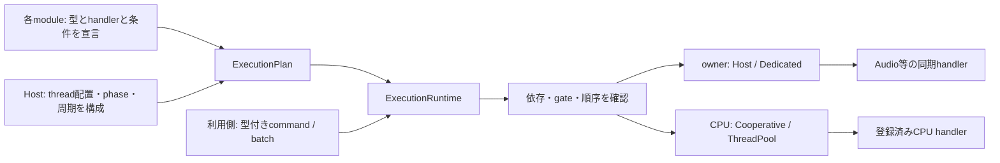
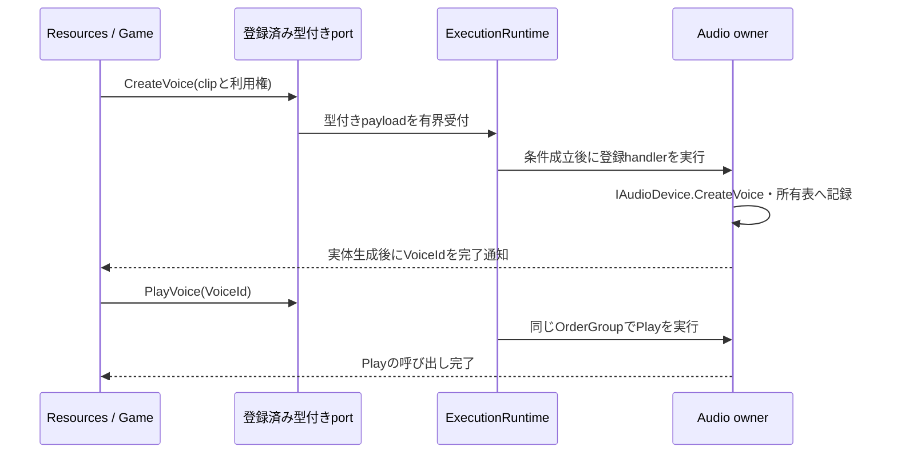

# ADR-CORE-0003: 宣言した仕事と型付きコマンドによる実行基盤

- 状態: 提案
- 日付: 2026-10-11
- 関連カテゴリ: engine、platform、input、graphics、audio、resources、ecs、animation、diagnostics

## 背景

Lumyteには、Input、BrowserのJS interop、Audio deviceなど、生成・操作・解放を同じ所有スレッドで行う処理と、独立したデータを並列計算できる処理がある。Browserではmanaged threadを作れない構成も必要になる。lockによる排他、処理順序、物理threadの固定は異なる条件である。

各呼び出し側がラムダを作って実行先を選ぶAPIでは、モジュールの所有者・進行条件・終了手順が利用コードへ分散する。AudioのPlay／Stop、Resourcesの実体生成、ECSの大量適用には、入力の型と実行条件を事前に確定し、小さいデータをまとめて送れる仕組みが必要である。

本ADRは、モジュールが仕事を宣言し、runtimeが宣言と構成に従って実行するcore基盤を定義する。生成要求の完了は実体生成完了を表す。生成前のhandle発行が必要ならResources側で設計し、ジョブ基盤が未生成voiceのproxyを返す仕組みにはしない。

このPRは設計案であり、実装・動作テスト・性能測定を含まない。以下のAPIはmainに存在しない追加提案である。未取り込みの従来案にあったInvokeAsync(Action／Func)、delegateを受けるAdd／AddOn／StartPeriodicは公開案から置き換える。

## 決定

### モジュールの宣言と実行時の責務

仕事を次の三つに分ける。

| 種類 | 宣言するもの | 実行条件と完了 |
| --- | --- | --- |
| 型付きcommand | 入力型、結果型、handler、target、順序group、gate | 受付済みで条件が成立すると一度実行。同期handlerの終了が完了 |
| 範囲計算 | 入力型、範囲handler、CPU target | graph内の先行完了後、指定粒度で実行。全範囲の終了が完了 |
| 継続更新 | 更新handler、owner、gate | host phaseまたは専用threadの周期でruntimeが直接実行 |

handlerはモジュール登録時に一度渡す実装であり、投入時にはcommandのstructだけを渡す。公開の投入APIはAction／Func、任意のラムダ、型名文字列を受け取らない。handler内部の通常のコードまでラムダを禁止するものではなく、ThreadPoolやTask継続の内部実装がdelegateを使うこととも区別する。

初期配置は `src/Core/Lumyte.Execution/`、名前空間・NuGet名は `Lumyte.Execution` とする。宣言・型付き配送・owner駆動・CPU graphを一つの基盤に置き、BCLだけへ依存する。Audio／Resources／ECS／DIへの逆依存は持たない。従来案の未実装 `Lumyte.Threading`／`Lumyte.Jobs` プロジェクトはこの案では作らない。Audioなどの統合層が登録とhandlerを提供し、低レベルbackendの同期APIを呼ぶ。この設計PRで空プロジェクトを追加しない。



### 登録、配置と起動

1. モジュールは論理owner、commandと結果の型、handler、順序group、gate、更新、初期化依存を宣言する。ここではnative deviceやthreadを作らない。handlerが保持するstateも構成用の参照に留める。
2. アプリはownerをHostまたは専用threadへ割り当て、CPU backend、host phase、更新周期、容量を設定する。同じ物理threadへ複数ownerを割り当てられる。
3. 実際のhost thread上でBuildOnCurrentHostを呼び、HostとCooperativeのownerを固定する。未割り当て、型やkeyの所属不一致、初期化依存の循環、不正な配置・更新周期を検査して宣言をfreezeする。
4. hostの初期化用Pumpを接続してからStartAsyncを呼ぶ。runtimeが必要な専用threadを起動し、依存順にモジュールのStartAsyncを進める。モジュールは型付きの初期化仕事を使い、deviceを正しいownerで生成する。
5. 全モジュールの起動成功後に通常commandを受け付け、宣言済み更新を有効にする。途中失敗でも成功済み・部分生成物のstateを保持し、同じownerで後始末する。

DIはモジュールstate、構成値、型付きportを渡す方法の一つである。DI登録からthreadを自動発見せず、同期factoryで非同期起動をblockしない。名前は診断用であり、型付きkeyとruntimeの所属で対象を識別する。同じAudioモジュールを二つ登録してもportを取り違えない。

### 宣言API

比較元はmain `81bba9e6a30ae7d2e926d0cf3247c140cca3502c`。宣言は主要メンバーの抜粋であり、以下はすべて追加である。

```diff
+namespace Lumyte.Execution
+{
+    public readonly struct Unit;
+    // すべてbuilder/plan所属の不透明key。defaultや別planのkeyは無効。
+    public readonly struct ModuleKey;
+    public readonly struct OwnerKey;
+    public readonly struct ThreadKey;
+    public readonly struct PhaseKey;
+    public readonly struct OrderGroupKey;
+    public readonly struct GateKey;
+    public readonly struct WorkKey<TCommand, TResult> where TCommand : struct;
+    public readonly struct RangeWorkKey<TContext> where TContext : struct;
+    public readonly struct UpdateKey;
+
+    public enum OwnerRequirement { HostOnly, FixedThread }
+    public enum WorkAdmission { Normal, Startup, Cleanup }
+    public enum CpuExecutionMode { Cooperative, ThreadPool }
+    public enum ShutdownMode { Drain, CancelPending }
+    public enum ExecutionStatus { Created, Starting, Running, Quiescing, Stopping, Stopped }
+
+    public readonly struct WorkTarget
+    {
+        public static WorkTarget Cpu { get; }
+        public static WorkTarget On(OwnerKey owner);
+    }
+
+    public sealed class WorkOptions
+    {
+        // defaultは無効。CpuまたはOn(owner)を明示する。
+        public WorkTarget Target { get; init; }
+        // owner commandは必須。異なる型でも同じgroupなら受付順を守る。
+        // CPU commandのdefaultは非順序化。直列化はgraphの辺で指定する。
+        public OrderGroupKey OrderGroup { get; init; }
+        public WorkAdmission Admission { get; init; } = WorkAdmission.Normal;
+        // 構築時にcopy。全gateが開いていることが開始条件。
+        public ReadOnlyMemory<GateKey> RequiredGates { get; init; }
+    }
+
+    public readonly struct WorkContext
+    {
+        // 現在の宣言targetを検査。CPU仕事でowner操作を許可する機能ではない。
+        public void VerifyAccess();
+    }
+
+    public interface ICommandHandler<TCommand, TResult> where TCommand : struct
+    {
+        // 同期・有限時間で返す。未完了仕事のwait、async void、別仕事の投入は禁止。
+        TResult Execute(in TCommand command, in WorkContext context);
+    }
+
+    public interface IRangeWorkHandler<TContext> where TContext : struct
+    {
+        // 受付前に一度評価する副作用のない長さ取得。ownerを参照しない。
+        int GetLength(in TContext context);
+        void Execute(in TContext context, int first, int endExclusive);
+    }
+
+    public readonly struct UpdateTick
+    {
+        public TimeSpan Elapsed { get; }
+        public long Index { get; }
+        public long SkippedTicks { get; }
+        public TimeSpan ScheduledTime { get; }
+        public TimeSpan StartedTime { get; }
+    }
+
+    public interface IUpdateHandler
+    {
+        // 登録された同じinstanceをownerで直接呼ぶ。更新ごとのcommandを作らない。
+        void Update(in UpdateTick tick, in WorkContext context);
+    }
+
+    public interface IExecutionModule
+    {
+        // 構成時に一度呼ぶ。device生成は禁止。
+        void Declare(ModuleBuilder builder);
+        // 外側の非同期workflow。継続threadは固定されない。
+        ValueTask StartAsync(ModuleContext context, CancellationToken token);
+        ValueTask StopAsync(ModuleContext context);
+    }
+
+    public sealed class ModuleBuilder
+    {
+        public OwnerKey Owner(string name, OwnerRequirement requirement);
+        public OrderGroupKey OrderGroup(string name, OwnerKey owner);
+        public GateKey Gate(string name);
+        public void DependsOn(ModuleKey dependency);
+        public WorkKey<TCommand, TResult> Command<TCommand, TResult, THandler>(
+            string name, THandler handler, WorkOptions options)
+            where TCommand : struct
+            where THandler : ICommandHandler<TCommand, TResult>;
+        public RangeWorkKey<TContext> Range<TContext, THandler>(string name, THandler handler)
+            where TContext : struct where THandler : IRangeWorkHandler<TContext>;
+        public UpdateKey Update<THandler>(string name, OwnerKey owner, THandler handler,
+            ReadOnlyMemory<GateKey> requiredGates = default) where THandler : IUpdateHandler;
+    }
+
+    public sealed class ExecutionPlanBuilder
+    {
+        public ExecutionPlanBuilder();
+        // Declareを同期実行してから返す。失敗時はbuilder全体を破棄する。
+        public ModuleKey AddModule(string name, IExecutionModule module);
+        public PhaseKey HostPhase(string name);
+        public ThreadKey DedicatedThread(string name);
+        public void BindHost(OwnerKey owner, PhaseKey phase);
+        public void BindDedicated(OwnerKey owner, ThreadKey thread);
+        public void DriveOnHost(UpdateKey update, PhaseKey phase);
+        public void DrivePeriodic(UpdateKey update, ThreadLoopOptions options);
+        public ExecutionRuntime BuildOnCurrentHost(CpuExecutionMode cpuMode,
+            int maxCpuConcurrency, ExecutionOptions options);
+    }
+}
```

`Command`は具象THandlerの閉じたgeneric adapterを登録時に作る。handlerは一度だけ保持し、投入データにhandlerやclosureを複製しない。struct handlerなら登録時のcopyを保持する。可変のdevice stateは明示した参照先に置き、ownerだけが変更する。CPU handlerは同時実行され得るので、モジュールinstanceの可変fieldを無同期に共有しない。

AOTで必要な型を明示登録し、実行時のassembly走査、MakeGenericType、DynamicInvoke、式のcompileに依存しない。source generatorは将来の記述省略に使えても、手書き登録だけで動く契約を基準にする。GetLengthや通常handler内からの別command／graph投入は拒否し、依存辺か外側workflowへ展開する。

`FixedThread`はHostにもDedicatedにも配置できる。`HostOnly`やOSイベント／JS interopの制約は専用threadへの移動で回避しない。BuildはownerとOrderGroupの不一致、ownerに対するCPU範囲処理、Host以外のhost phaseを拒否する。初期化依存はmodule instance間、graph依存は同じrun内のnode instance間とし、「型Aは型Bの後」という暗黙の依存を作らない。

### 型付きport、batchと結果

```diff
+namespace Lumyte.Execution
+{
+    public sealed class ExecutionOptions
+    {
+        // すべて正値。完了済み未回収の結果も容量へ含める。
+        public int MaxInFlightRuns { get; init; } = 64;
+        public int MaxCommands { get; init; } = 4096;
+        public int MaxGraphNodes { get; init; } = 4096;
+        // payload/result storeの保持byte数。再利用待ちの空きblockも含む。
+        public long MaxPayloadBytes { get; init; } = 4 * 1024 * 1024;
+        // 通常受付に使わせないcleanup専用の有界枠。
+        public int ReservedCleanupCommands { get; init; } = 32;
+        public int ReservedCleanupRuns { get; init; } = 4;
+        public long ReservedCleanupPayloadBytes { get; init; } = 64 * 1024;
+    }
+
+    public sealed class ExecutionQueueFullException : InvalidOperationException
+    {
+        public ExecutionQueueFullException(string message);
+    }
+
+    public sealed class CommandPort<TCommand, TResult> where TCommand : struct
+    {
+        // 一件batchの便宜API。実行は常にruntimeへ配送し、inline実行しない。
+        // 未受理・実行失敗は返すValueTaskへ伝える。結果は一度だけ観測する。
+        public ValueTask<TResult> ExecuteAsync(TCommand command,
+            CancellationToken token = default);
+    }
+
+    // builder世代と結果位置を保持し、対応するrun以外では使用できない。
+    public readonly struct CommandResultKey<TResult>;
+
+    public sealed class CommandBatch : IDisposable
+    {
+        // 単一producerで構築する再利用可能なstaging領域。maxCommands > 0。
+        public CommandBatch(int maxCommands);
+        public CommandResultKey<TResult> Add<TCommand, TResult>(
+            CommandPort<TCommand, TResult> port, in TCommand command) where TCommand : struct;
+        // 未受理または対応runの完了・Dispose後だけ再利用可能。旧keyは無効になる。
+        public void Reset();
+        public void Dispose();
+    }
+
+    public sealed class CommandRun : IDisposable
+    {
+        public bool IsCompleted { get; }
+        // 参照された場合だけ一つ作る共有Task。全handlerの静止と成功/取消/失敗を通知。
+        public Task Completion { get; }
+        // thread-safe、冪等。開始前の仕事だけを抑止する。
+        public void RequestCancel();
+        public void ThrowIfFailed();
+        // 全体完了後に各結果を読む。該当command失敗/取消は例外。
+        public TResult GetResult<TResult>(CommandResultKey<TResult> key);
+        // 完了前は拒否。内部結果slotを返すだけで、native資源は解放しない。
+        public void Dispose();
+    }
+
+    public sealed class ModuleContext
+    {
+        // activeなmodule lifecycleのための権限付き配送。所属と依存先を検査する。
+        public ValueTask<TResult> ExecuteAsync<TCommand, TResult>(
+            WorkKey<TCommand, TResult> key, TCommand command,
+            CancellationToken token = default) where TCommand : struct;
+        public GateControl GetGate(GateKey key);
+    }
+
+    public sealed class GateControl
+    {
+        // 任意threadから通知可能。closeは開始済みhandlerを中断しない。
+        public void Open();
+        public void Close();
+        // 永続失敗。待機要求を失敗させる。復旧は新しいmodule/runtime世代で行う。
+        public void Fail(Exception error);
+    }
+
+    public sealed class ExecutionRuntime
+    {
+        public ExecutionStatus Status { get; }
+        // 起動・更新・内部障害・cleanupの失敗を安全に公開する。通常command失敗はrunへ。
+        public Exception? Failure { get; }
+        public CommandPort<TCommand, TResult> Bind<TCommand, TResult>(
+            WorkKey<TCommand, TResult> key) where TCommand : struct;
+        public ValueTask StartAsync(CancellationToken token = default);
+        // falseは容量不足の未受理。batch全体を受理するか、一件も受理しない。
+        public bool TrySubmit(CommandBatch batch, out CommandRun? run,
+            CancellationToken token = default);
+        public int PumpHostLifecycle(int maxWorkItems, TimeSpan maxElapsed);
+        public int PumpJobs(int maxWorkItems, TimeSpan maxElapsed);
+        public int RunHostPhase(PhaseKey phase, int maxWorkItems, TimeSpan maxElapsed);
+        // 通常受付を閉じ、更新停止・既存仕事・module cleanup・thread終了を追跡する。
+        public ValueTask StopAsync(ShutdownMode mode = ShutdownMode.CancelPending);
+    }
+}
```

portはruntime、module instance、登録世代へ結び付く。利用側は受け取ったportへ入力を渡し、ownerやhandlerを毎回指定しない。ExecuteAsyncの引数不正は同期的な引数例外、起動前や終了後の外部受付は失敗ValueTask内の状態例外、単発APIの容量不足は `ExecutionQueueFullException` として返すValueTaskを失敗させる。既に取消済みなら未受理とし、TrySubmitはOperationCanceledExceptionを同期的に返す。成功したTrySubmitは必ずrunを返す。TrySubmitの無効batch・状態違反は同期例外、容量不足だけはfalseとrun=nullになる。

初期batchは同じowner・OrderGroupへ属する複数command、または非順序化CPU commandだけを受け付ける。異なるtargetをまたぐ依存はgraphで表す。同じowner batch内の異なるcommand型でも共通の受付sequenceを割り当て、同じOrderGroupの他batchが間へ割り込まない。別groupの仕事は公平性のため間で実行でき、CPU batchの実行順序は保証しない。原子的なのは受付であり、副作用のrollbackや音声sample精度の同時反映は保証しない。実行時の一件の失敗は後続未開始commandを抑止し、開始済み仕事の終了後にrunを失敗させる。成功済みの結果は失敗runでも個別に取得できる。

CommandBatchはBuilding→Submitted→対応run完了・Dispose→Reset→Buildingと進む。受理時にruntimeの予約storeへpayloadをcopyするが、result keyの世代を保つためSubmitted中のAdd／再Submit／Disposeを拒否する。容量不足ならBuildingのままで、後のturnに同じ内容を再試行できる。未受理のResetは内容を破棄し、keyを無効化する。未受理または対応run完了・Dispose後だけbatchをDisposeできる。

CommandRunはbatchごとに一つの安定した参照objectを確保し、公開instanceをpool再利用しない。結果はTResult専用storeへ保持し、GetResultは同じ結果を返すが、そのcopyは資源の所有権を増やさない。Disposeは冪等とし、以後の結果取得は拒否する。未完了runをDisposeしてborrowを失わせない。完了Taskを取得済みなら、そのTaskはrunのDispose後も同じ結果を保つ。

外部の投入はhandlerからでもownerからでもinlineに切り替えない。特にBrowserで同じ物理threadになっても、CPU処理中へAudio操作を再入させない。handler内のExecuteAsync／TrySubmit／Pump／Stopは契約違反として拒否する。moduleのStartAsync／StopAsyncはhandlerではなく、非同期workflowとして明示的に配送できる。

### 実行条件、順序と条件待ち

開始条件は、先行nodeの成功、moduleの起動状態、RequiredGates、targetの実行可能phase、同じOrderGroupの先行完了、CPU同時数枠の成立である。条件は構造化して登録し、`Func<bool>`を毎回走査しない。gateや依存の変更通知でready集合へ移し、host phaseはホストが明示する。

共通の物理threadに一つの条件待ちFIFOを作らない。待機集合はOrderGroupごとに分け、閉じたAudio gateで止まるのはAudioのgroupとその依存先だけにする。同じgroupの後続は追い越さず、別module／groupは進行できる。readyなgroupを公平に選び、一つの連続producerが他を飢餓させない。型ごとのFIFOだけではPlayとStopの順が逆転し得るため、順序は型をまたいで管理する。

gate閉鎖とhandler開始は原子的な確定点で競合を解決する。開始が勝ったhandlerは最後まで追跡する。Closeは現在実行中の処理の終了通知ではないため、資源を変更する側は別途その静止を確認する。Browserのresumeは同じHostの同期handler間でgateを閉じれば、既存Audio handlerが実行中でないことを確定できる。

条件待ちもcommand／node枠、payload、borrowの寿命に含める。待機が満杯なら新規投入を拒否し、隠れた無制限queueを作らない。cancel／gate失敗／停止で必ずterminal化できる。自分のgateを開く仕事を、そのgateの後ろや同じ停止groupへ置かない。gateを開く通知は通常command queueの容量を消費しない制御経路で行う。初期化には通常groupを迂回する権限付きlifecycle経路を使う。

gateの初期状態はClosed、Open／Closeは同状態への呼び出しも許す。Fail後は永久Failedとし、Open／Closeは状態例外になる。同じgateへの後続仕事も待機せず失敗させる。GetGateは自moduleのkeyだけを受け付ける。

gateはDomainのready状態を表すが、voiceの生存やdevice世代の検査を代行しない。handlerは開始時に世代と必要な資源利用権を検査し、不正なcommandを副作用前に失敗させる。異なるgroupや独立run間の全順序は保証せず、依存が必要なら同じgroup、graphの辺、または先行runの完了で示す。

### 型付き格納、容量と完了の費用

型ごとのpayload storeは `TCommand[]` 相当の再利用領域、結果は `TResult[]` 相当の領域とする。共通の順序queue／ready集合には登録ID、slot、generation、sequence、run IDだけを置く。payloadをobjectや非generic interfaceへboxしない。登録済みgeneric adapterがTHandlerを呼ぶため、投入ごとのdelegate・closure・Reflection invokeを必要としない。

runtimeはrun、header、payload、result、graph nodeの必要枠を受付前に予約して一括commitする。失敗時は一件も実行せず枠を戻す。型付きstoreのblock拡張とTResultの格納も総容量・byte上限へ含め、予算外の自動拡張で回避しない。別型の確保が必要な場合は未使用blockを返却して予算を回せるようにし、古い型のcacheだけで受付を永久拒否しない。slotのgenerationを検査し、古い通知やresult keyを再利用後の仕事へ適用しない。generationを安全に更新できないslotは再利用しない。

完了済みで未DisposeのCommandRunの結果も有界容量を使う。単発ExecuteAsyncは内部で一件runを作り、結果を返すまで追跡して内部slotを返す。ValueTaskだから無割り当てとは宣言しない。取消登録、例外、Task継続、最初のstore確保、batchごとのrun objectの費用を測る。高頻度の制御はbatchとポーリングを使えば、commandごとの完了Taskを必要としない。

structをcopyしても参照先はdeep copyしない。PCMやECS snapshotなどのbuffer・leaseは、未受理なら送信側が保持し、受理後は全handlerが静止するまで変更・返却しない。MaxPayloadBytesはpayloadとresultのstoreが保持する領域を制限するもので、参照先の巨大bufferのbyte予算はResources／統合側が別に制限する。

結果にnative資源の参照やIDが入っても、runのDisposeが資源の解放を代行しない。モジュールは生成直後に自分の所有表またはworkflowの所有記録へ登録する。結果未観測、後続失敗、取消でも生成物を失わず、型付きcleanup仕事で元ownerへ戻す。低頻度の生成結果も必ず観測し、利用権の移譲を確定する。

### 取消、失敗とメモリ可視性

受理後の取消と開始は同じ確定点で順序付ける。取消が先ならhandlerを実行せず、開始が先なら同期handlerの成功結果または例外まで追跡する。開始後の取消だけで生成結果を捨てない。batch／graphの別仕事が失敗しても、開始済みhandlerと配送済みowner仕事の静止前にrunを完了させない。

全仕事の会計後、例外があれば失敗、なければ開始前取消された仕事があれば取消、残りは成功とする。handler自身が投げたOperationCanceledExceptionは通常のhandler失敗であり、runtimeの開始前取消とは区別する。複数失敗は集約して観測できる。処理済みのPlayや生成をrollbackしない。

先行の書き込みは後続node、IsCompleted=trueの観測、Completionの完了観測へrelease/acquire相当で公開する。外部継続をhandler内でinline実行しない。await後のthreadは保証しないため、次のowner操作も型付きportを通す。完了はCPU／owner同期処理の終了であり、GPU fence、音声の再生終了、外部I/Oの終了ではない。

内部障害でも、ownerへ既に受理された仕事の開始前取消または実行終了まで入力を保持する。CPU backendの障害だけでownerの仕事が消えたと見なさない。別backendへ移して副作用を再実行しない。

### 宣言済み仕事のgraphとCPU範囲処理

```diff
+namespace Lumyte.Execution
+{
+    public readonly struct JobNodeId;
+    public sealed class JobGraphBuilder<TContext> where TContext : struct
+    {
+        public JobGraphBuilder();
+        // handlerとtargetは登録済みkeyから得る。ここでdelegateやownerを渡さない。
+        public JobNodeId Add(string name, WorkKey<TContext, Unit> work);
+        public JobNodeId AddRange(string name, RangeWorkKey<TContext> work, int batchSize);
+        public void DependsOn(JobNodeId after, JobNodeId before);
+        public JobGraph<TContext> Build();
+    }
+
+    public sealed class JobGraph<TContext> where TContext : struct
+    {
+        public int NodeCount { get; }
+    }
+
+    public sealed class JobRun : IDisposable
+    {
+        public bool IsCompleted { get; }
+        public Task Completion { get; }
+        public void RequestCancel();
+        public void ThrowIfFailed();
+        // 完了後だけ内部枠を返す。公開instanceは再利用しない。
+        public void Dispose();
+    }
+
+    public sealed class ExecutionRuntime
+    {
+        // 同じruntimeへ登録した仕事だけで構成。contextをrunにcopyする。
+        public bool TrySchedule<TContext>(JobGraph<TContext> graph, in TContext context,
+            out JobRun? run, CancellationToken token = default) where TContext : struct;
+    }
+}
```

初期graphは各nodeへ同じTContextを渡し、結果はUnitとする。run専用context内の明示した出力領域で段階をつなぐ。異なるTResultの自動変換、任意のデータflow型推論、nodeを作るlambdaは導入しない。生成結果を直接受け取りたいResourcesなどは型付きcommandの単発APIを使える。

graphは不変で再利用する。Buildで空graph、循環、異なるbuilderのID、無効key、Startup仕事を拒否し、重複辺は一辺へまとめる。通常nodeは一度、範囲nodeは `[0, length)` の重複しない最大batchSize件のchunkを処理する。GetLengthは受付前に一度評価し、負数・例外ならrun未受理とする。0件はcallbackなしで成功する。

TryScheduleはRunning中だけNormal／Cleanup仕事を受け付ける。状態・引数・事前取消の例外と容量不足falseの区別はTrySubmitと同じとする。run枠と全node枠を一括予約し、容量不足はfalseで返す。owner nodeがreadyになってから使う配送枠もnode予約に含め、内部の配送段階だけで追加の容量不足失敗を起こさない。外部commandとowner nodeは同じ順序groupの受付地点で並ぶ。owner nodeのgroup内sequenceはreadyになった時に確定し、先行待ちnodeが後から必要とする通常commandを早々に塞がない。graphの依存順と独立commandとの順序が必要なら、外側で先行runを待つ。

一つのnode／chunkの失敗またはrun取消後は、同じrunの未開始node・未claim chunkを抑止し、失敗した先行を待つnodeもterminalへ伝播する。既に開始した全handlerの静止を待ち、残った依存待ちだけでrunが永久未完了にならないよう会計する。

owner待ちとgate待ちはCPU同時数を占有しない。範囲計算はCPU backendだけへ配置し、maxCpuConcurrencyはCPU handlerだけの上限とする。worker一つは物理thread固定を意味しない。並列nodeやchunkの順序、浮動小数点reductionのbit一致は保証しない。必要なら固定順の集約仕事を宣言する。

ThreadPoolでは最大同時数のdrainがready範囲をclaimし、要素ごとのTask／queue entryを作らない。共有poolの最小・最大thread数を変更しない。CPU handlerは投入元のExecutionContext／AsyncLocal／SynchronizationContextやcultureに依存せず、必要値をcontextへ明示する。owner handlerはownerのcontextで実行する。単発CPU commandも同じbackendと同時数制限に従う。CooperativeではPumpJobsが同じ依存関係を進め、owner仕事はHost phaseまたは専用threadで実行する。Cooperative＋Dedicatedでも別threadからの完了通知を同期する。

PumpJobsは開始時点までのrunを公平に選び、callback、0件node、取消整理、依存辺伝播を有界な小区間で進める。件数・時間予算を確認して継続状態を残し、DAG全体を再帰処理しない。戻り値0は全run完了を意味しない。時間予算はsoftであり、開始済みhandlerは中断できない。各chunkを短くする責任はモジュールにある。

graphの全nodeはMaxGraphNodesへ、owner nodeの配送headerはMaxCommandsへも算入して受付時に予約する。ready化で追加容量を取りに行かず、CPU nodeの待機はowner枠を消費しない。graph contextと状態領域の格納byteも予算化し、内部slot会計を別backendで二重確保しない。rangeのchunk数分のobjectや配列を先に確保せず、進捗cursorと最大同時数に比例するready情報を使う。maxCpuConcurrencyは正値、Cooperativeでは1だけを許す。ThreadPool構成のPumpJobsはCPU handlerをHostへ移さず0を返す。

### 継続更新、専用threadとHost phase

```diff
+namespace Lumyte.Execution
+{
+    public sealed class ThreadLoopOptions
+    {
+        // period > 0、maxControlWorkItems > 0、0 < maxControlTime < period。
+        public ThreadLoopOptions(TimeSpan period, int maxControlWorkItems, TimeSpan maxControlTime);
+        public TimeSpan Period { get; }
+        public int MaxControlWorkItems { get; }
+        public TimeSpan MaxControlTime { get; }
+    }
+}
```

更新もモジュールがIUpdateHandlerとして一度宣言する。Dedicatedではruntimeが直接呼び、毎tickのcommand、Task、外側からの投入を作らない。同じ物理threadを共有する更新は初期案では同じ周期・予算に揃える。一周期のpassでgateが開いた更新を登録順に一回ずつ非並行に呼び、pass全体の終了後に次の予定時刻と制御予算を一度だけ更新する。先行更新の超過だけで後続更新を恒久的に省略しない。異なる周期を指定した共有構成はBuildで拒否し、独立threadを明示するかモジュール内で有界なsubstepを扱う。

更新有効化時刻を起点t0とし、周期P、予定時刻t0+nPを単調時計で管理する。初回Elapsedの起点もt0とする。最初の予定番号は1。到来を判定した時点の最新番号nを一度実行し、遅れた周期は省略する。Elapsedは前回実行開始からの実経過時間、SkippedTicksは実行しなかった予定数とする。Indexはpass共通、StartedTime／Elapsed／SkippedTicksは各handlerについて記録する。終了目標はt0+(n+1)P、次回はpass全体の終了より後の最初の予定時刻とし、無制限catch-upを行わない。

例えば10ms周期で初回開始12ms、終了37msなら次回は40ms、Index=4、SkippedTicks=2になる。control処理による超過や初回の遅れも集計する。gate閉鎖中の更新は積み上げず、再開後も同じ絶対予定に従い省略数と実経過時間を通知する。音声のsample時計はnative mixer／device callback／AudioWorkletに任せ、Audio.Updateの周期で代用しない。

専用threadはcommand到着、gateのready化、次回予定時刻、停止でwakeする。Updateと同時にhandlerを実行せず、due tickを優先し、合間にready groupの短い仕事を処理する。到着で予定時刻をリセットしない。件数・実処理時間の制御予算は登録時と各pass終了時だけ補充し、wakeごとには増やさない。待機時間は時間予算へ含めず、省略tick分を積算しない。

制御予算切れでは次tickか停止を待ち、常時signaledなqueueでbusy spinしない。pass終了後にready集合を再確認する。空判定と待機登録は通知を失わない形で接続する。全更新がgate待ちでも予算の補充は絶対周期境界で一度行い、更新を呼ばずにcontrolを進められるようにする。周期更新を持たない専用threadは到着通知で通常の有界drainを行う。起動・cleanupのlifecycle配送は通常の周期制御予算へ依存させない。Quiescingでは周期更新を停止しても受付済み仕事を有界drainで進め、予算補充が消えてDrainやcleanupが停止しないようにする。

Hostには自動timerを作らない。RunHostPhaseがそのphaseのpassを進める。pass開始時点までの受付sequence上限を各OrderGroupで固定し、その境界内のcommand、gateが開いた更新の順に進める。同じgroupの先行完了で後続がreadyになれば、境界内の後続も同じpassで進める。最初からreadyな先頭一件だけに限定しない。件数・時間予算で中断したらcommand／更新のcursorを持ち越し、次turnはその続きを新しいcommandより先に処理する。pass中の追加commandは次passへ回し、pass完了後は次のRunHostPhaseまで新passを開始しない。更新同士のcursorも保持するので、先頭の重い更新や連続producerが後続更新を飢餓させない。gateが閉じたgroupはpassを止めず待機集合へ移し、そのpassで進めなかった分は後のpassで扱う。

HostのIndexはphase呼び出し番号であり、更新を実行したturnの番号を通知する。ScheduledTimeはそのturnのphase開始時刻、StartedTimeはhandler開始時刻、Elapsedは前回の当該handler開始からの実経過時間、SkippedTicksは呼べなかったphase回数とする。初回Elapsedの起点は更新有効化時刻とし、いずれもruntimeの単調時計を使う。論理frame deltaを使うシミュレーションはmodule自身の入力で渡す。

PumpHostLifecycleは初期化・cleanup専用、PumpJobsはCooperativeのCPU／依存処理、RunHostPhaseは通常owner処理という契約を分ける。通常frame開始前と終了中も必要なPumpを止めない。Quiescing中のHost通常仕事はRunHostPhaseで同じphase制約のままdrainし、新しいUpdateを呼ばない。Drainを選ぶHostは終了中も必要phaseを呼ぶ。通常仕事をPumpHostLifecycleへ移してphaseを回避しない。各Pumpは固定Host限定・再入拒否であり、停止完了後は0を返す。maxWorkItemsとmaxElapsedは正値とし、戻り値は実行したhandler／chunk数であり、内部整理だけなら0も返る。いずれも未完了の仕事を同期waitするAPIではない。

OS scheduling、GC、同期native生成の長さによる遅れは残る。busy spin、realtime優先度、プロセス全体のtimer分解能変更、GC停止を既定で要求しない。hard realtimeやzero allocationの保証は行わず、予定との差、締切超過、コマンド反映遅延を測定する。

### Audioが宣言する仕事と呼び出し境界

Audio統合モジュールはdeviceのowner、制御用OrderGroup、利用可能gateを宣言し、少なくとも初期化、clip生成、voice生成、Play／Pause／Stop、状態適用、voice／clip／device解放とUpdateを登録する。各仕事は閉じた入力・結果型を持ち、共通基盤が対応handlerへ配送する。Audio固有の巨大switchをcoreへ持ち込まない。



`IAudioVoice.Play()`など既存低レベルAPIの契約は同期・owner限定のままとする。別threadから使うAudio統合APIが `PlayVoice` を送る。voidのPlayを裏で配送して、成功・失敗や実行時点だけを変える互換性変更はしない。完了はbackendのPlayが返った時点であり、音が聞こえ始めた時刻ではない。

以下はAudio統合層の宣言例である。型とhelperは提案例であり、既存Audio公開APIへの追加が確定済みという意味ではない。`AudioState`はdevice・clip・voiceの所有表を持ち、generationを検査する。`CreateVoiceAndRecord`は実体を生成して所有表へ記録し、記録失敗時も元ownerで回収する。clipの利用権はvoice破棄成功まで保持する。例のDeviceGenerationはprocess内でmodule instance／deviceの再生成をまたいで再利用しない識別値とし、上限で発行を拒否する。slot世代だけで別deviceの同値IDを受理しない。

```csharp
readonly record struct InitializeAudio;
readonly record struct CloseAudio;
readonly record struct ClipId(ulong DeviceGeneration, int Slot, int Generation);
readonly record struct VoiceId(ulong DeviceGeneration, int Slot, int Generation);
readonly record struct CreateVoice(ClipId Clip);
readonly record struct PlayVoice(VoiceId Voice);
readonly record struct StopVoice(VoiceId Voice);

sealed class AudioModule : IExecutionModule
{
    private readonly AudioState state;
    private WorkKey<InitializeAudio, Unit> initialize;
    private WorkKey<CloseAudio, Unit> close;
    public OwnerKey Owner { get; private set; }
    public UpdateKey Update { get; private set; }
    public WorkKey<CreateVoice, VoiceId> Create { get; private set; }
    public WorkKey<PlayVoice, Unit> Play { get; private set; }
    public WorkKey<StopVoice, Unit> Stop { get; private set; }

    public AudioModule(AudioState state) => this.state = state;

    public void Declare(ModuleBuilder b)
    {
        Owner = b.Owner("Audio", OwnerRequirement.FixedThread);
        var group = b.OrderGroup("Audio.Control", Owner);
        var normal = new WorkOptions {
            Target = WorkTarget.On(Owner), OrderGroup = group
        };
        initialize = b.Command<InitializeAudio, Unit, AudioState>("Initialize", state,
            new WorkOptions { Target = normal.Target, OrderGroup = group,
                Admission = WorkAdmission.Startup });
        close = b.Command<CloseAudio, Unit, AudioState>("Close", state,
            new WorkOptions { Target = normal.Target, OrderGroup = group,
                Admission = WorkAdmission.Cleanup });
        Create = b.Command<CreateVoice, VoiceId, AudioState>("CreateVoice", state, normal);
        Play = b.Command<PlayVoice, Unit, AudioState>("Play", state, normal);
        Stop = b.Command<StopVoice, Unit, AudioState>("Stop", state, normal);
        Update = b.Update("Audio.Update", Owner, state);
    }

    public async ValueTask StartAsync(ModuleContext context, CancellationToken token)
    {
        await context.ExecuteAsync(initialize, new InitializeAudio(), token);
    }

    public async ValueTask StopAsync(ModuleContext context)
    {
        await context.ExecuteAsync(close, new CloseAudio());
    }
}
```

上のstateは次のように閉じたhandlerを実装する。初期化・終了のhelperは同期native版の抜粋であり、所有記録、失敗時の回収、clip生成の登録は省略している。`InitializeOnOwner`でOpenALDeviceを生成するので、モジュールやDIが構成されたthreadでdeviceを作ってしまうことはない。

```csharp
sealed class AudioState :
    ICommandHandler<InitializeAudio, Unit>, ICommandHandler<CloseAudio, Unit>,
    ICommandHandler<CreateVoice, VoiceId>, ICommandHandler<PlayVoice, Unit>,
    ICommandHandler<StopVoice, Unit>, IUpdateHandler
{
    public Unit Execute(in InitializeAudio c, in WorkContext context)
    {
        context.VerifyAccess();
        InitializeOnOwner(); // new OpenALDevice(...)とowner IDの記録
        return default;
    }
    public VoiceId Execute(in CreateVoice c, in WorkContext context)
    {
        context.VerifyAccess();
        return CreateVoiceAndRecord(c.Clip); // 実体生成を終えてからIDを返す
    }
    public Unit Execute(in PlayVoice c, in WorkContext context)
    {
        context.VerifyAccess();
        FindVoice(c.Voice).Play();
        return default;
    }
    public Unit Execute(in StopVoice c, in WorkContext context)
    {
        context.VerifyAccess();
        FindVoice(c.Voice).Stop();
        return default;
    }
    public Unit Execute(in CloseAudio c, in WorkContext context)
    {
        context.VerifyAccess();
        CloseOnOwner(); // voice→clip→device。成功済み解放は再試行で重複させない
        return default;
    }
    public void Update(in UpdateTick tick, in WorkContext context)
    {
        context.VerifyAccess();
        Device.Update(); // 既存APIは引数なし。音声sample供給のloopではない
    }
    // Device、InitializeOnOwner、FindVoiceなどはAudio統合層の所有管理。
}
```

この方式では `PlayVoice` の送信ごとに `() => voice.Play()` を作らない。登録時に一つのhandlerとtyped adapterを用意し、送信ごとはVoiceIdの値を格納する。IDは生成前の仮handleではなく、生成完了後のモジュール所有物を示す。Audio統合層が実体参照を返す場合も、owner限定の低レベルAPIと寿命契約は維持する。

### DIなしで登録から実thread起動まで進める

次はnativeでAudio専用threadを作る構成である。既存のwindow／OS event loopが `OnHostTurn` を固定Host上で呼ぶ前提とし、例中のhelperとphaseの選択はアプリ側の責務である。掲載APIは提案であり、コンパイル済みサンプルではない。

```csharp
// 固定Host上。DeclareはAddModuleの中で同期実行される。
var plan = new ExecutionPlanBuilder();
var audio = new AudioModule(new AudioState());
plan.AddModule("Audio", audio);
var audioThread = plan.DedicatedThread("Audio.Control"); // まだthreadは起動しない
plan.BindDedicated(audio.Owner, audioThread);
plan.DrivePeriodic(audio.Update,
    new ThreadLoopOptions(TimeSpan.FromMilliseconds(10), 64, TimeSpan.FromMilliseconds(2)));
var runtime = plan.BuildOnCurrentHost(CpuExecutionMode.ThreadPool,
    maxCpuConcurrency: 4, new ExecutionOptions());
var create = runtime.Bind(audio.Create);
var play = runtime.Bind(audio.Play);
var stop = runtime.Bind(audio.Stop);

Task? startup = null;
Task? shutdown = null;
bool started = false;
bool startupObserved = false;
bool stopping = false;

void OnHostTurn()
{
    runtime.PumpHostLifecycle(64, TimeSpan.FromMilliseconds(2));
    runtime.PumpJobs(64, TimeSpan.FromMilliseconds(2));
    if (!stopping && runtime.Failure is { } failure)
    {
        ReportFailure(failure); // アプリの診断処理
        BeginStop();
    }
    if (!startupObserved && startup is { IsCompleted: true })
    {
        startupObserved = true;
        try
        {
            startup.GetAwaiter().GetResult(); // 完了済み結果の観測だけ
            started = !stopping;
            // startedならサービスへportを公開し、通常の生成・制御を開始する。
        }
        catch (Exception error) { ReportFailure(error); BeginStop(); }
    }
    if (shutdown is { IsCompleted: true })
    {
        var completed = shutdown;
        shutdown = null; // 同じ完了を毎turn観測しない
        try
        {
            completed.GetAwaiter().GetResult();
            // 成功を観測してからevent loopと所有stateを破棄する。
        }
        catch (Exception error)
        {
            ReportFailure(error); // Pumpを残す。回復後にStopAsyncで再試行する。
        }
    }
}

// OnHostTurnを既存hostへ接続した後に呼ぶ。
startup = runtime.StartAsync().AsTask();
// StartAsyncがthreadを起動→Initialize handler→device生成→全体起動完了。

// event loopを動かしたまま、外側のworkflowから利用する。
async ValueTask<VoiceId> CreateAndPlayAsync(ClipId residentClip)
{
    var voice = await create.ExecuteAsync(new CreateVoice(residentClip));
    await play.ExecuteAsync(new PlayVoice(voice));
    return voice;
}

void BeginStop()
{
    if (stopping) return;
    stopping = true; // 起動完了通知と競合してもproducerを再開しない
    // 実アプリでは先にproducer・resource loadを停止し、進行中workflowを追跡する。
    shutdown = runtime.StopAsync().AsTask();
}
```

GetResultは必ずIsCompleted確認後に限る。起動・終了失敗を通常frameへ流さず、hostの例外境界で記録し、BeginStop／cleanup再試行へ遷移する。外側workflowのawaitでHost event loopを止めない。コンソール型hostなら同じ固定threadのloopがPumpを回し、Browserなら各callbackからJS event loopへ必ず戻る。

高頻度の制御は次のように送れる。batchをframe間で再利用し、各commandへTaskを作らない。未受理時は入力と所有権を保持して次turnに再試行する。受理後はrun静止までbatchと参照先を保持し、IsCompleted確認、各結果の観測、run.Dispose、batch.Resetの順で再利用する。

```csharp
var batch = new CommandBatch(maxCommands: 256); // producerごとに一度確保
var played = batch.Add(play, new PlayVoice(voiceA));
var stopped = batch.Add(stop, new StopVoice(voiceB));
if (runtime.TrySubmit(batch, out var run))
{
    // runを追跡表へ保持。後のturnでIsCompletedを確認して結果を観測する。
    // PlayとStopは異なる型でも同じAudio.Controlの受付順で実行される。
}
```

Browserでは同じ宣言をHostへ割り当てる。backendをWebAudio用state／moduleへ変えるが、Create／Play／Stopの入力と結果の契約は同じにする。WebAudioのJS制約にはHostOnlyの宣言を使う。

```csharp
var audioPhase = plan.HostPhase("Audio.Control");
plan.BindHost(audio.Owner, audioPhase); // DedicatedThread/BindDedicatedの代わり
plan.DriveOnHost(audio.Update, audioPhase);
var runtime = plan.BuildOnCurrentHost(CpuExecutionMode.Cooperative,
    maxCpuConcurrency: 1, new ExecutionOptions());

// 起動・終了中もPumpHostLifecycleとPumpJobsを継続する。
// Running/QuiescingのHost turnで、安全な同じphaseを呼び続ける。
// Quiescingでは受付済みcommandをdrainし、新しいUpdateは呼ばない。
if (runtime.Status is ExecutionStatus.Running or ExecutionStatus.Quiescing)
    runtime.RunHostPhase(audioPhase, 64, TimeSpan.FromMilliseconds(2));
```

実threadがない環境ではDedicatedとThreadPool構成を起動前に拒否し、黙って別方式へfallbackしない。アプリのplatform構成が明示的にCooperative＋Hostを選ぶ。Audio、Game、Inputが同じ物理threadでも役割・gate・順序groupは独立している。

WebAudioの非同期初期化は、Startup handlerで `WebAudioDevice.CreateAsync` を開始し、その実operationをmoduleのStartAsyncが外側でawaitして、別のStartup handlerでowner stateへ確定する。最初のhandlerの結果はpending operationであり、ready deviceの生成結果ではない。この二段階操作は起動workflowだけの責務とし、runtimeがTask型の結果を自動unwrapしたり非同期handlerを扱ったりしない。起動完了は実operationと確定の両方を待ち、部分生成物もcleanup対象に含める。

### Resources、ECSと条件付き実行

Resourcesのstageは任意thread・複数keyで動くため、Audio向けstageへ型付きportと元device世代を渡す。decodeやI/Oは外側workflowで行い、ownerへ送るのはclip／voiceの同期生成・解放など短い処理とする。CPU jobに同期I/O待ちを置かない。

- `IResourceTransform<TInput,TOutput>.BuildAsync`は生成commandを送り、実体生成完了をawaitしてからreadyとして公開する。placeholderや未生成handleの先行公開は本基盤の完了契約に含めない。既存Resources案にも先行発行APIがあるとは見なさない。
- `ReleaseAsync`は生成時に保持した同じport／device世代へcleanup commandを送る。復旧後の新deviceを再解決して古い資源を解放しない。解放失敗時は所有物・依存・memory chargeを保持し、成功確認後に外す。
- `CreateClip`がPCMをcopyする場合はBuild完了まで入力を借り、backendが保持する場合はResident寿命を指定する。コマンドへの参照格納はPCMの所有権移譲やcopyを意味しない。
- voiceはclipのleaseを保持する。Stopだけでは返さず、voice.Dispose成功→clip lease返却→ResourcesのTrim／ReleaseAsync→device.Disposeの順を守る。ResourceHandleだけを送って寿命保護済みとしない。

ECSはGame側でAudio componentから所有済みsnapshotを作り、必要ならCPU rangeで準備し、宣言済みのAudio適用仕事をownerへ配送する。Audio handlerは生きたECS worldを直接読まない。componentの格納方式や読み書き宣言からの自動graph生成はECS側の後続設計である。

```csharp
// audioBridge.PrepareとApplyは、同じAudioFrame入力型で事前宣言した仕事。
// PrepareはCPU、ApplyはAudio owner + Audio.Control group + Ready gate。
var graphBuilder = new JobGraphBuilder<AudioFrame>();
var prepare = graphBuilder.AddRange("PrepareAudio", audioBridge.Prepare, batchSize: 64);
var apply = graphBuilder.Add("ApplyAudio", audioBridge.Apply);
graphBuilder.DependsOn(apply, prepare);
var graph = graphBuilder.Build(); // 構成時に一度

// frameはsnapshot、clip lease、結果領域を保持するstruct。
// 未受理なら保持し、受理したrunの静止後にだけ領域を返す。
if (runtime.TrySchedule(graph, in frame, out var run))
{
    // 後のturnで完了を観測し、Gameへfeedbackを適用する。
}
```

snapshotにはworld／entity／device世代とsequenceを持たせ、古いworldの遅延commandが新しいentityへ作用しないよう検査する。Audio側の対応表がvoiceとleaseを保持し、部分適用失敗時も生成済みvoiceを記録する。feedbackは別bufferを通してGame phaseで反映する。既存Audioは2D APIであり、3D位置やlistenerのAPIがある前提にしない。

Play／StopのedgeとGainなどの状態は意味が異なる。状態値をlatestへ集約する場合はAudio／ECS統合側が明示的に行い、まだ未受理のsnapshotを置き換える。受付済みのFIFOから汎用基盤が勝手にPlayを落としたり、参照中bufferを書き換えたりしない。batchの最大要素数を制限し、一つの長いApplyが入力・周期更新を占有しないようにする。

Browserで出力resumeが必要な場合はAudioのgateを閉じる。user gesture callbackの同期区間で実際の `ResumeOutputAsync` を開始し、その実operationの完了後にgateを開く。JS側のactivationを失うので、resume開始を通常portへenqueueしない。同じHostの同期handler間で開始し、実行中Audio操作との競合を避ける。通常Audio仕事と更新には同じReady gateを宣言し、停止用cleanupは失敗したgateに依存させず、module workflowが実resumeの静止を待ってから配送する。待機側の取消だけで実resumeが終わったと見なさず、gate閉鎖を維持する。通常command／Updateは待機するが、別groupのInput／Renderは進める。resume失敗はgate.Failと元世代のcleanupへ伝える。

### 起動失敗、終了とcleanup容量

runtimeの状態はCreated→Starting→Running→Quiescing→Stopping→Stoppedを基本とする。起動失敗、Update例外、内部障害はFailureへ保存し、通常受付を閉じてQuiescingへ移る。単独commandのDomainエラーは当該runへ返し、他runを止めない。予期しないUpdate例外はruntime全体の新規Update・通常受付を停止するが、専用threadの配送機構とcleanup経路は残す。Host／Dedicatedともhandler例外を同じFailureへ保存し、Pumpから直接Domain例外を投げる契約にはしない。利用側がFailureを観測して終了・復旧を行う。owner thread自体が実行不能ならcleanup成功を偽装せず、残った所有物を診断へ保持する。

StartAsyncは一回限りとし、同時呼び出しは同じ進行結果を観測する。Starting中のStopAsyncは起動取消を要求し、進行中の実初期化を静止させてから部分生成物をcleanupする。起動成功通知と競合しても通常受付や更新を再開しない。モジュールは初期化途中でもStopAsyncを受けられるstateを保持する。

ModuleContextの配送権限はactiveなphaseで区別する。StartAsyncのcontextは自moduleのStartup／Normal／Cleanup、および初期化成功済み依存先のNormal／Cleanupを許す。自分の通常仕事が必要とする初期化順はmodule workflowとRequiredGatesで保証する。StopAsyncのcontextは自moduleと未停止の依存先のCleanupだけを許し、StartupやNormalを再開する経路には使えない。依存先のStartupはそのmodule自身のStartAsyncだけが行う。外部portはRunning中にNormal／Cleanupを受け付け、StartupのportはBindで拒否する。停止開始後は外部producerからの投入を閉じ、activeなStopAsyncのModuleContextだけへcleanup経路を残す。Starting中の権限付き依存先Normal仕事もlifecycle配送として扱い、通常host phaseの開始を待たずPumpHostLifecycleで進める。RequiredGatesとowner検査は省略しない。context本体の配送権限はworkflow終了時に失効するが、所有moduleから取得したGateControlはruntime世代の終了まで使える。

終了は次の順で進める。

1. 外側のresource load／ECS producer／I/O workflowを終了へ向かわせ、新規受付を閉じる。runtimeに登録されない外部workflowの静止はアプリ／moduleが追跡する。
2. 新しいUpdate開始を抑止し、実行中Updateの終了を待つ。Drainは受付済み仕事の完了、CancelPendingは開始前仕事の取消と開始済み仕事の終了を追跡する。gate待ちも対象とし、Drainではgateが開くか失敗するまで完了しない。期限超過を成功扱いしない。
3. 全受付済みrunの仕事が静止した後、moduleを依存の逆順でStopAsyncする。ResourcesがAudioへ依存する構成ならResourcesのReleaseAsyncをこのcontextのcleanup配送へ接続し、Audio deviceを最後に解放する。ResourcesのDI依存をcoreへ追加するものではない。
4. cleanup成功後に専用threadを終了し、Host上のlifecycle処理も完了する。借りたHostそのものは終了しない。起動・停止・cleanupの間もHostのPumpを継続する。

停止中のModuleContext経由cleanupは通常容量とは独立した予約枠を使う。Running中の外部Cleanup portは通常枠を使い、予約を消費しない。予約上限は通常上限への追加枠であり、ReservedCleanupRuns／Commands／PayloadBytesを別会計する。headerだけでなく、run、typed payload、result、完了通知の領域も同時に確保できる有界枠とする。Buildでは各Cleanup仕事一件が最小blockと結果を含め予約上限へ収まることを検査する。予約storeも不要な空きblockを返却して別型へ再配分できるようにする。通常runの未回収結果でcleanupが閉塞しない。予約枠にも収まらなければ未受理を返し、外側workflowが進行中cleanupをawaitして再試行する。進行中cleanupがなく回収可能な領域もない場合は待機・再試行loopに入らず、容量の失敗と残存stateを報告する。handler内で待ったり、retry要求を無制限に積んだりしない。

cleanup失敗時は元ownerと残存stateを保持し、StopAsyncを失敗完了させる。停止状態から通常受付へは戻さない。以後のStopAsyncは失敗・未実施のcleanupを再試行し、成功済みmoduleを再呼び出しせず、失敗moduleは所有記録から未解放分だけ処理する。失敗moduleの依存先は、そのmoduleのcleanupが成功するまで停止しない。過去のFailureは成功した再試行後も診断用に保持する。進行中StopAsyncへの呼び出しは同じ結果を観測する。ただしDrain中のCancelPending指定は不可逆な取消強化として受理し、gate待ちを含む未開始仕事を抑止する。逆方向へ戻すことはできない。回復不能なowner障害は明示的な失敗のままとし、未解放物を成功扱いして破棄しない。

runの完了・結果保存とnative資源の寿命は別である。完了済みrunの結果を未読でもmoduleの所有表から解放できる。CommandRunを後で読むことは可能だが、終了したmodule世代のIDを新runtimeへ再投入できない。内部結果領域はrun.Disposeまで保持し、runtime終了だけで回収済みslotとして再利用しない。実体への独立した利用権を渡す統合APIなら、その返却をmodule cleanupが確認する。

### 環境ごとの配置

| 環境 | owner配置 | CPU実行 | 駆動と制約 |
| --- | --- | --- | --- |
| Desktop native | OS／window／InputをHost、必要なAudioをDedicated | ThreadPoolまたはCooperative | StartAsyncが専用threadを起動。通常Audioは到着wakeと直接周期更新 |
| nativeの単一thread構成 | Audio／Game等を同じHostへ配置 | Cooperative | OS callbackと明示phaseで有界に進める。必要な全phaseをhostが呼ぶ |
| Browser、managed threadsなし | JS／WebAudio／GameをHostへ配置 | Cooperative | JSへturnを返し、起動中もPump。同期wait、thread生成、CPUのThreadPool配送なし |
| Browser、managed threadsあり | JS affinityをHostへ残す | 対応確認後に明示構成 | worker有無だけでJS／Audio ownerを移動しない。対応backendは別途検証 |
| Native AOT | 上記owner契約を維持 | 対応platformの明示backend | 閉じたgeneric登録を使用し、動的コード生成を要求しない |

Input snapshotの確定、Diagnosticsのexecution point、Render／Presentのhost turn、GPU fenceなど既存の境界は維持する。CPU同時数1は物理thread固定の代用ではなく、job完了はGPU資源の解放可能時点でもない。

### 他ライブラリの調査と採用点

音声制御は一つの方式に統一されていない。2026-10-11の調査で次を確認した。C++／Rustの仕組みをC#へそのまま移した場合の性能は未測定である。

| ライブラリ | 確認した方式 | この基盤へ反映する点 |
| --- | --- | --- |
| [Unreal Engine FAudioThread](https://dev.epicgames.com/documentation/en-us/unreal-engine/API/Runtime/Engine/FAudioThread) | `TUniqueFunction<void()>`のcommand配送。thread状態により直接実行する経路もある | ラムダ配送自体が一律に遅い根拠にはしない。本案ではモジュール宣言と入力型の固定を優先し、常時enqueueの契約を選ぶ |
| [FMOD Studio 2.03](https://www.fmod.com/docs/2.03/api/studio-api-threads.html) | command bufferをupdateで渡し、非同期Studio threadで処理。同期modeでもmixerとは別。buffer満杯では待機し得る | 制御のbatch化を参考にする。本案は有界の未受理通知を選び、Browserでのblocking waitを要求しない |
| [XAudio2 operation sets](https://learn.microsoft.com/en-us/windows/win32/xaudio2/xaudio2-operation-sets) | Start／Stop／SetVolume等をgroupにまとめ、CommitChangesでsample精度の同時適用を指定 | 型をまたぐ関連操作のgroup化。本案のbatchは受付の原子性だけであり、sample精度の同時適用とは区別する |
| [Kira 0.12.5 command](https://github.com/tesselode/kira/blob/v0.12.5/crates/kira/src/command.rs) | `T: Send + Copy`をtriple bufferで送るlatest-value方式。FIFOが必要なら別のring bufferを使う方針 | 小さい型付きデータと再利用領域。latest-valueとPlay／Stopの順序保証を混同せず、集約はmoduleが選ぶ |
| [OpenAL Soft 1.25.2 source](https://github.com/kcat/openal-soft/blob/1.25.2/al/source.cpp) | property更新用領域の再利用・atomic交換と、再生状態遷移のVoiceChange列。lockやmixer待機を含む経路もある | 頻繁な状態更新と操作順序を分ける。OpenAL内部の同期があってもLumyte backendのowner検査は省略しない |

Kiraでは[resourceの追加・返却](https://github.com/tesselode/kira/blob/v0.12.5/crates/kira/src/backend/resources.rs)にも有界ringを使う。一方、[StaticSoundHandle](https://github.com/tesselode/kira/blob/v0.12.5/crates/kira/src/sound/static_sound/handle.rs)のpause／resume／stopは別々のlatest-value領域であり、すべての操作が一本のFIFOへ入るとは言わない。FMODの[flushCommands](https://www.fmod.com/docs/2.03/api/studio-api-system.html#studio_system_flushcommands)はblocking操作であり、本案の非同期の生成完了待ちと同一視しない。

[C# delegateの費用](https://devblogs.microsoft.com/dotnet/understanding-the-cost-of-csharp-delegates/)から、capture付きでqueueへ逃げるclosure、delegateの生成、間接呼び出しを分けて考える。static／cached delegateまで毎回allocationすると見なさない。型付きcommandもcopy、予約、同期、wakeの費用があり、structにすれば自動的に高速という判断はしない。

CPU jobと駆動では次を参考にする。

| 参考 | 採用点／異なる点 |
| --- | --- |
| [enkiTS](https://github.com/dougbinks/enkiTS) | 範囲分割とpinned taskの区別。本案もCPUとowner固定を分けるが、独自work stealingは初期要件にしない |
| [Unity Jobs](https://docs.unity3d.com/6000.0/Documentation/Manual/JobSystem.html) | 宣言した仕事、データ、依存を分ける。本案のowner／phaseとResources lifetimeは独自に定める |
| [Taskflow](https://taskflow.github.io/taskflow/ExecuteTaskflow.html) | worker内のblocking joinが枯渇を生む。本案のhandlerはnested waitを禁止し、依存辺へ展開する |
| [Rayonのthreadless fallback](https://docs.rs/rayon-core/1.13.0/rayon_core/#global-fallback-when-threading-is-unsupported) | threadlessのspawn進行は自動保証ではない。本案はCooperativeのPumpを明記する |
| [Bevy tasks 0.17.3](https://docs.rs/bevy_tasks/0.17.3/bevy_tasks/) | single／multi-thread APIとowner executorのtick。配置と明示駆動を分ける |
| [oneTBBのchunking](https://uxlfoundation.github.io/oneTBB/main/tbb_userguide/Controlling_Chunking_os.html) | 粒度による管理費用と並列性のtrade-off。一律の最適batch値を決めない |

.NET 10の[Wasm features](https://github.com/dotnet/runtime/blob/v10.0.0/src/mono/wasm/features.md#multi-threading)と[Thread実装](https://github.com/dotnet/runtime/blob/v10.0.0/src/libraries/System.Private.CoreLib/src/System/Threading/Thread.cs)を基準にする。`Thread.IsThreadStartSupported`はinternalなので公開契約に使わない。LongRunningやTask.Runをthread非対応環境の回避策にしない。

[PeriodicTimer](https://learn.microsoft.com/en-us/dotnet/api/system.threading.periodictimer.waitfornexttickasync?view=net-10.0)のawaitも[Threading.Timer](https://learn.microsoft.com/en-us/dotnet/api/system.threading.timer?view=net-10.0)のcallbackも、同じ物理ownerを保証しない。[clock_nanosleepの絶対時刻待機](https://www.man7.org/linux/man-pages/man2/clock_nanosleep.2.html)をdrift回避の参考にし、全platformにPOSIXを要求しない。[PortAudio callback指針](https://portaudio.com/docs/v19-doxydocs/writing_a_callback.html)に従い、sample供給callbackからmanaged queueやjobの完了を待たない。

### 性能測定と実装順序

性能は実装後に測定する。graph構築・generic登録・store確保・JIT／AOT起動と、warmup後の定常実行を分離する。

| 比較対象・負荷 | 記録する値 |
| --- | --- |
| owner上の直接loop／capture付きlambda配送／cached delegate配送／型付き単発／型付きbatch | 件数ごとのthroughput、全threadのallocated bytes、GC回数、受付～handler開始／完了のp50／p95／p99／max |
| 1／複数producer、同一／複数型、Play→Stopと生成結果、gate閉鎖、満杯 | 同期競合、copy bytes、wake回数、context switch、拒否率、順序、最大保持memory、再開遅延 |
| 異なるpayloadサイズ、buffer参照、結果未回収、cleanup飽和 | header／payload／resultの容量遵守、世代検査、cleanup進行、長時間のmemory推移 |
| CPU直接loop／Cooperative／本ThreadPool backend／Parallel.For／chunk単位Task | 粒度・仕事量・分布ごとの損益分岐、CPU使用率、末尾遅延、bytes/run |
| 周期Audio＋control burst＋大きい同期生成＋GC／CPU負荷 | 更新予定からの開始遅延、終了目標超過、省略tick、Play／Stop／生成の反映遅延 |
| Native AOT／実BrowserでHost共有、停止tab相当の遅延 | phase／Pumpの最大時間、入力遅延、JSへ戻る頻度、gate待ちによる他moduleへの影響 |

CPU・OS・.NET／Browser版、構成、warmup、反復数、入力、生データを保存する。呼び出し元threadだけのallocated bytesを総量としない。詳細traceはopt-inにし、commandごとの文字列・Activityを既定で作らない。独自lock-free MPSC、専用CPU pool、spin、cache line paddingは測定後に選び、先に「lock-freeだから高速」と確定しない。

実装は次の順で進める。各段階の実装はこのPRでは未実施である。

1. 宣言・型検査・Hostのtyped store・OrderGroup・結果・有界受付・cleanupを実装する。DIなしで同期nativeの生成→Play／Stop→解放を通す。
2. Dedicatedの起動・到着wake・周期UpdateとHost phase／gateを追加する。BrowserはCooperativeと非同期初期化・resumeを実環境で確認する。
3. 宣言済みCPU／owner graphとrange処理をCooperativeから実装し、ThreadPoolにも同じ依存・取消・容量契約を適用する。
4. ResourcesのBuildAsync／ReleaseAsyncと元owner／leaseを接続する。ECS snapshot→CPU準備→Audio適用→feedbackを追加する。
5. 性能比較と長時間試験でstore、batch、queue、通知方式を調整する。最適化の前後で順序・条件・終了契約を維持する。

## 実装時の受け入れ条件

次は将来の実装に必要な確認であり、この文書PRで動作確認済みとは扱わない。

- 未登録／default／別planのkey、型不一致、owner/group不一致、未配置、循環を構築・受付前に拒否する。型名走査・動的generic生成なしでNative AOTを通す。
- 構成→専用thread起動→ownerで初期化→起動完了→通常受付の順、部分起動失敗、起動中停止をDIなしで確認する。Browserでは初期化・終了中もHostが進む。
- 投入ごとのclosure／delegate／payload boxingがないことをallocation traceで確認し、単発、batch、Task観測、取消、失敗の費用は別々に記録する。
- 複数型のPlay→Stop、複数producer、batchの連続sequence、同じgroupの複数commandを一つのHost passで進められること、同じgroupのgate待ち、別groupの進行、公平性、ready通知と待機のlost wakeupを検証する。
- 一括予約中の取消／停止、全受理か全拒否、typed store拡張、結果未回収、古いresult key、slot generation、run.Dispose後の再利用を検証する。通常容量飽和でもcleanup予約枠で終了できる。
- 開始前取消は副作用なし、開始後取消は実際の生成結果を保持する。兄弟失敗や内部障害でも全handler静止前にrun完了・borrow返却しない。部分生成物を元ownerで回収する。
- CPU→owner→CPU、chain／diamond／独立枝、同じgraphの複数run、rangeの端数／0件／大きいlengthを確認する。owner待ちがCPU枠を占有せず、ready時に追加容量失敗を起こさない。
- Cooperativeはhandler・依存伝播・取消整理・長さ0のDAGにも予算と継続状態を持つ。nativeでthread生成禁止を検査し、threads無効の実BrowserでもJSへ戻ることを確認する。
- owner／phase検査、inlineなし、handlerからの別投入／Pump／停止拒否、未完了wait禁止を確認する。外部継続をhandler内でinline実行しない。
- 周期更新のTask／command不要、絶対予定、SkippedTicks／Elapsed、長いhandler、gate待ち、制御予算、早いwake、busy spinなしを制御時計で確認する。連続commandでHost更新が飢餓しないことも検証する。
- Audio生成・操作・解放のowner一致、実体生成後の結果、Stop後もvoice.Disposeまでclip保持、ResourcesのRelease失敗・元device世代・解放順を確認する。
- ECS世代／sequence、world退役、snapshotとleaseの寿命、部分適用、feedback、状態集約とedge順序の分離を確認する。
- Browser resumeをuser gesture内で開始し、実operation完了までgateを閉じる。待機取消、失敗、既に受理されたAudio command、他Host groupの進行を確認する。
- Drain／CancelPendingとDrainからの取消強化、閉じたgate、I/O中の起動取消、cleanup満杯／失敗／再試行、残存利用権、owner障害を検証し、未完了を成功終了としない。

## 検討した代替案

| 代替案 | 採用しない理由／再検討条件 |
| --- | --- |
| InvokeAsync(Action／Func)を汎用の公開投入APIにする | 実行条件とowner選択が利用側へ分散する。型とhandlerを一度宣言し、データを送る契約を選ぶ |
| Audio専用のcommand queueだけを実装する | Resources・Graphics・ECSも同じ容量、型、完了、owner、終了処理を必要とする。共通coreへ置く |
| commandをobject／interfaceへboxして送る | 簡単だが定常時の割り当てを増やす。閉じたgeneric storeと共通headerを使う |
| command型ごとにFIFOだけを作る | Play／Stopなど異なる型の順序を表せない。owner内のOrderGroupでsequenceを共有する |
| 全ownerを一つのFIFOへ統合する | BrowserでAudioのgate待ちがInput／Renderも止める。group別待機と公平なready集合を使う |
| 全操作をlatest-valueへ集約する | edge操作や生成・解放の順序が失われる。状態の集約は意味を知るmoduleに限定する |
| 同じ物理threadなら送信時にinline実行する | 先行commandを追い越し、phase途中へ再入する。明示portの受付契約を維持する |
| すべてTask.Run＋lock、または機能ごとにthread | ownerやthreadlessを満たさないか、threadを増やし過ぎる。宣言と物理配置を分離する |
| 周期ごとに外側からUpdateを送る | 送り手のframe遅延とqueue費用が周期へ伝わる。一度登録したhandlerを直接駆動する |
| 汎用async handlerとworker内join | 継続配置・停止・threadless進行が複雑になる。同期仕事と外側workflowに分ける |
| coreが未生成voiceのhandleを返す | 実体生成完了待ちの要求と異なり、Resourcesの準備・寿命管理を重複させる |
| 独自work stealingやlock-free queueを先に確定する | 正しさと移植の費用に対する測定根拠がない。比較後に内部実装として導入できる |
| 外部jobライブラリを直接導入する | 主にC++／Rust／Unity固有の実行モデルであり、C#、AOT、threadless Browserの境界は別途必要 |

## 結果と影響

- モジュールが仕事と実行条件を宣言し、同じ型付きportをnative専用threadとBrowserのHost共有で使える。DIに依存せず、Audioの実体生成・制御・解放を追跡できる。
- 高頻度の投入を小さいデータとbatchにでき、投入ごとのclosure・boxingを避ける設計になる。全経路で無割り当て、直接loopより高速、hard realtimeとは保証しない。
- 宣言、順序group、gate、所有記録、cleanupの実装が必要になる。基盤だけでDomainの資源寿命、データ競合、音声sample精度の同時反映を解決するものではない。
- 同期handlerの粒度とHost予算は利用側が守る。OS／GC、長いnative生成、共有ThreadPoolの負荷によるtail latencyは計測・調整が必要である。

## 別途決定する事項

- Engine固有のhost phase、DI extension、platformごとのwake通知の実装。
- Audio統合層の公開port／command型、ECS component形式、読み書き宣言からの依存自動生成。境界と寿命は本ADRに従う。
- 複数周期を同じ専用threadへ配置する一般化、priority、専用CPU pool、work stealing、跨run依存、型の異なるnode間の結果配線。
- Browser managed worker、JS interop／OffscreenCanvasを含む追加配置とsource generatorの必要性。

## 関連資料

- [ADR-0001: ADRの書き方と運用](../0001-adr-writing-policy.md)
- [Inputの所有権](../input/INPUT-0001-input-system.md)
- [Animationの共有定義と実行者](../animation/ANIMATION-0001-animation-system.md)
- [Diagnosticsの実行ポイント](../diagnostics/DIAGNOSTICS-0001-diagnostics-transport.md)
- [RenderGraph](../graphics/GRAPHICS-0015-render-graph.md)
- [Graphicsの明示的な資源寿命](../graphics/GRAPHICS-0014-caller-managed-resource-validation.md)
- [Browser backend](../../../src/Graphics/Lumyte.Graphics.Browser/README.md)
- [Audio API・所有契約の調査時点](https://github.com/ikihiki/Lumyte/blob/27b5e2bd71e198312836bfae081144d43855fb08/docs/adr/audio/AUDIO-0001-audio-system.md)（PR #28のAudio部分。削除予定の旧スレッド設計は使用しない）
- [OpenALDeviceのowner検査](https://github.com/ikihiki/Lumyte/blob/27b5e2bd71e198312836bfae081144d43855fb08/src/Audio/Lumyte.Audio.OpenAL/OpenALDevice.cs)
- [WebAudioDeviceの生成・resume契約](https://github.com/ikihiki/Lumyte/blob/27b5e2bd71e198312836bfae081144d43855fb08/src/Audio/Lumyte.Audio.Browser/WebAudioDevice.cs)
- [Resources stage・lease・解放の調査時点](https://github.com/ikihiki/Lumyte/blob/e7c219e2a223e3fcb60b4d279fefe5f1b142caa1/docs/adr/resources/RESOURCES-0001-resource-management.md)（PR #25の提案）
