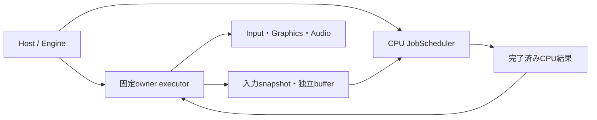

# ADR-CORE-0003: 所有スレッドとスレッド非依存のCPUジョブ実行

- 状態: 提案
- 日付: 2026-10-11
- 関連カテゴリ: engine、platform、input、graphics、animation、diagnostics

## 背景

Lumyteには、構築した物理スレッドで操作するInput、Activate時に所有者を固定する診断の実行ポイント、BrowserのJS interopなどのスレッド制約と、独立したデータに対して並列化できるCPU処理がある。Graphicsは各backendの制約と呼び出し側の同期に従い、RenderGraphはowner threadで記録する。すべての描画deviceへ一律の構築スレッド制約を追加するものではない。lockによる排他、仕事の順序、物理スレッドの固定は異なる契約である。また、Browserではmanaged threadを作れない構成が通常であり、非同期APIがあることは並列に実行できることを意味しない。

本ADRは固定所有スレッドへの配送とCPUジョブを共通の実行基盤として定義する。所有者・有界キュー・ホストのPump、専用thread自身が駆動する周期更新、CPUジョブの依存関係、スレッドなしでの進行、起動と終了を一つの契約として扱う。配置はcoreカテゴリとし、ホストや各機能はこの基盤を明示的に組み合わせる。

このPRの成果物は設計案である。実装プロジェクト、API実装、性能測定結果は含まない。実装時の検証条件を後述し、調査した他ライブラリの性能特性をLumyteの実測値として使わない。

## 決定

### 実行場所と責務

次の三つを区別する。

| 要求 | 提供する仕組み | 保証と利用例 |
| --- | --- | --- |
| 特定の物理スレッドで直列実行 | `IThreadExecutor` とownerのPump／専用thread | 生成から解放まで固定。Input、Window、JS interop、device操作 |
| 順序・非重複だけが必要 | CPUジョブ間の明示的な依存辺 | 先行完了後に後続開始。同じworkerになる保証はない |
| 相互に独立したCPU計算 | CPUジョブグラフと範囲分割 | nativeでは並列化可能。threadlessでは同じ依存関係で順次処理 |

「workerを一つにする」設定をowner保証の代用にしない。複数のHost／Game／Render／Audioの役割を同じexecutorへ割り当てられるようにし、機能数に比例してthreadを作らない。OSのメッセージループやSTAを必要とする役割は、適切なホストthreadに固定する。

CPUジョブにowner指定を混在させない。ジョブグラフはCPU計算だけで閉じ、Inputのsnapshot取得 → CPU計算 → ownerで結果適用という外側のworkflowで接続する。これにより、CPUジョブの進行が描画phaseのPumpを待つ循環を作らない。複数graphや複数frameで同じ可変対象を扱う場合も、外側のworkflowが先行runの完了を確認してから次を投入する。

配置は、所有スレッドへの配送を `src/Core/Lumyte.Threading/`、CPUジョブを `src/Core/Lumyte.Jobs/` とする。名前空間・NuGet名も各プロジェクト名に揃える。どちらもBCLに依存し、互いとInput／Graphics／Diagnostics／DIには依存しない。Engineまたはアプリの統合コードが両方を構成する。この設計PRではフォルダや空プロジェクトを追加しない。



### 所有スレッドへの配送API

比較元はmain `81bba9e6a30ae7d2e926d0cf3247c140cca3502c`。そこには `Lumyte.Threading` がなく、以下はすべて追加の提案である。所有スレッドへの配送とCPUジョブを本ADRで一緒に定義する。宣言は主要メンバーの抜粋とする。

```diff
+namespace Lumyte.Threading
+{
+    public interface IThreadExecutor
+    {
+        // 非空の診断用名称。一意性やthread識別には使用しない。
+        string Name { get; }
+        // 固定ownerかを確認する。受付状態や安全なframe phaseは保証しない。
+        bool CheckAccess();
+        // owner以外ならInvalidOperationException。
+        void VerifyAccess();
+        // 任意producerから同期区間をenqueueし、その終了を通知。async voidは禁止。
+        ValueTask InvokeAsync(Action action, CancellationToken cancellationToken = default);
+        // TがTask／ValueTaskでも内側の完了は追跡しない。
+        ValueTask<T> InvokeAsync<T>(Func<T> action, CancellationToken cancellationToken = default);
+    }
+
+    public sealed class ExecutionQueueFullException : InvalidOperationException
+    {
+        // 未受理を表す。callbackは一度も実行されていない。
+        public ExecutionQueueFullException(string executorName);
+        public string ExecutorName { get; }
+    }
+
+    public sealed class HostThreadExecutor : IThreadExecutor
+    {
+        // 現在のhost threadを借用。capacity > 0、待機件数の上限。
+        public HostThreadExecutor(string name, int capacity = 256);
+        // owner限定・再入拒否。開始時点の待機仕事から最大件数を実行。
+        public int Pump(int maxWorkItems = 64);
+        // thread-safe・冪等。受付を閉じ、受理済み仕事はdrainする。
+        public void Complete();
+        // 全受理済み仕事と内部後始末の終了。待機中もhostがPumpを続ける。
+        public Task Completion { get; }
+        // IThreadExecutorの全メンバーを実装する。
+    }
+
+    public sealed class DedicatedThreadExecutor : IThreadExecutor
+    {
+        // 専用managed threadを起動し、受付準備完了後に返す。OS loop／STAは提供しない。
+        // Browserは初期対象外。他のthread非対応環境もPlatformNotSupportedExceptionで失敗する。
+        public static ValueTask<DedicatedThreadExecutor> CreateAsync(string name, int capacity = 256);
+        // thread-safe・冪等。受付を閉じ、周期更新を停止して受理済み仕事をdrainする。
+        public void Complete();
+        // 以後callbackを実行せず、専用threadの終了処理を終えた時点で完了。
+        public Task Completion { get; }
+        // IThreadExecutorの全メンバーを実装する。
+    }
+}
```

`name`と例外の`executorName`は非空、capacityとmaxWorkItemsは正値とする。null callbackを含む引数不正は同期的に引数例外を投げる。専用thread非対応や起動失敗はCreateAsyncの返すValueTaskを失敗させ、部分的に生成した実行資源を片付ける。ホストはthread利用可能性を確認して構成を選び、非対応時に起動失敗を試してからfallbackする運用にしない。

### 所有者とホストの責務

HostThreadExecutorのownerはコンストラクターを呼んだ物理thread、DedicatedThreadExecutorのownerは新しく起動した専用threadである。一度決めたownerは終了まで変更しない。`AsyncLocal`、Task ID、たまたまworkerが一つであることを判定に使わない。CheckAccess／VerifyAccessは終了後も同じowner判定を行い、受付終了を確認するAPIの代用にはならない。

Host／Game／Render／Audioの役割へ、構成側がexecutorをコンストラクター引数などで明示的に渡す。staticな現在のexecutorやサービスロケーターは設けない。初期構成では同じhost executorを共有し、既存backendの契約が許す場合だけRenderやAudioを専用threadへ分離する。Window・Input取得などOSイベントやSTAが必要な役割を汎用の専用executorへ移さない。HostThreadExecutorはOSメッセージループやrequestAnimationFrameを開始・停止しない。

専用executorは通常の配送に加え、明示的に登録した周期更新を所有threadから直接駆動できる。周期と制御要求の取り込み予算は統合側が起動時に指定し、毎回のUpdateを外側から配送しない。Game／Renderを分離するときはframe番号付きの不変snapshotまたは所有権を移したbufferを有界の枠で渡す。受け手が返す前に書き換えず、frame省略の方針も統合側が決める。

### 受付・順序・キャンセル

配送は同期区間に限り、ownerからのInvokeAsyncも常にenqueueする。同時producerを受付地点で順序付け、受理したcallbackをFIFOで一度だけ実行する。取消で開始を抑止した要求は実行しない。異なるexecutor間の全順序は保証しない。適切なphaseのownerからはVerifyAccess後に直接操作できるが、その操作はqueueのFIFO順序に含まれない。

容量は待機件数の上限であり、実行中の一件は別に数える。捕捉するPCMやsnapshotのbyte上限は統合側が管理する。満杯は `ExecutionQueueFullException`、受付終了は `ObjectDisposedException` として返すValueTaskを失敗させ、callbackを受理しない。隠れた無制限の待機queueは作らない。未受理なら資源と解放責任は呼び出し側に残る。要求元への拒否、後のturnでの再試行、音量など最新値の明示的な集約は利用側が選び、executorが再生・停止・解放を勝手に捨てたり集約したりしない。

既に取消済みのtokenは受付前にcanceled ValueTaskを返す。受理後の取消と開始は原子的な確定点で競合を解決する。取消が勝てばcallbackを呼ばず待機枠を返し、ValueTaskを取り消す。開始が勝てば同期callbackを最後まで追跡し、成功結果または例外を返す。開始後の取消だけで通知を先に終わらせないため、生成した資源が返却前に所有者を失うことを防げる。引数検証、受付前取消、受付状態と容量の順に確認し、Completeと受理の競合も同じ受付地点で決める。

callbackの例外はそのInvokeAsyncへ伝え、他の仕事やexecutorの正常終了を妨げない。返されたValueTaskは呼び出し側が一度観測する。複数箇所で観測する必要があれば一度AsTaskして共有し、fire-and-forgetのPostは設けない。予期しない内部障害では受付を閉じ、未実行要求を失敗させる。開始済みcallbackは終了まで追跡し、その後executorのCompletionも失敗させる。

### Pump・非同期処理・配送の完了

hostは安全な更新位置でPumpを呼ぶ。誤ownerとPump再入は `InvalidOperationException`。開始時点の待機仕事から最大maxWorkItems件のcallbackを処理し、途中で投入された仕事は次のPumpへ残す。戻り値は実行したcallback数で、開始前に取り消した要求を含めない。予算は件数であり時間の上限ではない。実行中のcallbackを中断できないため、大きなuploadや長い処理は呼び出し側で分割する。

配送するcallbackにasync void、ブロッキングI/O、GPU待機を使わない。`Func<T>`がTask／ValueTaskを返しても、executorが追跡するのは内側の非同期処理を開始して戻るまでである。必要ならownerで開始したTaskをcallback外でawaitし、関連する資源の寿命も外側のworkflowが追跡する。内側の継続がownerを要求する場合は、その非同期APIとhost自身が契約を満たす必要がある。executorがSynchronizationContextを差し替えて任意のasync delegateを固定threadへ閉じ込めることはしない。

ownerから未完了の配送、I/OやCPUジョブを `.Wait()`、`.Result`、`GetAwaiter().GetResult()` で待たない。同じexecutorだけでなく別executorとの相互待機や、複数の役割が同じinstanceを指す場合にも適用する。待機中の再入Pumpも使わない。外側のworkflowが非同期に順序を組み立て、hostは独立してPumpを駆動する。

完了継続はcallback内でinline実行しない。BCL／host runtimeがTaskの継続を配送することと、owner callbackを実行するthreadの固定は別の契約である。InvokeAsyncのawait後がownerであるとは保証しないため、次のowner操作も明示的に配送する。Browserでも通常のイベントループによる継続とPumpを維持し、主threadをblockしない。

Completeは受付を閉じ、受理済みの単発callbackを取り消さずdrainする。Dedicatedで周期更新が有効なら、後述のloop停止も要求する。Hostではその後もownerからPumpを続け、専用executorは自身の処理ループで進める。通常のcallback失敗は個々のInvokeAsyncに残し、全受理済み仕事と実行器の後始末が終わればexecutorのCompletionは正常に完了する。完了後のHost.Pumpは0を返す。executorは借用host threadを終了せず、資源の自動解放、GPU完了、Audio再生、callbackが開始した外部I/Oの完了も追跡しない。

UI、ユーザー操作を要するWeb Audioの再開、Browserのframe取得からPresentまでの同期区間はhostの既存制約に従う。一般queueへ移すことでユーザー操作の有効期間や借用frameを次turnへ持ち越してはならない。例えばAudioの再開はユーザー操作handler内で最初のawaitより前に開始し、同一turnが必要な描画は準備を済ませてからframeを取得する。

### 所有資源と統合側の契約

deviceを固定ownerで扱う構成では、生成、子の生成・利用・解放、device解放まで同じownerへ配置する。リソース取得とデコードは外で進め、deviceへ依存する生成・転送・解放だけを配送する。resource managerなどのlockを保持してcallbackを呼んだり配送完了を待ったりしない。借用bufferとdeviceの利用権は、配送の完了と外部側の使用終了の両方を満たすまで保持する。

device復旧やscene終了をまたぐ要求には統合側の世代番号を持たせ、実行時にも有効性を確認する。古い要求を新しいdeviceへ無条件に適用しない。既に生成した資源の解放は元のownerへ戻し、未受理や失敗時も参照と解放責任を保持する。cleanupには取り消されたload tokenを流用しない。

音声のリアルタイムcallbackはmanaged配送queueやCPUジョブへ投入して完了を待つ場所ではない。将来のstream接続は事前に準備した有界bufferから消費し、callbackへ割り当て、I/O、lock、Task待機を持ち込まない。

### 所有スレッドが駆動する周期更新

継続的なAudio制御や一定周期のSimulationは、外側が毎回InvokeAsyncでUpdateを配送する構成にしない。DedicatedThreadExecutorへ同期更新callbackを一度だけ登録し、以後は同じ専用threadが自身の単調時計と待機機構で直接呼ぶ。更新ごとのTask、queue entry、他threadとの要求・完了の往復を作らず、送り手のframeやThreadPoolの空きを周期の起点にしない。

初期化・単発の制御・解放には既存InvokeAsyncを使い、周期更新中は制御要求を各更新境界で取り込む。周期更新、制御callback、初期化・解放はいずれも同じownerで非並行に実行する。一つのexecutorにつき有効な周期更新は一つとし、同じ周期の複数機能は一つのcallbackが決めた順に直接更新する。OSメッセージ処理や描画のPresentをこの周期へ無条件に移さない。

以下は同じ比較元mainに対する `Lumyte.Threading` の追加API案である。

```diff
+namespace Lumyte.Threading
+{
+    // 同期・短時間で返す。async、I/O／GPU／別executor／job完了の待機は禁止。
+    public delegate void ThreadLoopAction(in ThreadLoopTick tick);
+
+    public sealed class ThreadLoopOptions
+    {
+        // period > 0、maxControlWorkItems > 0、0 < maxControlTime < period。
+        // 値は構築後不変。周期と予算は用途ごとに明示する。
+        public ThreadLoopOptions(TimeSpan period, int maxControlWorkItems, TimeSpan maxControlTime);
+        public TimeSpan Period { get; }
+        public int MaxControlWorkItems { get; }
+        public TimeSpan MaxControlTime { get; }
+    }
+
+    public readonly struct ThreadLoopTick
+    {
+        // 起点からの周期番号。最初の予定は1。初回実行も遅延で1より大きくなり得る。
+        public long Index { get; }
+        public TimeSpan Period { get; }
+        // いずれも登録時の単調時計の起点からの経過時間。
+        public TimeSpan ScheduledTime { get; }
+        public TimeSpan StartedTime { get; }
+        // 前のUpdate開始からの実経過時間。初回は起点から。
+        public TimeSpan Elapsed { get; }
+        // 前回実行のIndexとの間に実行しなかった周期数。初回も起点から数える。
+        public long SkippedTicks { get; }
+    }
+
+    public sealed class ThreadLoopHandle
+    {
+        // 任意threadから呼べる冪等な停止要求。通常の制御queue容量を消費しない。
+        public void RequestStop();
+        // 以後Updateを開始せず、開始済みUpdateが返ると完了。失敗時は例外を伝える。
+        // Taskは登録ごとに一つ。完了は制御queueのdrainや資源解放を意味しない。
+        public Task Completion { get; }
+    }
+
+    public sealed class DedicatedThreadExecutor : IThreadExecutor
+    {
+        // owner限定。通常は初期化完了後のInvokeAsync内で一度呼ぶ。
+        // 最初の予定時刻は登録時刻 + period。呼び出し内でUpdateは実行しない。
+        public ThreadLoopHandle StartPeriodic(ThreadLoopOptions options, ThreadLoopAction update);
+        // 前節のCreateAsync、InvokeAsync、Complete等も実装する。
+    }
+}
```

null引数、非正または表現可能範囲を超える周期・予算は引数例外とする。StartPeriodicは別threadからの呼び出し、有効なloopが既にある場合、そのexecutorの更新callback内からの呼び出しを `InvalidOperationException`、受付終了後を `ObjectDisposedException` として同期的に拒否する。登録に失敗した場合はloopを残さない。成功すると現在の制御callbackが返った後から周期駆動へ切り替える。停止済みhandleを再利用せず、再開は停止完了の観測後に新たなStartPeriodicで行う。

StartPeriodicとCompleteは同じlifecycleの確定点で順序付ける。登録が先ならCompleteはそのloopも停止し、Completeが先ならStartPeriodicは未登録のまま受付終了で失敗する。受付確認とloop設置の間に終了処理が抜ける競合を許さない。

#### 周期、締切と遅れた更新

起点を `t0`、周期を `P` として、予定時刻を `t0 + n * P`、当該更新の終了目標を `t0 + (n + 1) * P` とする。wall clockの変更に影響されない単調時計を使い、Update終了後にPだけsleepして周期を累積的にずらさない。native待機実装は、次の予定時刻までの残り時間と停止通知を扱い、早いwakeやspurious wakeでは時計を再確認する。Task.DelayやThreadPool timerを一回ごとの起動源にはしない。idle時の待機はexecutor内部だけで行い、callback内の同期待機を許可するものではない。

初期方式は遅延分を省略する方式に統一する。内部では次の予定番号と直近に実行した番号を保持し、次の順で進める。

1. 予定時刻に達したら、wake時点で到来済みの最新の周期番号nを選ぶ。飛ばした周期のUpdateをqueueへ積まない。
2. 後述の制御要求取り込みを行い、その後の実時刻をStartedTimeとしてUpdateを一度直接呼ぶ。制御処理中に時間を超過しても、このnを後ろへ付け替えて遅延を隠さない。
3. SkippedTicksは `n - 前回実行番号 - 1`、Elapsedは前回Update開始から今回開始までの実時間とする。初回の前回番号は0、前回開始はt0とする。
4. Update終了時刻より後にある最初の予定時刻を次に選ぶ。実行中に過ぎた周期は省略し、次のSkippedTicksにも含める。経過した回数だけ連続Updateするcatch-upは行わない。

例えば周期10msで初回予定が10ms、実行開始が12ms、終了が37msなら、次回予定は40msとなる。初回Index=1、次回Index=4、次回SkippedTicks=2であり、20msと30msの更新を後追いしない。途中で停止して次回callbackがない場合も、省略と締切超過は診断集計へ残す。

固定stepのsimulationが必要なら、componentがElapsedをaccumulatorへ加え、明示した最大substep数と残余時間の破棄／持ち越し方針を持つ。schedulerが可変Elapsedを固定stepへ変換したり、無制限catch-upで制御要求や他の仕事を止めたりしない。初期APIは動的な周期変更を持たず、停止して新しい登録で起点を設定し直す。

#### 制御要求を取り込む境界

loop稼働中のInvokeAsyncは、次の周期境界で取り込む有界FIFOへ入る。投入は更新を早めたり予定時刻をリセットしたりしない。各境界の開始時点のqueueから、MaxControlWorkItemsまたはMaxControlTimeのどちらかに達するまで同期callbackを処理し、その後にUpdateを呼ぶ。途中の新しい投入は次の境界へ回す。取り消された要求の整理でも時間予算を確認し、callbackは内部lockの外で実行する。

実行中callbackは中断できないため、一件の制御要求が予算を超える可能性は残る。通常の待機時間は周期と滞留件数に依存し、満杯時は未受理で返す。長いupload、I/O、shader compileなどを同じ周期executorへ投入せず、事前準備するかloop停止中に行う。短い制御要求とUpdateの合計が周期に収まるよう測定する。

値の最新状態だけが必要な音量などは、統合側が更新を集約して送ることもできる。再生・停止・解放のような順序を持つ操作はFIFOを維持し、queueが勝手に捨てない。外側は要求完了を観測するが、各frameでUpdateの配送と完了を待つ構成にはしない。ownerから外側へは完成したsnapshotや有界bufferを公開し、他threadがその場で返事をすることをUpdateの進行条件にしない。

#### 停止、失敗と資源寿命

RequestStopは通常queueとは別の状態とwake通知で受理し、満杯や次回予定時刻を待たずに専用threadへ通知する。停止とUpdate開始は原子的な確定点で競合を解決し、停止が勝てば次のUpdateを開始しない。開始が勝てばその一回の終了を待つ。制御callback実行中も強制中断せず、返った時点で停止を確認する。停止要求はUpdate自身からも呼べるが、そのCompletionをcallback内で待ってはならない。

handleは一回の登録に結び付く。停止済みの古いhandleへRequestStopしても、後から登録した別のloopには作用しない。

handleのCompletionは開始済みUpdate終了後に確定し、書き込みを観測側へ公開する。停止後は通常の専用executorへ戻って受理済み制御要求を処理できる。loop停止は制御要求の取消や受付終了ではない。停止完了後にも古い制御要求が実行され得るため、通常終了ではproducerを先に止め、FIFOでownerのcleanupへ進む。

Update例外では自動再試行せずloopを停止し、handleのCompletionを失敗させる。executorの配送機構は後始末のため維持する。通常の制御callback例外はそのInvokeAsyncだけを失敗させ、loopを止めない。回復不能なexecutor内部障害では、既存の受付閉鎖と要求の失敗に加えて有効なloopも失敗させ、開始済みcallbackの終了を追跡する。新しいloopを開始するかは呼び出し側が状態を検査して決める。

正常終了はproducer停止 → loopのRequestStopとCompletion観測 → CPU仕事・外部I/Oの完了 → ownerで資源解放 → executor.CompleteとCompletion観測の順とする。executor.Complete自体も有効なloopへ停止を要求してから受理済み制御要求をdrainするが、資源解放を代行しない。先にCompleteしてからcleanupを投入してはならない。handleやexecutorの完了継続はcallback内でinline実行しない。

#### host・Browserと音声の実時間処理

HostThreadExecutorへは自動timerやStartPeriodicを追加しない。host自身が持つframe／イベントloopの適切なphaseで同期Updateを直接呼ぶ。threadなし環境では同じcomponentをhostへ割り当て、必要ならhostの単調時刻で更新要否を判定する。hostのturnより短い周期を保証できず、非表示タブで停止すればその間は進まない。OSイベント、requestAnimationFrame、vsync、AudioWorkletなど既存hostの駆動源を尊重し、専用managed thread用の待機をBrowserへ持ち込まない。

周期Audio.Updateは再生状態の管理や制御要求の反映であり、音声sampleの供給時計にはしない。実際のPCM消費・生成はnative device callback、既存ミキサー、AudioWorkletなど音声backendの駆動源に従う。そこからInvokeAsync、CPUジョブや周期loopの完了を待たない。データは事前に用意した有界bufferや状態snapshotで渡し、buffer不足時の無音化などは音声backend側で定義する。OS／GC／timerの遅延があるmanaged周期loopで音声のhard realtimeを保証するものではない。

専用thread化で外側のframe遅延とThreadPoolのqueue待ちを周期から分離できるが、GC、OS scheduling、長い制御callback、Update自体の超過は残る。既定でbusy spin、OSのrealtime優先度、プロセス全体のtimer分解能変更、GC停止を要求しない。予定時刻との差、実行時間、締切超過、省略数、制御要求の反映遅延を測定し、soft realtimeとして評価する。

### CPUジョブの単位と依存関係

一つの `JobGraph<TContext>` は不変のDAGであり、毎frame作り直さず再利用する。Builderが仕事と依存辺を登録し、Buildで循環・異なるBuilderのID・重複辺を検査して確定する。`DependsOn(after, before)` はbeforeの全仕事が正常に完了してからafterを実行する。自己依存と循環は拒否し、重複辺は一辺へまとめる。

通常ノードは一つの短い同期callback、範囲ノードは `[0, length)` を重複しない連続範囲に分けたcallback群である。範囲内は呼び出し側がループする。`batchSize`は一回のcallbackの最大要素数とし、最終範囲だけ短くなる。同じ範囲ノードのcallbackは並行実行され得る。全範囲の成功がノードの成功となり、後続ノードを一度だけreadyにする。長さ0はcallbackを呼ばず正常完了し、後続へ進む。

長さはrunごとに `getLength(context)` で一度取得する。これは投入thread上で、scheduler内部lockの外で行う短い副作用のない処理とする。snapshot内の要素数だけを参照し、ownerオブジェクトやI/Oへアクセスしない。負数や例外は投入失敗であり、ジョブは一つも受理しない。0件だけのrunでも依存関係と完了通知は通常どおり処理する。

Contextは値型としてrunにコピーするが、含まれる参照先は深いコピーをしない。static delegateと明示Contextを基本とし、graphにframe固有のclosureを捕捉しない。入力snapshot、出力範囲、借用bufferの所有者は呼び出し側が管理し、runの完了まで書換え・返却・解放を行わない。同じgraphを複数runで使えるが、Contextの参照先まで共有してよいとは限らない。

単一runで直列にしたい操作は辺で結ぶ。別run間にも非重複が必要なら先行run完了後に次を受理させる。グローバルなSerialフラグや暗黙のresource lockを設けない。同じ再生者、出力、イベントsinkへ同時にアクセスしないことは利用者の契約であり、並行アクセスの自動推論は初期対象外である。

### CPUジョブAPIの追加差分

比較元はmain `81bba9e6a30ae7d2e926d0cf3247c140cca3502c`。そこには `Lumyte.Jobs` がなく、以下はすべて追加の提案である。宣言は主要メンバーの抜粋とする。

```diff
+namespace Lumyte.Jobs
+{
+    // 呼び出し中だけ有効なcontextのreadonly参照。async voidは禁止。
+    public delegate void JobAction<TContext>(in TContext context) where TContext : struct;
+    public delegate int JobLength<TContext>(in TContext context) where TContext : struct;
+    public delegate void JobRangeAction<TContext>(
+        in TContext context, int startInclusive, int endExclusive) where TContext : struct;
+
+    // Builder固有のID。defaultと別BuilderのIDは無効。
+    public readonly struct JobNodeId;
+
+    // 単一threadで構築。Build後の編集は拒否し、Buildの再呼出しは同じgraphを返す。
+    public sealed class JobGraphBuilder<TContext> where TContext : struct
+    {
+        public JobGraphBuilder();
+        public JobNodeId Add(string name, JobAction<TContext> action);
+        // getLengthは投入側で評価。batchSize > 0、範囲の最大要素数。
+        public JobNodeId AddParallel(string name, JobLength<TContext> getLength,
+            int batchSize, JobRangeAction<TContext> action);
+        public void DependsOn(JobNodeId after, JobNodeId before);
+        public JobGraph<TContext> Build();
+    }
+
+    // 不変で再利用可能。空graphも有効。公開constructorは持たない。
+    public sealed class JobGraph<TContext> where TContext : struct
+    {
+        public int NodeCount { get; }
+    }
+
+    public enum JobExecutionMode { Cooperative, ThreadPool }
+    public enum JobRunStatus { Pending, Running, Succeeded, Canceled, Faulted }
+    public enum JobShutdownMode { Drain, CancelPending }
+
+    public sealed class JobSchedulerOptions
+    {
+        // 正の値。既定64。未完了runの最大数。
+        public int MaxInFlightRuns { get; init; } = 64;
+        // 正の値。既定4096。未完了runが予約するノード数の合計上限。
+        public int MaxInFlightNodes { get; init; } = 4096;
+    }
+
+    public sealed class JobScheduler
+    {
+        // 現在threadを借用。CPU workerを生成せず、jobをThreadPoolへ投入しない。
+        public static JobScheduler CreateCooperative(JobSchedulerOptions? options = null);
+        // maxConcurrency > 0。hostがthread利用可能と判断した環境だけで使用。
+        // Browserは初期実装ではPlatformNotSupportedException。CPU数から自動選択しない。
+        public static JobScheduler CreateThreadPool(int maxConcurrency,
+            JobSchedulerOptions? options = null);
+        public JobExecutionMode Mode { get; }
+        // Cooperativeでは1。専用threadの本数ではなく、同時callback数の上限。
+        public int MaxConcurrency { get; }
+        // 容量不足だけfalse + run=null。全runを一括受理し、呼び出し内でjobを実行しない。
+        public bool TrySchedule<TContext>(JobGraph<TContext> graph, in TContext context,
+            out JobRun? run, CancellationToken cancellationToken = default) where TContext : struct;
+        // Cooperativeの所有thread限定。再入拒否。両予算は正値。
+        // 通常callback一つ／範囲callback一つをwork itemとして数える。
+        public int Pump(int maxWorkItems, TimeSpan maxElapsed);
+        // thread-safe・冪等。最初の呼び出しが停止modeを確定する。
+        public void BeginShutdown(JobShutdownMode mode = JobShutdownMode.Drain);
+        // 受付終了と全runのterminal化後、backendが以後jobを開始せず後始末を終えた時点で完了。
+        public Task Completion { get; }
+    }
+
+    // runごとに独立した参照。公開constructorなし、利用者へ公開したinstanceはpool再利用しない。
+    public sealed class JobRun
+    {
+        public JobRunStatus Status { get; }
+        // Succeeded／Canceled／Faultedでtrue。true観測は完了済み書き込みを公開する。
+        public bool IsCompleted { get; }
+        // 参照時に必要なら一つだけ生成。成功／取消／例外を通知する共有Task。
+        // Taskの同期Waitは使わない。await後のthreadは保証しない。
+        public Task Completion { get; }
+        // 未完了はInvalidOperationException、取消はOperationCanceledException、
+        // 失敗は全callback例外を保持するAggregateException。
+        public void ThrowIfFailed();
+    }
+}
```

名前は非空の診断用文字列で、識別や依存解決には使わない。同名を許す。null delegate／graph、無効ID、負数の長さ、非正の設定は引数例外とする。循環とBuild後の編集は `InvalidOperationException`。optionsは生成時にコピー・検証する。Buildに失敗したBuilderは編集可能なままとする。

`TrySchedule`は任意producerから呼べるが、任意のschedulerのjob callback／getLength内からの再投入は `InvalidOperationException` とする。終了後は `ObjectDisposedException`。既に取消済みtokenなら `OperationCanceledException` を同期的に返し未受理とする。graph単体のNodeCountが容量上限を超える場合は、待っても成功しないため `ArgumentException` とする。受理前にrun枠と全ノード枠を一括予約し、容量不足・終了との競合による部分実行を認めない。容量不足ではgetLengthを省略してよい。getLength評価後も受付と容量を再確認し、評価しただけでは受理済みとしない。

runの受付線形化点を過ぎた取消は受理後の取消として扱い、必ず非nullのrunを返す。`TrySchedule`自身はjobをinline実行しないが、ThreadPoolの別threadでは戻る前に開始・完了し得る。run間の開始・完了順は保証しない。

### 進行・完了・失敗

`Pending`は受理済みでcallback未開始、`Running`は一つ以上のcallbackを開始済み、terminalは `Succeeded`／`Canceled`／`Faulted` とする。空graphはPendingからSucceededへ直接遷移できる。terminal状態は変化しない。

依存カウンターと完了通知はrelease/acquire相当で同期する。先行callbackの書き込みは後続callbackと、IsCompleted=trueの観測／Completionのawaitに成功した消費者から見える。CPU完了はGPU fence、Audio再生、外部I/Oの完了を意味しない。並列の範囲・兄弟ノードの実行順や浮動小数点reductionのbit一致は保証しない。再現性が必要なら範囲別の出力を後続の固定順で集約する。

例外または取消要求を観測するとrun全体を停止方向へ進め、未開始callbackを抑止する。停止と開始は原子的な確定点で競合を解決する。開始が勝ったcallbackは最後まで実行させ、終了までcontextとbufferの借用を維持する。依存待ちノードも終了会計へ含め、handleを永久にPendingにしない。既に成功したcallbackの副作用はロールバックしない。

全開始済みcallbackの終了後、例外が一つでもあればFaulted、なければ受理後の取消が成功確定より先に観測された場合Canceled、それ以外Succeededとする。例外はrun内で収集し、全体をAggregateExceptionとして観測できる。callbackが自ら投げた `OperationCanceledException` も通常の失敗であり、制御tokenによるschedulerの取消とは区別する。兄弟ノードの開始タイミングによって完了した副作用の範囲は変わり得る。

terminal化時にcontext参照とscheduler内部のノード枠を返し、JobRunには安定した状態と例外情報だけを残す。公開JobRunとCompletionのTaskを別runへ再利用しないため、古いhandleが新しい実行を指すことはない。内部slotには世代を持たせ、遅い通知が再利用後のslotを変更しないよう検証する。run全体のTaskは任意で一つ、ノードや要素ごとには作らない。外部await継続はjobの完了処理内でinline実行しない。

Cooperativeが使わないのはCPU workerの生成・jobのThreadPool配送・完了の同期待機である。Taskの非同期継続はBCLとホストruntimeの仕組みで配送され、nativeではThreadPool、threadなしBrowserではイベントループを使い得る。これはCPUジョブのbackendとは別であり、継続の実行場所をschedulerが保証するものではない。ホストはawait継続とPumpの両方を進行させる。Taskを必要としないframe loopはIsCompletedとThrowIfFailedで観測できる。

### ThreadPoolとスレッドなしのbackend

初期native backendは.NET ThreadPoolを利用し、scheduler自身が同時実行数と受理量を制限する。固定専用CPU poolを先に作らない。ThreadPoolはプロセス共有のため、他のI/O継続と競合し、frame deadlineやworkerのidentityを保証しない。`SetMinThreads`／`SetMaxThreads`でプロセス全体を変更しない。

readyノードをすべてTaskにする方式は採らず、最大MaxConcurrency個のdrain callbackがready仕事から範囲を獲得する。範囲を配列として全展開せず、次の開始位置をclaimするcounterで管理する。runごとの可変状態とready情報は予約したノード数と同時実行数に比例させ、lengthに比例するTask／queue entryを作らない。graph自身の共有する依存配列はノード数＋辺数に比例し、runごとに複製しない。仕事がない場合はdrain callbackを返し、ready追加との競合をlost wakeupなく解決する。長いdrainによる共有pool占有を避けるため、実装時に件数／時間で再配送する量を測定する。

Cooperative backendは独立した実行経路とし、workerを起動して失敗してからfallbackする方式にしない。TryScheduleはキューへ受理するだけで、作成threadのPumpが依存順に仕事を進める。未完了JobRunをawaitするだけでは仕事は進まない。ホストの各turnにPumpを接続し、初期化・通常frame・終了の各段階でも駆動する。

Pumpは開始時点までに受理したrunを対象とし、そのrun内で新たにreadyになった後続も残り予算で実行できる。途中で受理したrunは次回へ回す。readyなrunをround-robinで選び、一つの巨大な範囲ノードが他runを飢餓させない。実行前に件数と経過時間を確認し、開始したcallbackは中断しない。これはsoft budgetであり、長いcallbackがframeを超えることは防げない。単一の範囲callbackが収まるbatchSizeを利用者が選ぶ。時間計測には単調時計を用いる。

予算確認はユーザーcallbackだけを対象にしない。長さ0ノードの完了伝播、取消による未開始ノードの整理も、各ノードの状態遷移と依存辺の有界な小バッチごとに経過時間を確認し、途中状態を次のPumpへ持ち越せるようにする。再帰でDAG全体を一度に完了させない。maxWorkItemsと戻り値は実行したcallback数であり、内部整理だけを進めて0を返すこともある。0は全run完了を意味しないため、進行と終了の判断には各Completionを使う。

| 環境 | owner処理 | CPU backend | 同期待機 |
| --- | --- | --- | --- |
| Windows／Linux | Host、必要時だけDedicatedと周期loop | ThreadPoolまたはCooperativeを明示選択 | owner／job callbackでは禁止 |
| Browser・通常のthreadなしWasm | main contextのHost | Cooperative | 禁止。各turnをJSへ返す |
| Browser・thread対応Wasm | JS interopのownerは別途維持 | 初期実装ではCooperative | mainをblockしない |
| その他のthread作成不可host | 既存host threadのHost | Cooperative | hostイベント処理を止めない |

.NET 10では公開の汎用thread-capability APIを前提にしない。`Environment.ProcessorCount`が複数でもthreadが作れるとは限らない。ホストが配置・ビルド条件に基づいてfactoryを選ぶ。ThreadPool backendの起動や実行機構に内部障害があれば新規受付を閉じ、受理済みrunを実行中callbackの終了後に失敗させる。実行途中で別backendへ移してcallbackを再実行しない。

.NET 10のWasm multithreadingは既定無効で実験的機能として説明されている。対応runtime、`WasmEnableThreads`、SharedArrayBuffer、COOP／COEPなどが必要になる。単一CPU backendのために配信条件を変更しない。Browser worker／OffscreenCanvasの対応は、実際のhostとJS interop制約を検証する別の設計対象とする。

### ブロッキングと非同期I/O

CPU callbackは同期処理のみである。`async void`、Taskを内部に起動して完了前に戻る処理、ブロッキングI/O、GPU待機、ownerへの配送待機を禁止する。任意delegate内部の `.Wait()` を一般に検出することはできないため、API契約・利用例・回帰検証で明示する。公開の同期 `Complete(run)` や、待機しながら他のownerのPumpを呼ぶAPIは設けない。

ネストしたグラフ実行・worker内joinも初期対象外とし、依存辺または外側の非同期workflowへ展開する。`Pump`と停止操作を任意のschedulerのjob callback／getLengthから呼ぶと `InvalidOperationException`。callback内で別schedulerを同期的に待つ構成も契約違反である。これにより、全workerが子仕事を待って止まる構成と、子の完了を待たず親のbufferを返す構成を避ける。

I/Oは本来のasync APIを直接使い、待つだけの `Task.Run` を作らない。I/Oで準備したデータをCPUジョブへ渡し、CPU完了後にownerへ適用を配送する。`SynchronizationContext`や`ExecutionContext`をジョブごとにcaptureしない。AsyncLocal、thread local、ambientなDI scope／Activity／cultureに計算入力や所有権を依存させず、必要な値をContextに明示する。Cooperativeでもホストのambient状態に依存するcallbackを移植可能とは扱わない。

### DIを使わない登録と起動の利用例

マルチスレッドを使えるnative hostで、Host・Game・Renderは既存host thread、Audio制御は専用thread、CPUジョブはThreadPoolへ配置する例を示す。ここでの「登録」は、役割に対応するexecutorの参照をアプリの構成オブジェクトへ保持することである。名前からthreadを検索したり、DIや属性から自動検出したりしない。`ExecutionRoles`、`NoDiApplication`、`OwnerComponent`は例のアプリ側の型であり、Lumyteの追加公開APIではない。

起動は次の順で進む。

1. 既存hostの開始callbackでHostThreadExecutorを生成し、現在の物理threadをownerとして固定する。この操作は新しいthreadを作らない。
2. 初期化中も呼ばれるhostのturnへPumpを接続する。通常のゲーム更新を開始する前から駆動する。
3. StartAsyncがDedicatedThreadExecutor.CreateAsyncを呼ぶ。この呼び出しがAudio用threadを起動し、受付準備完了後にexecutorを返す。
4. 返されたexecutorをAudioの役割へ、host executorをHost・Game・Renderの役割へ登録する。登録自体はthreadを作らない。
5. 各executorのInvokeAsync内で、その役割を使うcomponentを生成・初期化する。constructorには同じexecutor参照を渡す。これにより、生成する場所と利用側が認識するownerが一致する。
6. 全componentの初期化後、AudioのownerでStartPeriodicを一度呼ぶ。以後のAudio制御更新は専用threadが駆動する。StartAsyncの成功をhostが確認してから通常のGame更新も開始する。

```csharp
using Lumyte.Jobs;
using Lumyte.Threading;

// アプリの役割割り当て。実行器を所有・停止するのはNoDiApplication。
sealed record ExecutionRoles(
    IThreadExecutor Host, IThreadExecutor Game, IThreadExecutor Render, IThreadExecutor Audio);

sealed class NoDiApplication
{
    private DedicatedThreadExecutor? _audioThread;
    private JobScheduler? _jobs;
    private OwnerComponent? _game;
    private OwnerComponent? _audio;

    // 必ず実際のhost thread上でnewする。async継続上で遅延生成しない。
    public NoDiApplication()
    {
        Host = new HostThreadExecutor("host", capacity: 256);
    }

    public HostThreadExecutor Host { get; }

    // StartAsyncの成功を観測するまでは利用側へ公開しない。
    public ExecutionRoles? Roles { get; private set; }
    public ThreadLoopHandle? AudioLoop { get; private set; }

    // 起動は一度。呼び出し側はこのTaskを保持して完了と失敗を観測する。
    public async Task StartAsync()
    {
        // ここで新しい物理threadを起動する。await後がhostとは限らない。
        _audioThread = await DedicatedThreadExecutor.CreateAsync("audio-control", capacity: 256);

        var roles = new ExecutionRoles(Host, Host, Host, _audioThread);
        Roles = roles; // 役割への登録。Host・Game・Renderは同じinstance。

        // CPU計算の同時数を指定する。専用threadを2本作る指定ではない。
        _jobs = JobScheduler.CreateThreadPool(maxConcurrency: 2);

        await roles.Audio.InvokeAsync(() =>
        {
            // constructorも専用Audio threadで呼ばれる。
            _audio = new OwnerComponent(roles.Audio);
            _audio.Initialize();
        });

        await roles.Game.InvokeAsync(() =>
        {
            // awaitの継続threadに依存せず、hostのPumpから呼ばれる。
            _game = new OwnerComponent(roles.Game);
            _game.Initialize();
        });

        await roles.Audio.InvokeAsync(() =>
        {
            // 周期と制御予算は説明用。必要な初期化が全て終わってから一度だけ登録。
            var options = new ThreadLoopOptions(TimeSpan.FromMilliseconds(10),
                maxControlWorkItems: 16, maxControlTime: TimeSpan.FromMilliseconds(1));
            AudioLoop = _audioThread.StartPeriodic(options,
                (in ThreadLoopTick tick) => _audio!.Update(tick.Elapsed));
        });
    }

    // 状態が変わった時だけ呼ぶ。呼び出し側は返されたValueTaskを観測する。
    // 起動成功後からproducer停止前までの利用に限定する。
    public ValueTask SetAudioPausedAsync(bool paused) =>
        Roles!.Audio.InvokeAsync(() => _audio!.SetPaused(paused));

    // StartAsyncの終了と業務producerの停止後、一度に一呼び出しだけ行う。
    // 初期化失敗時も、生成済みの参照はfieldsに残るため同じ手順で片付けられる。
    public async Task StopAsync()
    {
        if (AudioLoop is not null)
        {
            AudioLoop.RequestStop(); // queue満杯でも停止要求を受け付ける。
            try
            {
                await AudioLoop.Completion; // Updateが返るまで資源を解放しない。
            }
            catch (Exception error)
            {
                // loopの失敗を観測して記録する。ownerでの後始末は続ける。
                Console.Error.WriteLine(error);
            }
        }

        if (_jobs is not null)
        {
            _jobs.BeginShutdown(JobShutdownMode.CancelPending);
            await _jobs.Completion;
        }

        await Host.InvokeAsync(() =>
        {
            _game?.Dispose();
            _game = null; // Disposeが成功した場合だけ参照を外す。
        });
        if (_audioThread is not null)
        {
            await _audioThread.InvokeAsync(() =>
            {
                _audio?.Dispose();
                _audio = null;
            });
            _audioThread.Complete();
            await _audioThread.Completion;
        }

        Roles = null;
        Host.Complete();
        await Host.Completion; // hostはこの待機中もPumpを継続する。
    }
}

// Game／Audio制御のスレッド制約を示す最小component。実際の音声deviceではない。
sealed class OwnerComponent
{
    private readonly IThreadExecutor _owner;
    private bool _paused;
    private long _updates;

    public OwnerComponent(IThreadExecutor owner)
    {
        owner.VerifyAccess();
        _owner = owner; // 利用側はこの参照から自分のownerを認識する。
    }

    public void Initialize()
    {
        _owner.VerifyAccess();
        Console.WriteLine($"{_owner.Name}: thread {Environment.CurrentManagedThreadId}");
    }

    public void Update(TimeSpan elapsed)
    {
        _owner.VerifyAccess();
        if (!_paused)
        {
            _updates++; // 実際には短い状態更新。ここでPCMを供給する例ではない。
        }
    }

    public void SetPaused(bool paused)
    {
        _owner.VerifyAccess();
        _paused = paused;
    }

    public void Dispose() => _owner.VerifyAccess();
}
```

`OwnerComponent.Initialize`の出力で、GameがhostのID、Audioが別のIDになることを確認できる。Nameは表示用であり、同名のexecutorでも同じthreadとは限らない。ThreadPoolのworkerはCPU仕事の投入時にruntimeが管理するため、役割へ登録せず、固定thread IDも利用側へ渡さない。

hostとの接続は以下のようにする。OnHostStartedとOnHostTurnは、アプリが既存のOSイベントループへ接続する同期callbackの例である。Lumyteがこのイベントループを実装するわけではない。hostは両方を同じ物理threadで呼び、起動・通常更新・終了処理中にOnHostTurnを繰り返す。

```csharp
NoDiApplication app = null!;
Task startup = null!;
bool startupObserved = false;
bool stopRequested = false;
bool ready = false;

void OnHostStarted()
{
    app = new NoDiApplication(); // 実際のhost threadをここで登録する。
    startup = app.StartAsync(); // awaitせずTaskを保持し、イベントループへ戻る。
}

void OnHostTurn()
{
    // 起動完了を条件にしてはいけない。StartAsync内のGame初期化もここで進む。
    app.Host.Pump(maxWorkItems: 32);
    if (!startupObserved && startup.IsCompleted)
    {
        startupObserved = true;
        try
        {
            // 完了済みTaskの結果だけを取得する。未完了Taskを同期waitしない。
            startup.GetAwaiter().GetResult();
            app.Roles!.Game.VerifyAccess();
            // 起動中に終了要求が来ていればGame更新を再開しない。Audioは専用loopで進む。
            ready = !stopRequested;
        }
        catch (Exception error)
        {
            Console.Error.WriteLine(error);
            stopRequested = true;
            // 更新を開始せず、生成済み資源のStopAsyncを外側の終了処理から呼ぶ。
        }
    }

    if (ready && app.AudioLoop!.Completion.IsCompleted)
    {
        stopRequested = true;
        ready = false; // 外側の終了処理へ移る。失敗したloopを放置しない。
        try
        {
            app.AudioLoop.Completion.GetAwaiter().GetResult(); // 完了済みのみ観測。
        }
        catch (Exception error)
        {
            Console.Error.WriteLine(error);
        }
    }
}
```

hostの接続順は「両callbackを登録 → OnHostStarted → OnHostTurnの反復」とする。起動Taskをawaitする外側のworkflowを使う場合も、hostのイベントループ自体は止めない。開始callbackをasync voidにしたり、StartAsyncが終わってからPumpを登録したりしない。

終了要求時はhost上でstopRequestedをtrue、readyをfalseにして新規更新・I/Oなどのproducerを止め、startupが終了したことを確認した後、StopAsyncが返すTaskを保持する。起動中の終了要求でも、後の起動成功でproducerを再開しない。OnHostTurnを続けながらそのTaskを非同期に観測し、正常終了後にhostのイベントループを終了する。起動失敗時も同様である。StopAsyncの失敗時はappと生存資源を保持して必要なPumpを続け、失敗箇所を確認して後始末を再試行する。無条件のfinallyでexecutorをCompleteしてはならない。実資源を生成するconstructor自身が失敗した場合の部分生成物は、そのconstructorが片付ける。

Audioの定期Updateは一度のStartPeriodic登録で続き、OnHostTurnやGameから更新要求を送り続けない。SetAudioPausedAsyncのような状態変更だけが制御queueを通る。例の10ms周期と1ms予算は推奨値ではなく、音声sampleの供給周期も意味しない。登録が成功すると最初の予定時刻から動くため、loopが触る依存対象はStartPeriodicより前に全て初期化する。

threadなし構成ではAudioにもHostを割り当て、StartPeriodicは使わずhostの安全な更新phaseから、hostが測った実経過時間を渡してUpdateを直接呼ぶ。componentはThreadLoopTickに依存せず、専用loopではadapterがtick.Elapsedを渡す。CPU側をCreateCooperativeにする場合は、同じhost turnからそのPumpも呼ぶ。上のnative用例をfactory一行の変更だけでthreadless対応とせず、Audioの駆動と後始末もhostの契約に合わせる。DIを後から導入する場合も、この役割割り当てと起動順を保ち、DIは設定と参照の受け渡しを担当する。

### フレームへの接続例

典型的な一回のフレームは、ownerでイベント取得・診断Pump・Input更新・snapshot作成、CPUジョブ、ownerで結果適用・イベント配送・描画の順とする。複数frameを重ねる場合はsnapshotと出力bufferも世代ごとに分離し、有界の受け渡し枠を設ける。

```csharp
// 初期化時に一度だけ構築。FrameDataは借用bufferを持つreadonly struct。
var builder = new JobGraphBuilder<FrameData>();
JobNodeId evaluate = builder.AddParallel("animation", static (in FrameData frame) => frame.Count,
    batchSize: 64, static (in FrameData frame, int start, int end) =>
    {
        // 各要素は別々の再生者・出力・イベントsinkを持つ。
        for (int i = start; i < end; i++)
        {
            frame.Evaluate(i);
        }
    });
JobNodeId gather = builder.Add("gather", static (in FrameData frame) => frame.Gather());
builder.DependsOn(gather, evaluate);
JobGraph<FrameData> graph = builder.Build();

// owner上でsnapshot取得後。falseならbufferを保持して後のturnで再試行する。
if (jobs.TrySchedule(graph, in frame, out JobRun? run))
{
    pendingRun = run;
}
```

```csharp
// awaitしないhost更新callback。初期化・終了中も必要に応じて呼ぶ。
owner.VerifyAccess();
owner.Pump(maxWorkItems: 32);
if (jobs.Mode == JobExecutionMode.Cooperative)
{
    jobs.Pump(maxWorkItems: 16, maxElapsed: TimeSpan.FromMilliseconds(1));
}

if (pendingRun is { IsCompleted: true })
{
    // 失敗時も全callbackは停止済み。try/finallyで借用bufferを返す。
    try
    {
        pendingRun.ThrowIfFailed();
        ApplyCompletedFrame(); // ownerの安全なphaseでのみ適用する。
    }
    finally
    {
        ReturnFrameBuffers();
        pendingRun = null;
    }
}
// 未完了なら前の完成済みsnapshotを使うか、このframeの描画を延期してhostへ戻る。
// Browserのframe取得・記録・Submit・Presentは同じturn内で完結させる。
```

例のbatchSize=64、件数・1ms予算は説明用であり、性能の推奨値ではない。awaitを使う外側のworkflowでも同じCPU完了を待てるが、その間のCooperative Pumpはホストが独立して呼び続ける。await後の適用には `owner.InvokeAsync` を使う。

既存のInputSystemは構築から参照・更新までownerを維持する。Animationは異なる再生者単位で評価を分割し、イベントの実処理をownerへ戻す。Diagnosticsの `IDiagnosticPump<TPoint>` は既存のexecution pointを維持し、ジョブのdrainへ置き換えない。RenderGraphのRecordとcommand bufferは現行の同期契約を維持し、ジョブ化による暗黙の並列記録やbarrier生成を追加しない。

### 起動・停止と所有権

ホストを起動し、ownerの実行場所とCPU backendを選び、ownerでdevice・機能を構築する。Host.Pumpの開始前はowner上で同期初期化を直接呼ぶ。InvokeAsyncが必要な初期化は、先に起動用のイベントループへPumpを接続してから非同期に待つ。DedicatedはCreateAsync完了時点で自身の処理ループが稼働している。DIの同期factoryで非同期初期化をblockしない。

Cooperativeの初期化でジョブを使うなら初期化用turnでもPumpを駆動する。初期化完了後だけ開始する通常frameに進行を依存させない。途中失敗時は成功済みの子からowner上で解放し、実行器の受付と必要なPumpを後始末が終わるまで残す。

終了は次の順で行う。

1. 業務の新規producerを止める。周期loopはRequestStopし、開始済みUpdateの終了と各handleのCompletionを観測する。ownerの受付・PumpとCooperativeのPumpは、この待機中から終了手順全体を通して継続する。その上でI/O workflowを完了または取消し、後からCPU仕事が投入されない状態にする。
2. `BeginShutdown(Drain)`、または未開始計算を不要とする場合は `CancelPending` を呼ぶ。どちらも新規runを拒否する。CancelPendingは全未完了runに取消を要求し、開始済みcallbackは強制停止しない。
3. ホストのCooperative Pumpを継続してschedulerのCompletionを非同期に待つ。受理済みrunごとの結果を観測し、必要なowner適用・後始末を配送して、借用bufferを返す。
4. 外部GPU／Audioの完了条件も満たして子資源、device、scopeをownerで解放する。全機能の後始末が成功したら共有instanceにつき一度executorをCompleteし、Host.Pumpを続けながらそのCompletionを非同期に待つ。drainと実行器の後始末が完了してからホストを終了する。

`JobScheduler.Completion`はジョブの個別失敗では失敗せず、それらを各JobRunに残して正常に停止する。内部障害はschedulerのCompletionも失敗させる。停止後にPumpを呼べば残りを進められ、停止完了後は0を返す。ThreadPool modeでPumpを呼ぶことは `InvalidOperationException`。停止を開始しただけではbufferを解放してはならない。

executorをCompleteしてからcleanupを配送しても未受理になる。通常queueが満杯なら受付とownerを保ったまま先行仕事を進めて再試行する。子やdeviceの解放が失敗した場合も、失敗と生存資源の参照を保持する。安全に片付けられる独立した機能だけを進め、参照が残るdeviceやexecutorを先に閉じない。

キューが空でもI/O workflowが生きていればエンジン全体の停止完了ではない。停止期限はホストが管理し、期限超過でも実行中の参照を解放したりthreadを強制終了したりしない。呼び出し側へ未完了を報告する。非表示タブではrequestAnimationFrameだけに頼らず終了用のhost turnも使うが、ブラウザーに停止された間の進行は保証できない。

## 他ライブラリの調査と性能方針

2026-10-11に以下の一次資料を確認した。C++／Rust／Unityの設計上の知見を比較し、異なるruntimeの測定値をC#へ転用しない。

| 対象 | 資料で確認した方式 | 本設計への反映 |
| --- | --- | --- |
| [.NET TPL](https://learn.microsoft.com/en-us/dotnet/api/system.threading.tasks.taskscheduler?view=net-10.0)／[ThreadPool](https://learn.microsoft.com/en-us/dotnet/standard/threading/the-managed-thread-pool) | work stealing、local queue、worker数調整。プロセス共有でthread identityを固定しない | 初期CPU backendに使用。owner固定は別executor。同時数と投入量はLumyte側でも制限 |
| [enkiTS](https://github.com/dougbinks/enkiTS#project-features) | pinned task、待機中の仕事実行、scheduling時の割り当て抑制 | ownerと自由実行を分け、内部格納を再利用。汎用の協調waitは初期APIに持ち込まない |
| [Unity IJobParallelFor](https://docs.unity3d.com/6000.0/Documentation/ScriptReference/Unity.Jobs.IJobParallelFor.html) | batch分割とatomic work stealing。軽い計算ほど大きいbatchを使う | 要素ごとのTaskを避け、範囲callbackの粒度を指定。UnityのbatchSizeは最小粒度であり本APIの最大chunk長とは異なる |
| [Taskflow](https://taskflow.github.io/taskflow/ExecuteTaskflow.html) | worker内のblocking waitによる枯渇を説明し、協調実行corunを提供 | worker内の子仕事待機を初期契約で禁止し、依存辺で表現 |
| [Rayon 1.13.0](https://docs.rs/rayon-core/1.13.0/rayon_core/#global-fallback-when-threading-is-unsupported) | threadlessでjoinは順次実行できるが、spawnの進行は自動保証しない | threadlessを明示的なbackendとし、Pumpによる進行条件を定める |
| [Bevy tasks 0.17.3](https://docs.rs/bevy_tasks/0.17.3/bevy_tasks/) | single／multi-threadで共通API、Compute／AsyncCompute／IOの区分、owner上のThreadExecutorのtick | ownerの明示駆動とCPU／I/Oの責務分離。複数poolの分割は必要性を測定して決める |
| [oneTBB](https://uxlfoundation.github.io/oneTBB/main/tbb_userguide/Controlling_Chunking_os.html) | 小さいgrainの管理費用、大きいgrainの並列性低下、partitionerによる調整 | 一律の万能batch値を定めず、仕事量・分布・threadlessのturn予算を含めて調整 |

追加の.NET 10固有資料は [Wasm features](https://github.com/dotnet/runtime/blob/v10.0.0/src/mono/wasm/features.md#multi-threading)、[Threadの実装](https://github.com/dotnet/runtime/blob/v10.0.0/src/libraries/System.Private.CoreLib/src/System/Threading/Thread.cs)、[ThreadPoolTaskScheduler](https://github.com/dotnet/runtime/blob/v10.0.0/src/libraries/System.Private.CoreLib/src/System/Threading/Tasks/ThreadPoolTaskScheduler.cs)。`Thread.IsThreadStartSupported`はinternalで公開契約に利用できない。`LongRunning`もthread非対応環境の回避策ではない。[UnsafeQueueUserWorkItem](https://learn.microsoft.com/en-us/dotnet/api/system.threading.threadpool.unsafequeueuserworkitem?view=net-10.0)のExecutionContext非伝播を前提とする場合も、前述のContext契約を維持する。

周期駆動については [.NET PeriodicTimer](https://learn.microsoft.com/en-us/dotnet/api/system.threading.periodictimer.waitfornexttickasync?view=net-10.0) のtick集約と単一consumer、[System.Threading.Timer](https://learn.microsoft.com/en-us/dotnet/api/system.threading.timer?view=net-10.0) のThreadPool callbackと重複実行の説明を確認した。PeriodicTimerのawaitは物理threadの固定を保証せず、Threading.Timerもowner executorの代用にならない。所有threadが直接Updateを呼ぶ方式を選ぶ。

[Linux clock_nanosleep](https://www.man7.org/linux/man-pages/man2/clock_nanosleep.2.html) は絶対時刻による待機が相対sleepのdriftを避けることと、実際の開始にはscheduling遅延があることを説明する。本設計はこの原則を単調時計の予定時刻へ適用するもので、全環境にPOSIX APIを要求しない。[PortAudioのcallback指針](https://portaudio.com/docs/v19-doxydocs/writing_a_callback.html) は音声需要に応じたcallbackと、allocation・I/O・mutexなど実行時間が不定な処理を避けることを示す。これをAudio制御loopと音声供給の分離の根拠とする。

性能上の初期方針は次とする。

- graphの構築・循環検出・依存配列の確保をフレーム外へ置く。delegateをgraph内に保持し、runは状態配列をpoolから借りる。実行中node数と容量予約を一致させ、動的な無制限配列拡大で上限を回避しない。
- 範囲ノードは最大batchSizeで分け、rangeが一つなら通常ノード相当の経路を使う。小仕事をenqueueすべきかは直接ループとの比較で決める。性能を理由にTrySchedule内の暗黙inline実行へ切り替えない。
- 一つのrunにJobRunを一つ確保し、Completionを参照した場合だけTaskを確保する。全経路でzero allocationとは宣言しない。例外・取消・診断有効時の確保も別に測る。
- 完了したrunの枠を返し、job数ではなくnode数＋最大同時数に比例するready情報を保持する。Contextが参照するデータ量は含まれないため、Resources／frameのbyte予算を統合側で制限する。
- ownerの配送遅延、runの待機／実行時間、拒否件数、ready数、実行中数、取消／失敗を集約する。詳細トレースはopt-inとし、要素ごとのActivity・文字列生成・高cardinalityタグを既定で発行しない。
- 周期loopは初期登録時にdelegate・handle・待機資源を用意し、各tickは値型の時刻情報と直接呼出しで進める。定常tickにTask／queue entryを作らず、制御要求の空queue確認・wake頻度も測る。ログやActivityを毎tick生成せず、遅延・締切超過・省略数を集約する。
- 独自work stealing deque、spin時間、cache line padding、専用CPU pool、frame優先度は計測後に決める。ThreadPoolの共有負荷がp95／p99を悪化させる場合に固定poolを比較し、既存backendと同じAPI契約を保つ。

### 実装時の性能測定

直接の単一threadループを基準とし、Cooperative、ThreadPool＋本scheduler、`Parallel.For`、chunk単位のTaskを同じ結果・入力・warmup条件で比較する。必要性が出た場合だけ専用poolの試作を加える。graph構築、初回JIT／AOT起動、定常実行を分離し、Linux／Windowsのx64・ARM64とthreadなしBrowserで測定する。

| 負荷 | 変える条件 | 記録する値と判断 |
| --- | --- | --- |
| 空run／noop／短い依存鎖・全長さ0の密なDAG | node数、producer数、診断on/off | 受付～完了時間、jobs/s、割り当てbytes/run。管理費用の基準 |
| Animation相当の均一配列 | 要素数、計算量、batchSize、同時数 | wall time、speedup、CPU使用率。並列化の損益分岐 |
| 仕事量が偏る範囲・fan-out／fan-in | 分布、依存深さ、巨大range | worker遊休、末尾遅延、claim競合。work stealing導入判断 |
| owner配送＋CPU＋async I/O混在 | poolの外部負荷、frame頻度 | frame時間と配送遅延のp50／p95／p99、queue滞留、拒否率 |
| threadなしの大きなrun | batchSize、Pump時間・件数 | 一回のPump最大時間、host入力遅延、完了までのturn数 |
| 外側から毎回配送／所有threadの直接周期更新 | 同じ同期Update、同じ周期、senderのframe遅延、CPU／GC負荷、制御要求burst | 予定時刻からの開始遅延p50／p95／p99／max、更新時間、終了目標超過数、省略tick、control反映遅延、割り当て、wake／context switch。送り手依存を外した効果と残るばらつきを比較 |
| 長時間繰返し・取消・容量飽和 | run数、成功／失敗率、停止mode | GC回数、最大保持memory、上限の遵守、停止所要時間 |

CPU、OS、.NET／Browser版、ビルド設定、論理CPU数、warmup・反復数、入力データ、実行コマンドと生データを残す。平均だけで判断せず分散とtail latencyを比較する。全threadの割り当てを観測し、投入threadだけのallocated bytesを総量としない。ブラウザー性能は実イベントループとWasm成果物で測る。具体的な性能目標・最適なbatch値は実測後に定める。

## 実装時の受け入れ条件

以下は今後の実装を受け入れるための検証であり、この文書PRで実行済みとは扱わない。

- ownerの生成・操作・解放のthread一致、複数役割の同一executor、誤thread／再入Pumpの拒否、開始時snapshotによるPump予算、FIFOと満杯時の未受理。CPU Pumpでは全長さ0のDAG、広いfan-out、取消整理でも時間予算を再確認し、途中から再開できること。
- executorの引数例外とfaulted／canceled ValueTaskの区別、満杯・受付終了・開始前取消と開始の競合、開始後取消でも生成した資源を失わないこと。callback例外後の継続、内部障害時の未実行要求とCompletionの失敗。
- Hostの借用threadとDedicatedの生成threadでのowner一致、専用threadの起動失敗時cleanup、Completeの冪等性・受理競合、全受理済み仕事のdrain。Taskを返すcallbackの外側workflowが内側の完了と資源寿命を追跡すること。
- 通常frame開始前の初期化Pump、途中失敗の逆順cleanup、共有executorの終了、cleanup満杯・解放失敗の再試行、取消済みload tokenをcleanupへ流用しないこと。
- DIなしの起動例で、hostの事前Pump接続、専用thread起動後の役割登録、owner上のconstructor／初期化、依存対象の初期化後の周期loop登録、起動成功前のhost通常更新禁止を確認する。初期化途中の失敗でも参照を保持し、Pump継続下で後始末できること。起動中の終了要求後にproducerを再開しないこと。
- 周期loopの一度だけの登録、Updateと初期化・制御・解放のowner一致、同時登録・誤owner・再入登録の拒否、毎tickのTask／投入要求がないこと。送り手のframeを止めても専用loopが進むこと。
- 制御可能な単調時計で、初回時刻、絶対予定によるdrift回避、早いwake、長いUpdate、長い制御callback、suspend相当の遅延を検証する。SkippedTicks／Elapsed／終了目標の一致、省略回数分のcatch-upをしないことを確認する。
- 制御要求の有界FIFO・境界snapshot・件数／時間予算、満杯と連続producer下でもUpdateへ進むこと、投入による周期リセットなし、停止通知のlost wakeupなしを確認する。
- queue満杯中・長周期の待機中・制御処理中・Update開始との競合でもRequestStopを受け付けること。開始済みUpdateの終了後にhandleを完了し、停止後のcleanupと新規loop登録が可能で、古いhandleの停止が新しいloopへ作用しないこと。Update例外でloopだけが停止し、Complete時はloop停止と受理済み要求drainを両方追跡すること。StartPeriodicとCompleteの競合で未追跡のloopが残らないこと。
- Audio制御loopの停止・遅延と音声backendのsample供給周期を分離する。音声callbackからmanaged queue／job待機へ入らないこと。host割り当てでは専用threadやtimerを起動せず、安全なphaseで直接更新すること。
- chain／diamond／独立枝の依存順と一度だけ実行、循環／無効IDの拒否、0件・端数・大きなlengthの範囲重複／欠落なし、先行結果のメモリ可視性。
- 同じgraphの複数runと独立Context、異なるrun間の枠再利用、古いJobRunを保持したまま新しいrunが完了しても状態が混ざらないこと。
- 任意producerの容量競合、予約中の受付終了、getLength例外、受理直前／直後の取消、run単位の全受理または全拒否、ready追加とdrain終了のlost wakeup。
- 実行中callbackの取消・兄弟の例外・依存待ち・0件ノードを含めた全runのterminal化。完了前のbuffer返却が起きず、例外後も別runが進むこと。
- job／getLength内の再投入・Pump・停止操作の拒否（別schedulerへの呼出しも含む）。wait禁止の利用例と検査を用意し、worker枯渇を前提に進行するテストを書かない。
- Cooperativeをnativeでも強制し、schedulerによるCPU worker生成・jobのThreadPool配送・blocking waitを呼ぶと失敗する検査で通常・取消・停止を実行する。Taskの非同期継続はruntimeの配送として別に検証する。加えてthreads無効のWasmを実Browserで動かし、JSへturnが戻り、初期化／終了のPumpも進むことを確認する。
- MaxConcurrency=1が物理thread固定を意味しない契約、同時数上限、node／run容量上限、ThreadPoolの個数変更なし、ambient contextに依存しない結果を確認する。
- 入力snapshot、独立Animation評価、owner結果適用、既存Diagnostics execution point、同一turn内Presentをつないだ統合。CPU成功だけでGPU資源を解放しないこと。
- Drain／CancelPending、I/O中でqueueが空の終了、owner cleanup中の満杯、停止期限超過を検証し、未完了handleや生存bufferを成功として破棄しない。

実装は、まずHostThreadExecutorとgraph／Cooperativeで契約を確立し、次にDedicatedThreadExecutorの配送・周期更新とThreadPoolを各契約の検証へ通し、最後に実ホスト統合と性能測定を行う。NativeのテストだけでBrowser対応済みとはしない。

## 検討した代替案

| 代替案 | 採用しない理由／再検討条件 |
| --- | --- |
| 各Updateを外側からInvokeAsyncで配送 | 送り手のframe遅延、queue待ち、wake待ちが周期へ伝わる。専用ownerに一度登録し、状態変更だけを配送する |
| await PeriodicTimer／Threading.Timerで固定ownerを代用 | await後の物理threadやcallbackの非重複を同時に保証できない。専用threadの同期loopと単調時計を使う |
| 遅れたtickを全てcatch-upする | 負荷増加がさらに遅れを生む。schedulerは省略数を通知し、必要な固定stepだけcomponentが上限付きで処理する |
| すべてTask.Run＋lock | 物理thread、phase、threadlessでの進行を保証せず、細粒度では管理費用が大きい |
| 機能ごとに専用thread | 機能数に伴う過剰なthreadと配送が増える。owner固定が必要な役割だけに限定 |
| 独自の固定pool＋work stealingを最初から実装 | correctness・wake・停止・移植の負担に対する実測根拠がない。共有poolのtail latencyが問題なら比較する |
| owner taskをCPU DAGに混在させ、wait中に実行 | owner phaseの暗黙再入や、ownerのPump待ちによる循環が生じる。外側のworkflowで分離する |
| threadなしは未対応／即時inlineのみ | Browserを除外するか、一度に長い処理でhostを止める。共通の依存関係と予算付きPumpを選ぶ |
| 汎用async delegate・nested join | 継続の配置、再入、終了、threadlessの進行が複雑化する。同期CPU区間とI/O workflowを分ける |
| ownerからのInvokeAsyncを暗黙にinline実行 | 先行要求を追い越し、更新途中へ再入し得る。常時enqueueと適切なphaseの直接呼出しを分ける |
| backendごとの自動配送・無制限queue | 呼出しの完了条件とframe境界が見えにくく、遅いuploadや停止タブでmemoryが増える。有界配送と明示的な負荷制御を選ぶ |
| 外部ライブラリを直接導入 | enkiTS／Taskflow／oneTBBは主にC++、Rayon／BevyはRust、Unity JobsはUnityの実行・データモデルに依存する。C#のAOTとBrowserを含む現状ではBCLと小さな独自契約を選ぶ |

## 結果と影響

- 物理thread固定、所有者自身の周期更新、順序・排他、並列計算を明確に扱い、threadなしでも同じgraphを進行できる。
- 既存のowner契約・GPU完了・診断phaseを維持し、backendへ暗黙の配送やlockを加えない。
- reusable graphとchunk処理で定常時の管理費用を抑える設計だが、直接ループより速いことは未検証である。小仕事には直接実行を選ぶ余地を残す。
- 同期CPU callback、明示Context、ownerとの外側workflowという制約が利用コードに加わる。bufferの寿命、データ競合、frameの遅延・省略方針をschedulerだけで解決するものではない。
- 周期Updateごとの配送を省けるが、OS／GCによる遅れとcallbackの予算超過は残る。ThreadPool共有の競合、Cooperativeの非preemptiveな予算超過も含め、粒度調整と実測が必要になる。

## 別途決定する事項

- ホスト別のwake通知、Engineのframe phaseとDI登録API。owner配送・専用threadの周期更新・CPUジョブの基本契約は本ADRで定める。
- 固定専用CPU pool、優先度、複数pool、動的な子ジョブ、跨run依存、協調joinの必要性と公開API。
- Browserのmanaged worker、JS interop所有者、OffscreenCanvasを含む対応構成。
- ECSの読み書き宣言による依存自動生成、Native／SIMDカーネル、可変graphの差分更新。

## 関連資料

- [ADR-0001: ADRの書き方と運用](../0001-adr-writing-policy.md)
- [Inputの所有権](../input/INPUT-0001-input-system.md)
- [Animationの共有定義と実行者](../animation/ANIMATION-0001-animation-system.md)
- [Diagnosticsの実行ポイント](../diagnostics/DIAGNOSTICS-0001-diagnostics-transport.md)
- [RenderGraph](../graphics/GRAPHICS-0015-render-graph.md)
- [Graphicsの明示的な資源寿命](../graphics/GRAPHICS-0014-caller-managed-resource-validation.md)
- [Browser backend](../../../src/Graphics/Lumyte.Graphics.Browser/README.md)
