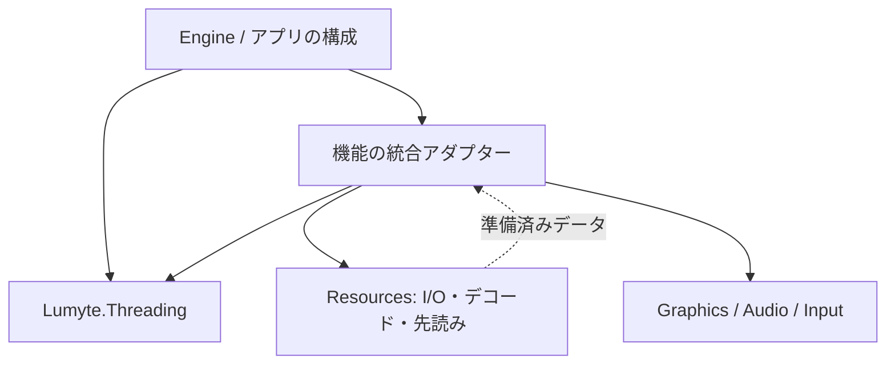

# ADR-ENGINE-0001: 所有スレッドへの処理配送とエンジンの実行境界

- 状態: 提案
- 日付: 2026-10-11
- 関連カテゴリ: core、platform、input、graphics、audio、diagnostics

## 背景

Input、Audio、Window、描画デバイスの操作には、生成時のスレッドやホストのイベントループに結び付いた制約がある。リソースの取得・デコードや診断の受信は別の場所で進むため、その結果を各機能が操作できる場所へ戻す必要がある。`Task.Run` で実行したり、lockで直列化したりするだけでは、同じ物理スレッドで操作する契約を満たせない。

Audioのレビューでは、各デバイスの所有スレッドを守っていても、OpenALのプロセス共通current contextが別スレッドから切り替わる問題が確認された。この不具合はバックエンドでthread-local contextを使って修正する。一方、どのスレッドにデバイスを作り、I/Oの後にどこへ操作を配送し、終了まで誰が実行を継続するかはエンジン全体の判断である。

このADRは共通の実行基盤と統合方針の提案であり、スケジューラーの実装を含まない。既存バックエンドの公開API・スレッド制約を変更せず、その呼び出し側を構成する。汎用ジョブグラフ、ワークスティーリング、DSP、リアルタイムミキサーの実装は別の対象とする。

## 決定

### 固定所有者と論理的な役割

一つのexecutorを、一つの固定所有スレッド上で短い同期処理を直列実行する場所と定義する。所有スレッドは生成から終了まで変更しない。BrowserではJS interopを利用できるホストのmain contextに固定する。`AsyncLocal`やTaskの識別子を所有権の根拠にしない。

Engineまたはアプリが、Host、Game、Render、Audioの役割にexecutorを割り当てる。役割はスレッド数を意味せず、複数の役割へ同一instanceを渡せる。最初は同じホストスレッドへまとめ、必要なデスクトップ構成でRenderやAudioを専用スレッドへ分離できる。依存はコンストラクターから明示的に渡し、staticな現在のexecutorやサービスロケーターを設けない。

| 実行場所 | 役割と制約 |
| --- | --- |
| ホスト所有スレッド | OSイベント、Window、Inputの取得・更新。WindowsのSTAやBrowserのDOMなど、既存ホストの制約を維持する |
| Gameの所有者 | Input snapshotの消費、ゲーム状態、Animation、Compositionの更新。同じ可変instanceを同時に更新しない |
| Renderの所有者 | デバイスの生成・利用・解放、uploadと描画。バックエンド固有の制約が許す構成だけ専用スレッドへ分離する |
| Audioの所有者 | デバイスの生成・制御・Update・解放。OpenALの内部ミキサーやAudioWorkletの実行場所とは別である |
| 非同期I/O・CPU処理 | Resourcesの取得・デコード・先読み、独立したCPU計算。ThreadPoolはスレッド固定を必要としない仕事に使う |

WindowsのWindow・TSFなどを汎用の専用executorへ移してはならない。ホストが必要なapartmentとOSイベント処理を提供する。Browserの初期構成では全役割をmain contextへまとめ、専用managed threadを前提にしない。CPU処理の同時数・投入量はResourcesやジョブの呼び出し側で制限し、I/Oを待つだけの`Task.Run`は使わない。

### 配置と依存方向

共通契約と実行器は `src/Core/Lumyte.Threading/`、名前空間・パッケージ名は `Lumyte.Threading` とする。BCLに依存し、Audio、Graphics、Resources、DI、Engineを参照しない。Engineと各統合アダプターがこの契約を利用する。低水準バックエンドへ暗黙の配送やロックを追加しない。設計段階では空のプロジェクトを追加しない。



### 公開API案

比較元は本PRの `c1477806b8233678ab3c15b9eff7b6a3bd9937d0`。比較元に `Lumyte.Threading` は存在せず、以下はすべて追加の提案である。型の宣言は主要メンバーの抜粋とする。

```diff
+namespace Lumyte.Threading
+{
+    public interface IThreadExecutor
+    {
+        // 非空の診断用名称。一意性やスレッド識別に利用しない。
+        string Name { get; }
+        // 所有スレッドかを確認する。受付状態や安全な更新phaseは判定しない。
+        bool CheckAccess();
+        // 所有スレッド外ならInvalidOperationException。
+        void VerifyAccess();
+        // 常にキューへ投入する。同期callbackの終了を待つ。async voidは禁止。
+        ValueTask InvokeAsync(Action action, CancellationToken cancellationToken = default);
+        // Tは同期処理の結果。Task/ValueTaskを返しても内側の完了を追跡しない。
+        ValueTask<T> InvokeAsync<T>(Func<T> action, CancellationToken cancellationToken = default);
+    }
+
+    public sealed class ExecutionQueueFullException : InvalidOperationException
+    {
+        // 満杯による未受理を表す。callbackは一度も実行されていない。
+        public ExecutionQueueFullException(string executorName);
+        public string ExecutorName { get; }
+    }
+
+    public sealed class HostThreadExecutor : IThreadExecutor
+    {
+        // 現在のホストスレッドを借用する。capacityは待機件数の正の上限。
+        public HostThreadExecutor(string name, int capacity = 256);
+        // 所有スレッドでのみ呼ぶ。再入は拒否。開始時点のキューから最大件数を処理。
+        // callbackの失敗は個々のInvokeAsyncへ返し、残りの処理を継続する。
+        public int Pump(int maxWorkItems = 64);
+        // スレッド安全・冪等。新規受付を閉じ、受理済み処理を残す。
+        public void Complete();
+        // 全受理済み処理の終了と実行器の片付け。待機中もホストはPumpを継続する。
+        public Task Completion { get; }
+        // IThreadExecutorの全メンバーを実装する。
+    }
+
+    public sealed class DedicatedThreadExecutor : IThreadExecutor
+    {
+        // デスクトップの専用managed threadを起動し、受付準備後に返す。
+        // OSイベントループやSTAは提供しない。BrowserではPlatformNotSupportedException。
+        public static ValueTask<DedicatedThreadExecutor> CreateAsync(string name, int capacity = 256);
+        // 受付を閉じ、専用threadで受理済み処理をdrainして停止する。スレッド安全・冪等。
+        public void Complete();
+        // 実行器が以後callbackを実行せず、専用threadの終了処理を終えた時点で完了。
+        public Task Completion { get; }
+        // IThreadExecutorの全メンバーを実装する。
+    }
+}
```

`name`の空・null、非正のcapacity・maxWorkItems、nullのcallbackは同期的に引数例外とする。受付終了は `ObjectDisposedException`、満杯は `ExecutionQueueFullException` として返すValueTaskを失敗させる。これらは未受理であり、callbackの副作用はない。専用threadの起動に失敗した場合は部分生成した実行資源を片付け、CreateAsyncを失敗させる。

### 順序・有界キュー・キャンセル

同時投入を受付地点で順序付け、受理した処理をFIFOで一度だけ実行する。異なるexecutor間の全順序は保証しない。所有スレッドからのInvokeAsyncも常にキューへ入れ、先行処理を追い越さない。既に適切なphaseにいる呼び出し側は、VerifyAccess後にバックエンドを直接呼べる。この直接呼び出しはキューとのFIFO順序に含まれない。

待機中の件数にcapacityを適用し、実行中の一件は別に数える。満杯時は待機用の隠れた無制限キューを作らず未受理で失敗させる。呼び出し側は要求元へ拒否を返す、投入量を減らす、音量などの最新値を明示的に集約する方針を選ぶ。再生・停止・解放を実行器が勝手に捨てたり集約したりしない。待機件数の上限は捕捉したPCMなどのbyte上限を意味しないため、リソース側のメモリ予算も維持する。

キャンセルと実行開始は一つの確定点で競合を解決する。既にキャンセル済みの要求は受付前に取り消す。受理後、開始前にキャンセルが勝てばcallbackを呼ばず枠を返し、対応ValueTaskを取り消す。開始が勝てば同期callbackを最後まで実行し、成功結果または例外を返す。開始後のキャンセルだけで待機を先に終了させない。これにより、生成済みclipを受け取れず所有者が失われる事態を防ぐ。

各callbackの例外はその呼び出しへ伝え、後続の処理を止めない。Taskの継続はキュー内でインライン実行せず、`RunContinuationsAsynchronously`相当で完了させる。ただしawait後が所有スレッドになる保証はない。受理したValueTaskは呼び出し側が必ず観測し、fire-and-forgetのPostは初期APIに設けない。実行器自体の回復不能な内部失敗では、新規受付を閉じて未実行要求とCompletionを失敗させる。

### 非同期処理と再入

配送単位は同期処理の区間である。任意のasync delegateを所有スレッドに固定して実行する機構や、SynchronizationContextの差し替えは提供しない。`async () => ...`をActionへ渡すとasync voidになり、最初のawaitでcallbackが終了して例外・寿命の追跡が失われるため禁止する。実装時にはAPIドキュメントと利用例でこの制約を示す。

通常は「I/Oをawait → 必要な同期操作をInvokeAsync → 外部完了をawait → 次の操作をInvokeAsync」と分ける。所有スレッドからしか開始できない非同期APIは、同期callbackでTaskを取得し、callbackの外でそのTaskをawaitできる。この場合、実行器が追跡するのは開始までであり、呼び出し側がTaskと関連する資源を保持する。非同期API自身の継続が所有スレッドを必要とする場合は、バックエンド／ホストの既存契約で満たす必要があり、この実行器だけで移植可能にはならない。

owner上で `.Wait()`、`.Result`、`GetAwaiter().GetResult()` により未完了の配送・I/Oを待たない。callback内から同じexecutorへ投入して同期的に待つと進行できない。役割の別名が同一executorを指す場合も同じである。他のexecutorの完了を待つ同期呼び出しや、待機中にPumpを再入させる方式も禁止する。外側の非同期workflowが依存順序を組み立てる。

callbackは短く保ち、ブロッキングI/Oや長いデコードを行わない。Pumpは開始時点の待機処理から最大maxWorkItems件だけ取り出し、途中で投入された仕事は次のPumpへ残す。これは件数の予算であり、実行中のcallbackを時間で中断しない。フレームに収まらないuploadは呼び出し側が分割する。

### フレーム・ホストとの接続

HostThreadExecutorはホストの所有権を借り、OSメッセージループやrequestAnimationFrameを開始・停止しない。ホストは既存イベントループ内の安全なphaseでPumpを呼ぶ。Browserで閉じたwhileループを回さず、各turnをJSへ返す。requestAnimationFrameだけに依存すると非表示タブで終了処理が進まないため、ホストは通常のイベント配送でも終了用Pumpを継続できるようにする。ブラウザー自体が停止した間の進行は保証しない。

単一スレッド構成の基本順は、ホストイベント取得、実行器のPump、Input更新、Action／Game／Animation更新、必要なAudio.Update、描画、次turnへの復帰とする。Diagnostics.Pumpは既存の安全な更新位置へ明示的に置き、通信の受信callbackから状態を操作しない。一般の処理キューはフレームphaseの検証を行わないため、更新途中の再入を避ける責任は統合側にある。

専用executorは投入された仕事を処理するだけで、ゲームのtickやAudio.Updateを自動生成しない。Engineが更新頻度と次回要求を管理し、処理が遅れた場合に更新要求を無制限に積まない。描画snapshotやAudio状態の受け渡しも、この統合側の有界な要求管理に含める。

Browserでは次の二つを配送で遅らせない。

- Web Audioの出力再開はユーザー操作handler内で開始する。CheckAccessがtrueのmain contextからResumeOutputAsyncを直接呼び、最初のawaitより前にブラウザーへ再開を要求する。完了まで他のAudio制御を止める責任は統合側に置く。
- 描画先の取得 → 記録 → Submit → Presentは一つのturn内の同期区間で完了する。途中のawaitや次のPumpへの分割で借用frameを持ち越さない。非同期の準備はframe取得より前に済ませる。

GameとRenderを分離する場合、完成した不変snapshotまたは所有権を移したbufferをフレーム番号付きで渡す。受け手が解放するまで書き換えず、有界の受け渡し枠を使う。どのframeを省略するかは統合側の方針とし、ゲームの可変worldやInputの現在状態をRenderから直接読まない。同様にAudioの状態はowner上でUpdateしてコピーし、別スレッドへ渡す。サービスが公開する値を汎用実行器が自動的にthread-safeにするものではない。

### Resources・デバイスとの接続

取得・デコード・先読み・ストリーミング用bufferは引き続きResourcesの責務である。確認した [PR #25](https://github.com/ikihiki/Lumyte/pull/25) の `e7c219e2a223e3fcb60b4d279fefe5f1b142caa1` は、型付きPipeline、独立したstream session、同期contextを保証しないStageを提案している。未取り込みの提案として参照し、このADRでResourcesのAPIや採用状態を変更しない。

deviceに依存するStageへ、そのdeviceと同じownerのIThreadExecutorを注入する。CPU準備後の生成・転送・解放だけを配送する。managerのlock内からcallbackを実行したり、lockを保持して配送完了を待ったりしない。借用PCM、lease、device世代の利用権は、配送の完了とネイティブ側の使用が終わるまで維持する。満杯やキャンセルで未受理なら所有権は呼び出し側に残る。

device生成から子の生成、利用、子の解放、device解放まで同じ所有者を使う。device復旧やscene終了をまたぐ要求には統合側の世代番号を付け、実行前にも有効性を確認する。古い要求を新しいdeviceへ無条件に転送しない。既に確保した物の解放は元のownerへ配送し、失敗時は参照と解放責任を保持する。

実行器の完了はCPU callbackの終了だけを意味する。GraphicsのGPU完了・barrier・資源寿命は [GRAPHICS-0014](../graphics/GRAPHICS-0014-caller-managed-resource-validation.md) と各APIの契約に従う。Audioの再生完了も別であり、Playの配送完了時にclipやleaseを返してはならない。

音声のリアルタイムcallbackは、このmanagedキューへ投入したり完了を待ったりしない。将来のストリーミング接続はResourcesが準備した有界bufferから消費し、割り当て・I/O・lock・Task待機を持ち込まない。キュー上のAudio.Updateが遅れても、ミキサーによる常駐PCMの消費は継続する。

### 起動と終了

起動では、ホストの実行場所と役割の対応を決め、executorを作ってから、そのownerでdeviceと各機能を構築する。DIの同期factoryでasync初期化をブロックせず、構成側が明示的にawaitする。利用側へ渡す前に初期化を完了し、途中失敗時も成功済みの子からowner上で解放する。

ホストのPump開始前は、そのowner上で同期の初期化を直接呼ぶ。初期化でInvokeAsyncが必要なら、先に起動用のイベントループへPumpを接続し、初期化をawaitする間も進行させる。初期化が終わるまでRunを開始せず、RunだけがPumpを呼ぶ構成にはしない。専用executorはCreateAsyncの完了時点で自身の処理ループが稼働している。待機中の再入Pumpや同期ブロックで起動を補わない。

終了を組み立てるEngine／アプリは、次の順序を守る。

1. scene更新、診断からの新規変更、ロード・再生要求など、業務の新規producerを止める。この時点ではexecutorの受付とPumpを維持する。
2. 起動済みの非同期workflowを取り消すか完了まで待つ。I/O後の配送と部分生成物の片付けがownerへ戻れる状態を保つ。待機キューが空でも、I/O中のworkflowが残っていれば終了と扱わない。
3. ownerでvoiceの参照を解除し、stream session・leaseを返す。Graphicsでは必要なGPU完了を確認し、子、resource managerの生成物、deviceの順に解放する。resource managerと関連workflowの終了成功後にDI scopeを閉じる。
4. 全機能の片付けが成功してから、共有instanceにつき一度Completeを呼ぶ。受理済み処理をdrainし、ホスト側はPumpを続けながらCompletionを非同期に待つ。最後にホストイベントループを終了する。

実行器は業務workflow、再生、GPU、resource managerを追跡・解放しない。Complete後の追加投入はcleanupであっても拒否するため、Completeを先に呼んでからDisposeを配送する順序は成立しない。通常キューの満杯でcleanupを受理できなければ、受付・ownerを保ったまま先行仕事を進めて再試行し、完了したと扱わない。

deviceや子の解放失敗時は、失敗と生存物を保持して再試行できる状態にする。安全に片付けられる独立した機能は進めるが、参照が残るdeviceやexecutorを先に閉じない。停止期限に達してもスレッドを強制終了せず、未完了を呼び出し側へ報告する。バックエンドの非同期close開始しか確認できない場合など、完了保証の限界もそのまま引き継ぐ。

### 使用例

以下は提案APIと既存Audio APIを組み合わせる例である。`audioExecutor`とdeviceは構成側が生成し、呼び出し側が所有期間を管理する。

```csharp
// I/O・デコードはこの関数の前にResourcesで完了している。
// pcmは借用。呼び出し完了まで変更・返却しない。
static async Task<IAudioClip> UploadClipAsync(
    IThreadExecutor audioExecutor,
    IAudioDevice audio,
    AudioFormat format,
    ReadOnlyMemory<float> pcm,
    CancellationToken cancellationToken)
{
    return await audioExecutor.InvokeAsync(
        () => audio.CreateClip(format, pcm.Span), cancellationToken);
}

// 返されたclipの操作や解放も同じexecutorへ配送する。
// Stage.ReleaseAsyncでは取消済みロードtokenをcleanupへ流用しない。
await audioExecutor.InvokeAsync(() => clip.Dispose());
```

```csharp
// ホストが管理する一回の更新callback。awaitを含めない。
hostExecutor.VerifyAccess();
hostExecutor.Pump(maxWorkItems: 64);
// この後にInput／Game／Animationの更新を行う。
// 同じownerを使うAudioの状態を反映する。
audio.Update();
// 描画のframe取得・記録・Submit・Presentをこのturn内で行う。
// callbackから戻り、次のホストイベントを処理する。
```

## 検討した代替案

- すべてTask.Runへ渡しlockで直列化する: 実行する物理スレッドが変わり、Input、JS interop、native contextの制約を満たせない。
- 機能ごとに必ず専用スレッドを作る: 小さいアプリやBrowserでは不要な配送・待機が増える。役割を同じexecutorへ割り当てられる構成を選ぶ。
- 各バックエンドが自動配送する: 呼び出しの完了条件が変わり、frame境界や寿命が見えにくい。低水準APIは直接呼び出しを維持する。
- 汎用のasync delegateを丸ごと直列化する: await中の再入、継続用の容量、同じownerへの再配送、終了中の継続許可が複雑になる。初期APIは同期区間に限定する。
- 所有者からのInvokeAsyncを暗黙にinline実行する: 先行要求を追い越し、意図しないphaseや更新途中に処理される。常時enqueueと明示的な直接呼び出しを分ける。
- 無制限キューで拒否を避ける: 遅いuploadや停止中のタブでメモリと待ち時間が増え続ける。有界の受付と呼び出し側の負荷制御を選ぶ。

## 結果と影響

- バックエンドの直接実装と所有スレッド契約を維持し、Resources・診断などからの操作を共通の仕組みで配送できる。
- 単一スレッドと複数スレッドの構成で同じ呼び出し契約を使えるが、phase、snapshot、処理量、寿命の管理は統合側に必要である。
- 非同期I/O、CPUの配送完了、GPU／音声の実行完了を個別に追跡するため、終了処理は単純なqueue drainだけでは完結しない。
- 同期区間だけを受け付ける制約により、非同期APIの開始と完了後の制御を明示的に分けるコードが増える。初期実装の契約とBrowser上の進行を検証しやすくする。

## 実装時の受け入れ条件

本PRでは設計の整合性だけを確認し、以下は実行基盤の実装時に検証する。

- 専用threadと借用ホストでの生成・実行・解放のスレッド一致、誤ったownerとPump再入の拒否、役割を同じinstanceにまとめた構成。
- 複数producerの受付順、一度だけの実行、満杯・Complete後の未受理、開始前キャンセルと開始後キャンセルの競合、例外後の継続、返された生成物の所有者が失われないこと。
- I/O中はキューが空でも終了と扱わず、その後の生成・cleanupを配送できること。完了とCompleteの競合、満杯時のcleanup再試行、子の解放失敗後の再試行。
- Browserの実イベントループでユーザー操作からの再開、同一turn内のPresent、終了用Pump、主threadをブロックしないI/O接続。
- OpenALの複数owner、Inputの非再入更新、Diagnosticsの安全なPump、Graphicsの明示GPU待機、Resources Stageの生成・解放を含む統合。

## 別途決定する事項

- Engine／Frameworkの具体的な起動・DI登録・フレームphase APIと、ホスト別のwake通知アダプター。
- 並列CPUジョブグラフ、優先度、描画snapshotの標準形式、遅延・キュー深さの診断と性能目標。
- AudioWorkletとstream bufferの受け渡し、Browser worker／OffscreenCanvasを使う追加構成。

## 参考資料

- [AUDIO-0001: オーディオ機構](../audio/AUDIO-0001-audio-system.md)
- [INPUT-0001: Inputシステム](../input/INPUT-0001-input-system.md)
- [DIAGNOSTICS-0001: 診断基盤](../diagnostics/DIAGNOSTICS-0001-diagnostics-transport.md)
- [Browser Graphicsの実行制約](../../../src/Graphics/Lumyte.Graphics.Browser/README.md)
- [Platform・Windowingの進行中のPR #30](https://github.com/ikihiki/Lumyte/pull/30)
