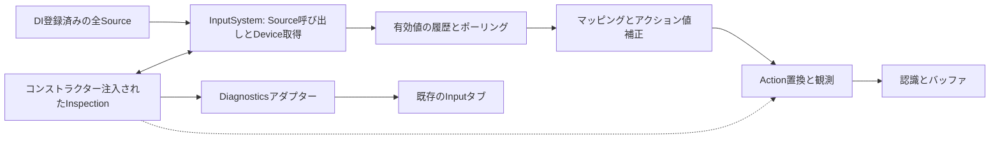

# ADR-INPUT-0004: 診断システムによる入力監視と期限付きオーバーライド

- 状態: 一部採用（監視ページを実装、オーバーライド・Tape実行は提案）
- 日付: 2026-10-11

## 背景

デバイスの接続、補正、仮想デバイス、コンテキスト継承、マッピング、認識を通る入力について、どこで値が変わったかを診断画面で確認したい。実機操作を続けながらボタンやアクション値を一時的に置換して、入力経路とゲーム処理を検証できる必要もある。

[INPUT-0001](INPUT-0001-input-system.md)の履歴保持、[INPUT-0002](INPUT-0002-processing-and-recognition.md)の補正、[INPUT-0003](INPUT-0003-actions-and-contexts.md)の認識・設定保存を維持する。[診断通信](../diagnostics/DIAGNOSTICS-0001-diagnostics-transport.md)が定める権限、所有スレッドでの操作実行、期限付きリース、単一所有者と、[診断UI](../diagnostics/DIAGNOSTICS-0002-server-hosted-ui.md)のInputタブへ接続する。操作のペイロード上限と受付枠は[DIAGNOSTICS-0003](../diagnostics/DIAGNOSTICS-0003-command-payloads-and-traffic.md)の拡張契約に従う。

## 決定

### 責務と依存方向

入力固有の観測・リース管理は `src/Input/Lumyte.Input.Inspection/` に置く。Input・Processing・Actionsへ依存し、Diagnostics・通信・設定DTOへ依存しない。診断アダプターは `src/Input/Lumyte.Input.Diagnostics/` に置き、Inspection・Diagnostics・DIと診断生成器を利用する。Settingsとの連携は構成ルートで既存のInputSettingsCoordinatorを使う。PlatformはOS・ハードウェアから取得する責務を維持する。

InputSystemは引き続きDIからIInputSourceを受け取り、Sourceの登録機構からDeviceを取得する。全Sourceに対する監視・置換はInputSystemのコンストラクターから受け取るIInputInspectionで適用する。SourceやDeviceの実体、Descriptor、登録順を維持する。InputSystem自身がSourceの呼び出しとRegistry登録・Device取得を仲介し、Initialize・Shutdownの巻き戻しとDevice破棄を二重実行しない。

Actions側に通信非依存のIActionInspectionフックを定義し、Inspectionが実装する。ActionsはInspectionパッケージへ依存しない。ActionSystemもコンストラクターDIで単一のIActionInspectionを受け取り、全Context・全Actionの評価、補正、認識、ライフサイクルへ自動的に作用させる。診断を使わない構成は従来のコンストラクターで動作する。アダプターは内部辞書をリフレクションで読み書きしない。



### コンストラクターDIによる全Sourceへの適用

InputSystemは `IEnumerable<IInputSource>` と単一の `IInputInspection` をコンストラクターから受け取る。DIでは同じゲームスコープのInputInspectionSessionをIInputInspectionとして登録する。Use関数で登録されたSourceもInputSystemの構築時に列挙され、その全てにinspectionが自動的に作用する。Source・Deviceの許可リストや個別の監視登録、Sourceデコレーター、段階別のパイプライン列は設けない。

InputSystemはSourceのInitialize・Update・Shutdown、RegistryによるDevice登録・削除、DeviceのDrainEventsと状態・履歴への反映をinspectionへ通知する。DeviceのRegisteredはID割り当て後かつ初回取得前、ProcessはDrainEvents後かつ状態更新・履歴記録前に呼ぶ。入力が空のDeviceにもProcessを呼び、リース開始・期限・解除の差分を生成する。Unregisteredは最終取得後に呼び、リースとハンドルを失効させる。初期化失敗時にも対応する終了通知を行い、通常の切断・Focus喪失による合成解放を置換で押下へ戻さない。

Sourceが物理・仮想のどちらであるか、補正済みかどうかによってinspectionの適用可否を変えない。InputSystemへ渡る全InputDataを受け取り、置換前と置換後を観測する。Source内部の処理で消費され、InputSystemへ一度も返らない中間値はこの境界から取得できない。補正段階をSourceの型から推測せず、InputSystemが受け取った値として表示する。補正前の値を見るためだけのObservingInputSourceはこの設計から除く。

観測範囲と、一回のオーバーライド操作で変更する入力の指定は区別する。inspectionの接続には対象指定が不要で、全Source・全Deviceへ適用する。リース操作だけは変更するDevice/ControlやActionを選ぶ。対象ハンドルはinspectionが自動発行し、RegisterControlやRegisterActionによる公開対象の事前登録を要求しない。

入力メモリーは同期呼び出し中だけ借用し、保持する観測記録はコピーする。出力はInputSystemが読み終えるまで有効とし、変更がなければ同じメモリーを返す。既存DrainEvents契約から必要な場合だけ作業バッファへコピーし、inspectionなしの経路にコピーを追加しない。所有スレッド・再入禁止・通知例外の契約はInputSystemに従う。処理失敗時に一部だけを記録してバッチ全体を再送しない。

Sourceとinspectionの所有者はDIスコープとし、InputSystemは借用してDeviceとRegistryの終了を担当する。Sourceは一つのInputSystemだけに接続し、Singleton Sourceを複数ゲームスコープで共有してInitializeしない。診断なしの手動構築には従来のコンストラクターを残す。DIはinspection付きのコンストラクターを使用し、既存のSystemファクトリーもinspectionを明示的に渡す。IInputSourceのServiceDescriptorを書き換えたり、同じサービスを再解決する循環ファクトリーを作ったりしない。

inspection付きコンストラクターの第3引数TimeProviderは省略可能とする。`new InputSystem(sources, null)` はTimeProviderとIInputInspectionのオーバーロードが曖昧なため、コンパイルエラーのままとする。既存コード・サンプルも `new InputSystem(sources, timeProvider: null)`、`new InputSystem(sources, inspection: inspection)` のように引数名で意図を示し、曖昧な呼び出しを保つためのオーバーロードは追加しない。

### ActionSystemへの自動適用

DIでは同じInputInspectionSessionをIActionInspectionとしても登録し、ActionSystemのコンストラクターへ注入する。ActionSystemは構築成功時に自身とプロファイルをinspectionへ通知する。呼び出し側のRegister、Context/Actionの個別登録、公開対象の許可リストは不要。プロファイル内の全Context・全Actionと継承後の実効定義を自動的に追跡する。ApplyProfileで追加・削除・変更された定義も同じ経路で反映する。

inspectionへの通知はマッピング値、補正値、有効値、認識結果を含み、補正の有無によって適用範囲を変えない。置換は全ての評価で同じフックを通す一方、有効Contextと通常の認識順序を維持するため、最終値の置換位置は認識前とする。無効Contextもプロファイルとして監視するが、診断のために有効化・認識を実行しない。

ActionSystemは終了時にinspectionへ通知して全ハンドル・リースを失効させる。終了通知のためIDisposableを実装し、DIが破棄する。従来のコンストラクターで作ったSystemも破棄後の変更・照会を拒否する。構築失敗時は暫定登録を取り消し、共有inspectionそのものをActionSystemが破棄しない。複数ActionSystemはオブジェクト識別とプロファイル世代で分離する。

### 監視する内容

観測対象はSourceとDeviceの接続状態、InputSystemが受け取った値・inspectionによる有効値、履歴のSequence範囲とHasGap、有効Contextと継承元、宣言バインディングと実効バインディング、補正前後と置換後のアクション値、認識結果、バッファ件数、リバインド状態、適用中設定Revisionとする。タッチ・ペン・筆圧も既存InputDataの種類を維持して観測する。テキスト入力の内容は既定で収集しない。

InputSystem側の記録はReceivedとEffectiveDevice、ActionSystem側はMapped・CorrectedAction・EffectiveAction・Recognizedで区別する。InputSystemの履歴はinspection適用後の有効値で、受け取った値の診断記録は独立した有界リングへ保持する。元のSourceの入力と公開済みInputRecordを変更せず、既存InputRecordのSequenceを診断側で採番・再利用しない。仮想Deviceは提供されるDescriptorの情報を表示する。

同じフレーム内の上流観測は独自のObservation番号とDevice登録世代で関連付ける。InputSystemへ記録された時点で対応するSequenceを付け、マッピング後の値にはContext・Actionと寄与Deviceを付ける。Sequenceをまだ持たない値やタイマー由来の認識に架空のSequenceを付けない。

所有スレッド上で更新を完了した後、不変のスナップショットを発行する。通信とUIはそのコピーだけを読む。Deviceや認識一覧は上限付きページ照会とし、スナップショット番号と次カーソルを返す。世代違い・リング欠落は再同期を要求する。バッファ監視は件数と非消費のコピーを使い、TryConsumeを呼ばない。

初期診断カタログはscalar制約に合わせ、概要取得・対象一覧のページ取得・選択対象の照会・リース取得/更新/解除/照会を生成する。InputData配列やCompositionノードをDiagnosticResultへ直接返さない。ページ上限と符号化サイズを決めたJSON文字列として返し、使用するDTOとJSONコンテキストはソース生成する。InputタブにDeviceのグラフィカル表示、診断側Deviceによるライブ操作、Tapeエディター、Actionマッピングの表示・編集を実装する。汎用操作フォームも残し、同じゲーム側操作へ接続する。

### 診断プロトコルと操作種別

[DIAGNOSTICS-0003](../diagnostics/DIAGNOSTICS-0003-command-payloads-and-traffic.md)に従い、入力アダプターの公開カタログにOperationDescriptor.Trafficと各StringのMaxLengthを宣言する。DiagnosticOperation属性で生成する場合も同じ宣言を用い、クライアントが要求ごとにTrafficを選ぶ形にしない。HTTPとMagicOnionの両経路で同じカタログと検証を使う。

| Traffic | Inputでの用途 | 要求の扱い |
| --- | --- | --- |
| Standard | Tapeのアップロード・確定・再生開始、LiveSession開始、設定編集・保存、単発照会、通常のリース取得・更新 | 通常の結果保持・重複排除を使う |
| Stream | 連番付きライブ入力バッチ、Device現在値の周期照会 | 要求期限を1000 ms以内とし、結果の重複排除情報も要求期限まで保持する |
| Control | ライブとTapeの心拍・停止、リース解放、一時停止 | 独立した受付枠と優先実行を使い、Standard/Streamの飽和で受付を妨げない |

Trafficは権限を代替しない。操作ごとのObserve・Edit・OverrideInputを引き続き検証する。Controlも有限の受付枠と所有スレッドの実行予算に従い、停止要求の到達を保証できない場合はリース期限で解除する。停止が先に実行された後に届くStreamバッチは終了済みLiveSessionとして拒否し、転送を復活させない。

操作引数・成功結果のStringはMaxLength未指定で4096文字、宣言可能な最大値は1,048,576文字とする。ページJSON、Tapeチャンク、設定ツリーに必要な上限を明示し、フィールド単位の文字数とは別に符号化済み要求全体の4 MiB制限を守る。JSONのエスケープ増分も全体サイズへ含め、4 MiBを超える結果publicationを生成しない。Log・Metric・Traceの文字列は4096文字のままとする。

入力カタログはStream/Controlと4096文字を超えるフィールドを含むため、AgentはClientHelloのProtocolVersion 2を選ぶ。版1として拡張カタログを公開せず、版2を拒否された場合も通常操作へ自動フォールバックしない。入力の監視・操作が使えない理由を診断側へ表示する。

### Deviceのグラフィカル表示

既存Blazor Server / Fluent UIのInputタブをDevices・Tape・Actionsの3ビューに分ける。DevicesはInputSystemごとの接続一覧からDeviceを選び、Keyboardのキー配列と押下表示、Mouseの位置・移動・ボタン・ホイール、Controllerのボタン・スティック平面・トリガーバー、Touchの接触点と軌跡、Penの位置・接触・傾き・筆圧バーを表示する。公開Descriptorで判定できない配置は汎用の型別値表示へ落とす。座標系・単位・範囲を表示し、不明な範囲を推測して正規化しない。

現在値は履歴イベントをUIで積算せず、ゲーム側のDevice状態スナップショットから表示する。受け取った実値とinspection適用後の値を同じ図の別色で示し、操作元（実Device・ライブ転送・Tape）と有効リース・残り期限を添える。軌跡と短時間グラフだけは有界の観測記録を使う。履歴の欠落と現在値の不明を区別し、切断・初期状態・未提供の値を0と偽装しない。

表示更新は診断UIの200 ms集約に従い、選択Deviceの描画を優先する。ボタンの短い押下は観測イベントのフラッシュ表示を併用し、描画更新を待って入力処理を止めない。表示停止は入力オーバーライドの停止とは別操作とする。

### 診断側に接続したDeviceによるライブ転送

操作元はゲームに接続されたDeviceではなく、診断を開いている端末のKeyboard・Mouse・Gamepad、または診断ホストのローカル入力アダプターとする。ブラウザーの場合はInputビュー内の専用領域でKeyboard/PointerイベントとGamepad APIを取得し、必要な小さなJavaScriptモジュールからBlazorへ渡す。サーバー上のDeviceをブラウザーが列挙できるとは扱わない。非対応環境には画面上のボタン・スティック操作を提供する。入力捕捉の開始/終了を明示し、設定エディターに入力したキーは転送しない。

UIで操作元Controlとゲーム側Controlを型付きに対応付け、取得した値を同じInputOverrideServiceへ送る。Sourceの監視範囲は引き続き全体であり、この対応付けは変更する入力の選択だけに使う。ゲーム側に診断Deviceを勝手に物理Deviceとして登録しない。対応するControlを持たない場合は拒否して利用者に示す。画面上の直接操作・ライブ転送・Tape再生は同じ対象のリースを共有できず、開始時に競合を表示する。

転送は診断Sessionとゲームの登録世代に結び付いたLiveSessionをStandard操作で先に作り、操作元の値を連番付きのStreamバッチで送る。ボタンのPress/Release順は保ち、軸の連続更新だけを最新値へ集約する。各要求の期限は1000 ms以内とし、期限を延長した再送や期限切れ要求の自動再送をしない。要求の保持中は同一RequestIdの重複排除を使い、保持期限後もLiveSessionのバッチ連番で重複・古い入力を拒否する。ボタン列の欠落、busy/expired、キュー溢れでは転送を停止してリースを解除し、最新値から失われた操作を推測しない。診断側の時刻は順序参考用で、適用時刻とSequenceはゲーム側で付ける。

心拍はControl操作で初期値500 msごとに送り、ゲーム側のリース期限は2秒とする。リース期限は最大5秒の上限以内に収め、Stream要求の最大1000 msとは別に管理する。操作元Deviceの切断、捕捉領域のフォーカス喪失、タブ非表示、Circuit終了、認証失効でControlの停止要求を送り、送信不能でもリース期限で解除する。既存のUIログアウトでゲーム接続全体を切らない契約は維持し、このUIが所有するLiveSessionとTape再生だけを止める。遠隔入力には遅延があるため、フレーム精度の試験には事前送信したTapeを使う。

### Tapeによる時系列オーバーライド

[Termlessの記録・再生](https://github.com/beorn/termless#recording--playback)にある短い操作列を編集・再生する使い方を参考にする。Termlessをランタイム依存にせず、端末用.tapeとの互換を約束しない。Lumyte用のバージョン付きInputTapeとして、手書きスクリプト・ライブ操作の記録・ゲーム側の受信値記録を同じ命令列へ変換する。

初期命令はPress、Release、Set、WaitFramesとする。Control名は公開enumから解決し、対象はヘッダーのDevice/Context/Actionエイリアスへ明示的に関連付ける。名前はスクリプトの可読表現に限り、実行計画は型付き対象ハンドルを持つ。自動選択で別Deviceへ再接続せず、読み込み時に現在の対象と割り当てを確認する。

```text
Tape 1
Target pad = Device "test-controller"
Press pad.ControllerButton.A
WaitFrames 2
Release pad.ControllerButton.A
Set pad.ControllerStick.Left 0.5 -0.25
WaitFrames 30
Set pad.ControllerStick.Left 0 0
```

上記は提案構文。画面では命令リスト・対象トラック・現在フレームを表示し、手書きとグラフィカル編集を相互変換する。Press/ReleaseはButtonの0/1、Setは軸のReplaceへ変換し、WaitFramesは相対フレーム位置を進める。同じフレームの命令は記述順に実行する。記録は開始時の現在値を先頭Set/Pressとして含め、終了時に全リースを解放する。記録リングに欠落があれば不完全なTapeとし、実行用への変換を拒否する。

再生前にゲーム側で全命令・値・対象世代・順序・上限を検証し、対象Controlのリースを全て一括確保する。一つでも競合・不正な対象があれば何も再生しない。開始フレームを合意した後はゲーム側所有スレッドが計画を進める。通信往復を待って命令ごとに実行したり、過去のInputRecordを再送したりしない。同じフレーム内のPress/Releaseも中間値を消さず、以下の順序付き取得経路で通常の記録・認識へ渡す。

一つのTapeの再生段階はDeviceかActionのどちらかとし、異なる段階の対象トラックの混在を読み込み時に拒否する。Deviceトラックは同じInputSystem、Actionトラックは同じActionSystemに所属させる。計画の確定時に命令を相対フレームと記述順の配列へ展開し、実行中はカーソルを進める。Deviceごとのバッチへの振り分けや毎フレームのソートを行わない。同一段階で複数のTapeが同時再生される場合は、再生の受付順、各Tapeの記述順で当該フレームの命令を連結する。

InputSystemは通常の全Deviceの取得・Process・記録を終えた後、inspectionのDrainScheduledInputからDeviceをまたぐ単一の命令列を受け取る。各要素のDeviceと登録世代・Focus・リースを再検証し、列の順番に状態・ポーリング・履歴を更新してInputRecordのSequenceを採番する。記録の完了をScheduledInputRecordedでinspectionへ通知し、命令番号とSequenceを対応付ける。たとえばControllerのPress、KeyboardのPress、ControllerのReleaseはDevice登録順に関係なくこの順番でActionSystemへ届く。通常の実入力と解除差分はこの列より先に処理し、Tapeが対象にしているControlの実入力は従来どおり受信値として追跡する。ProcessでTapeの当該フレームの最終値を先に適用せず、各命令の記録時点で保持値を進める。切断・Focus喪失が先に判明したTapeは列への展開を取り消す。

ActionSystemは通常のInputRecordの評価後、DrainScheduledActionsの単一列を記述順に評価する。各要素で有効Context・対象世代を再検証し、そのActionの最終値を一回ずつ更新してChanged・認識へ渡す。ScheduledActionAppliedでinspectionの保持値を進め、最後の値を次回の通常評価でも保持する。Actionだけの命令にInputRecordのSequenceを作らず、Observationと命令番号で追跡する。Press/Releaseを一つの最終値へ集約せず、各InputRecordの時刻に応じた通常のタイマー進行を維持する。合成命令のたびにAdvanceやフレーム終端処理を重複実行しない。

順序付き列のメモリーは当該InputSystem.UpdateまたはActionSystem.Advanceの完了まで借用し、次回へ持ち越さない。検証済みの計画から有界の再利用バッファへ展開し、1フレームの命令上限も10,000件とする。上限超過は開始前に拒否する。例外時は適用済みの命令番号を保持し、列全体を再送しない。inspectionなしでは列の生成・コピー・ソートを追加せず、再生中の追加処理は当該フレームの命令数に比例する。

既存のフレーム指定リースと同様に、開始フレームを過ぎた新規再生は拒否する。再生開始後の予定は再生起点からの相対フレームで管理し、処理しなかったフレームを次にまとめて追いつき再生しない。フレーム飛び・プロファイル置換・対象消失では停止して解除する。ライブと同じ心拍/期限を使い、長いTapeも一回の無期限リースにしない。ゲームのフレームが停止していても期限は単調時計で進む。

再生・停止・一フレーム送り・一時停止・最初から再生を提供する。一時停止は対象リースを解除する。停止位置からの再開はその位置のControl状態を再構築した新しい再生として開始し、認識途中状態やゲーム状態を復元したとは扱わない。スクラブは記録表示だけを移動し、ゲームへの巻き戻しは実行しない。ループは明示回数を指定し、各周の末尾で解放と認識Resetを行う。完了・中止・切断は停止理由と実行済みの最終命令番号を返す。

記録はReceived / EffectiveDevice / EffectiveActionのどれかをメタデータで区別する。同じ操作のDevice段階とAction段階を同時に再注入せず、どちらを再生するか選ぶ。Tapeは入力シナリオの再現であり、時計・乱数・ゲーム状態まで含む決定的な再現を保証しない。初期の再生Controlは前述のキー・マウスボタン・Controller・アクション値に合わせ、Touch/Penはグラフィカル表示と記録を行うが、非対応の再生命令を黙って捨てない。

Tapeの保存/読込は専用ファイルとして診断端末で行い、InputActionSettingsへ混ぜない。ゲームへ送る計画はJSONの有界チャンクとしてStandard操作でアップロードし、全体のサイズ・ハッシュ・版を検証してから確定する。再生開始もStandard操作とし、この操作でOverrideInput権限を検証してリースを取得する。初期上限はUTF-8で1 MiB、10,000命令、10,000フレーム、8トラック、ループ10回。チャンク本文はUTF-8で32 KiBまでとし、カタログの文字列フィールドにはMaxLength = 32768も明示する。文字の途中で分割せず、符号化した操作要求全体の4 MiB上限も送信前に確認する。チャンク送信は応答を受けて次へ進み、通常の結果保持枠を無制限の並列送信で消費しない。未確定アップロードは30秒で破棄する。心拍・停止・一時停止はControlを使う。ファイルの解析で任意コードやシェルコマンドを実行しない。

### Actionのマッピング表示と編集

ActionsビューはActionSystem → Contextの継承ツリー → Actionの順に表示し、現在値のバー/平面表示と現在適用中のマッピングを並べる。各Actionに宣言元Context、継承後の実効バインディング、InputControl、対象Device選択、Scale、押下/解放閾値、Normalize・Sensitivity・Smoothing、認識定義を示す。無効Contextは無効と表示し、設定Revisionと実行中の適用Revisionを別に表示する。

宣言したバインディングと継承した実効バインディングを区別する。親の定義を編集すると継承する子に及ぶことを表示し、子だけを変える操作は子のローカル定義へコピーして別BindingIdを割り当てる。子で一つでも同じActionのバインディングを定義すると親の群全体を置換する既存規則をUIにも反映する。ローカル群の削除で継承へ戻す操作も提供する。

Control・Device・Actionの選択は公開カタログから行い、自由入力の文字列IDを繰り返し指定しない。編集候補は元の設定Revisionを保持し、InputSettingsConverter.BuildProfileとActionProfile.Validateで親参照・循環・型・閾値・参照整合性を検証する。Device Controlの重複割り当ては表示し、意図的な共有を認める既存規則とリバインドの競合方針を使う。

永続編集は[SETTINGS-0002](../settings/SETTINGS-0002-diagnostic-operations.md)のInputActionSettingsツリー取得・編集候補・save-tree/save-resultを利用する。入力専用エディターは候補JSONを組み立て、既存Settingsアダプターへ送る。新しい独立した保存経路やサーバーからのActionSystem直接変更は作らない。非同期保存のSaved確認後、InputSettingsCoordinator.CommitCommittedSettingsが次の更新境界で反映する。失敗・Revision競合では実行中プロファイルを変えず、競合した候補を保持して再読み込みと差分確認を促す。保存成功から反映完了までを画面で区別する。

マッピング監視にはObserve、編集・保存にはEdit、ライブ/Tape/一時値置換にはOverrideInputを要求する。InputActionSettingsの診断保存への登録は既存Settings契約に従うが、inspectionが全Actionを監視するための個別登録は不要。設定保存を構成していないSystemはマッピングを読み取り専用で表示する。保存によるプロファイル変更では関連リース・Tape・LiveSessionを停止し、古いTargetIdで操作を続けない。

### オーバーライドを適用する位置

| 対象 | 適用位置 | 検証できる範囲 |
| --- | --- | --- |
| DeviceのInputControl | Sourceの種類・補正状態によらず、InputSystem内のDevice取得境界 | 履歴・イベント・ポーリング、マッピング、アクション補正、認識 |
| Context内のAction | アクション値補正後、認識前 | 最終的な操作値に対する認識とゲーム処理 |

Device側の置換はInputSystemに注入されたinspectionでDevice単位・Control単位とし、InputSystemのイベント・ポーリング・保持履歴に同じ有効値を渡す。置換中も上流入力を取り出して実値を追跡する。通常のリース開始・解除の差分はProcessから、Tapeやライブ転送の順序付き値変更はDrainScheduledInputから渡し、InputSystemが通常どおり時刻とSequenceを付ける。同じ差分を両経路へ重複生成せず、押し続けるリースで毎フレーム押下イベントを生成しない。

Action側の置換はActionSystemの補正を通った実値を保持してから最終値へ適用する。Contextの優先順位・排他・有効化・選択Deviceは先に評価する。無効なContextへ入力を送り込まず、子Contextのリースを親や兄弟へ継承しない。通常のActionEventと認識経路を通し、認識済み操作や入力バッファを直接注入・編集しない。Action置換の寄与Deviceを架空に生成せず、診断記録のLeaseIdで置換由来を示す。

初期対象は既存InputControlのキー・マウスボタン・Controllerボタン・スティック・トリガーと、Button / Axis1D / Axis2Dアクションとする。ButtonはReplaceのみ、軸はReplaceとAddをサポートする。ButtonはXが0または1かつYが0、Axis1DはYが0、値は有限数とする。Addは実値との加算後に対象型の範囲へclampする。トリガーは0〜1、スティック・アクション軸は-1〜1。非対応Control・不正な型・範囲外のReplaceは拒否する。

タッチの接触IDやペンの接触・筆圧を組み立てる操作、IME・文字入力、接続・Focusの偽装は初期の置換対象にしない。監視は可能で、これらの操作をテストしたい場合は専用の仮想SourceをDIへ追加する。Device置換とAction置換を同時に使う場合はこの処理順を維持し、監視に両方のLeaseIdを示す。

### 型付き対象と公開識別子

ローカルコードはInputDeviceId・InputControl、ActionSystemオブジェクトとCompositionのContext・Action定義オブジェクトで対象を指定する。診断UIにはスナップショットで発行したGuidのTargetIdを渡し、自由入力の文字列でDevice・Contextを検索しない。TargetIdはSystemの自動接続とプロファイル世代に結び付け、再接続やApplyProfile後の古いハンドルはtarget-goneとする。

ActionSystemをinspectionへ接続すると全Context・Actionのハンドルを自動発行する。DeviceもInputSystemの登録通知から自動的に追跡する。実行上のSystem識別と画面表示名を分け、同名Contextを持つ複数プレイヤーを混同しない。

### リース、競合、解除

Acquireは認証済みSessionId・ActorIdと要求IDから所有者を作り、対象・方式・値・開始フレーム・期間を検証する。UIに所有者を自己申告させない。初期は同じ対象に対して予約期間を含め一つのリースだけを許可し、既存所有者も別Acquireで置き換えずUpdateを使う。対象消失、競合、期限、上限違反は安定したエラーコードを返す。

開始は実行中フレーム、またはゲーム側の未来フレームを指定する。過去の開始は拒否し、開始を飛び越した予約も失効させる。期限は開始時のTimeProvider単調時計から測る。停止・ポーズでInputSystem.ElapsedTimeが進まなくてもリース期限を延ばさない。停止中は論理失効とし、所有スレッドの最初の更新で有効値を復帰させる。UpdateとReleaseは所有者、LeaseId、期待リースRevisionを検証する。活動中のUpdateは開始フレームを変更せず、値・方式・現在からの残り期間を更新する。予約中だけ未来の開始フレームを変更できる。UIには残り期間を返し、単調時計の絶対値を通信へ出さない。

Sessionの切断・権限撤回・期限切れ、Device切断、対象Contextの無効化、プロファイル置換、System終了で解除する。診断切断通知は有界の制御キューへ送り、所有スレッドで処理する。キュー溢れ時は該当Sessionの失効フラグを確実に保持する。通信をInput更新から待たない。切断通知が失われても有限の期限で復帰する。

解除は最新の実値から有効値を再計算する。診断で押したボタンだけが残らないよう必要な解放を生成する。実ボタンが押下中なら値は押下のままだが、リース取得・解除境界でその対象に依存する認識途中状態とバッファを破棄し、解放後の新しい実押下まで新規Press / Chord / Sequenceの起点にしない。軸は直ちに最新実値へ戻す。平滑化などの実値側処理は置換中も更新する。

Deviceレベルの置換開始・解除は依存する全ActionSystemへ通知する。依存関係を特定できない独自認識器は該当Device/Context単位でResetし、破棄件数を診断へ示す。リバインド捕捉中のSystemに影響する新しいリースは拒否し、影響するリースが残る間はBeginRebindを拒否する。合成した診断入力が保存済みのキー割り当てになるのを防ぐ。

### 更新境界と権限

1. フレームと単調時計を確定し、切断・失効・対象消失を処理する。
2. InputSettingsCoordinator.CommitCommittedSettingsで確定設定を実際に反映し、inspection.ConfigurationChangedで変わった設定に属するゲームスコープのハンドル・リース・Tape・LiveSessionを失効させる。各ActionSystem.CommitPendingChangesで残る予約変更も確定する。
3. BeforeInputProcessingのDiagnosticPumpで予算内の要求を実行する。読み取りは直前の完了スナップショットを返す。成功したリース操作はこのフレームの入力処理に使う。
4. InputSystem.UpdateでDevice有効値を記録し、新規記録を順番に各ActionSystem.Advanceへ渡す。
5. Action置換・認識・通知を完了し、監視スナップショットを発行する。

既存のApplyCommittedSettingsは変更を予約し、ApplyProfileはAdvanceの先頭まで適用されない。この予約完了を診断の反映完了として扱わない。追加するActionSystem.CommitPendingChangesは所有スレッドの非評価時に予約変更を順番に確定し、プロファイル・有効Context・Device選択・補正・認識器・バッファを更新する。ProfileChanged・ContextDeactivatedと取消通知をこの呼び出し内で完了し、古いハンドルとリースをPumpより前に失効させる。InputRecordの消費、入力値の再評価、時計の前進、認識タイマーの実行は行わない。空なら何もせず、適用済みの変更を次のAdvanceで繰り返さない。既存のAdvance冒頭も同じ内部確定処理を使い、診断なしの呼び出し方を維持する。

InputSettingsCoordinator.CommitCommittedSettingsは変更済みの確定スナップショットを読み、プロファイル・バッファ・補正器・仮想生成器を全て検証・準備してから、それぞれのCommitPendingChangesを呼ぶ。CorrectingInputSourceとVirtualizingInputSourceにも取得を伴わない確定処理を追加し、交換時のResetと必要なFocus境界データはこの段階で準備し、通常の取得で一度だけ出力する。予約Revisionと適用Revisionを分離し、既存ApplyCommittedSettingsで予約済みでも未確定ならこの処理で確定する。適用RevisionとSaveRebindAsyncの比較対象は実際の確定成功後に更新する。戻り値は設定変更が実際に反映されたかを示し、trueのとき構成ルートが同じ所有スレッドでinspection.ConfigurationChangedを呼んでからPumpへ進む。処理中の例外は診断要求の受付と当該フレームの入力処理を中断し、反映済みRevisionを偽って公開しない。

Pump実行中に保存が完了した設定は次のフレーム境界へ回す。Pump内でApplyProfileなどの構成変更を直接予約する操作は公開しない。リース操作は当該フレームへ適用するが、保存・アップロード操作では実行中の入力構成を変更しない。このため、旧TargetIdの要求が新しいプロファイルに滑り込んだり、旧TapeのDevice入力が新しいマッピングで認識されたりしない。設定が変わらないフレームはRevision比較と空キュー確認だけで、設定反映のために空のAdvanceを追加実行しない。

診断要求結果は入力の受付・リース管理の結果を示し、ゲーム処理が成功したことを保証しない。受付済み要求の通信再送は各Trafficの保持期間内でDiagnosticPumpの同一Session/RequestIdの重複排除を使う。Streamの期限後は再送せず、ライブのバッチ連番でも二重適用を防ぐ。切断後の結果不明はLease照会で解決する。DIスコープとInputの所有スレッドを一致させ、通信スレッドからInputSystemやActionSystemを直接変更しない。

Observeはスナップショットの照会、OverrideInputはリース操作、Editは保存設定の変更に必要とする。監視・入力操作の公開可否は構成側でも制限する。リースはメモリ上だけに保持し、InputActionSettings / InputProcessingSettingsへ自動保存しない。補正・マッピングを永続的に変える場合は既存の設定編集・検証・Revision比較・保存成功後適用を使う。リースRevision、観測スナップショット番号、設定Revisionを混同しない。

監査には主体、要求ID、対象、方式、開始・更新・解除の結果と理由を記録する。生成器のscalar引数制約とゲーム側の値・所有権チェックの両方を適用する。

### DI構成と相互作用の例

以下は提案APIを用いる構成例。バックエンドのUse関数がIInputSourceを登録した後、Systemを構築する前に一括登録する。UseWindowsInputは登録のイメージであり、既存APIとして追加を要求するものではない。

```csharp
services.UseWindowsInput(); // 例: バックエンドがIInputSourceを自動登録する。
services.AddInputInspection(); // 同じスコープのinspectionをDI登録する。
services.AddScoped<InputSystem>(); // コンストラクターからSourceとinspectionを注入する。
services.AddScoped(p => new ActionSystem(profile, bufferOptions: null,
    inspection: p.GetRequiredService<IActionInspection>()));
services.AddDiagnosticExecutionPoint<BeforeInputProcessing>("before-input-processing");
services.AddDiagnosticSubsystem<InputDiagnostics, BeforeInputProcessing>(
    new SubsystemDescriptor("input", "Input", 1));
```

明示的なInputSystemファクトリーが必要な場合も、個別Sourceを包まずinspectionをコンストラクターへ渡す。InputTimeSourceを使う構成では同じファクトリー内でAttachする。

```csharp
services.AddScoped(p => new InputSystem(
    p.GetServices<IInputSource>(),
    inspection: p.GetRequiredService<IInputInspection>(),
    timeProvider: null));
```

Systemの構築とPump.Activateは入力所有スレッドで実行する。System構築時にハンドルを自動発行し、同じゲームスコープでのみ有効とする。

```csharp
// フレーム境界。設定適用後に診断要求を受け付ける。
inspection.BeginFrame(frameNumber);
if (coordinator.CommitCommittedSettings())
{
    inspection.ConfigurationChanged();
}
actions.CommitPendingChanges(); // 予約済みの構成変更を確定し、古い対象を失効させる。

// ローカルコードは確定後の定義オブジェクトから対象を得る。診断UIは公開TargetIdを使う。
InputOverrideTarget jumpTarget = inspection.GetActionTarget(actions, game, jump);
InputOverrideResult result = overrides.Acquire(
    new InputOverrideOwner(sessionId, actorId),
    jumpTarget,
    new InputOverrideSpec(InputOverrideMode.Replace, new Vector2(1, 0), TimeSpan.FromSeconds(1)));

pump.Pump(new DiagnosticFrame(frameNumber, timestampTicks), budget);
records.Clear(); // input.Recorded は通常どおり新規記録をこの一覧へ追加する。
input.Update();
actions.Advance(records.ToArray(), input.ElapsedTime);
inspection.CompleteFrame();
ActionState effective = actions.GetState(game, jump);
// 1秒後、または解除の次の境界で実入力へ復帰する。
```

例のローカルAcquireは所有スレッドのBeginFrameと設定適用を終えた後に呼ぶ。診断アダプターの場合は同じAcquireをPumpから呼び、OwnerはDiagnosticOperationContextから生成する。診断パッケージを有効にしたゲームスコープだけにAddDiagnosticSubsystemを登録する。

### 公開 API 一覧

比較元はmainの `cc766f2`。監視ページに必要な次のAPIと `Lumyte.Input.Diagnostics` パッケージを実装した。InputSystemは全Source・Device、ActionSystemはプロファイル・状態変化・認識結果を、同じDIスコープのInputInspectionSessionへ通知する。診断サーバーのInputページは500 msごとにStream操作 `input/get-snapshot` を読み、Devices / Actions / Tapeのビューを表示する。

```diff
+namespace Lumyte.Input
+{
+    public interface IInputInspection
+    {
+        void SystemCreated(InputSystem system);
+        void SourceInitializing(InputSystem system, IInputSource source);
+        void SourceUpdated(InputSystem system, IInputSource source);
+        void SourceShutdown(InputSystem system, IInputSource source);
+        void Registered(InputSystem system, InputDeviceId device,
+            InputDeviceDescriptor descriptor);
+        void DeviceUpdated(InputSystem system, InputDeviceId device,
+            InputDeviceState state, ulong latestSequence);
+        void Unregistered(InputSystem system, InputDeviceId device);
+        void SystemDisposed(InputSystem system);
+    }
+    public sealed class InputSystem
+    {
+        public InputSystem(IEnumerable<IInputSource> sources, IInputInspection inspection,
+            TimeProvider? timeProvider = null);
+    }
+}
+namespace Lumyte.Input.Actions
+{
+    public interface IActionInspection
+    {
+        void SystemCreated(ActionSystem system, ActionProfile profile);
+        void ProfileChanged(ActionSystem system, ActionProfile profile);
+        void Advanced(ActionSystem system, ReadOnlyMemory<ActionEvent> events,
+            ReadOnlyMemory<RecognizedAction> recognized, TimeSpan now);
+        void SystemDisposed(ActionSystem system);
+    }
-    public sealed class ActionSystem
+    public sealed class ActionSystem : IDisposable
+    {
+        public ActionSystem(ActionProfile profile, InputBufferOptions? bufferOptions,
+            IActionInspection inspection);
+        public void Dispose();
+    }
+}
+namespace Lumyte.Input.Diagnostics
+{
+    public sealed class BeforeInputProcessing;
+    public sealed record InputSnapshotReceipt(string Json);
+    public sealed class InputInspectionSession : IInputInspection, IActionInspection, IDisposable
+    {
+        public long Revision { get; }
+        public void SystemCreated(InputSystem system);
+        public void SourceInitializing(InputSystem system, IInputSource source);
+        public void SourceUpdated(InputSystem system, IInputSource source);
+        public void SourceShutdown(InputSystem system, IInputSource source);
+        public void Registered(InputSystem system, InputDeviceId device,
+            InputDeviceDescriptor descriptor);
+        public void DeviceUpdated(InputSystem system, InputDeviceId device,
+            InputDeviceState state, ulong latestSequence);
+        public void Unregistered(InputSystem system, InputDeviceId device);
+        public void SystemDisposed(InputSystem system);
+        public void SystemCreated(ActionSystem system, ActionProfile profile);
+        public void ProfileChanged(ActionSystem system, ActionProfile profile);
+        public void Advanced(ActionSystem system, ReadOnlyMemory<ActionEvent> events,
+            ReadOnlyMemory<RecognizedAction> recognized, TimeSpan now);
+        public void SystemDisposed(ActionSystem system);
+        public string CreateSnapshot();
+        public void Dispose();
+    }
+    public sealed partial class InputDiagnostics
+    {
+        public InputDiagnostics(InputInspectionSession inspection);
+    }
+    public static class InputInspectionServiceCollectionExtensions
+    {
+        public static IServiceCollection AddInputInspection(this IServiceCollection services);
+        public static IServiceCollection AddInputDiagnostics<TPoint>(this IServiceCollection services,
+            SubsystemDescriptor? descriptor = null) where TPoint : class;
+    }
+}
```

以下はオーバーライド・Tape・ライブ入力を実装する際に追加する提案APIである。監視実装はこの将来APIを先取りして公開しない。

```diff
+namespace Lumyte.Input.Inspection
+{
+    public enum InputObservationStage { Received, EffectiveDevice, Mapped, CorrectedAction, EffectiveAction, Recognized }
+    public enum InputOverrideMode { Replace, Add }
+    public readonly record struct InputOverrideOwner(Guid SessionId, string ActorId);
+    // 値そのものではなく登録世代に結び付いた不透明な対象ハンドル。
+    public readonly record struct InputOverrideTarget(Guid Id);
+    public sealed record InputOverrideSpec(InputOverrideMode Mode, Vector2 Value,
+        TimeSpan Duration, long? StartFrame = null);
+    public sealed record InputOverrideLease(Guid Id, InputOverrideTarget Target,
+        InputOverrideSpec Spec, long Revision, TimeSpan Remaining, bool IsActive);
+    // 失敗時はLeaseがnull。所有者・対象・競合・型・期限のエラーを返す。
+    public sealed record InputOverrideResult(bool IsSuccess, InputOverrideLease? Lease,
+        string? ErrorCode = null, string? ErrorMessage = null);
+    public enum InputTapeCommandKind { Press, Release, Set, WaitFrames }
+    public sealed record InputTapeCommand(InputTapeCommandKind Kind, int Track, Vector2 Value, long Frames = 0);
+    // 名前は保存用。再生前に全トラックを現在の型付きTargetへ関連付ける。
+    public sealed record InputTapeTrack(string Alias, ActionValueKind Kind);
+    public sealed record InputTape(int Version, InputObservationStage RecordedStage,
+        ImmutableArray<InputTapeTrack> Tracks, ImmutableArray<InputTapeCommand> Commands);
+    public sealed record InputTapePlayback(Guid Id, long Revision, long CommandIndex, bool IsRunning, string? StopReason);
+    public sealed record InputLiveSession(Guid Id, long Revision);
+    public sealed record InputLiveValue(InputOverrideTarget Target, Vector2 Value);
+    public interface IInputTapeService
+    {
+        // 全対象を一括検証・確保する。失敗は部分再生せず例外としてアダプターでRejectへ変換。
+        InputTapePlayback Play(InputOverrideOwner owner, InputTape tape,
+            IReadOnlyList<InputOverrideTarget> tracks, long startFrame, int repeatCount = 1);
+        InputTapePlayback GetPlayback(InputOverrideOwner owner, Guid playbackId);
+        InputTapePlayback Stop(InputOverrideOwner owner, Guid playbackId, long expectedRevision);
+    }
+    public interface IInputLiveService
+    {
+        InputLiveSession Begin(InputOverrideOwner owner, IReadOnlyList<InputOverrideTarget> targets);
+        void Send(InputOverrideOwner owner, Guid sessionId, long batchSequence,
+            IReadOnlyList<InputLiveValue> orderedValues);
+        void Heartbeat(InputOverrideOwner owner, Guid sessionId);
+        void Stop(InputOverrideOwner owner, Guid sessionId);
+    }
+    public interface IInputOverrideService
+    {
+        InputOverrideResult Acquire(InputOverrideOwner owner, InputOverrideTarget target, InputOverrideSpec spec);
+        InputOverrideResult Update(InputOverrideOwner owner, Guid leaseId,
+            long expectedRevision, InputOverrideSpec spec);
+        InputOverrideResult Release(InputOverrideOwner owner, Guid leaseId, long expectedRevision);
+        InputOverrideResult GetLease(InputOverrideOwner owner, Guid leaseId);
+    }
+    public sealed record InputInspectionPage(long Snapshot, string Json, string? NextCursor, long Dropped);
+    public sealed class InputInspectionSession : IInputOverrideService, IInputInspection, IActionInspection, IDisposable
+    {
+        public InputInspectionSession(TimeProvider? clock = null);
+        public void SourceInitializing(IInputSource source);
+        public void SourceUpdated(IInputSource source);
+        public void SourceShutdown(IInputSource source);
+        public void Registered(InputDeviceId device, InputDeviceDescriptor descriptor);
+        public ReadOnlyMemory<InputData> Process(InputDeviceId device, ReadOnlyMemory<InputData> data, TimeSpan now);
+        public ReadOnlyMemory<InputInspectionInput> DrainScheduledInput(TimeSpan now);
+        public void ScheduledInputRecorded(long order, InputRecord record);
+        public void Unregistered(InputDeviceId device);
+        public InputOverrideTarget GetActionTarget(ActionSystem system,
+            Compose.Definitions.Context context, Compose.Definitions.Action action);
+        public InputOverrideTarget GetControlTarget(InputDeviceId device, InputControl control);
+        // 有界記録の上限と観測段階を設定。空の集合なら取得値の収集を止める。
+        public void ConfigureCapture(IReadOnlyCollection<InputObservationStage> stages, int maxEntries);
+        public void BeginFrame(long frame);
+        // 確定設定が変わった後、Pumpより前にスコープ内の対象世代と操作を失効させる。
+        public void ConfigurationChanged();
+        public void CompleteFrame();
+        // 最後に完了した不変スナップショットを読む。通信スレッドでも呼べる。
+        public InputInspectionPage ReadPage(long? snapshot = null, string? cursor = null, int maxEntries = 128);
+        public void SystemCreated(ActionSystem system, ActionProfile profile);
+        public void SystemDisposed(ActionSystem system);
+        public void ObserveMapped(ActionSystem system, string contextId, string actionId, Vector2 value);
+        public void ObserveRecognized(ActionSystem system, RecognizedAction recognition);
+        public Vector2 EvaluateValue(ActionSystem system, string contextId, string actionId,
+            ActionValueKind kind, Vector2 correctedValue, TimeSpan now);
+        public ReadOnlyMemory<ActionInspectionInput> DrainScheduledActions(ActionSystem system, TimeSpan now);
+        public void ScheduledActionApplied(ActionSystem system, long order);
+        public void ContextDeactivated(ActionSystem system, string contextId);
+        public void ProfileChanged(ActionSystem system);
+        // 通信側からも呼べる通知。Inputの状態はここでは変更しない。
+        public void NotifySessionClosed(Guid sessionId);
+        public InputOverrideResult Acquire(InputOverrideOwner owner, InputOverrideTarget target, InputOverrideSpec spec);
+        public InputOverrideResult Update(InputOverrideOwner owner, Guid leaseId,
+            long expectedRevision, InputOverrideSpec spec);
+        public InputOverrideResult Release(InputOverrideOwner owner, Guid leaseId, long expectedRevision);
+        public InputOverrideResult GetLease(InputOverrideOwner owner, Guid leaseId);
+        public void Dispose();
+    }
+}
 namespace Lumyte.Input
 {
+    // Orderはフレーム内の合成命令順。InputRecord.Sequenceとは別に扱う。
+    public readonly record struct InputInspectionInput(long Order, InputDeviceId Device, InputData Data);
+    // Inputが所有する共通取得境界。InputはInspectionへ依存しない。
+    public interface IInputInspection
+    {
+        void SourceInitializing(IInputSource source);
+        void SourceUpdated(IInputSource source);
+        void SourceShutdown(IInputSource source);
+        void Registered(InputDeviceId device, InputDeviceDescriptor descriptor);
+        ReadOnlyMemory<InputData> Process(InputDeviceId device, ReadOnlyMemory<InputData> data, TimeSpan now);
+        ReadOnlyMemory<InputInspectionInput> DrainScheduledInput(TimeSpan now);
+        void ScheduledInputRecorded(long order, InputRecord record);
+        void Unregistered(InputDeviceId device);
+    }
     public sealed class InputSystem
     {
+        // 従来のコンストラクターは維持。全Sourceの全Deviceへ適用する。
+        public InputSystem(IEnumerable<IInputSource> sources, IInputInspection inspection,
+            TimeProvider? timeProvider = null);
     }
 }
 namespace Lumyte.Input.Actions
 {
+    // Actionの最終値を順番に評価する。DeviceのSequenceを架空に割り当てない。
+    public readonly record struct ActionInspectionInput(long Order, string ContextId, string ActionId, Vector2 Value);
+    // Actionsが所有する評価契約。Inspectionパッケージへの逆依存を作らない。
+    public interface IActionInspection
+    {
+        void SystemCreated(ActionSystem system, ActionProfile profile);
+        void SystemDisposed(ActionSystem system);
+        void ObserveMapped(ActionSystem system, string contextId, string actionId, Vector2 value);
+        void ObserveRecognized(ActionSystem system, RecognizedAction recognition);
+        Vector2 EvaluateValue(ActionSystem system, string contextId, string actionId,
+            ActionValueKind kind, Vector2 correctedValue, TimeSpan now);
+        ReadOnlyMemory<ActionInspectionInput> DrainScheduledActions(ActionSystem system, TimeSpan now);
+        void ScheduledActionApplied(ActionSystem system, long order);
+        void ContextDeactivated(ActionSystem system, string contextId);
+        void ProfileChanged(ActionSystem system);
+    }
-    public sealed class ActionSystem
+    public sealed class ActionSystem : IDisposable
     {
+        // 従来のコンストラクターも残す。inspectionは同じゲームスコープで共有する。
+        public ActionSystem(ActionProfile profile, InputBufferOptions? bufferOptions,
+            IActionInspection inspection);
+        // 入力の取得・評価・タイマー更新を行わず、予約済みの構成変更と失効通知を確定する。
+        public void CommitPendingChanges();
+        // DI終了で自動接続とリースを解除。inspection自体は借用する。
+        public void Dispose();
     }
 }
 namespace Lumyte.Input.Processing
 {
     public sealed class CorrectingInputSource
     {
+        // 取得なしで補正器の交換を確定。境界データは次の取得で一度だけ出力する。
+        public void CommitPendingChanges();
     }
     public sealed class VirtualizingInputSource
     {
+        // 取得なしで生成器の交換を確定。境界データは次の取得で一度だけ出力する。
+        public void CommitPendingChanges();
     }
 }
 namespace Lumyte.Input.Settings
 {
     public sealed class InputSettingsCoordinator
     {
+        // 確定設定を予約だけでなく反映し、成功後に適用Revisionを更新する。
+        public bool CommitCommittedSettings();
     }
 }
+namespace Lumyte.Input.Diagnostics
+{
+    public static class InputInspectionServiceCollectionExtensions
+    {
+        // 同じInspectionをIInputInspection・IActionInspection・IInputOverrideServiceとして登録する。
+        public static IServiceCollection AddInputInspection(this IServiceCollection services);
+    }
+    public sealed class BeforeInputProcessing { }
+    // 生成器でIDiagnosticContributorを実装。操作はDiagnosticOperation属性で公開する。
+    public sealed partial class InputDiagnostics : IDiagnosticContributor
+    {
+        public InputDiagnostics(InputInspectionSession inspection);
+        public void Configure(DiagnosticBuilder builder);
+    }
+}
```

Tape/Liveサービスの実装はinspectionの同じリース台帳を共有する。心拍・一時停止・一フレーム送り・記録取得とアップロード操作の詳細API、観測スナップショットのページDTOと対象リストの具体的なscalar出力は、診断生成器・通信の上限に合わせて実装前に本ADRで確定する。上記DI例のActionSystem呼び出しは `bufferOptions: null` も指定する。

### 性能と検証方針

診断無効時はinspection・観測収集・System登録を作らず、通常の無入力更新の割り当てを増やさない。監視のみ・置換ありの負荷を分けて測定する。全Source・全Context・全Actionへの適用を維持したまま観測記録を有界化し、既定の記録上限4096件、ページ上限128件、同時リース64件、期間上限5秒、予約開始は最大120フレーム先とする。上限値は測定後に変更可能にする。欠落を件数で報告し、InputSystemの保持ポリシーを診断の都合で変更しない。DeviceやAction IDを無制限のMetricsタグにせず、集約した処理時間・観測欠落・リース数を公開する。

受け入れ検証は、監視が認識・バッファ消費へ影響しないこと、Device置換のイベント/履歴/ポーリングの一致、Action置換の認識順序、実押下中の解除、軸復帰、無入力時とポーズ時の期限、未来開始、再送と競合、他所有者の解除拒否、Device切断・Context無効化・ApplyProfileによる失効、親子Contextの独立性、複数プレイヤーの分離、リバインドとの排他、通知例外後の重複実行防止、リング欠落時の再同期、DI終了順、Useが自動登録する複数Sourceと実行中のDevice追加への一括適用、解決前に追加したSourceの包含、inspectionなしの既存動作、空バッチでの解除、ActionSystemのコンストラクターDIだけで全定義が接続されること、プロファイル差し替え時の自動追跡、System破棄と構築失敗時の登録回収、Device現在値の型別描画、短い押下と履歴欠落の表示、ライブ転送の欠落停止、Tapeの一括確保・同フレーム内順序・停止時復帰・フレーム飛び、マッピングの親子編集とRevision競合、保存成功後の適用表示を含む。保存済み設定にリースが混入しないことと、AOT・トリミング環境で診断アダプターとJSON出力が動作することも確認する。

順序保証はDevice登録順がKeyboard→ControllerでもTapeのController→Keyboard→ControllerがSequenceとSequence認識で維持されること、Actionの同フレームPress/Releaseが二つの遷移として届くこと、段階混在・過大なフレームを開始前に拒否することで検証する。設定境界は旧TargetIdの要求をPumpへ積んだまま保存を完了し、Pumpがtarget-goneを返して旧Tape/Liveが新マッピングへ一件も入力しないことを確認する。補正器・仮想生成器の交換もPump前に確定し、境界データは一度だけ出力する。変更なしの境界、明示的な確定後のAdvance、非同期保存がPump中に完了する場合に、タイマー・認識・取消通知・Revision更新が重複しないことも検証する。

通信は32 KiBのTapeチャンクと1 MiBの設定ツリーが宣言したMaxLengthでHTTP/MagicOnionを往復できること、符号化した要求の4 MiB上限を超えたら拒否することを確認する。60 Hzのライブ送信を継続しても通常操作の保持枠を消費しないこと、Stream枠の飽和中もControlの心拍・停止を受け付けること、停止後の遅延バッチが転送を再開しないことを検証する。Streamの最大1000 ms、期限後の再送禁止とバッチ連番、拡張カタログのProtocolVersion 2も確認する。

## 検討した代替案

### 仮想Deviceの追加だけで全てを扱う

入力の追加には適するが、実Deviceの特定Controlを置換できず、実値との比較とContext別の最終Action値の検証が難しい。専用Sourceによるタッチ・ペンのシナリオ試験には引き続き利用する。

### 診断側から内部状態や認識結果を直接変更する

履歴・ポーリング・イベントの一致、ヒステリシス、認識途中状態、バッファの一回限りの消費を壊す。公開された入力評価境界で置換し、通常の通知と認識を通す。

### 設定DTOへオーバーライドを保存する

一時的な検証が次回起動にも残り、切断・期限による復帰が不明確になる。永続設定の編集と期限付きリースを分ける。

## 結果と影響

Inputの各段階を比較し、型付きの対象を選んで期限付き操作を実行できる。診断通信への依存をアダプターへ限定し、既存のSource DI・履歴保持・設定保存の契約を維持する。

解除時の差分生成、認識の抑止、DeviceからActionへの依存追跡、対象世代の管理が追加で必要になる。観測できるのはInputSystemへ返された値であり、Source内部の未公開中間値まで自動的に可視化するものではない。フレーム番号とリース時計を別に扱い、この設計だけでは決定的な記録再生を保証しない。
