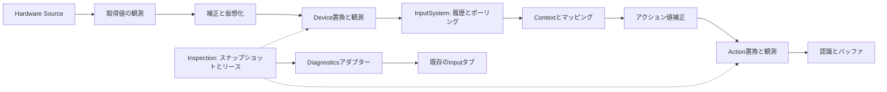

# ADR-INPUT-0004: 診断システムによる入力監視と期限付きオーバーライド

- 状態: 提案（設計のみ、未実装）
- 日付: 2026-10-11

## 背景

デバイスの接続、補正、仮想デバイス、コンテキスト継承、マッピング、認識を通る入力について、どこで値が変わったかを診断画面で確認したい。実機操作を続けながらボタンやアクション値を一時的に置換して、入力経路とゲーム処理を検証できる必要もある。

[INPUT-0001](INPUT-0001-input-system.md)の履歴保持、[INPUT-0002](INPUT-0002-processing-and-recognition.md)の補正、[INPUT-0003](INPUT-0003-actions-and-contexts.md)の認識・設定保存を維持する。[診断通信](../diagnostics/DIAGNOSTICS-0001-diagnostics-transport.md)が定める権限、所有スレッドでの操作実行、期限付きリース、単一所有者と、[診断UI](../diagnostics/DIAGNOSTICS-0002-server-hosted-ui.md)のInputタブへ接続する。

## 決定

### 責務と依存方向

入力固有の観測・リース管理は `src/Input/Lumyte.Input.Inspection/` に置く。Input・Processing・Actionsへ依存し、Diagnostics・通信・設定DTOへ依存しない。診断アダプターは `src/Input/Lumyte.Input.Diagnostics/` に置き、Inspection・Diagnostics・DIと診断生成器を利用する。Settingsとの連携は構成ルートで既存のInputSettingsCoordinatorを使う。PlatformはOS・ハードウェアから取得する責務を維持する。

InputSystemは引き続きDIからIInputSourceを受け取り、Sourceの登録機構からDeviceを取得する。観測・置換するDeviceはSourceデコレーターで包み、Descriptorと登録順を維持する。既存の補正・仮想化デコレーターと同じRegistry契約を使い、Initialize・Shutdownの巻き戻しとDevice破棄を二重実行しない。

Actions側に通信非依存のIActionInspectionフックを定義し、Inspectionが実装する。ActionsはInspectionパッケージへ依存しない。ActionSystemにはこの任意フックを追加注入できるようにする。診断を使わない構成は従来のコンストラクターで動作する。アダプターは内部辞書をリフレクションで読み書きしない。



### 監視する内容

観測対象はSourceとDeviceの接続状態、取得値・補正後の値・有効値、履歴のSequence範囲とHasGap、有効Contextと継承元、宣言バインディングと実効バインディング、補正前後と置換後のアクション値、認識結果、バッファ件数、リバインド状態、適用中設定Revisionとする。タッチ・ペン・筆圧も既存InputDataの種類を維持して観測する。テキスト入力の内容は既定で収集しない。

値は処理段階を示すInputObservationStage付きで記録する。取得値・補正値はデコレーターの読み取り専用フックで取得し、入力処理を再実行しない。仮想Deviceは生成元との対応を記録する。InputSystemの履歴はそのSystemへ渡された有効値であり、上流の取得値を含む診断記録は独立した有界リングに保持する。原本となるSourceの入力と公開済みInputRecordを変更せず、既存InputRecordのSequenceを診断側で採番・再利用しない。

同じフレーム内の上流観測は独自のObservation番号とDevice登録世代で関連付ける。InputSystemへ記録された時点で対応するSequenceを付け、マッピング後の値にはContext・Actionと寄与Deviceを付ける。Sequenceをまだ持たない値やタイマー由来の認識に架空のSequenceを付けない。

所有スレッド上で更新を完了した後、不変のスナップショットを発行する。通信とUIはそのコピーだけを読む。Deviceや認識一覧は上限付きページ照会とし、スナップショット番号と次カーソルを返す。世代違い・リング欠落は再同期を要求する。バッファ監視は件数と非消費のコピーを使い、TryConsumeを呼ばない。

初期診断カタログはscalar制約に合わせ、概要取得・対象一覧のページ取得・選択対象の照会・リース取得/更新/解除/照会を生成する。InputData配列やCompositionノードをDiagnosticResultへ直接返さない。ページ上限と符号化サイズを決めたJSON文字列として返し、使用するDTOとJSONコンテキストはソース生成する。既存Inputタブのフォームで操作を公開し、専用可視化UIは後続実装で追加する。

### オーバーライドを適用する位置

| 対象 | 適用位置 | 検証できる範囲 |
| --- | --- | --- |
| DeviceのInputControl | 補正・仮想化後、InputSystemがDeviceからDrainEventsする境界 | 履歴・イベント・ポーリング、マッピング、アクション補正、認識 |
| Context内のAction | アクション値補正後、認識前 | 最終的な操作値に対する認識とゲーム処理 |

Device側の置換はDevice単位・Control単位とし、InputSystemのイベント・ポーリング・保持履歴に同じ有効値を渡す。置換中も上流入力を取り出して実値を追跡する。押下・値変化・開始・解除の差分をDeviceのバッチへ生成し、InputSystemが通常どおり時刻とSequenceを付ける。押し続けるリースで毎フレーム押下イベントを生成しない。

Action側の置換はActionSystemの補正を通った実値を保持してから最終値へ適用する。Contextの優先順位・排他・有効化・選択Deviceは先に評価する。無効なContextへ入力を送り込まず、子Contextのリースを親や兄弟へ継承しない。通常のActionEventと認識経路を通し、認識済み操作や入力バッファを直接注入・編集しない。Action置換の寄与Deviceを架空に生成せず、診断記録のLeaseIdで置換由来を示す。

初期対象は既存InputControlのキー・マウスボタン・Controllerボタン・スティック・トリガーと、Button / Axis1D / Axis2Dアクションとする。ButtonはReplaceのみ、軸はReplaceとAddをサポートする。ButtonはXが0または1かつYが0、Axis1DはYが0、値は有限数とする。Addは実値との加算後に対象型の範囲へclampする。トリガーは0〜1、スティック・アクション軸は-1〜1。非対応Control・不正な型・範囲外のReplaceは拒否する。

タッチの接触IDやペンの接触・筆圧を組み立てる操作、IME・文字入力、接続・Focusの偽装は初期の置換対象にしない。監視は可能で、これらの操作をテストしたい場合は専用の仮想SourceをDIへ追加する。Device置換とAction置換を同時に使う場合はこの処理順を維持し、監視に両方のLeaseIdを示す。

### 型付き対象と公開識別子

ローカルコードはInputDeviceId・InputControl、登録されたActionSystemのハンドルとCompositionのContext・Action定義オブジェクトで対象を指定する。診断UIにはスナップショットで発行したGuidのTargetIdを渡し、自由入力の文字列でDevice・Contextを検索しない。TargetIdはSystem登録とプロファイル世代に結び付け、再接続やApplyProfile後の古いハンドルはtarget-goneとする。

Actionの公開は構成側のRegisterActionで明示する。内部索引から全アクションを無条件に公開しない。Deviceは登録時に公開方針を評価する。実行上のSystem識別と画面表示名を分け、同名Contextを持つ複数プレイヤーを混同しない。

### リース、競合、解除

Acquireは認証済みSessionId・ActorIdと要求IDから所有者を作り、対象・方式・値・開始フレーム・期間を検証する。UIに所有者を自己申告させない。初期は同じ対象に対して予約期間を含め一つのリースだけを許可し、既存所有者も別Acquireで置き換えずUpdateを使う。対象消失、競合、期限、上限違反は安定したエラーコードを返す。

開始は実行中フレーム、またはゲーム側の未来フレームを指定する。過去の開始は拒否し、開始を飛び越した予約も失効させる。期限は開始時のTimeProvider単調時計から測る。停止・ポーズでInputSystem.ElapsedTimeが進まなくてもリース期限を延ばさない。停止中は論理失効とし、所有スレッドの最初の更新で有効値を復帰させる。UpdateとReleaseは所有者、LeaseId、期待リースRevisionを検証する。活動中のUpdateは開始フレームを変更せず、値・方式・現在からの残り期間を更新する。予約中だけ未来の開始フレームを変更できる。UIには残り期間を返し、単調時計の絶対値を通信へ出さない。

Sessionの切断・権限撤回・期限切れ、Device切断、対象Contextの無効化、プロファイル置換、System終了で解除する。診断切断通知は有界の制御キューへ送り、所有スレッドで処理する。キュー溢れ時は該当Sessionの失効フラグを確実に保持する。通信をInput更新から待たない。切断通知が失われても有限の期限で復帰する。

解除は最新の実値から有効値を再計算する。診断で押したボタンだけが残らないよう必要な解放を生成する。実ボタンが押下中なら値は押下のままだが、リース取得・解除境界でその対象に依存する認識途中状態とバッファを破棄し、解放後の新しい実押下まで新規Press / Chord / Sequenceの起点にしない。軸は直ちに最新実値へ戻す。平滑化などの実値側処理は置換中も更新する。

Deviceレベルの置換開始・解除は依存する全ActionSystemへ通知する。依存関係を特定できない独自認識器は該当Device/Context単位でResetし、破棄件数を診断へ示す。リバインド捕捉中のSystemに影響する新しいリースは拒否し、影響するリースが残る間はBeginRebindを拒否する。合成した診断入力が保存済みのキー割り当てになるのを防ぐ。

### 更新境界と権限

1. フレームと単調時計を確定し、切断・失効・対象消失を処理する。
2. 既存InputSettingsCoordinatorの確定設定を適用し、変わった対象のハンドルとリースを失効させる。
3. BeforeInputProcessingのDiagnosticPumpで予算内の要求を実行する。読み取りは直前の完了スナップショットを返す。成功したリース操作はこのフレームの入力処理に使う。
4. InputSystem.UpdateでDevice有効値を記録し、新規記録を順番に各ActionSystem.Advanceへ渡す。
5. Action置換・認識・通知を完了し、監視スナップショットを発行する。

診断要求結果は入力の受付・リース管理の結果を示し、ゲーム処理が成功したことを保証しない。受付済み要求の通信再送はDiagnosticPumpの同一Session/RequestIdの重複排除を使う。切断後の結果不明はLease照会で解決する。DIスコープとInputの所有スレッドを一致させ、通信スレッドからInputSystemやActionSystemを直接変更しない。

Observeはスナップショットの照会、OverrideInputはリース操作、Editは保存設定の変更に必要とする。監視・入力操作の公開可否は構成側でも制限する。リースはメモリ上だけに保持し、InputActionSettings / InputProcessingSettingsへ自動保存しない。補正・マッピングを永続的に変える場合は既存の設定編集・検証・Revision比較・保存成功後適用を使う。リースRevision、観測スナップショット番号、設定Revisionを混同しない。

監査には主体、要求ID、対象、方式、開始・更新・解除の結果と理由を記録する。生成器のscalar引数制約とゲーム側の値・所有権チェックの両方を適用する。

### DI構成と相互作用の例

以下は提案APIを用いる構成例。DemoSource、InputTimeSource、jump、gameは既存サンプルの定義を使う。sourceの破棄はDI、DeviceとRegistryはInputSystemが所有する。

```csharp
services.AddScoped<InputInspectionSession>();
services.AddScoped<IInputOverrideService>(p => p.GetRequiredService<InputInspectionSession>());
services.AddScoped<DemoSource>();
services.AddScoped<InputTimeSource>();
services.AddScoped(p => new ObservingInputSource(p.GetRequiredService<DemoSource>(),
    p.GetRequiredService<InputInspectionSession>(), InputObservationStage.Acquired));
services.AddScoped(p => new CorrectingInputSource(p.GetRequiredService<ObservingInputSource>(),
    corrections, p.GetRequiredService<InputTimeSource>().GetElapsedTime));
services.AddScoped(p => new VirtualizingInputSource(p.GetRequiredService<CorrectingInputSource>(),
    virtualDeviceFactory, p.GetRequiredService<InputTimeSource>().GetElapsedTime));
services.AddScoped<IInputSource>(p => new OverridingInputSource(
    p.GetRequiredService<VirtualizingInputSource>(), p.GetRequiredService<InputInspectionSession>()));
services.AddScoped(p =>
{
    var input = new InputSystem(p.GetServices<IInputSource>());
    p.GetRequiredService<InputTimeSource>().Attach(input);
    return input;
});
services.AddScoped(p => new ActionSystem(profile, bufferOptions: null, inspection: p.GetRequiredService<InputInspectionSession>()));
services.AddDiagnosticExecutionPoint<BeforeInputProcessing>("before-input-processing");
services.AddDiagnosticSubsystem<InputDiagnostics, BeforeInputProcessing>(
    new SubsystemDescriptor("input", "Input", 1));
```

SystemとActionの登録、Pump.Activateは入力所有スレッドで実行する。登録したハンドルは同じゲームスコープでのみ有効。

```csharp
using var systemRegistration = inspection.Register(actions);
InputOverrideTarget jumpTarget = inspection.RegisterAction(systemRegistration, game, jump);
// ローカルコードは定義オブジェクトから対象を得る。診断UIは公開TargetIdを使う。
InputOverrideResult result = overrides.Acquire(
    new InputOverrideOwner(sessionId, actorId),
    jumpTarget,
    new InputOverrideSpec(InputOverrideMode.Replace, new Vector2(1, 0), TimeSpan.FromSeconds(1)));

// フレーム境界。設定適用後に診断要求を受け付ける。
inspection.BeginFrame(frameNumber);
coordinator.ApplyCommittedSettings();
pump.Pump(new DiagnosticFrame(frameNumber, timestampTicks), budget);
records.Clear(); // input.Recorded は通常どおり新規記録をこの一覧へ追加する。
input.Update();
actions.Advance(records.ToArray(), input.ElapsedTime);
inspection.CompleteFrame();
ActionState effective = actions.GetState(game, jump);
// 1秒後、または解除の次の境界で実入力へ復帰する。
```

例のローカルAcquireは所有スレッドのBeginFrameと設定適用を終えた後に呼ぶ。診断アダプターの場合は同じAcquireをPumpから呼び、OwnerはDiagnosticOperationContextから生成する。診断パッケージを有効にしたゲームスコープだけにAddDiagnosticSubsystemを登録する。

### 公開 API 一覧

比較元はmainの `cc766f2`。以下は追加を提案する主要APIであり、まだ実装されていない。Systemへの観測フック・内部評価契約は実装時に具体化し、本ADRへ追記する。

```diff
+namespace Lumyte.Input.Inspection
+{
+    public enum InputObservationStage { Acquired, Corrected, EffectiveDevice, Mapped, CorrectedAction, EffectiveAction, Recognized }
+    public enum InputOverrideMode { Replace, Add }
+    public readonly record struct InputOverrideOwner(Guid SessionId, string ActorId);
+    // 値そのものではなく登録世代に結び付いた不透明な対象ハンドル。
+    public readonly record struct InputOverrideTarget(Guid Id);
+    public sealed record InputOverrideSpec(InputOverrideMode Mode, Vector2 Value,
+        TimeSpan Duration, long? StartFrame = null);
+    public sealed record InputOverrideLease(Guid Id, InputOverrideTarget Target,
+        InputOverrideSpec Spec, long Revision, TimeSpan Remaining, bool IsActive);
+    // 失敗時はLeaseがnull。所有者・対象・競合・型・期限のエラーを返す。
+    public sealed record InputOverrideResult(bool IsSuccess, InputOverrideLease? Lease,
+        string? ErrorCode = null, string? ErrorMessage = null);
+    public interface IInputOverrideService
+    {
+        InputOverrideResult Acquire(InputOverrideOwner owner, InputOverrideTarget target, InputOverrideSpec spec);
+        InputOverrideResult Update(InputOverrideOwner owner, Guid leaseId,
+            long expectedRevision, InputOverrideSpec spec);
+        InputOverrideResult Release(InputOverrideOwner owner, Guid leaseId, long expectedRevision);
+        InputOverrideResult GetLease(InputOverrideOwner owner, Guid leaseId);
+    }
+    // 対応するActionSystemを登録から除き、関連リースを解除する。
+    public sealed class InputActionRegistration : IDisposable
+    {
+        public void Dispose();
+    }
+    public sealed record InputInspectionPage(long Snapshot, string Json, string? NextCursor, long Dropped);
+    public sealed class InputInspectionSession : IInputOverrideService, IActionInspection, IDisposable
+    {
+        public InputInspectionSession(TimeProvider? clock = null);
+        public InputActionRegistration Register(ActionSystem system);
+        public InputOverrideTarget RegisterAction(InputActionRegistration registration,
+            Compose.Definitions.Context context, Compose.Definitions.Action action);
+        public InputOverrideTarget RegisterControl(InputDeviceId device, InputControl control);
+        // 有界記録の上限と観測段階を設定。空の集合なら取得値の収集を止める。
+        public void ConfigureCapture(IReadOnlyCollection<InputObservationStage> stages, int maxEntries);
+        public void BeginFrame(long frame);
+        public void CompleteFrame();
+        // 最後に完了した不変スナップショットを読む。通信スレッドでも呼べる。
+        public InputInspectionPage ReadPage(long? snapshot = null, string? cursor = null, int maxEntries = 128);
+        public Vector2 EvaluateValue(ActionSystem system, string contextId, string actionId,
+            ActionValueKind kind, Vector2 correctedValue, TimeSpan now);
+        public void ContextDeactivated(ActionSystem system, string contextId);
+        public void ProfileChanged(ActionSystem system);
+        // 通信側からも呼べる通知。Inputの状態はここでは変更しない。
+        public void NotifySessionClosed(Guid sessionId);
+        public InputOverrideResult Acquire(InputOverrideOwner owner, InputOverrideTarget target, InputOverrideSpec spec);
+        public InputOverrideResult Update(InputOverrideOwner owner, Guid leaseId,
+            long expectedRevision, InputOverrideSpec spec);
+        public InputOverrideResult Release(InputOverrideOwner owner, Guid leaseId, long expectedRevision);
+        public InputOverrideResult GetLease(InputOverrideOwner owner, Guid leaseId);
+        public void Dispose();
+    }
+    // Sourceの取得値を観測する。RegistryとDeviceの所有権を移さない。
+    public sealed class ObservingInputSource : IInputSource
+    {
+        public ObservingInputSource(IInputSource inner, InputInspectionSession inspection, InputObservationStage stage);
+        public void Initialize(IInputDeviceRegistry registry);
+        public void Update();
+        public void Shutdown();
+        public void Dispose();
+    }
+    public sealed class OverridingInputSource : IInputSource
+    {
+        public OverridingInputSource(IInputSource inner, InputInspectionSession inspection);
+        public void Initialize(IInputDeviceRegistry registry);
+        public void Update();
+        public void Shutdown();
+        public void Dispose();
+    }
+}
 namespace Lumyte.Input.Actions
 {
+    // Actionsが所有する評価契約。Inspectionパッケージへの逆依存を作らない。
+    public interface IActionInspection
+    {
+        Vector2 EvaluateValue(ActionSystem system, string contextId, string actionId,
+            ActionValueKind kind, Vector2 correctedValue, TimeSpan now);
+        void ContextDeactivated(ActionSystem system, string contextId);
+        void ProfileChanged(ActionSystem system);
+    }
     public sealed class ActionSystem
     {
+        // 従来のコンストラクターも残す。inspectionは同じゲームスコープで共有する。
+        public ActionSystem(ActionProfile profile, InputBufferOptions? bufferOptions,
+            IActionInspection inspection);
     }
 }
+namespace Lumyte.Input.Diagnostics
+{
+    public sealed class BeforeInputProcessing { }
+    // 生成器でIDiagnosticContributorを実装。操作はDiagnosticOperation属性で公開する。
+    public sealed partial class InputDiagnostics : IDiagnosticContributor
+    {
+        public InputDiagnostics(InputInspectionSession inspection);
+        public void Describe(DiagnosticBuilder builder);
+    }
+}
```

観測スナップショットのページDTOと対象リストの具体的なscalar出力は、診断生成器・通信の上限に合わせて実装前に本ADRで確定する。上記DI例のActionSystem呼び出しは `bufferOptions: null` も指定する。

### 性能と検証方針

診断無効時はデコレーター・観測収集・System登録を作らず、通常の無入力更新の割り当てを増やさない。監視のみ・置換ありの負荷を分けて測定する。値の観測は購読段階と対象を絞り、既定の記録上限4096件、ページ上限128件、同時リース64件、期間上限5秒、予約開始は最大120フレーム先とする。上限値は測定後に変更可能にする。欠落を件数で報告し、InputSystemの保持ポリシーを診断の都合で変更しない。DeviceやAction IDを無制限のMetricsタグにせず、集約した処理時間・観測欠落・リース数を公開する。

受け入れ検証は、監視が認識・バッファ消費へ影響しないこと、Device置換のイベント/履歴/ポーリングの一致、Action置換の認識順序、実押下中の解除、軸復帰、無入力時とポーズ時の期限、未来開始、再送と競合、他所有者の解除拒否、Device切断・Context無効化・ApplyProfileによる失効、親子Contextの独立性、複数プレイヤーの分離、リバインドとの排他、通知例外後の重複実行防止、リング欠落時の再同期、DI終了順を含む。保存済み設定にリースが混入しないことと、AOT・トリミング環境で診断アダプターとJSON出力が動作することも確認する。

## 検討した代替案

### 仮想Deviceの追加だけで全てを扱う

入力の追加には適するが、実Deviceの特定Controlを置換できず、実値との比較とContext別の最終Action値の検証が難しい。専用Sourceによるタッチ・ペンのシナリオ試験には引き続き利用する。

### 診断側から内部状態や認識結果を直接変更する

履歴・ポーリング・イベントの一致、ヒステリシス、認識途中状態、バッファの一回限りの消費を壊す。公開された入力評価境界で置換し、通常の通知と認識を通す。

### 設定DTOへオーバーライドを保存する

一時的な検証が次回起動にも残り、切断・期限による復帰が不明確になる。永続設定の編集と期限付きリースを分ける。

## 結果と影響

Inputの各段階を比較し、型付きの対象を選んで期限付き操作を実行できる。診断通信への依存をアダプターへ限定し、既存のSource DI・履歴保持・設定保存の契約を維持する。

解除時の差分生成、認識の抑止、DeviceからActionへの依存追跡、対象世代の管理が追加で必要になる。上流入力の観測は任意デコレーターが提供するフックの範囲に限られ、補正器の内部状態を自動的に可視化するものではない。フレーム番号とリース時計を別に扱い、この設計だけでは決定的な記録再生を保証しない。
