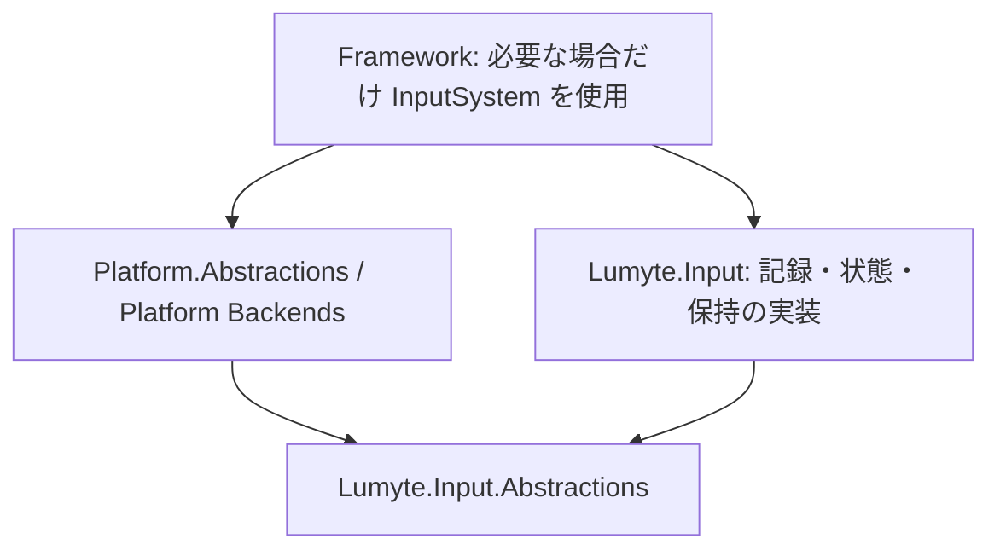

# ADR-INPUT-0005: Platform が参照する入力取得契約の分離

- 状態: 提案
- 日付: 2026-10-11

## 背景

Platform の IPlatform.CreateInputSource は既存 IInputSource を返す。ただしその契約の参照だけで、InputSystem の履歴・状態・保持処理を含む Lumyte.Input 本体まで配布対象にする必要はない。入力取得の Backend と管理実装が依存する最小の共通契約を分離する。

本 ADR は [INPUT-0001](INPUT-0001-input-system.md) の配置・依存方針を変更する提案である。入力データの意味、Source / Device の所有権、記録・保持の挙動は維持する。本 PR は設計文書のみであり、実際のプロジェクト分割は本案を採用した後に行う。採用時に INPUT-0001 の状態と後継参照を更新する。

## 決定

### 配置と依存関係

`src/Input/Lumyte.Input.Abstractions/` に .NET 10 の契約パッケージ Lumyte.Input.Abstractions を追加する。実行時依存は .NET 標準ライブラリだけとし、Input 本体、Platform、Framework、Processing、Actions、Settings、Diagnostics に依存しない。



Platform.Abstractions と Platform バックエンドの参照先は Input.Abstractions とする。Platform の ProjectReference / NuGet の依存閉包に Lumyte.Input 本体を含めない。Framework が記録・ポーリングを使用するときだけ Lumyte.Input を追加する。取得契約を直接消費する利用側は独自 Registry を実装でき、InputSystem を必須としない。

Lumyte.Input は Input.Abstractions を参照する。Processing / Actions / Input.Settings は実際に使用する実装に応じて従来の依存を維持し、Source / Device だけを実装するコードは Abstractions の参照へ切り替える。この分離に合わせて他の入力機能まで一律に Abstractions へ移さない。

### 分離対象と残す実装

Source / Device の公開契約が参照する型を閉じた集合として移す。IInputSource / IInputDeviceRegistry / IInputDevice の3 interface だけを移して、メソッドの入出力型から本体への参照が残る構成は避ける。

対象は公開31型である。下記の API 一覧は3 interface、InputDeviceId / Descriptor / Info / Kind / IdentityKind、InputData と全派生データ、キー・ボタン・軸・接触・ペンの ID / enum を含む。DeviceConnectedData が InputDeviceInfo を参照するため、それも契約側へ移す。

InputData と全派生データを同じ assembly に移し、private protected の基底コンストラクターによる派生制限を維持する。既存の enum 値、record の生成・分解、座標・筆圧・入力正規化の意味は変えない。

本体には InputSystem、内部 DeviceState、InputDeviceState、InputRecord、InputReadResult、InputRetentionPolicy を残す。これらは取得インターフェースのシグネチャに不要な、記録・状態参照・保持を提供する実装側の API である。

### 公開 API の所属と互換性

比較元は main の cc766f2。既存型は Lumyte.Input assembly から新しい Lumyte.Input.Abstractions assembly へ移動する。名前空間は Lumyte.Input のまま維持し、下記の追加行は新しい assembly の公開境界を表す。型名やシグネチャを変更する提案ではない。

```diff
+using System;
+using System.Collections.Generic;
+using System.Numerics;
+
+namespace Lumyte.Input;
+
+// 移動先 assembly の公開 API。名前空間・シグネチャ・enum 値は変更しない。
+public enum ControllerButton
+{
+    South,
+
+    East,
+
+    West,
+
+    North,
+
+    DPadUp,
+
+    DPadDown,
+
+    DPadLeft,
+
+    DPadRight,
+
+    LeftShoulder,
+
+    RightShoulder,
+
+    LeftStick,
+
+    RightStick,
+
+    Start,
+
+    Select,
+}
+
+public sealed record ControllerButtonData(ControllerButton Button, bool IsDown) : InputData;
+
+public enum ControllerStick
+{
+    Left,
+
+    Right,
+}
+
+public sealed record ControllerStickData(ControllerStick Stick, Vector2 Value) : InputData;
+
+public enum ControllerTrigger
+{
+    Left,
+
+    Right,
+}
+
+public sealed record ControllerTriggerData(ControllerTrigger Trigger, float Value) : InputData;
+
+public sealed record DeviceConnectedData(InputDeviceInfo Info) : InputData;
+
+public sealed record DeviceDisconnectedData : InputData;
+
+public sealed record FocusData(bool IsFocused) : InputData;
+
+public interface IInputDevice : IDisposable
+{
+    InputDeviceDescriptor Descriptor { get; }
+
+    IReadOnlyList<InputData> DrainEvents();
+}
+
+public interface IInputDeviceRegistry
+{
+    InputDeviceId RegisterDevice(IInputDevice device);
+
+    void UnregisterDevice(InputDeviceId device);
+}
+
+public interface IInputSource : IDisposable
+{
+    void Initialize(IInputDeviceRegistry registry);
+
+    void Update();
+
+    void Shutdown();
+}
+
+public abstract record InputData
+{
+    private protected InputData()
+    {
+    }
+}
+
+public sealed record InputDeviceDescriptor(InputDeviceKind Kind, string Name, InputDeviceIdentityKind IdentityKind);
+
+public readonly record struct InputDeviceId(ulong Value);
+
+public enum InputDeviceIdentityKind
+{
+    Physical,
+
+    Logical,
+}
+
+public sealed record InputDeviceInfo(InputDeviceId Id, InputDeviceKind Kind, string Name, InputDeviceIdentityKind IdentityKind);
+
+public enum InputDeviceKind
+{
+    Keyboard,
+
+    Mouse,
+
+    Controller,
+
+    Touch,
+
+    Pen,
+}
+
+// Key の完全な定義は既存 Key.cs と同一。ここでは列挙子を省略する。
+public enum Key { /* 既存の全列挙子と値を維持 */ }
+
+public sealed record KeyData(Key Key, bool IsDown, bool IsRepeat) : InputData;
+
+public enum MouseButton
+{
+    Left,
+
+    Right,
+
+    Middle,
+
+    X1,
+
+    X2,
+}
+
+public sealed record MouseButtonData(MouseButton Button, bool IsDown) : InputData;
+
+public sealed record MouseMoveData(Vector2 Position) : InputData;
+
+public sealed record MouseWheelData(Vector2 Delta) : InputData;
+
+[Flags]
+public enum PenButtons
+{
+    None = 0,
+
+    Barrel = 1,
+
+    SecondaryBarrel = 2,
+}
+
+public sealed record PenData(PenPointerId PointerId, PenPhase Phase, Vector2 Position, float? Pressure, bool IsInContact, PenButtons Buttons, bool IsEraser) : InputData;
+
+public enum PenPhase
+{
+    Entered,
+
+    Moved,
+
+    Down,
+
+    Up,
+
+    Left,
+
+    Canceled,
+}
+
+public readonly record struct PenPointerId(ulong Value);
+
+public readonly record struct TouchContactId(ulong Value);
+
+public sealed record TouchData(TouchContactId ContactId, TouchPhase Phase, Vector2 Position, float? Pressure) : InputData;
+
+public enum TouchPhase
+{
+    Began,
+
+    Moved,
+
+    Ended,
+
+    Canceled,
+}
```

IPlatform.CreateInputSource の宣言は Lumyte.Input.IInputSource のままであり、参照する assembly だけが Abstractions に変わる。Platform に using / namespace の新旧変換層や InputSystem の factory を設けない。

既存の Lumyte.Input パッケージは Abstractions への依存と移動31型の TypeForwardedTo を追加する。既存利用者の using、型名、InputSystem への Source 注入を維持し、旧 assembly の型を参照するバイナリも転送先へ解決する。Platform は転送元の本体を参照せず、直接 Abstractions を参照する。同じ型を両 assembly に定義したり、契約をリンクソースで複製したりしない。

TypeForwardedTo は移動する型すべてに追加し、base / derived の record や enum も対象とする。リフレクションの AssemblyQualifiedName は移動先に変わるため、assembly 名を永続化した独自形式は別途移行が必要である。これらの入力型の永続形式は本 ADR では新設しない。

### 所有権・実装順

Source.Initialize / Update / Shutdown、Registry の Source ごとの登録制限、登録成功時の Device 所有権移転、DrainEvents の非消費失敗契約を維持する。通常の所有者は InputSystem、直接消費する場合はその Registry 実装の所有者となる。InputDeviceId はその入力管理スコープ内で一意であり再利用しない。Source を複数消費者へ共有しない。

実装時は契約ファイルを一度だけ移動し、本体へ参照と型転送を追加して全利用プロジェクトを再ビルドする。Platform は契約側だけを参照する。ソリューション、pack、CI の対象に新パッケージを追加し、既存 Input の単体テストと Source / Device の契約テストを維持する。

## 検討した代替案

- Platform が本体を参照し trimming で削る: 依存として実装を持ち込むため採用しない。
- 3 interface だけを移す: 入出力型から実装への依存が残るため、必要な型の閉包を移す。
- 名前空間を Lumyte.Input.Abstractions に変える: 本案では所属 assembly の分離だけで目的を満たせるため、既存利用者の型名変更を避ける。
- 全 Input API を Abstractions に置く: 履歴・状態・保持の実装境界を曖昧にするため採用しない。

## 結果と影響

Platform を使うだけなら Input の契約 assembly だけが必要になる。履歴・状態・保持を使うアプリだけ Input 本体を追加できる。契約 assembly と本体のリリース、型転送、既存利用者の互換性を検証する必要がある。

## 検証方針

- Abstractions だけを参照する最小プロジェクトで Source / Device / Registry と各 InputData を実装・生成できる。
- Abstractions の参照 assembly と NuGet の依存閉包に Lumyte.Input 本体が含まれない。
- Platform と Native Window の最小アプリの復元・publish 出力に Input 本体、Processing、Actions が含まれない。
- 入力未使用時に Framework が InputSystem を必須生成しない。
- 全31型の依存閉包、InputData の派生制限、enum の値、record の生成・分解を維持する。
- 分割前にビルドした利用側バイナリが全移動型の型転送で解決できる。
- 既存 Input / Processing / Actions / Settings のテストとサンプル、pack、書式・静的解析を実装時に実行する。

この設計 PR では Markdown lint、リンク、分離31型と残す6型の一覧、API diff と既存ソースの対応を確認する。assembly の分割・型転送・publish は未実装であり、検証済みとは扱わない。

## 参考資料

- [INPUT-0001: InputSystem と Source / Device の契約](INPUT-0001-input-system.md)
- [Platform の生成と IWindow の直接実装](../platform/PLATFORM-0001-platform-and-window-contracts.md)
- [ADR-0001: ADR の書き方と運用](../0001-adr-writing-policy.md)
