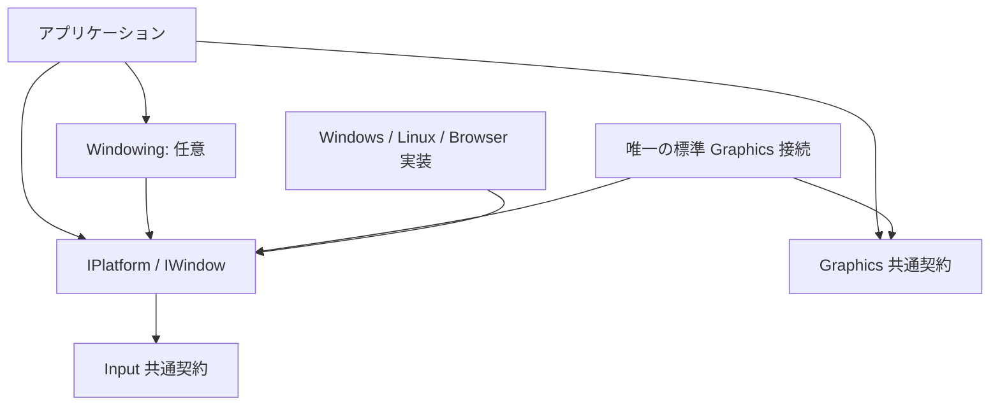

# ADR-PLATFORM-0001: Platform による共通インターフェースの生成と Window の直接実装

- 状態: 提案
- 日付: 2026-10-11

## 背景

Lumyte の OS ごとの機能は、Graphics が生成済みの Device から共通インターフェースを返す構成と同様に、生成済みの Platform から利用したい。単一ウインドウのアプリケーションが、複数ウインドウ管理のためのライブラリを必須とする構成は避ける。

本 ADR は Platform の生成境界、イベント取得、Native Window、既存 Input との接続を提案する。[Windowing](../window/WINDOW-0001-window-system.md)はこの契約を利用する任意の上位ライブラリである。両 ADR とも設計案であり、この PR は実装を追加しない。

## 決定

### 配置と依存方向

共通インターフェースを `src/Platform/Lumyte.Platform.Abstractions/`、名前空間・NuGet を `Lumyte.Platform.Abstractions` とする。Windows、Linux、Browser の具象 Platform は対応する `Lumyte.Platform.Windows`、`Lumyte.Platform.Linux`、`Lumyte.Platform.Browser` に配置する。

起動コードが対象の具象 Platform を作成し、以後は `IPlatform` から共通インターフェースを生成する。共通層に OS 自動選択 factory や共通 Platform wrapper を置かない。各バックエンドが `IPlatform` と生成物の `IWindow` を直接実装し、共通 WindowSystem がバックエンドへ命令を転送する方式は採用しない。



Platform.Abstractions は既存 `Lumyte.Input` の IInputSource を生成結果に使用するため Input 共通契約を参照する。Input は Platform に依存せず、既存 InputRecord / InputSystem の契約を変更しない。Platform.Abstractions は Windowing、Graphics、Engine、特定の DI コンテナーに依存しない。

最初の生成対象は IWindow と IInputSource とする。今後の文字入力、clipboard、display、ファイルダイアログなども対応する共通契約を定義した上で IPlatform に生成メソッドを追加し、利用側が生成物を所有する形に揃える。この PR では未定義の機能に空の interface や汎用 GetService を設けない。

### 公開 API 案

比較元は `main` の `cc766f2`。以下はすべて新規追加する宣言の抜粋である。Platform.Abstractions に OS ハンドル union や Graphics の型を入れない。

```diff
+namespace Lumyte.Platform.Abstractions;
+
+// Platform の寿命内で一意。空の PlatformId / Value 0 は無効。
+public readonly record struct WindowId(Guid PlatformId, ulong Value);
+public readonly record struct WindowRequestId(ulong Value);
+public readonly record struct WindowRect(float X, float Y, float Width, float Height);
+public readonly record struct WindowPixelSize(int Width, int Height);
+public enum WindowKind { Normal, Tool, Popup }
+public enum WindowActivation { Activate, PreserveFocus }
+public enum WindowDisplayMode { Normal, Minimized, Maximized, Fullscreen }
+public enum WindowLifetime { Open, Closing, Closed }
+public enum WindowPlacementSide { Below, Above, Right, Left }
+public enum WindowRequestStatus { Applied, Denied, Unsupported, Failed, Superseded }
+[Flags]
+public enum PlatformFeatures { None = 0, NativeWindows = 1, DeviceInput = 2 }
+[Flags]
+public enum WindowFeatures
+{
+    None = 0, OwnedWindow = 1, NonActivating = 2, AnchorPlacement = 4,
+    Minimize = 8, Maximize = 16, Fullscreen = 32,
+}
+
+public interface IPlatform : IDisposable
+{
+    public Guid Id { get; }
+    public PlatformFeatures Features { get; }
+    // 呼び出し側が所有する、非表示の Native Window。Backend が直接実装する。
+    public IWindow CreateWindow(WindowDescriptor descriptor);
+    // この Platform の全対象デバイスを取得する Source。呼び出し側が所有する。
+    // 同一 Platform の同時生成は一つまで。同じ物理入力の重複取得を避ける。
+    public Lumyte.Input.IInputSource CreateInputSource();
+    // OS キューを一度だけ取得し、Window 通知と Source 用キューへ振り分ける。
+    // System / Windowing を使わないアプリもこの一つの取得入口を使う。
+    public void PumpEvents();
+    // 子 Window / Source が未解放なら変更前に InvalidOperationException。
+    // GPU 待機や子の暗黙 Dispose は行わない。成功後は冪等。
+}
+
+public sealed record WindowDescriptor
+{
+    public string Title { get; init; } = "";
+    public WindowKind Kind { get; init; } = WindowKind.Normal;
+    // 同じ Platform の Open な Native。所有関係であって座標上の親ではない。
+    public IWindow? Owner { get; init; }
+    public System.Numerics.Vector2 ClientSize { get; init; } = new(800, 600);
+    public WindowActivation Activation { get; init; } = WindowActivation.Activate;
+    public bool IsResizable { get; init; } = true;
+}
+public sealed record WindowPlacement(
+    WindowRect Anchor, WindowPlacementSide PreferredSide, float Gap = 0);
+
+// 各 Backend が直接実装する Native 表示先。Hosted はこの interface にしない。
+public interface IWindow : IDisposable
+{
+    public WindowId Id { get; }
+    public WindowState State { get; }
+    public WindowRequestId Show();
+    public WindowRequestId Hide();
+    public WindowRequestId SetTitle(string title);
+    public WindowRequestId Resize(System.Numerics.Vector2 clientSize);
+    // Owner のクライアント座標にあるアンカーから配置する。Owner 必須。
+    public WindowRequestId Place(WindowPlacement placement);
+    public WindowRequestId Activate();
+    public WindowRequestId BringToFront();
+    public WindowRequestId SetDisplayMode(WindowDisplayMode mode);
+    // 明示終了は取消不能。生存する所有者付き Window があれば Denied。
+    // 保持トークンがあれば Closing に移し、物理破棄は保持解除後へ延期する。
+    public WindowRequestId Close();
+    // Backend 固有の型で表示先を借用。未対応 TTarget は NotSupportedException。
+    public TTarget GetNativeTarget<TTarget>();
+    // 外部 Surface より先に Native を破棄しないための明示的な保持。
+    public IDisposable RetainNativeTarget();
+    // 不変の観測値。PumpEvents で管理スレッドへ通知する。
+    public event Action<WindowState>? StateChanged;
+    public event Action<WindowRequestResult>? RequestCompleted;
+    // Native のユーザー終了要求だけ取消可能。通知中は Cancel の設定のみ許可。
+    public event EventHandler<WindowClosingEventArgs>? Closing;
+    // 生存する owned Window / 保持トークンがあれば変更前に拒否。
+    // 完了済みなら Native を冪等に解放。GPU 同期は呼び出し側の責務。
+}
+
+// Backend が生成する不変スナップショット。要求値と観測値を区別する。
+public sealed record WindowState
+{
+    public required WindowId Id { get; init; }
+    public required WindowId? Owner { get; init; }
+    public required WindowKind Kind { get; init; }
+    public required WindowActivation Activation { get; init; }
+    public required string Title { get; init; }
+    public required System.Numerics.Vector2 ClientSize { get; init; }
+    public required WindowPixelSize PixelSize { get; init; }
+    public required System.Numerics.Vector2 Scale { get; init; }
+    public required bool IsVisible { get; init; }
+    public required bool IsActive { get; init; }
+    public required WindowDisplayMode DisplayMode { get; init; }
+    public required WindowLifetime Lifetime { get; init; }
+    public required WindowFeatures Features { get; init; }
+}
+public sealed record WindowRequestResult(
+    WindowId Window, WindowRequestId Request, WindowRequestStatus Status, string? Error);
+public sealed class WindowClosingEventArgs : EventArgs
+{
+    public WindowClosingEventArgs(WindowId window);
+    public WindowId Window { get; }
+    public bool Cancel { get; set; }
+}
```

### Factory・操作・座標の契約

Platform.Id はインスタンスごとに異なる識別子、WindowId は Platform 内の単調増加番号とする。終了後に再利用せず、別 Platform の Owner を拒否する。CreateWindow は全入力を検証し、生成失敗では部分生成した Native を解放して IWindow を返さない。Native の生成は同期とし、同期生成できない環境の非同期 factory は別途決定する。

数値は有限値、生成時の ClientSize は正、Resize は 0 以上とする。負値、不正 enum、Gap の負値、不正 Owner は ArgumentException 系、破棄後は ObjectDisposedException、未対応機能は生成時に NotSupportedException とする。Popup は Owner と PreserveFocus を必須とし、非活性表示を守れない環境では生成を拒否する。

要求は各 IWindow の Backend が保持し、PumpEvents で OS の受理・観測結果を反映する。RequestId は当該 IWindow 内で 1 起点、再利用しない。要求ごとに RequestCompleted を一度通知し、未知の機能、拒否、失敗、置換を区別する。受理だけで観測値を変更しない。結果を待つ要求は有限の期限内に完了させ、具体的な期限は Backend ADR に記載する。

論理座標はクライアント領域の左上原点、右・下を正とする。ClientSize と Scale は論理サイズ・倍率、PixelSize は実際の整数寸法であり OS 枠を含めない。DPI と実寸は同じ StateChanged で公開する。任意のトップレベル絶対位置は共通契約に要求せず、Place は所有者のクライアント座標から Platform が変換する。配置は希望側、反対側、利用可能領域内へのクランプの順とし、サイズは黙って縮めない。Owner の移動・DPI 変更時は最後のアンカーから再配置する。

Native の Z 順・活性化は OS の観測を正とし、他アプリや compositor を含む絶対順は保証しない。PreserveFocus の Show / Raise / ポインター操作は入力フォーカスを奪わず、Activate は拒否する。非表示の Activate で暗黙 Show しない。Minimize / Maximize / Fullscreen は Features と個別の結果に従う。

### イベント取得・Input・スレッド

IPlatform は各 Backend の OS 接続と共通取得器を所有する。PumpEvents は一回の取得で Window と入力の境界順序を保ち、IWindow の観測値・通知と Source の未取得キューへ振り分ける。IInputSource.Update / IInputDevice.DrainEvents / WindowSystem.Update は OS キューを再取得しない。一般の入力源は既存 InputSystem に別途注入できる。

CreateInputSource は同一 Platform の active Source を一つに制限する。Source は InputSystem の構築時に Initialize で Registry へ接続し、既存 Input ADR の所有権を守る。登録 Device は InputSystem が所有する。InputSystem による Source.Shutdown / Device 解放後に Source を Dispose し、最後に Platform を解放する。Source を Dispose した後は新しい Source の生成を許可するが、古い通知を再配信しない。

初期化・取得・操作・購読変更・解放は Platform の作成スレッド、通常は UI スレッドから行う。Native callback は未処理キューへ蓄積し、利用コードを直接呼ばない。PumpEvents 開始時点のイベントを処理し、処理中の新着は次回へ回す。再入を禁止し、通知中は不変状態の照会と Closing.Cancel の設定だけ許可する。別スレッドへは取得済みの不変値を同期して渡す。

購読者の例外は状態を巻き戻さず、他の購読者と Window の処理を続け、最後に AggregateException とする。Closing 購読者の例外時は取消として扱う。不正な Backend 観測値は当該 Window で拒否・報告し、独立した Window の処理を続ける。Native 失敗は診断へ返し、入力文字や候補文字列を診断に混ぜない。

Window 対象付き入力、共通取得順の envelope、キャプチャ、文字入力セッションの公開型は後続 Input / Platform ADR で具体化する。WindowId を既存 InputRecord へ追加したとは扱わない。単一ウインドウでも対象付き入力の取得器は Platform 内部で使い、Windowing を要求しない。

### 寿命・所有者・終了

Platform は Native 接続を所有し、返した IWindow / IInputSource の所有者は生成した側である。IWindow は自分の Native 資源と要求キューを所有する。Owner は Native の OS 所有関係であり、生成物の .NET 所有権を移さない。Windowing を使わないアプリでも子から親を終了・解放する。

Close は Open → Closing → Closed の要求である。Open の終了処理は新規入力・描画の停止と非表示を含む。Close 時点で物理的に生存する owned Window があれば Denied として Open を維持し、利用側が先に子を終了させる。ユーザー終了要求でも owned Window が残る場合は終了を取り消し、Open を維持する。OS の強制喪失は取消不能である。

RetainNativeTarget のトークンは Native 表示先の保持だけを行い、GPU 使用は追跡しない。Closing に移っても保持中は Native を破棄しない。最後のトークンを解除した後の PumpEvents で Native を解放して Closed と完了結果を通知する。Closed は物理解放の完了であり、古い取得値は以後無効である。Closing の取得値は残る Surface の終了処理に使用できるが、新規の取得・保持・Show は拒否する。

トークン Dispose は管理スレッド限定、通知中は拒否し、成功後は冪等とする。Native 解放失敗では Closing として保持し、後続 PumpEvents / Dispose で再試行可能とする。同じ Close 要求を失敗として完了した場合、再試行は Native 解放だけを行い、同じ要求結果を再通知しない。

IWindow.Dispose は active 子や保持トークンがあれば変更前に拒否する。それ以外は Native と管理資源を解放し、成功後は冪等。Platform.Dispose は全 Window / Source が Dispose 済みであることを要求する。GPU 待機、子の暗黙終了、Windowing の暗黙生成は行わない。

通常終了は新規描画停止 → GPU 使用と取得・提示の完了確認 → Frame と子資源の解放 → Swapchain・Surface の解放 → Native 保持解除 → IWindow → Source → IPlatform とする。InputSystem は Source より先に終了する。強制喪失では保持トークンが Native の存続を保証できず、Graphics は Lost / DeviceLost を処理する。

### Graphics 接続は単一ウインドウから利用できる

標準アダプターは `src/Platform/Lumyte.Platform.Graphics/`、名前空間・パッケージも `Lumyte.Platform.Graphics` とする。Platform.Abstractions と標準 Platform、Graphics.Abstractions と標準 Graphics を参照し、Windowing を参照しない。公式に提供する接続アダプターはこの一つに限定する。

Windows / X11 / Wayland の標準経路は Wgpu、Browser は BrowserDevice とし、環境による変換は同じ Connect の内部に置く。Window × Graphics の全組み合わせへの接続、登録 factory、組み合わせ探索は提供しない。対象環境別の依存はビルドで切り替える。

```diff
+namespace Lumyte.Platform.Graphics;
+
+public static class StandardWindowGraphicsAdapter
+{
+    // IWindow を直接受け取る。WindowSystem や managed ID は不要。
+    // window / device は借用。Native 保持と Surface を一つの接続が所有する。
+    // 標準外は NotSupportedException。別 Device を自動生成しない。
+    // 部分生成失敗では Surface を解放してから保持を解除する。
+    public static WindowGraphicsConnection Connect(
+        Lumyte.Platform.Abstractions.IWindow window,
+        Lumyte.Graphics.Abstractions.IGraphicDevice device);
+}
+public sealed class WindowGraphicsConnection : IDisposable
+{
+    public Lumyte.Platform.Abstractions.IWindow Window { get; }
+    // 接続が所有する Surface の借用。直接 Dispose しない。
+    public Lumyte.Graphics.Abstractions.IGraphicsSurface Surface { get; }
+    // GPU / 提示の完了と子資源の解放を利用側が確認してから呼ぶ。
+    // Surface 解放成功後に保持を解除。失敗時は保持を維持して再試行可能。
+    // 冪等。待機・Present・Window.Close は行わない。
+    public void Dispose();
+}
```

Wgpu は GetNativeTarget から HWND / Xlib / Wayland の型付き値を取得して対応する SurfaceSource へ変換し、生成済み Device の CreateSurface に渡す。Browser は既存 canvas の GPUCanvasContext を渡す。ハンドル型と Browser canvas の所有権は各 Platform ADR で定義する。

他の Graphics / Window の組み合わせは利用側が RetainNativeTarget と GetNativeTarget を使い、既存バックエンド固有 CreateSurface へ直接接続する。例えば独立 Vulkan は利用側の callback と必要な instance extension / present queue を用意する。公式の組み合わせ別アダプターは追加しない。

capabilities、正確な PixelSize による Swapchain 設定、Frame、semaphore、Submit、Present、再構成、解放は [GRAPHICS-0013](../graphics/GRAPHICS-0013-surface-swapchain-presentation.md) と [GRAPHICS-0014](../graphics/GRAPHICS-0014-caller-managed-resource-validation.md) に従い利用側が明示管理する。サイズ 0 / 非表示 / 最小化 / Closing では新規取得・提示を停止する。接続アダプターに render loop や暗黙の GPU 待機を置かない。

### 単一ウインドウの利用フロー

起動コードが具象 Platform と具象 Graphics Device を作る。その後は以下の共通契約だけを使用する。これは未実装の API 案に基づく利用抜粋であり、GPU 描画・同期・終了処理は省略している。

```csharp
// platform / device は起動コードが生成した IPlatform / IGraphicDevice。
IWindow window = platform.CreateWindow(new WindowDescriptor { Title = "Lumyte" });
WindowGraphicsConnection connection = StandardWindowGraphicsAdapter.Connect(window, device);
window.Show();
platform.PumpEvents();
WindowState state = window.State;
// state.PixelSize と connection.Surface から Swapchain を明示設定して描画する。
// 終了時は GPU / 提示完了と子資源解放の後、connection → window → platform。
```

この経路には WindowSystem、Hosted、Windowing の参照も生成も必要ない。入力を使う場合だけ CreateInputSource の結果を既存 InputSystem に注入する。

### 各環境の受け入れ条件

| 対象 | Window と入力の制約 | 標準接続 |
| --- | --- | --- |
| Windows | 複数 Native、所有関係、非活性表示、モニター DPI を検証 | Wgpu / HWND |
| X11 | WM による配置・活性化拒否を結果として報告 | Wgpu / Xlib |
| Wayland | 任意の絶対位置・前面化を保証せず popup の protocol 制約を反映 | Wgpu / Wayland |
| Browser | 初期対象は構成側が提供した canvas。独立画面生成は未対応 | BrowserDevice / GPUCanvasContext |

これは設計の受け入れ条件であり実機対応済み一覧ではない。Browser の fullscreen など、能力と当該要求の許可も区別する。

## 検討した代替案

- 共通 WindowSystem が IWindowBackend へすべての操作を転送する: 単一 Window でも管理層を必須とするため採用しない。
- 共通 factory が OS を選ぶ: バックエンド選択と生成設定は起動コードに残す。
- IWindow に Hosted やメニューを含める: OS の生成物と上位 UI の表示領域を混ぜるため Native に限定する。
- 組み合わせ別の Graphics アダプターを提供する: 維持対象が増えるため標準の一つと利用側の直接接続に分ける。

## 結果と影響

各バックエンドが共通インターフェースを直接実装し、単一ウインドウは Platform / Graphics だけで利用できる。Windowing と UI の導入は必要な管理機能に応じて選べる。操作の観測・要求・通知・Native の寿命は Backend の責務となるため、各 Backend が同じ契約を満たす必要がある。

## 検証方針

- 各具象 Platform が IPlatform を、生成 Window が IWindow を直接実装する。
- Windowing を ProjectReference に含めない単一 Window サンプルを各対象環境で動かす。
- 同じ Platform から複数 Window を生成し、サイズ・状態・要求・寿命が混ざらない。
- Source の一度の生成、OS キューの一度の取得、InputSystem / Source / Platform の終了順を検証する。
- 要求と観測、拒否・置換・期限切れ、通知例外・再入、生成失敗の部分解放を検証する。
- 保持中 Close の延期、子から親の終了、保持中 Dispose の変更前拒否、強制喪失を検証する。
- 標準の一つの Connect と、標準外の直接接続の両方で正しい Surface の借用寿命を検証する。
- 型付き表示先、DPI、ゼロサイズ、再構成、片側だけの終了と他 Window の描画継続を実環境で確認する。

設計 PR 自体は Markdown lint、相対リンク、API diff と本文の整合を検証する。実装・性能・実機対応は未検証。

## 別途決定する事項

- 具象 Platform の生成 API、OS ライブラリ、Native ABI、Browser canvas の所有権と型付き target。
- Native の非同期生成、要求完了期限、ヘッドレスの機能報告。
- 対象付き入力、文字入力セッション、IME、clipboard、display などの生成契約。
- 対象環境別の標準 Graphics 接続パッケージのビルド構成。

## 参考資料

- [ADR-0001: ADR の書き方と運用](../0001-adr-writing-policy.md)
- [ADR-0002: リポジトリのフォルダ構成](../0002-repository-layout.md)
- [Windowing: 任意の複数ウインドウ管理](../window/WINDOW-0001-window-system.md)
- [Input のデバイス記録と Source 契約](../input/INPUT-0001-input-system.md)
- [Graphics の提示契約](../graphics/GRAPHICS-0013-surface-swapchain-presentation.md)
