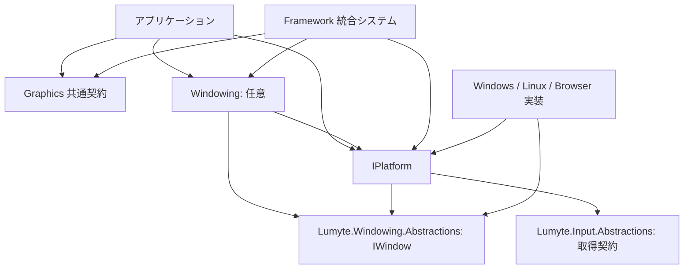

# ADR-PLATFORM-0001: Platform による共通インターフェースの生成と Window の直接実装

- 状態: 採用
- 日付: 2026-10-11

## 背景

Lumyte の OS ごとの機能は、Graphics が生成済みの Device から共通インターフェースを返す構成と同様に、生成済みの Platform から利用したい。単一ウインドウのアプリケーションが、複数ウインドウ管理のためのライブラリを必須とする構成は避ける。

本 ADR は Platform の生成境界、イベント取得、Native Window、既存 Input との接続を提案する。[Windowing](../window/WINDOW-0001-window-system.md)はこの契約を利用する任意の上位ライブラリである。本 PR に共通契約、Windows / X11 / Browser の初期バックエンド、任意の Windowing 管理を追加する。機能の実装有無は各 Features と下記の対応範囲で区別する。

## 決定

### 配置と依存方向

IPlatform と PlatformFeatures を `src/Platform/Lumyte.Platform.Abstractions/`、名前空間・NuGet を `Lumyte.Platform.Abstractions` とする。Windows、Linux、Browser の具象 Platform は対応する `Lumyte.Platform.Windows`、`Lumyte.Platform.Linux`、`Lumyte.Platform.Browser` に配置する。

起動コードが対象の具象 Platform を作成し、以後は `IPlatform` から共通インターフェースを生成する。共通層に OS 自動選択 factory や共通 Platform wrapper を置かない。各バックエンドが `IPlatform` と生成物の `IWindow` を直接実装し、共通 WindowSystem がバックエンドへ命令を転送する方式は採用しない。



Platform.Abstractions と Platform バックエンドは [Lumyte.Input.Abstractions](../input/INPUT-0005-input-abstractions.md) の取得契約だけを参照する。IInputSource の名前空間と所属 assembly は Lumyte.Input.Abstractions とする。Lumyte.Input 本体、Processing、Actions、Settings を Platform の依存として導入しない。履歴・状態・保持の実装は Input 本体に残し、Framework が必要な場合だけ参照・生成する。Input は Platform に依存せず、既存 InputRecord / InputSystem の挙動を変更しない。Platform.Abstractions は Windowing の管理実装、Graphics、Framework、Engine、特定の DI コンテナーに依存しない。

IWindow とそのシグネチャに必要な型は [Lumyte.Windowing.Abstractions](../window/WINDOW-0001-window-system.md#native-window-の共通契約) に定義する。Platform.Abstractions と各バックエンドはこの契約パッケージを参照し、Windowing の管理実装には依存しない。Windowing.Abstractions は .NET ランタイム以外に依存せず、Platform への逆参照を持たない。

生成対象は IWindow、IInputSource、[Clipboard と文字入力サービス](PLATFORM-0002-clipboard-and-text-input.md)とする。今後の display、ファイルダイアログなども対応する共通契約を定義した上で IPlatform に生成メソッドを追加し、利用側が生成物を所有する形に揃える。この PR では未定義の機能に空の interface や汎用 GetService を設けない。

現在はライブラリの利用者がいないため、Platform と IWindow も旧 API との互換性を要件にしない。IPlatform は Lumyte.Platform.Abstractions、IWindow は Lumyte.Windowing.Abstractions に直接定義し、旧 API の別名、型転送、互換ラッパーは設けない。各バックエンドはこの IWindow を直接実装する。

### 公開 API 案

比較元は `main` の `cc766f2`。以下はすべて新規追加する宣言の抜粋である。IWindow と関連する Window 型の宣言は Window ADR に記載する。両 Abstractions に OS ハンドル union や Graphics の型を入れない。

```diff
+using Lumyte.Windowing.Abstractions;
+
+namespace Lumyte.Platform.Abstractions;
+
+[Flags]
+public enum PlatformFeatures { None = 0, NativeWindows = 1, DeviceInput = 2, Clipboard = 4, TextInput = 8 }
+public interface IPlatform : IDisposable
+{
+    public Guid Id { get; }
+    public PlatformFeatures Features { get; }
+    // 呼び出し側が所有する、非表示の Native Window。Backend が直接実装する。
+    public IWindow CreateWindow(WindowDescriptor descriptor);
+    // この Platform の全対象デバイスを取得する Source。呼び出し側が所有する。
+    // 同一 Platform の同時生成は一つまで。同じ物理入力の重複取得を避ける。
+    // Lumyte.Input.Abstractions assembly の型。本体の参照は不要。
+    public Lumyte.Input.Abstractions.IInputSource CreateInputSource();
+    // OS キューを一度だけ取得し、Window 通知と Source 用キューへ振り分ける。
+    // System / Windowing を使わないアプリもこの一つの取得入口を使う。
+    public IClipboard CreateClipboard();
+    public ITextInputService CreateTextInputService();
+    public void PumpEvents();
+    // 子 Window / Source が未解放なら変更前に InvalidOperationException。
+    // GPU 待機や子の暗黙 Dispose は行わない。成功後は冪等。
+}
+
```

### Factory・操作・座標の契約

Platform.Id はインスタンスごとに異なる識別子、WindowId は Platform 内の単調増加番号とする。終了後に再利用せず、別 Platform の Owner を拒否する。CreateWindow は全入力を検証し、生成失敗では部分生成した Native を解放して IWindow を返さない。CreateWindow の生成は同期とする。BrowserPlatform は JavaScript module を非同期に import するため CreateAsync で初期化し、その後の CreateWindow は同期とする。

数値は有限値、生成時の ClientSize は正、Resize は 0 以上とする。負値、不正 enum、Gap の負値、不正 Owner は ArgumentException 系、破棄後は ObjectDisposedException、未対応機能は生成時に NotSupportedException とする。Popup は Owner と PreserveFocus を必須とし、非活性表示を守れない環境では生成を拒否する。

要求は各 IWindow の Backend が保持し、PumpEvents で OS の受理・観測結果を反映する。RequestId は当該 IWindow 内で 1 起点、再利用しない。要求ごとに RequestCompleted を一度通知し、未知の機能、拒否、失敗、置換を区別する。受理だけで観測値を変更しない。結果を待つ要求は有限の期限内に完了させ、具体的な期限は Backend ADR に記載する。

論理座標はクライアント領域の左上原点、右・下を正とする。ClientSize と Scale は論理サイズ・倍率、PixelSize は実際の整数寸法であり OS 枠を含めない。DPI と実寸は同じ StateChanged で公開する。任意のトップレベル絶対位置は共通契約に要求せず、Place は所有者のクライアント座標から Platform が変換する。配置は希望側、反対側、利用可能領域内へのクランプの順とし、サイズは黙って縮めない。Owner の移動・DPI 変更時は最後のアンカーから再配置する。

Native の Z 順・活性化は OS の観測を正とし、他アプリや compositor を含む絶対順は保証しない。PreserveFocus の Show / Raise / ポインター操作は入力フォーカスを奪わず、Activate は拒否する。非表示の Activate で暗黙 Show しない。Minimize / Maximize / Fullscreen は Features と個別の結果に従う。

### イベント取得・Input・スレッド

IPlatform は各 Backend の OS 接続と共通取得器を所有する。PumpEvents は一回の取得で Window と入力の境界順序を保ち、IWindow の観測値・通知と Source の未取得キューへ振り分ける。IInputSource.Update / IInputDevice.DrainEvents / WindowSystem.Update は OS キューを再取得しない。一般の入力源は既存 InputSystem に別途注入できる。

CreateInputSource は同一 Platform の active Source を一つに制限する。Source は InputSystem の構築時に Initialize で Registry へ接続し、既存 Input ADR の所有権を守る。登録 Device は InputSystem が所有する。InputSystem による Source.Shutdown / Device 解放後に Source を Dispose し、最後に Platform を解放する。Source を Dispose した後は新しい Source の生成を許可するが、古い通知を再配信しない。

初期化・取得・操作・購読変更・解放は Platform の作成スレッド、通常は UI スレッドから行う。Native callback は未処理キューへ蓄積し、利用コードを直接呼ばない。PumpEvents 開始時点のイベントを処理し、処理中の新着は次回へ回す。再入を禁止し、通知中は不変状態の照会と Closing.Cancel の設定だけ許可する。別スレッドへは取得済みの不変値を同期して渡す。

購読者の例外は状態を巻き戻さず、他の購読者と Window の処理を続け、最後に AggregateException とする。Closing 購読者の例外時は取消として扱う。不正な Backend 観測値は当該 Window で拒否・報告し、独立した Window の処理を続ける。Native 失敗は診断へ返し、入力文字や候補文字列を診断に混ぜない。

Window 対象付き入力、共通取得順の envelope、キャプチャは後続 Input / Platform ADR で具体化する。文字入力セッションは PLATFORM-0002 に定義する。WindowId を既存 InputRecord へ追加したとは扱わない。単一ウインドウでも対象付き入力の取得器は Platform 内部で使い、Windowing を要求しない。

### 寿命・所有者・終了

Platform は Native 接続を所有し、返した IWindow / IInputSource の所有者は生成した側である。IWindow は自分の Native 資源と要求キューを所有する。Owner は Native の OS 所有関係であり、生成物の .NET 所有権を移さない。Windowing を使わないアプリでも子から親を終了・解放する。

Close は Open → Closing → Closed の要求である。Open の終了処理は新規入力・描画の停止と非表示を含む。Close 時点で物理的に生存する owned Window があれば Denied として Open を維持し、利用側が先に子を終了させる。ユーザー終了要求でも owned Window が残る場合は終了を取り消し、Open を維持する。OS の強制喪失は取消不能である。

RetainNativeTarget のトークンは Native 表示先の保持だけを行い、GPU 使用は追跡しない。Closing に移っても保持中は Native を破棄しない。最後のトークンを解除した後の PumpEvents で Native を解放して Closed と完了結果を通知する。Closed は物理解放の完了であり、古い取得値は以後無効である。Closing の取得値は残る Surface の終了処理に使用できるが、新規の取得・保持・Show は拒否する。

トークン Dispose は管理スレッド限定、通知中は拒否し、成功後は冪等とする。Native 解放失敗では Closing として保持し、後続 PumpEvents / Dispose で再試行可能とする。同じ Close 要求を失敗として完了した場合、再試行は Native 解放だけを行い、同じ要求結果を再通知しない。

IWindow.Dispose は active 子や保持トークンがあれば変更前に拒否する。それ以外は Native と管理資源を解放し、成功後は冪等。Platform.Dispose は全 Window / Source が Dispose 済みであることを要求する。GPU 待機、子の暗黙終了、Windowing の暗黙生成は行わない。

通常終了は新規描画停止 → GPU 使用と取得・提示の完了確認 → Frame と子資源の解放 → Swapchain・Surface の解放 → Native 保持解除 → IWindow → Source → IPlatform とする。InputSystem は Source より先に終了する。強制喪失では保持トークンが Native の存続を保証できず、Graphics は Lost / DeviceLost を処理する。

### Framework 層による Graphics 統合

Platform と Graphics の接続は Framework 層の統合システムが担当する。Platform / Windowing に Graphics 接続パッケージや接続用の公開 API を追加しない。Framework は生成済み IWindow と Graphics Device を受け取り、環境・バックエンドに対応した表示先を取得して、既存 Graphics のバックエンド固有 CreateSurface へ渡す。

HWND などの表示先は、Framework が IWindow を対象バックエンドの具象 Window クラスへキャストし、その具象クラスのプロパティから取得する。IWindow には汎用の表示先取得 API やハンドルのプロパティを追加しない。IWindow は共通操作と RetainNativeTarget を提供し、Graphics の型を扱わない。Framework は Surface と Native 保持トークンの対応、Swapchain の設定、リサイズ、描画・提示の停止と再開、GPU / 提示完了、解放順を一元管理する。Surface の解放が完了してから保持を解除し、Window の終了を進める。Framework の統合システムの型・生成・登録 API は後続の Framework ADR で定め、この PR では宣言しない。

具象 Window クラスの公開型・ハンドルのプロパティと Browser canvas の所有権は各 Platform ADR に記載する。Windows は HWND / HINSTANCE、X11 は Display / Window、Wayland は wl_display / wl_surface、Browser は GPUCanvasContext を対応する具象型から取得する。キャスト先が構成に適合しない場合は Framework が接続を拒否し、別型への推測変換やゼロハンドルでの接続を行わない。取得値は借用であり、Surface を解放するまで Native の保持を継続する。Graphics 側の対応形式・寸法・mode、Frame、semaphore、Submit、Present、再構成、解放は [GRAPHICS-0013](../graphics/GRAPHICS-0013-surface-swapchain-presentation.md) と [GRAPHICS-0014](../graphics/GRAPHICS-0014-caller-managed-resource-validation.md) に従う。Framework がこれらの呼び出しと同期を担い、低水準の Platform / Graphics 自体に暗黙の GPU 待機や相互依存を持ち込まない。

Framework の統合を使わない利用側も、同じ具象 Window クラスへのキャストと既存 Graphics API から直接接続できる。その場合は利用側が表示先の生存と同期・終了順を管理する。使用する Graphics バックエンドの組み合わせを、この Platform ADR では固定しない。

### 単一ウインドウの利用フロー

起動コードが具象 Platform を生成し、IPlatform.CreateWindow から IWindow を取得する。描画する場合はその IWindow を Framework の統合システムへ渡し、または利用側が直接 Graphics へ接続する。以下は共通契約の利用例である。

```csharp
// platform は起動コードが生成した IPlatform。
// IPlatform: Lumyte.Platform.Abstractions、IWindow / WindowDescriptor: Lumyte.Windowing.Abstractions
IWindow window = platform.CreateWindow(new WindowDescriptor { Title = "Lumyte" });
window.Show();
platform.PumpEvents();
WindowState state = window.State;
// 描画は Framework の統合システムが window と Graphics Device を接続して行う。
// Framework の具体 API は後続 ADR で定める。
```

この経路には WindowSystem、Hosted、Windowing の参照も生成も必要ない。Framework の単一ウインドウ経路も Windowing を必須にしない。入力を使う場合は CreateInputSource の結果を既存 InputSystem に注入し、Framework が使用時の更新・終了順を統合する。

### 各環境の受け入れ条件

| 対象 | Window と入力の制約 | Graphics に渡せる表示先 |
| --- | --- | --- |
| Windows | 複数 Native、所有関係、非活性表示、モニター DPI を検証 | HWND / HINSTANCE |
| X11 | WM による配置・活性化拒否を結果として報告 | Xlib の Display / Window |
| Wayland | 任意の絶対位置・前面化を保証せず popup の protocol 制約を反映 | wl_display / wl_surface |
| Browser | 初期対象は構成側が提供した canvas。独立画面生成は未対応 | GPUCanvasContext |

上表は目標とする受け入れ条件であり、すべての機能が実装済みであるとは扱わない。初期実装は次の範囲とする。

- WindowsPlatform / WindowsWindow: Windows 10 1809 以降の STA。HWND / HInstance、所有者付き Window、非活性表示、配置、通常・最小化・最大化、DPI、保持と終了、論理キーボード・マウス。Fullscreen は Unsupported。
- LinuxPlatform / LinuxWindow: 64-bit Linux の X11。XDisplay / XWindow、所有者、override-redirect Popup、表示・非表示・リサイズ、保持と終了、論理キーボード・マウス。DPI は初期実装では 1。IsResizable による WM のリサイズ制限は未実装。配置・明示活性化・前面化・通常以外の display mode は Unsupported。キーマップの既定は evdev ベースで、異なる XKB 配置は constructor の keyMapping で指定する。Wayland は未実装。
- BrowserPlatform / BrowserWindow: CreateAsync(JSObject canvas, string modulePath) で既存 HTMLCanvasElement を借用する。CanvasContext、表示・非表示・寸法・DPI・フォーカス、保持と終了、DOM の論理キーボード・マウス。独立画面・所有者・Native Popup・fullscreen は未対応で、Hosted を明示選択する。解放時に元の canvas 属性・寸法を復元し、canvas 自体を破棄しない。

各 Input Source は OS を再取得せず、PumpEvents が蓄積したデータを排出する。物理デバイス別の Raw Input、ゲームパッド、タッチ、ペンの取得は初期バックエンドに含めない。Input の契約と処理基盤はこれらのデータ型を引き続き扱える。

X11 は Native 要求を観測値で確認し、反映されない場合は二秒後に Denied とする。Xlib のプロトコルエラーは scoped handler と XSync で回収して Failed / 例外集約へ伝える。X server の接続そのものの喪失は Xlib の致命的 I/O エラーの制約を受け、回復可能な Lost 状態を保証しない。

## 検討した代替案

- 共通 WindowSystem が IWindowBackend へすべての操作を転送する: 単一 Window でも管理層を必須とするため採用しない。
- 共通 factory が OS を選ぶ: バックエンド選択と生成設定は起動コードに残す。
- IWindow に Hosted やメニューを含める: OS の生成物と上位 UI の表示領域を混ぜるため Native に限定する。
- Platform に Graphics 接続を含める: 各共通層を結合するため採用せず、Framework 層の統合システムが接続を担当する。

## 結果と影響

各バックエンドが共通インターフェースを直接実装し、単一ウインドウは Platform / Graphics だけで利用できる。Windowing と UI の導入は必要な管理機能に応じて選べる。操作の観測・要求・通知・Native の寿命は Backend の責務となるため、各 Backend が同じ契約を満たす必要がある。

## 検証方針

- 各具象 Platform が IPlatform を、生成 Window が IWindow を直接実装する。
- Windowing を ProjectReference に含めない単一 Window サンプルを各対象環境で動かす。
- 同じ Platform から複数 Window を生成し、サイズ・状態・要求・寿命が混ざらない。
- Source の一度の生成、OS キューの一度の取得、InputSystem / Source / Platform の終了順を検証する。
- Platform と契約パッケージだけを使う最小アプリの依存・publish 出力に Input 本体と Windowing 管理実装が含まれないことを実装時に検証する。
- 要求と観測、拒否・置換・期限切れ、通知例外・再入、生成失敗の部分解放を検証する。
- 保持中 Close の延期、子から親の終了、保持中 Dispose の変更前拒否、強制喪失を検証する。
- Framework の統合と利用側の直接接続で Surface より先に Native を解放しないことを検証する。
- 具象 Window クラスへのキャストによる表示先取得、不適合な型の接続拒否、DPI、ゼロサイズ、再構成、片側だけの終了と他 Window の描画継続を実環境で確認する。

共通契約・Windowing の単体テスト、Xvfb 上の Native 生成・表示・リサイズ・終了、Input の既存テスト、Browser の JS 単体テストで検証する。Windows の Native テストは Windows で実行する。GPU 接続、実ブラウザー、実 WM ごとの挙動は別途確認が必要である。IME backend は今回の実装範囲に含めない。

## 別途決定する事項

- 具象 Platform の生成 API、OS ライブラリ、Native ABI、Browser canvas の所有権と具象 Window クラスのハンドル取得 API。
- Native の非同期生成、要求完了期限、ヘッドレスの機能報告。
- 対象付き入力、独自 IME 候補、display などの追加生成契約。
- Framework 統合システムの公開 API、バックエンド構成、更新・描画・復旧・終了の統合契約。

## 参考資料

- [ADR-0001: ADR の書き方と運用](../0001-adr-writing-policy.md)
- [ADR-0002: リポジトリのフォルダ構成](../0002-repository-layout.md)
- [Windowing: 任意の複数ウインドウ管理](../window/WINDOW-0001-window-system.md)
- [Input のデバイス記録と Source 契約](../input/INPUT-0001-input-system.md)
- [Input の取得契約を Abstractions へ分離する設計案](../input/INPUT-0005-input-abstractions.md)
- [Graphics の提示契約](../graphics/GRAPHICS-0013-surface-swapchain-presentation.md)
