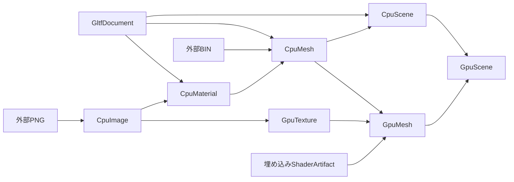

# ADR-RESOURCES-0009: CPUで集約したシーンからGPU表現を構築する

- 状態: 提案
- 日付: 2026-10-20
- 関連カテゴリ: graphics

## 背景

一つのモデル文書は階層、メッシュ、マテリアル、外部バッファ、画像を参照する。文書から直接GPUオブジェクトを作ると、内容の検証にもデバイスが必要になり、共有・寿命・変更伝播の境界が見えにくい。

GPU未初期化でもシーン全体を取得できるCPU表現を定め、その具体的な依存をResourcesで保持する。GPU表現への変換と実描画を通して、複合Pipeline、HotReload、メモリ計上の契約を検証する。

## 決定

### 適用範囲とデータモデル

`samples/Lumyte.Resources.Gltf.Sample` 内の設計とし、汎用モデルライブラリの公開APIは追加しない。Source、Stage、Graphics factoryをDIで構成し、同じResourceManager内でCPUとGPUの出力を解決する。CPU Stageは一つの既定Runtime、GpuTexture・GpuMesh・GpuSceneのStageは同じGraphicsResourceRuntimeを使うよう、出力型ごとに登録する。Managerは選択した環境のExecutorとDependenciesを一度収集し、共通の構築・解放手順を実行する。

CPUシーンはノード階層、local/world行列、共有CPUメッシュを持つ。メッシュはマテリアルを、マテリアルはデコード済み画像を具体型の参照として保持する。ノードやマテリアルへ子のキーを重複保持せず、GPU変換が必要とするアドレスは参照先のメッシュ・画像に持たせる。

同じメッシュを参照する複数ノードは一つのCPUメッシュを共有するが、world行列はノードごとに保持する。同じノードの重複参照、循環、1024個を超えるノードを拒否する。glTFのmatrixまたはTRSをSystem.Numericsの行ベクトル規約へ変換し、worldをlocal × parentで合成する。

### Sourceと依存の構築

合成Sourceは `shaders/` をDLL埋め込みへ、それ以外をFileSystemへ振り分ける。読み込みと変更通知が同じ振り分け規則を使い、埋め込みshaderのためのファイル監視は起動しない。外部URIは文書相対で解決し、asset root外への参照を拒否する。

メッシュ・マテリアル・シーンの一次入力アドレスは文書ルートへ正規化し、同じGltfDocumentを共有する。文書と生の外部BINはBuild依存である。CPUシーン → メッシュ → マテリアル → 画像はResident依存とし、CPUシーンの利用中にTrimしても子の頂点や画素を参照できる。



GPUシーンStageはCPUシーンの階層をたどり、CPUメッシュのAddressからGpuMeshを要求する。各GpuMeshのPipelineが同じ構築viewのCPUメッシュを入力とし、画像とshaderも個別Pipelineから解決する。CPU値を別Managerへ渡す独立コンバーターとしては扱わない。

GpuSceneに対するCpuSceneと、GpuMeshに対するCpuMeshはBuild寿命とする。GPU側は完成後に必要なGpuMesh・GpuTextureへのResident依存を別に保持し、CPU中間値の解放とGPU実体の寿命を分離する。二つのノードが同じGpuMeshを描画するときも、drawごとにworld行列を渡す。

### GPUの所有とメモリ

Mesh／TextureのGPU生成Stageは `IResourceTransform<TInput, TOutput, GraphicsResourceRuntime>` の型付きRuntime引数を使い、構築ごとに `AcquireAsync` で現在の物理デバイス世代を取得する。Stage自身はserviceや実行先を固定して保持しない。同じGraphicsResourceRuntimeの依存構築は一つのジョブで進め、CPU側Runtimeとの境界でジョブを分ける。生成したNative子資源はcontextのResident cleanupへ登録し、作成の逆順で解放する。型付きReleaseAsyncにもManagerが生成時のRuntimeを渡す。出力が完成する前の失敗も回収するNativeResourcesは元のRuntime・epochと実際のdeviceを保持し、そのインスタンスメソッドをcleanupへ登録する。捕捉ラムダを追加せず、loss後にアクセスを拒否するlease.Deviceを再取得しない。成功した解放だけを所有リストから除き、例外時は未完了部分をManagerの再試行へ残す。

CPUの文書バッファ、頂点、画像はMemory scopeで確保する。GPU頂点は取得できる実サイズ、textureは幅 × 高さ × 4の概算をreservationとchargeで計上する。Native子資源を解放した後にchargeを返す。画像decoder内部の一時配列、JSON内部構造、driver内部確保、描画先とreadbackの確保はこの計上に含めない。

upload用staging、command、submissionはcontextのBuild cleanupへ所有を移し、GPU完了まで保持する。submit後の待機をロード待機者のキャンセルで途中終了させず、通常は構築完了時に一時資源を解放する。lossによる待機失敗でも、旧epochの退役確認より先にDisposeしない。生成途中の例外や退役・解放の失敗では未完了のNative資源、device lease、Memory scopeが候補のcleanupへ残り、TrimAsyncで再試行できる。

Stageのcleanupはfake deviceでlossと失敗を注入して検証する。描画用の一時資源はSceneRenderer内のusingで管理しており、描画中lossの解放再試行、デバイス再生成とシーン再構築後の再描画は未対応である。サンプル全体をloss復旧済みの利用例としては扱わない。

### 更新と公開

外部PNGの変更を観測すると、CPU画像、マテリアル、メッシュ、シーンとGPU表現を再構築する。候補を同じviewで構築して一括公開するため、CPU側の色だけが先に変わるなどの部分更新を避けられる。

ResourceReferenceは論理シーンを保持し、同じHandleから更新後のResourceLeaseを取得する。描画中の旧Leaseは旧GPUデータを保持し、入力ファイルの旧版保存なしに変更前の画像を再描画できる。不正な文書、欠落画像、変換例外では候補を解放し、旧公開と旧Leaseを保持する。

サンプルは同梱assetを一時ディレクトリへコピーして更新する。このコピーは検証用fixtureの作成であり、Sourceのsnapshot保存契約ではない。

## APIと契約

以下はサンプル内部型の抜粋であり、配布ライブラリの公開APIではない。

```diff
+namespace Lumyte.Resources.Gltf.Sample
+{
+    // 子への参照はManagerのResident依存で保持する。
+    internal sealed record CpuScene(IReadOnlyList<CpuSceneNode> Roots);
+    internal sealed record CpuSceneNode(int Index, Matrix4x4 Local, Matrix4x4 World,
+        CpuMesh? Mesh, IReadOnlyList<CpuSceneNode> Children);
+    internal sealed record CpuMesh(ResourceAddress Address,
+        IMemoryBuffer<GltfVertex> Vertices, CpuMaterial Material);
+    internal sealed record CpuMaterial(Vector4 Color, CpuImage Texture);
+    internal sealed record CpuImage(ResourceId Id, int Width, int Height,
+        IMemoryBuffer<byte> Pixels);
+    internal sealed record GpuScene(IReadOnlyList<SceneDraw> Draws);
+    internal sealed record SceneDraw(GpuMesh Mesh, Matrix4x4 World);
+
+    internal sealed class SceneStage : IResourceTransform<GltfDocument, CpuScene>
+    {
+        // 文書は構築後に保持しない。メッシュへの依存は別にResidentで記録する。
+        public ResourceDependencyLifetime InputLifetime { get; } // Build
+        public ResourceAddress GetInput(ResourceAddress output);
+        public ValueTask<CpuScene> BuildAsync(GltfDocument input,
+            ResourceBuildContext context, CancellationToken cancellationToken);
+        public ValueTask ReleaseAsync(CpuScene resource);
+    }
+    internal sealed class SceneUploadStage : IResourceTransform<CpuScene, GpuScene>
+    {
+        // CPUシーンを借りてGpuMeshを解決する。GPU子の所有はManagerへ記録する。
+        public ResourceDependencyLifetime InputLifetime { get; } // Build
+        public ResourceAddress GetInput(ResourceAddress output);
+        public ValueTask<GpuScene> BuildAsync(CpuScene input,
+            ResourceBuildContext context, CancellationToken cancellationToken);
+        public ValueTask ReleaseAsync(GpuScene resource);
+    }
+}
```

SceneStageとSceneUploadStageのReleaseAsync自体は子をDisposeしない。依存の利用権とscopeをManagerへ登録済みであり、親の解放後に共通の解放経路で返す。

### 入力の対応範囲

glTF 2.0の外部BIN・PNG、静的TRIANGLES、1メッシュ1primitive、floatのPOSITION/NORMAL/TEXCOORD_0、unsigned 8/16/32bit index、opaque base-color texture/factor、matrix/TRSによる階層に対応する。indexはCPUで展開して描画用頂点列を生成する。

GLB、data URI、必須拡張、疎・normalized accessor、skin、animation、morph、複数primitive、透明描画、normal mapは対象外とする。簡易照明と固定samplerを使い、PBRやglTF samplerの再現を保証しない。対応外の機能や範囲外accessorを拒否するが、任意の不正glTFに対する完全な検証器ではない。

## 検討した代替案

- 文書から直接GPUシーンを構築する: CPUだけでシーンの構造・画像・共有を検証できなくなる。CPU集約を独立した出力型にする。
- CPU型がGPUキーを保持する: CPU表現へデバイス向けの解決規則が混ざる。識別情報はCPUデータ自身のAddressに限定し、変換StageがGPU型を選ぶ。
- 子を毎回複製する: メッシュや画像の共有が失われ、保持量と転送量が増える。Managerの型付きキーで共有する。
- 子の借用参照だけを保持して依存を登録しない: Trimが親の生存中に子を解放できてしまう。具体的な参照とResident依存を併せて保持する。

## 結果と影響

GPUなしでCPUシーンを取得でき、同じデータをGPU描画へ接続できる。型付きPipelineが共有・解放・更新範囲を管理するため、サンプルに別のアセットキャッシュを作らずに済む。

画像だけの変更でもCPUメッシュとGPUメッシュが再構築され、頂点転送が発生する。index展開も頂点数とメモリを増やす。これらはPipelineの整合性を実証するための単純な表現であり、最小更新量や描画性能を保証しない。旧Leaseを保持する検証では新旧のGPU資源が併存する。

## 検証方針

`--validate` でGraphics deviceを初期化せず、外部BIN・PNGの解決、階層と行列合成、メッシュ・画像共有、Trim後の参照継続を確認する。循環ノード、画像欠落、範囲外データの更新が旧世代を壊さないことを確認する。

Vulkanで512×512の画面外描画を行い、深度・textureを含む画像をGPU readbackする。外部PNGだけの変更が自動公開へ到達し、同じHandleから新画像を取得でき、旧Leaseで元画像を再現できることを検証する。Linux CIではLavapipeを使う。解放後は対象poolのCommittedBytesが0になることを確認する。

GPUを使う検証にはVulkan driverが必要であり、CPU検証のみの成功をGPU描画の成功とは扱わない。デバイスloss回復と実運用向けglTF互換性は本サンプルの検証結果に含めない。

StageのNativeResourcesを同じソースのままテストへ組み込み、通常時のBuild一時資源の回収、loss後の旧epochによる解放、退役待ちと失敗、子資源の部分解放後の再試行、生成失敗候補の保持を検証する。新deviceへの復旧後も旧leaseを返すまで旧ownerを退役させず、解放済みの子を二重解放しないことを確認する。

## 関連ADR

- [Sourceの取得と整合性](RESOURCES-0006-source-access.md)
- [入力の自動監視](RESOURCES-0007-automatic-monitoring.md)
- [Graphicsデバイス世代との接続](RESOURCES-0008-graphics-generations.md)
- [HotReload](RESOURCES-0004-hot-reload.md)
