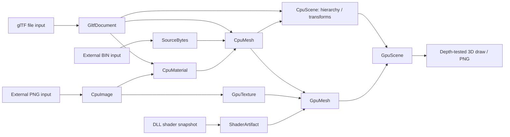

# glTF resource pipeline sample

外部ファイルを持つglTF 2.0を実際にVulkanで3D描画し、Pipelineの依存解決を検証します。
ウィンドウを必要とせず、512×512のPNGを出力します。Vulkanドライバーが必要です。
LinuxのCIではLavapipeを使います。

```sh
dotnet run --project samples/Lumyte.Resources.Gltf.Sample -c Release -- ./artifacts/gltf-render.png
```

`gltf-render.png` と、外部PNGだけを変更した後の `gltf-render-reloaded.png` を出力します。
同じ `ResourceHandle<GpuScene>` で新しい世代を取得し、保持していた旧leaseでは
変更前と同じ画像を再描画できることも、GPU readbackで検証します。
実行時には同梱Assetsを一時ディレクトリへコピーするため、元ファイルは変更しません。このコピーはサンプル実行用のfixtureで、Sourceが行うsnapshot保存ではありません。
FileSystem Sourceは直接読み込みとメタデータによる変更検出だけを行い、旧入力は保存しません。
旧GPU leaseによる再描画には、構築済みのGPUデータを使用します。

```sh
# GPUのない環境では、外部バッファ・PNGの読み込みと失敗時の世代保持を検証します。
dotnet run --project samples/Lumyte.Resources.Gltf.Sample -c Release -- --validate
```

## Separate source files

- `Assets/models/cubes.gltf`: メッシュ、マテリアル、二つのノードとシーンを持つ文書。
- `Assets/models/cubes.bin`: interleaved頂点属性と16bitインデックス。
- `Assets/textures/checker.png`: glTFから `../textures/checker.png` で参照する外部画像。
- `Shaders/*.slang`: ビルド時にDLLへ埋め込み、リソースSource/Stage経由で読むシェーダー。

モデル・画像はこのサンプル用に作成したオリジナルデータです。

## Pipelines and ownership



Source、Stage、デバイスFactoryはDIで登録します。サンプルの合成Sourceは、
`shaders/` をDLL埋め込みへ、それ以外をFileSystemへ振り分けます。
`AddResources` を一度呼び、CPUとGPUの全Pipelineを一つのsingleton ResourceManagerへ登録します。
`provider.GetRequiredService<ResourceManager>()` で同じManagerを取得し、CPU検証後も破棄せず、
不要な世代をTrimしてからGPUシーンのロードに使います。SourceとStageもsingletonで、
Graphics device serviceは `AddGraphicsDevice<DeviceFactory>(ServiceLifetime.Singleton)` で寿命を揃えます。
`AddResourceGraphics()`で同じdevice serviceを借用するGraphicsResourceRuntimeを登録し、名前を指定せず型で選択します。
ホストが既定のResourceRuntimeとExecutionRuntimeをThreadPoolで準備・開始してからロードします。
Stageの開始と通常の`await`後の再開はCPUジョブとして実行し、I/O・子リソース・GPU完了を待つ間は
CPUの同時実行枠を使いません。終了時はManagerの破棄を完了し、ExecutionRuntimeを停止してからDI providerを閉じます。
終了時のcleanup失敗から回復するホストは、ManagerとDI providerを保持し、ExecutionRuntimeを
動かしたまま同じ`ResourceManager.DisposeAsync`を再試行します。DI providerの破棄を再試行の境界には使いません。
複合型は独自の構造で具体的な子への参照を保持します。
`CpuSceneNode.Mesh`、`CpuMesh.Material`、`CpuMaterial.Texture`が子への具体的な参照です。
メッシュとマテリアルの入力アドレスは文書のルートに正規化し、文書を共有します。
`GltfDocument → CpuScene → GpuScene` の順に変換します。`CpuScene`の取得が完了した時点で、
ノードの親子関係・local/world行列・共有CPUメッシュ・マテリアル・デコード済み画像が
揃っています。CPUシーンのロードにはデバイスの初期化やGPUリソースの作成は不要です。
メッシュからマテリアル、マテリアルから画像への依存はResidentで保持し、CPUシーンの
利用中にtrimしても頂点・画像を参照できます。ノードやマテリアルに子のキーを重複して保持せず、参照先の型に必要な識別情報を保持します。

GPUシーンStageは完成済みCPUシーンの階層をたどり、参照先CPUメッシュのアドレスからGPUメッシュを要求します。
各GPUメッシュPipelineは共有されたCPUメッシュを入力とし、テクスチャも個別のPipelineで
GPUへ転送します。GPUシーンにおけるCPUシーンの入力寿命はBuildです。
二つのノードは同じGPUメッシュとテクスチャを共有し、別々の変換行列で描画します。
PNG変更時にはCPU画像・マテリアル・メッシュ・シーンも新世代となり、その後GPU出力を構築します。

`--validate` は自動監視を無効にし、GPU未初期化のままCPUシーンを取得します。階層・行列の合成・共有・trim後の寿命、
循環ノードや画像欠落時の旧世代保持を、明示的な再構築で確認します。
通常の描画実行では読み取りだけのCPU検証を行い、その後同じManagerでGPU描画と自動HotReloadを検証します。
更新の成功・失敗はManagerの`Reloaded`／`ReloadFailed`を購読して確認します。
不正ファイルを一時的に作る検証と自動監視を並行させません。

CPUの頂点・画像・文書バッファはMemory scopeから取得します。
GPU頂点の実サイズとテクスチャの概算サイズを予約・計上し、native childを解放した後に
chargeを返します。StbImageSharp内部の一時配列、JSON内部構造、ドライバー内部の
割り当て、描画先・readbackなどサンプル描画器の割り当てはこの計上に含みません。
解放後にリソース用poolの計上が0へ戻ることを確認します。

CPU Stageは共有の既定Runtimeを使い、GpuTexture・GpuMesh・GpuSceneには登録時にGraphicsResourceRuntimeを割り当てます。
Managerが環境のExecutorとDependenciesを一度収集し、構築と解放の共通手順を実行します。
GPU生成Stageは `IResourceTransform<TInput, TOutput, GraphicsResourceRuntime>` を宣言して型付きRuntime引数で選択済み環境を受け取り、`AcquireAsync` で構築ごとの物理デバイス世代への依存を登録します。
同じGraphicsResourceRuntimeのMesh／Texture／Scene構築は同じジョブを使い、CPU側の既定Runtimeへ切り替わる境界で別ジョブにします。
型付きReleaseAsyncにもManagerが生成時のRuntimeを渡します。部分生成物を持つNativeResourcesは元Runtime・device・Leaseを保持し、解放時にLostならそのepochのretirementを待ちます。
既存の所有オブジェクトのメソッドをcleanupへ登録し、追加の捕捉ラムダは作りません。
転送用のstaging・command・submissionはBuild cleanupが保持し、正常時は構築完了で解放します。
退役確認や解放に失敗した場合も子資源とdevice leaseを保持し、ManagerのTrimAsyncで再試行できます。
このcleanupは同じソースを使ったテストで、loss・退役待ち・解放失敗・構築失敗を検証します。

描画用の一時資源はSceneRenderer内のusingで管理しており、描画中lossに対する解放再試行は未対応です。
デバイス再作成・シーン再構築・再描画の制御もアプリ側の責任です。このサンプルの実描画では
デバイスロストを人為的には発生させません。

## Supported subset

これは汎用glTFライブラリではなくPipelineの実証用実装です。
静的TRIANGLES、1メッシュ1primitive、floatのPOSITION/NORMAL/TEXCOORD_0、
unsigned 8/16/32bit index、外部buffer、PNG画像、opaque base-color texture/factor、
ノード階層のmatrix/TRSに対応します。glTF 2.0の右手系と透視投影、深度テストを使います。
マテリアルは簡易の固定照明で描画し、PBRのmetallic/roughnessは再現しません。
サンプラーは固定設定で、glTFのsampler設定は使いません。

GLB、data URI、必須拡張、疎・normalized accessor、スキニング、アニメーション、
morph target、複数primitive、透明描画、normal mapには対応しません。
実運用向けのサイズ制限・全入力検証・すべてのglTF機能を備えたローダーの代替では
ありません。外部URIは文書相対で解決し、asset rootを越える参照は拒否します。

リソースの取得は`Manager.AcquireAsync → ResourceReference`、値の取得は
`Reference.Acquire → ResourceLease`の順に行います。描画用Leaseを保持している間も
HotReloadは新世代を公開でき、既存Leaseは旧世代の値を保持します。

The composite source routes reads and change monitoring together. File inputs
provide native notifications, while DLL-embedded shaders have no change stream.
The single manager disables automatic reload through `ResourceReloadOptions.Enabled`
in `--validate` mode; rendering mode monitors its source automatically.
