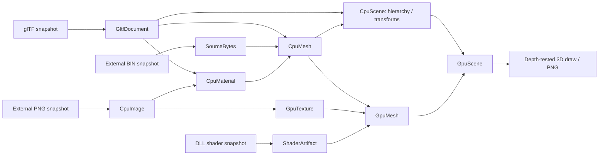

# glTF resource pipeline sample

外部ファイルを持つglTF 2.0を実際にVulkanで3D描画し、Pipelineの依存解決を検証します。
ウィンドウを必要とせず、512×512のPNGを出力します。Vulkanドライバーが必要です。
LinuxのCIではLavapipeを使います。

```sh
dotnet run --project samples/Lumyte.Resources.Gltf.Sample -c Release -- ./artifacts/gltf-render.png
```

`gltf-render.png` と、外部PNGだけを変更した後の `gltf-render-reloaded.png` を出力します。
同じ `ResourceHandle<GpuScene>` で新しい世代を取得し、保持していた旧leaseでは
変更前と同じ画像を再描画できることも、GPU readbackで検証します。
実行時には同梱Assetsを一時ディレクトリへコピーするため、元ファイルは変更しません。

```sh
# GPUのない環境では、外部バッファ・PNGの読み込みと失敗時の世代保持を検証します。
dotnet run --project samples/Lumyte.Resources.Gltf.Sample -c Release -- --validate
```

## Separate source files

- `Assets/models/cubes.gltf`: メッシュ、マテリアル、二つのノードとシーンを持つ文書。
- `Assets/models/cubes.bin`: interleaved頂点属性と16bitインデックス。
- `Assets/textures/checker.png`: glTFから `../textures/checker.png` で参照する外部画像。
- `Shaders/*.slang`: ビルド時にDLLへ埋め込み、リソースSource/Stage経由で読むシェーダー。

モデル・画像はこのサンプル用に作成したオリジナルデータです。

## Pipelines and ownership



Source、Stage、デバイスFactoryはDIで登録します。サンプルの合成Sourceは、
`shaders/` をDLL埋め込みへ、それ以外をFileSystemへ振り分けます。
`IResourceDocument.Subresources` は同一文書から得られる出力型を公開します。
メッシュとマテリアルの入力アドレスは文書のルートに正規化し、文書を共有します。
`GltfDocument → CpuScene → GpuScene` の順に変換します。`CpuScene`の取得が完了した時点で、
ノードの親子関係・local/world行列・共有CPUメッシュ・マテリアル・デコード済み画像が
揃っています。CPUシーンのロードにはデバイスの初期化やGPUリソースの作成は不要です。
メッシュからマテリアル、マテリアルから画像への依存はResidentで保持し、CPUシーンの
利用中にtrimしても頂点・画像を参照できます。CPU側にはGPU型のリソースキーを持たせません。

GPUシーンStageは完成済みCPUシーンの階層をたどり、同じアドレスのGPUメッシュを要求します。
各GPUメッシュPipelineは共有されたCPUメッシュを入力とし、テクスチャも個別のPipelineで
GPUへ転送します。GPUシーンにおけるCPUシーンの入力寿命はBuildです。
二つのノードは同じGPUメッシュとテクスチャを共有し、別々の変換行列で描画します。
PNG変更時にはCPU画像・マテリアル・メッシュ・シーンも新世代となり、その後GPU出力を構築します。

`--validate` はGPU未初期化のままCPUシーンを取得し、階層・行列の合成・共有・trim後の寿命、
循環ノードや画像欠落時の旧世代保持を確認します。

CPUの頂点・画像・文書バッファはMemory scopeから取得します。
GPU頂点の実サイズとテクスチャの概算サイズを予約・計上し、native childを解放した後に
chargeを返します。StbImageSharp内部の一時配列、JSON内部構造、ドライバー内部の
割り当て、描画先・readbackなどサンプル描画器の割り当てはこの計上に含みません。
解放後にリソース用poolの計上が0へ戻ることを確認します。

GPU Stageは `UseGraphicsAsync` で物理デバイス世代への依存を登録します。
転送完了までstagingを保持し、解放時にデバイスがLostならretirementを待ちます。
デバイス再作成・再描画の制御はアプリ側の責任です。このサンプルではデバイスロストを
人為的には発生させません。

## Supported subset

これは汎用glTFライブラリではなくPipelineの実証用実装です。
静的TRIANGLES、1メッシュ1primitive、floatのPOSITION/NORMAL/TEXCOORD_0、
unsigned 8/16/32bit index、外部buffer、PNG画像、opaque base-color texture/factor、
ノード階層のmatrix/TRSに対応します。glTF 2.0の右手系と透視投影、深度テストを使います。
マテリアルは簡易の固定照明で描画し、PBRのmetallic/roughnessは再現しません。
サンプラーは固定設定で、glTFのsampler設定は使いません。

GLB、data URI、必須拡張、疎・normalized accessor、スキニング、アニメーション、
morph target、複数primitive、透明描画、normal mapには対応しません。
実運用向けのサイズ制限・全入力検証・すべてのglTF機能を備えたローダーの代替では
ありません。外部URIは文書相対で解決し、asset rootを越える参照は拒否します。
